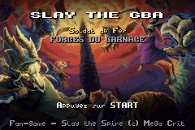
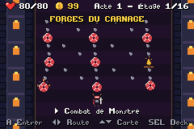
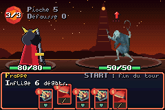
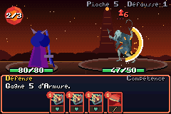
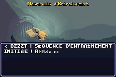
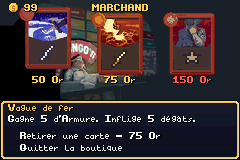

# Slay the GBA 🗡️🃏

[](https://github.com/Boblebol/slay_the_gba/releases/latest)
[](https://github.com/Boblebol/slay_the_gba/releases)
[](https://github.com/Boblebol/slay_the_gba/actions/workflows/release.yml)

[](https://github.com/GValiente/butano)

[-green)](NOTICE.md)


**Slay the Spire 2 demade for the Game Boy Advance.** Five heroes, five cartridges, one Spire to climb, in 240×160
with Pokémon-style battles and the game's real card art. Free, unofficial fan game, written in C++20 with the
[Butano](https://github.com/GValiente/butano) engine.

> 🇫🇷 **The game is in French.** Every in-game text (cards, relics, events, menus) is in French, and so is most of
> the website. If you know Slay the Spire, the card art, numbers and intent icons carry you a long way. An English
> version will depend on how much interest there is.

🌐 **Website & downloads:** [slay-the-gba.alexandre-enouf.fr](https://slay-the-gba.alexandre-enouf.fr/en/index.html)
(English page) · [French site](https://slay-the-gba.alexandre-enouf.fr/) ·
📦 [Latest release](https://github.com/Boblebol/slay_the_gba/releases/latest) ·
📖 [How it was built](https://alexandre-enouf.fr/blog/slay-the-gba-vibe-coding-game-boy-advance/?lang=en)

| | | |
|---|---|---|
|  |  |  |
|  |  |  |

---

## 🎉 100% reached: playtesters wanted!

The implementation tracker ([`AVANCEMENT.md`](AVANCEMENT.md)) is at **100%** since v1.0.0: every card, relic, potion,
monster, boss, event and Ancient of the Slay the Spire 2 data in the project bible (patch v0.111.0 Beta) is in the
game, and a full run works from the title screen to the final boss with all five heroes.

Now it needs players. Download an edition, play a run, and
**[report a bug](https://github.com/Boblebol/slay_the_gba/issues/new?template=bug_report.yml)** (a short form, in French, English answers welcome) for anything you notice: bugs, crashes,
softlocks, balance, text that overflows the screen. Feedback by e-mail works too:
[alexandre.enouf@gmail.com](mailto:alexandre.enouf@gmail.com).

---

## 🎮 What's in the game

* **Five cartridges, one per hero**, like the classic handheld games sold in several versions: The Ironclad
  (`slay_ironclad.gba`), The Silent, The Defect, The Regent and The Necrobinder. Each has its own card pool,
  starting relic, colour, title screen and signature mechanic.
* **A full run**: Neow at the start, a 3-act Spire with branching paths, monsters, elites, bosses (each act draws
  its boss from several), events, shops, campfires, treasure, the Ancients between acts, victory and credits.
* **The Slay the Spire 2 content**: ~570 cards, ~300 relics, potions, enchantments, curses, summons, orbs and
  the rest of each hero's mechanics, with the values of the reference game.
* **A GBA interface**: hero seen from behind on the left, enemies on the right with their intents, cards that zoom
  in before hitting, floating damage, mosaic deaths, chiptune music and sound effects.
* **Quality of life**: automatic save on the cartridge (SRAM), pause menu, options (volume, control presets),
  Ascension levels, compendium and run statistics.

## ▶️ How to play

1. Download a `.gba` file from the [website](https://slay-the-gba.alexandre-enouf.fr/en/index.html#download) or the
   [latest release](https://github.com/Boblebol/slay_the_gba/releases/latest).
2. Open it in a Game Boy Advance emulator: [mGBA](https://mgba.io/downloads.html) on a computer, Delta on
   iPhone/iPad, My Boy! or RetroArch on Android.
3. Or copy it to a flash cart (EZ-Flash, EverDrive) and play on a real GBA, GBA SP, Game Boy Micro or DS.

The game shows its controls on screen. In combat: **D-Pad** to pick a card, **A** to play it (then pick a target),
**B** to cancel, **R** or **L** to end the turn depending on the control preset chosen in the options, **START** to
pause, **SELECT** to look at the deck.

## 🤖 How it was made

No line of this game was written by hand: the code, tests, art pipeline and documentation were produced by
autonomous AI coding agents (Claude), working through GitHub issues and pull requests, checking their own work
with native tests and a headless mGBA emulator. The full story is in the
[blog post](https://alexandre-enouf.fr/blog/slay-the-gba-vibe-coding-game-boy-advance/?lang=en).

---

## 🛠️ Build from source

The build falls back to Docker (`devkitpro/devkitarm`) when devkitARM is not installed on the host.

```bash
git clone --recursive https://github.com/Boblebol/slay_the_gba
make ironclad      # one cartridge (also: silent, defect, regent, necrobinder)
make roms          # the five cartridges
make test          # native engine tests (clang++, no GBA needed)
make play          # play the combat engine in a terminal
```

The game rules live in the hardware-agnostic `src/engine/` (compiled natively for the tests); the GBA
presentation layer lives in `src/gba/`. Contributors and agents follow [`AGENTS.md`](AGENTS.md) (in French):
one branch and one pull request per issue.

## 🎨 Art Pipeline

Sprites, backgrounds and the French-capable font are generated from the `bible/images/` dump
(card art, monster & boss art, event paintings, card frames):

```bash
uv run scripts/build_gba_art.py
```

Everything lands in `graphics/`, plus two generated headers: `include/gba/slay_font.h` and
`include/gba/card_art.h`. The second one lists, for each cartridge, the card art it carries (its hero's cards
and the shared ones): a ROM does not embed the illustrations of the four other heroes.

Sound effects (8-bit WAV) and the seven looping background themes (4-channel ProTracker modules:
title, map, combat, elite, boss, victory, game over) are synthesised from chiptune oscillators and
hand-written note sequences (no third-party audio) into `audio/`:

```bash
uv run scripts/build_gba_audio.py
```

The presentation layer plays them through `gba::play_sfx()` and `gba::play_music()` (cross-fades between
themes), at the volumes stored in the cartridge save. The GBA presentation layer lives in
`src/gba/` (one class per scene, cached text labels, tweened animations and fades); the game rules stay in
the hardware-agnostic `src/engine/`.

---

## 🤝 Contributing

Bug reports from playtesters are the most useful contribution right now: use the
[bug report form](https://github.com/Boblebol/slay_the_gba/issues/new?template=bug_report.yml) and attach a screenshot
or your `.sav` if you can. Code contributions go through pull requests: see [`CONTRIBUTING.md`](CONTRIBUTING.md)
(build, tests, branch and PR rules) and the [code of conduct](CODE_OF_CONDUCT.md). Security issues: see
[`SECURITY.md`](SECURITY.md).

## 📖 Credits
* Original game design, card texts, names and art by [Mega Crit](https://www.megacrit.com/) (*Slay the Spire*,
  *Slay the Spire 2*).
* [Butano C++ Engine](https://github.com/GValiente/butano) by Gustavo Valiente (zlib license), and the libraries it
  bundles in each ROM (maxmod, libtonc, agbabi…, all permissive: MIT, zlib, ISC, MPL, public domain). Their
  licenses are in [`butano/licenses/`](https://github.com/GValiente/butano/tree/master/licenses).
* [Tonc: GBA Programming Guide](https://www.coranac.com/tonc/text/) by J Vijn
* Music and sound effects are synthesised by `scripts/build_gba_audio.py`: no third-party audio.

## ⚖️ Legal notice

**Slay the GBA is an unofficial, non-commercial fan project.** It is not affiliated with, endorsed, sponsored or
approved by Mega Crit or Nintendo.

* *Slay the Spire*, *Slay the Spire 2*, their names, characters, card and relic texts and artwork are the property
  of Mega Crit. The card, monster and event illustrations under `bible/images/`, `graphics/` and `site/` are
  Mega Crit's artwork, reproduced here for a free fan adaptation.
* *Game Boy Advance* is a trademark of Nintendo. No Nintendo code or BIOS is included; the cartridges are homebrew
  built with the free devkitARM toolchain.
* The hero battle sprites, the music, the sound effects, the interface and the code are the project's own work;
  every other illustration is Mega Crit's art, downscaled and converted to the GBA palette.
* The game is free. It must not be sold, nor bundled with anything sold.
* If you hold rights on any of this content and want something changed or removed, open an issue or write to
  [alexandre.enouf@gmail.com](mailto:alexandre.enouf@gmail.com): it will be handled promptly.

**License:** the project's own code, hero sprites, music and sound effects are under the [MIT license](LICENSE).
The Mega Crit content listed above is **not**: [`NOTICE.md`](NOTICE.md) says exactly what the license covers, and
[`THIRD_PARTY_NOTICES.md`](THIRD_PARTY_NOTICES.md) lists the licenses of Butano and the libraries in the ROMs.

## 🌐 Website

A static fan site (landing page, one page per cartridge with every card, bestiary, relics, potions,
events, ancients and the full design bible) is generated into `site/`:

```bash
make site          # build and open in the browser (make site-build: build only)
```

The site is in French, like the game. `site/en/index.html` is an English landing page (pitch, French-only notice,
downloads, how to play, FAQ) generated by `build_index_en()`; every page links to the other language from the menu.

The five cartridges ("éditions") are defined once in `scripts/editions.py` (name, colour, zone, tagline,
signature mechanic, palettes, showcase cards). `make site-build` first regenerates the five instruction booklets
(`bible/livrets_gba/`, via `scripts/build_livrets.py`, from that file and the card/relic data), then the website,
so the booklets, the bible and the site always describe the same five editions.

### Implementation tracker

[`AVANCEMENT.md`](AVANCEMENT.md) and the site's `avancement.html` page list everything the game has to implement to
cover Slay the Spire 2 (per hero, then for the whole game), whether each item is done, and the resulting percentage (the global figure is the mean of the section percentages, so each section weighs the same).

* Cards, relics, potions, monsters and events are read from `bible/data` and marked done when the engine implements
  them (`scripts/progress.py` scans `src/engine`), so they follow the code.
* Mechanics, game systems and screens are listed by hand in [`avancement.toml`](avancement.toml), with a status
  `oui` / `partiel` / `non`. The same file corrects the detection where an entry is only partly faithful.

```bash
make progress      # rewrite AVANCEMENT.md and print the summary (make site-build does it too)
```

### Releases

The version number follows the tracker: `0.<whole percentage>.<patch>` while something is left to implement
(9.9 % done gives `0.9.x`), `1.0.0` once every item of `AVANCEMENT.md` is done.

`.github/workflows/release.yml` runs on every push to `main`: it runs the tests, regenerates the website and
`AVANCEMENT.md`, and commits them, which is what Netlify deploys. When the game itself changed since the last tag
(`src/`, `include/`, `graphics/`, `audio/`), it also builds the five ROMs, publishes them in `site/roms/`, writes
the version to `VERSION` and creates the GitHub release `vX.Y.Z` with the ROMs and the progress summary.
`.github/workflows/ci.yml` runs the same tests on pull requests.

Deploy to Netlify: connect the repository in Netlify; `netlify.toml` runs `make site-package`, which
only assembles committed files (pages, bible images, ROMs) into `dist/`. After changing the game or the
bible, rebuild and commit the generated files:

```bash
make roms && make site-build   # refresh ROMs (site/roms/) and pages
git add site && git commit -m "build(site): refresh website" && git push
```

`make site-build` only publishes a ROM built after the last change to `src/`, `include/`, `graphics/` or `audio/`.
A stale local build is skipped with a warning and the previous download stays in `site/roms/`.

`make deploy` / `make deploy-preview` still deploy straight from your machine with the Netlify CLI.
