# 👤 Les 5 Personnages Jouables — Slay the Spire 2 sur Game Boy Advance

> **Référence officielle de gameplay pour `slay_the_gba`**  
> **Patch :** `v0.111.0 Beta` (Dernière version officielle)  
> Les 5 archétypes complets : Soldat de Fer, La Silencieuse, Le Défectueux, Le Régent et La Nécrolieuse — une cartouche par héros.  
> Charte commune des éditions (couleurs, zones, références) : [Collection des livrets](livrets_gba/README.md).

---

## 📊 Matrice Comparative des Personnages

| Personnage | Titre | PV Max | Relique de Départ | Deck de Départ | Mécanique Signature |
|---|---|:---:|---|---|---|
| **Soldat de Fer** | Guerrier Maudit de l'Enfer | `80 PV` |  Sang ardent (BURNING_BLOOD) | 5x Frappe, 4x Défense, 1x Heurt | Spécialisé dans la force brute, les attaques massives de zon... |
| **La Silencieuse** | Chasseresse Mortelle des Brumes | `70 PV` |  Anneau du serpent (RING_OF_THE_SNAKE) | 5x Frappe, 5x Défense, 1x Neutralisation, 1x Survivant | Maîtresse des poisons à progression exponentielle (Catalyseu... |
| **Le Défectueux** | Automate de Combat Éveillé | `75 PV` |  Noyau fissuré (CRACKED_CORE) | 4x Frappe, 4x Défense, 1x Éclair, 1x Activation double | Gestion stratégique des slots d'orbes (Foudre, Glace, Obscur... |
| **Le Régent** | Souverain Céleste Déchu (Nouveau dans STS2) | `75 PV` |  Droit divin (DIVINE_RIGHT) | 4x Frappe, 4x Défense, 1x Chute d'étoile, 1x Vénération | Accumulation d'Étoiles pour libérer des frappes cosmiques, d... |
| **La Nécrolieuse** | Gardienne des Morts et des Os (Nouveau dans STS2) | `65 PV` |  Phylactère enchaîné (BOUND_PHYLACTERY) | 4x Frappe, 4x Défense, 1x Déchaînement, 1x Garde du corps | Gestion de familiers et squelettes invoqués au combat, manip... |

---

## ⚔️ Soldat de Fer (Guerrier Maudit de l'Enfer)

* **Points de Vie de Départ :** `80 PV` (PV Max initial)
* **Or de Départ :** `99 Pièces d'or`
* **Énergie de Base :** `3 ⚡` par tour
* **Emplacements de Potions :** `3 emplacements`
* **Teinte Thématique GBA :** Rouge Sang (`#C82030` / GBA: `0x001F`) — cartouche `slay_ironclad.gba`, zone : Forges du Carnage
* **Style de Jeu & Synergies :** Spécialisé dans la force brute, les attaques massives de zone, l'armure infranchissable (Barricade/Heurt de bouclier) et les pactes sanglants avec les démons.

### 🏺 Relique de Départ :  Sang ardent (BURNING_BLOOD)
> À la fin de chaque combat, récupérez 6 PV.

### 🃏 Deck de Départ (Starter Deck)
* **5x** `Frappe (STRIKE_IRONCLAD)` — *Attaque de base (6 dégâts pour 1 ⚡)*
* **4x** `Défense (DEFEND_IRONCLAD)` — *Compétence de base (5 armure pour 1 ⚡)*
* **1x** `Heurt (BASH)` — *Attaque lourde (8 dégâts + 2 Vulnérable pour 2 ⚡)*

### 📦 Les 20 Cartes Communes Spécifiques de Soldat de Fer
Les cartes communes forment le socle de construction de deck après chaque combat normal :

| Carte | Coût | Type | Effet de Base | Amélioration |
|---|:---:|:---:|---|---|
| 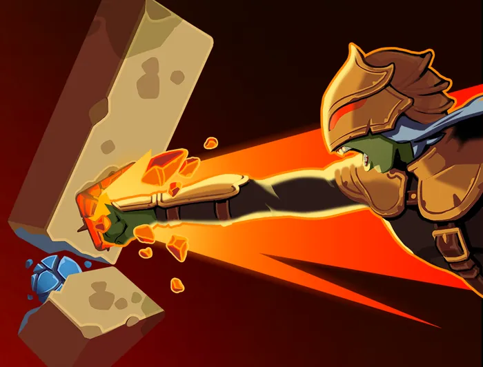 **Colère** (`ANGER`) | `0` ⚡ | *Attack* | Infligez 6 dégâts. Ajoutez une copie de cette carte à votre **Défausse**. | Infligez 8 dégâts. Ajoutez une copie de cette carte à votre **Défausse**. |
|  **Armement** (`ARMAMENTS`) | `1` ⚡ | *Skill* | Gagnez 5 d'**Armure**. **Améliorez** une carte dans votre **Main**. | Gagnez 5 d'**Armure**. **Améliorez** TOUTES les cartes dans votre **Main**. |
|  **Mur de sang** (`BLOOD_WALL`) | `2` ⚡ | *Skill* | Perdez 2 PV. Gagnez 16 d'**Armure**. | Perdez 2 PV. Gagnez 20 d'**Armure**. |
| 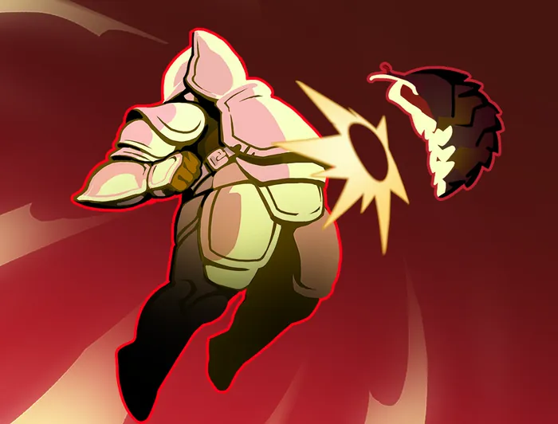 **Plaquage** (`BODY_SLAM`) | `1` ⚡ | *Attack* | Infligez un montant de dégâts égal à votre **Armure**. | Infligez un montant de dégâts égal à votre **Armure**. |
| 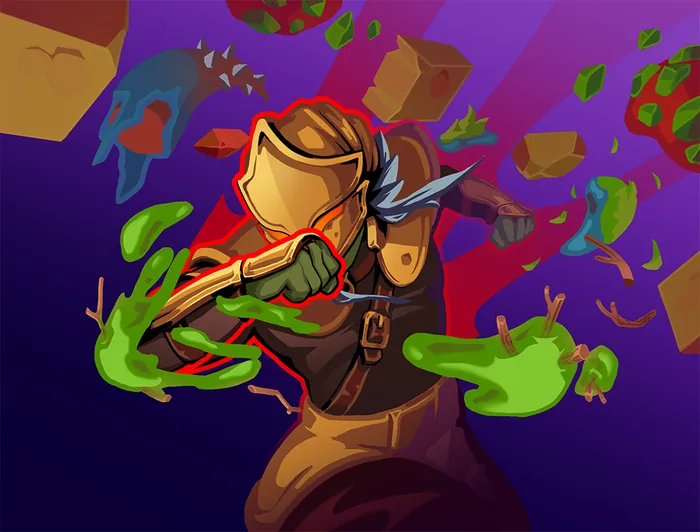 **Percée** (`BREAKTHROUGH`) | `1` ⚡ | *Attack* | Perdez 1 PV. Infligez 9 dégâts à TOUS les ennemis. | Perdez 1 PV. Infligez 13 dégâts à TOUS les ennemis. |
|  **Scorie** (`CINDER`) | `2` ⚡ | *Attack* | Infligez 18 dégâts. **Épuisez** une carte aléatoire. | Infligez 24 dégâts. **Épuisez** une carte aléatoire. |
| 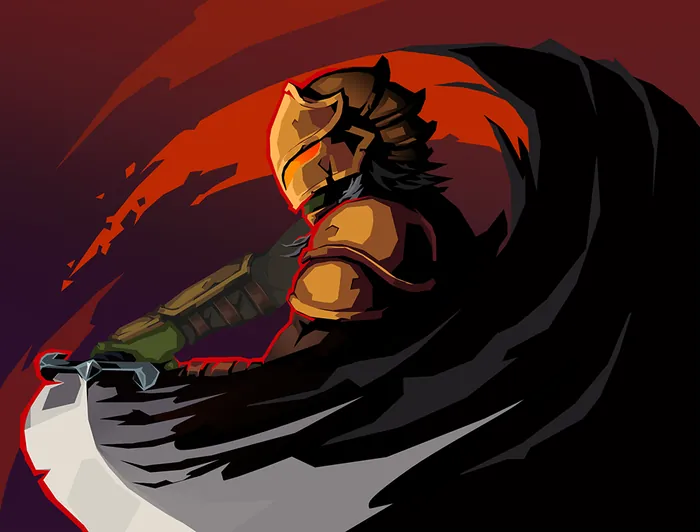 **Ravage** (`HAVOC`) | `1` ⚡ | *Skill* | Jouez la carte du dessus de votre **Pioche** et **Épuisez**-la. | Jouez la carte du dessus de votre **Pioche** et **Épuisez**-la. |
| 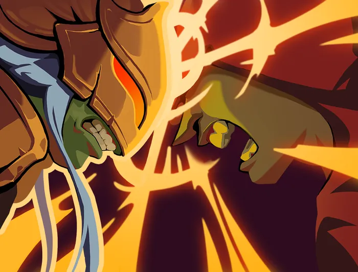 **Coup de boule** (`HEADBUTT`) | `1` ⚡ | *Attack* | Infligez 9 dégâts. Placez une carte de votre **Défausse** sur le dessus de votre **Pioche**. | Infligez 12 dégâts. Placez une carte de votre **Défausse** sur le dessus de votre **Pioche**. |
| 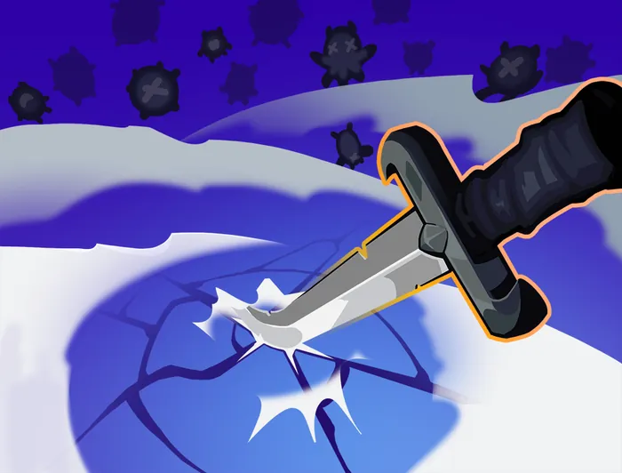 **Vague de fer** (`IRON_WAVE`) | `1` ⚡ | *Attack* | Gagnez 5 d'**Armure**. Infligez 5 dégâts. | Gagnez 7 d'**Armure**. Infligez 7 dégâts. |
|  **Poing en fusion** (`MOLTEN_FIST`) | `1` ⚡ | *Attack* | Infligez 10 dégâts. Doublez le nombre d'incidences de **Vulnérable** sur l'ennemi. **Épuisement**. | Infligez 14 dégâts. Doublez le nombre d'incidences de **Vulnérable** sur l'ennemi. **Épuisement**. |
| 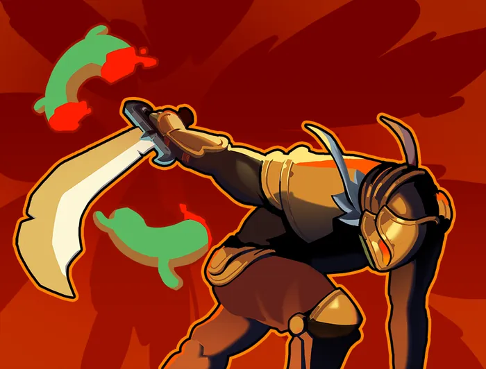 **Frappe perfectionnée** (`PERFECTED_STRIKE`) | `2` ⚡ | *Attack* | Infligez 6 dégâts. Inflige 2 dégâts supplémentaires pour CHACUNE de vos cartes contenant « Frappe ». | Infligez 6 dégâts. Inflige 3 dégâts supplémentaires pour CHACUNE de vos cartes contenant « Frappe ». |
|  **Frappe du pommeau** (`POMMEL_STRIKE`) | `1` ⚡ | *Attack* | Infligez 9 dégâts. Piochez 1 carte. | Infligez 10 dégâts. Piochez 2 cartes. |
|  **Frappe préparatoire** (`SETUP_STRIKE`) | `1` ⚡ | *Attack* | Infligez 7 dégâts. Gagnez 3 de **Force** jusqu'à la fin du tour. | Infligez 9 dégâts. Gagnez 4 de **Force** jusqu'à la fin du tour. |
|  **Même pas mal** (`SHRUG_IT_OFF`) | `1` ⚡ | *Skill* | Gagnez 8 d'**Armure**. Piochez 1 carte. | Gagnez 11 d'**Armure**. Piochez 1 carte. |
| 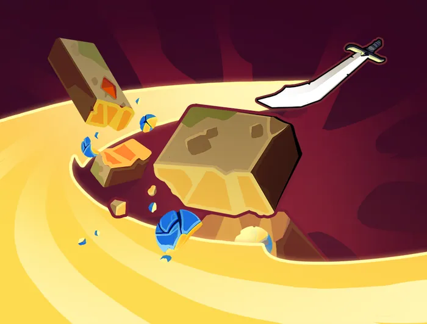 **Épée boomerang** (`SWORD_BOOMERANG`) | `1` ⚡ | *Attack* | Infligez 3 dégâts à un ennemi aléatoire 3 fois. | Infligez 3 dégâts à un ennemi aléatoire 4 fois. |
|  **Provocation** (`TAUNT`) | `1` ⚡ | *Skill* | Gagnez 6 d'**Armure**. Appliquez **Vulnérable** (1). | Gagnez 7 d'**Armure**. Appliquez **Vulnérable** (2). |
| 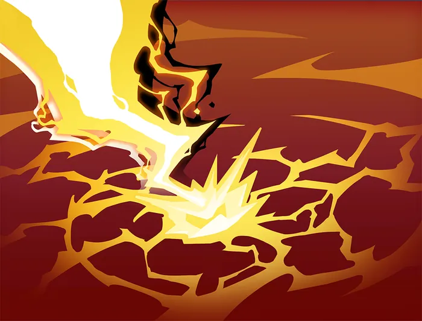 **Coup de tonnerre** (`THUNDERCLAP`) | `1` ⚡ | *Attack* | Infligez 4 dégâts et appliquez **Vulnérable** (1) à TOUS les ennemis. | Infligez 7 dégâts et appliquez **Vulnérable** (1) à TOUS les ennemis. |
|  **Intimidation** (`TREMBLE`) | `1` ⚡ | *Skill* | Appliquez **Vulnérable** (3). **Épuisement**. | Appliquez **Vulnérable** (4). **Épuisement**. |
|  **Virilité** (`TRUE_GRIT`) | `1` ⚡ | *Skill* | Gagnez 7 d'**Armure**. **Épuisez** 1 carte au hasard. | Gagnez 9 d'**Armure**. **Épuisez** 1 carte. |
|  **Frappe jumelée** (`TWIN_STRIKE`) | `1` ⚡ | *Attack* | Infligez 5 dégâts 2 fois. | Infligez 7 dégâts 2 fois. |

👉 *Voir l'intégralité des 90+ cartes de Soldat de Fer (Peu communes, Rares, Anciennes) dans le tome dédié :*  
[Consulter le Tome des Cartes du Soldat de Fer](09_cartes_ironclad.md)

---

## ⚔️ La Silencieuse (Chasseresse Mortelle des Brumes)

* **Points de Vie de Départ :** `70 PV` (PV Max initial)
* **Or de Départ :** `99 Pièces d'or`
* **Énergie de Base :** `3 ⚡` par tour
* **Emplacements de Potions :** `3 emplacements`
* **Teinte Thématique GBA :** Vert Venin (`#40A048` / GBA: `0x03E0`) — cartouche `slay_silent.gba`, zone : Marais du Venin
* **Style de Jeu & Synergies :** Maîtresse des poisons à progression exponentielle (Catalyseur), des volées infinies de surins (Shivs) et de la manipulation fluide de la pioche/défausse.

### 🏺 Relique de Départ :  Anneau du serpent (RING_OF_THE_SNAKE)
> Au début de chaque combat, piochez 2 cartes supplémentaires.

### 🃏 Deck de Départ (Starter Deck)
* **5x** `Frappe (STRIKE_SILENT)` — *Attaque de base (6 dégâts pour 1 ⚡)*
* **5x** `Défense (DEFEND_SILENT)` — *Compétence de base (5 armure pour 1 ⚡)*
* **1x** `Neutralisation (NEUTRALIZE)` — *Attaque agile (3 dégâts + 1 Faiblesse pour 0 ⚡)*
* **1x** `Survivant (SURVIVOR)` — *Compétence tactique (8 armure + défausse 1 carte pour 1 ⚡)*

### 📦 Les 20 Cartes Communes Spécifiques de La Silencieuse
Les cartes communes forment le socle de construction de deck après chaque combat normal :

| Carte | Coût | Type | Effet de Base | Amélioration |
|---|:---:|:---:|---|---|
|  **Anticipation** (`ANTICIPATE`) | `0` ⚡ | *Skill* | Gagnez 2 de **Dextérité** jusqu'à la fin du tour. | Gagnez 4 de **Dextérité** jusqu'à la fin du tour. |
| 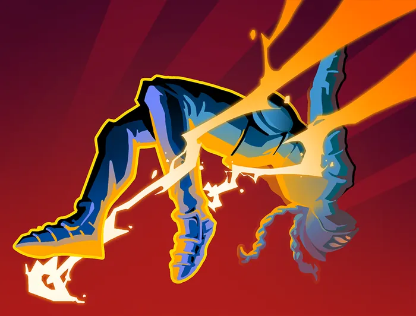 **Salto arrière** (`BACKFLIP`) | `1` ⚡ | *Skill* | Gagnez 5 d'**Armure**. Piochez 2 cartes. | Gagnez 8 d'**Armure**. Piochez 2 cartes. |
| 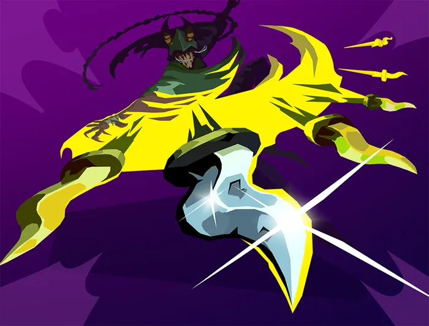 **Danse des lames** (`BLADE_DANCE`) | `1` ⚡ | *Skill* | Ajoutez 3 **Surins** à votre **Main**. **Épuisement**. | Ajoutez 4 **Surins** à votre **Main**. **Épuisement**. |
| 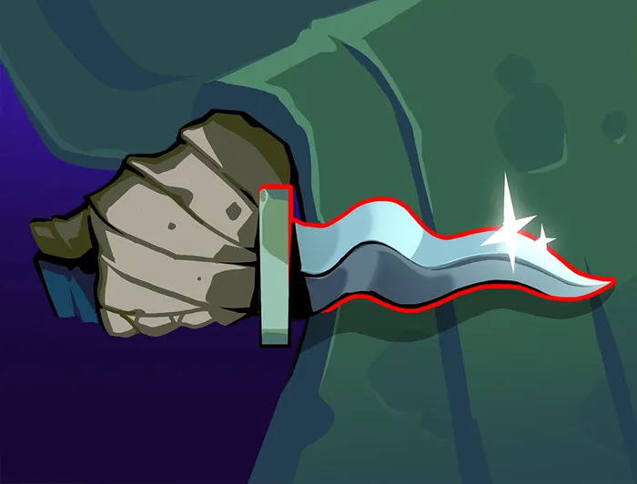 **Cape et épée** (`CLOAK_AND_DAGGER`) | `1` ⚡ | *Skill* | Gagnez 6 d'**Armure**. Ajoutez 1 **Surin** à votre **Main**. | Gagnez 6 d'**Armure**. Ajoutez 2 **Surins** à votre **Main**. |
| 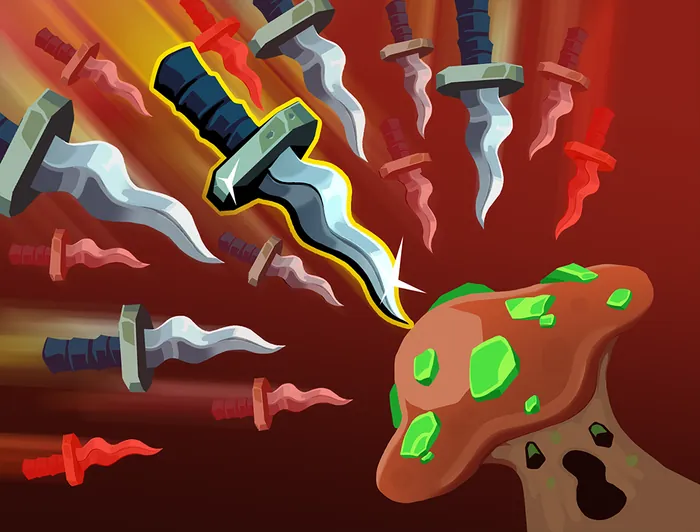 **Pluie de couteaux** (`DAGGER_SPRAY`) | `1` ⚡ | *Attack* | Infligez 4 dégâts à TOUS les ennemis 2 fois. | Infligez 6 dégâts à TOUS les ennemis 2 fois. |
|  **Lancer de couteau** (`DAGGER_THROW`) | `1` ⚡ | *Attack* | Infligez 9 dégâts. Piochez 1 carte. Défaussez 1 carte. | Infligez 12 dégâts. Piochez 1 carte. Défaussez 1 carte. |
|  **Poison mortel** (`DEADLY_POISON`) | `1` ⚡ | *Skill* | Appliquez 5 de **Poison**. | Appliquez 7 de **Poison**. |
|  **Déviation** (`DEFLECT`) | `0` ⚡ | *Skill* | Gagnez 4 d'**Armure**. | Gagnez 7 d'**Armure**. |
| 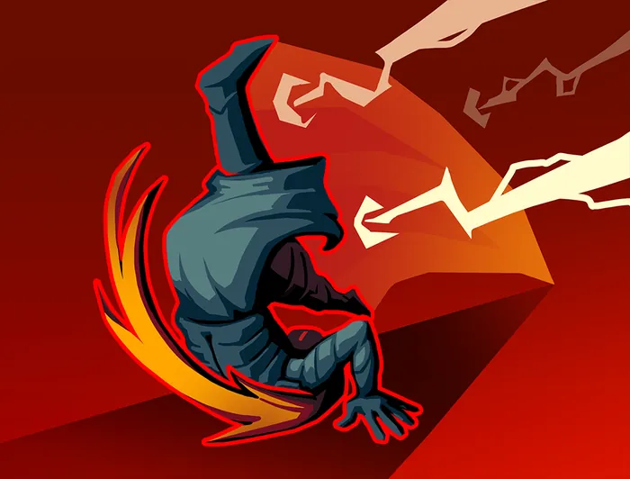 **Dérobade** (`DODGE_AND_ROLL`) | `1` ⚡ | *Skill* | Gagnez 4 d'**Armure**. Au prochain tour, gagnez 4 d'**Armure**. | Gagnez 6 d'**Armure**. Au prochain tour, gagnez 6 d'**Armure**. |
| 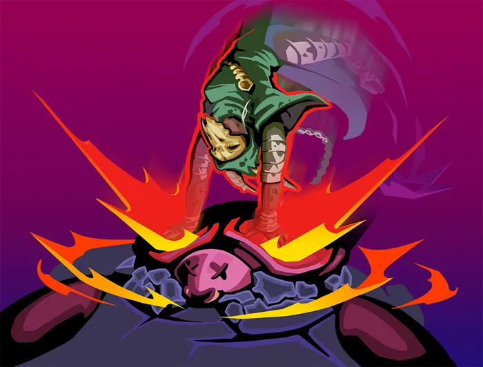 **Tic tac** (`FLICK_FLACK`) | `1` ⚡ | *Attack* | **Ruse**. Infligez 7 dégâts à TOUS les ennemis. | **Ruse**. Infligez 9 dégâts à TOUS les ennemis. |
|  **Frappe initiale** (`LEADING_STRIKE`) | `1` ⚡ | *Attack* | Infligez 3 dégâts. Ajoutez 2 **Surins** à votre **Main**. | Infligez 6 dégâts. Ajoutez 2 **Surins** à votre **Main**. |
|  **Hurlement perçant** (`PIERCING_WAIL`) | `1` ⚡ | *Skill* | TOUS les ennemis perdent 6 de **Force** jusqu'à la fin du tour. **Épuisement**. | TOUS les ennemis perdent 8 de **Force** jusqu'à la fin du tour. **Épuisement**. |
|  **Poignard empoisonné** (`POISONED_STAB`) | `1` ⚡ | *Attack* | Infligez 6 dégâts. Appliquez 3 de **Poison**. | Infligez 8 dégâts. Appliquez 4 de **Poison**. |
| 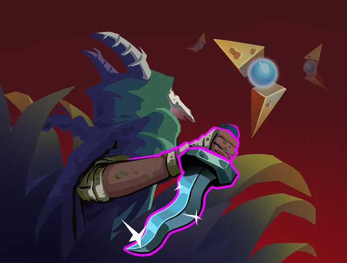 **Prédateur** (`PREDATOR`) | `2` ⚡ | *Attack* | Infligez 15 dégâts. Au prochain tour, piochez 2 cartes. | Infligez 20 dégâts. Au prochain tour, piochez 2 cartes. |
|  **Préparatifs** (`PREPARED`) | `0` ⚡ | *Skill* | Piochez 1 carte. Défaussez 1 carte. | Piochez 2 cartes. Défaussez 2 cartes. |
| 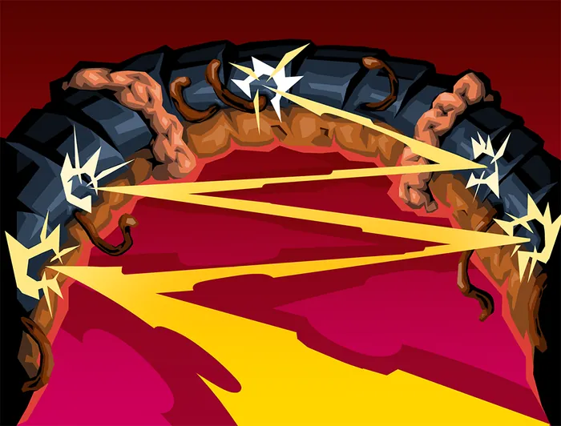 **Ricochet** (`RICOCHET`) | `2` ⚡ | *Attack* | **Ruse**. Infligez 3 dégâts à un ennemi aléatoire 4 fois. | **Ruse**. Infligez 3 dégâts à un ennemi aléatoire 5 fois. |
| 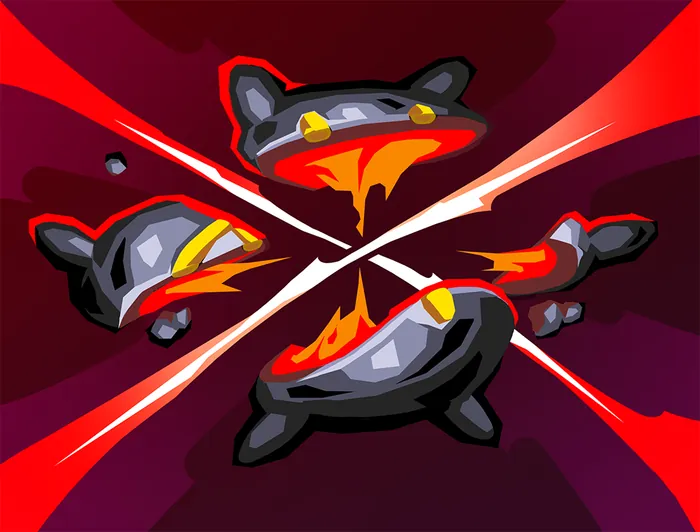 **Trancher** (`SLICE`) | `0` ⚡ | *Attack* | Infligez 6 dégâts. | Infligez 9 dégâts. |
| 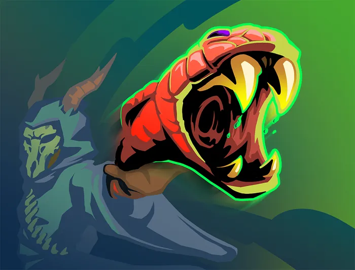 **Morsure de serpent** (`SNAKEBITE`) | `2` ⚡ | *Skill* | **Retenue**. Appliquez 7 de **Poison**. | **Retenue**. Appliquez 10 de **Poison**. |
| 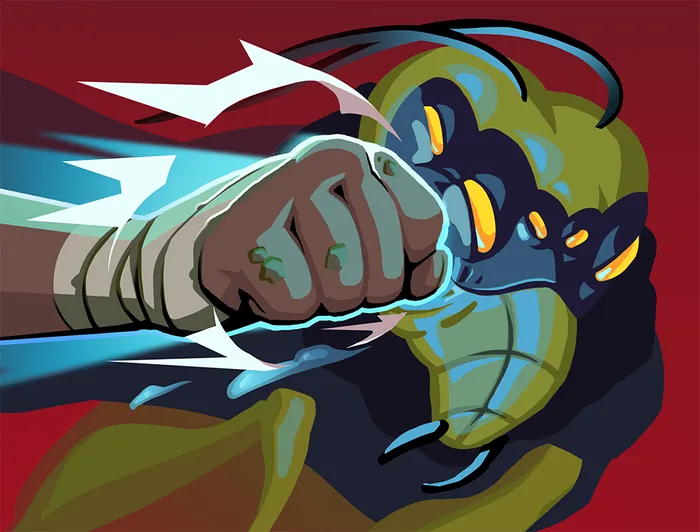 **Coup bas** (`SUCKER_PUNCH`) | `1` ⚡ | *Attack* | Infligez 8 dégâts. Appliquez **Affaibli** (1). | Infligez 10 dégâts. Appliquez **Affaibli** (2). |
| 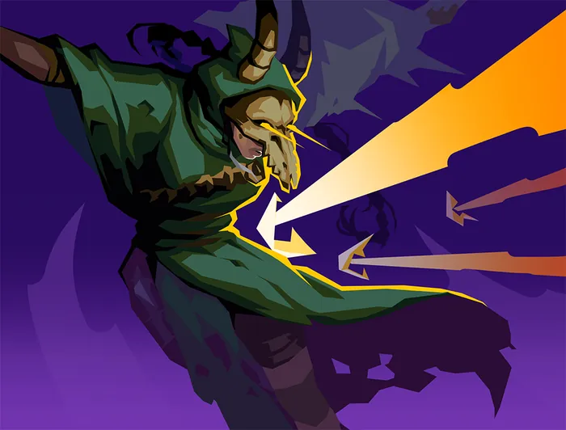 **Intouchable** (`UNTOUCHABLE`) | `2` ⚡ | *Skill* | **Ruse**. Gagnez 6 d'**Armure**. | **Ruse**. Gagnez 9 d'**Armure**. |

👉 *Voir l'intégralité des 90+ cartes de La Silencieuse (Peu communes, Rares, Anciennes) dans le tome dédié :*  
[Consulter le Tome des Cartes de La Silencieuse](10_cartes_silent.md)

---

## ⚔️ Le Défectueux (Automate de Combat Éveillé)

* **Points de Vie de Départ :** `75 PV` (PV Max initial)
* **Or de Départ :** `99 Pièces d'or`
* **Énergie de Base :** `3 ⚡` par tour
* **Emplacements de Potions :** `3 emplacements`
* **Teinte Thématique GBA :** Bleu Saphir (`#3870D8` / GBA: `0x7C00`) — cartouche `slay_defect.gba`, zone : Complexe Astral
* **Style de Jeu & Synergies :** Gestion stratégique des slots d'orbes (Foudre, Glace, Obscurité, Plasma), optimisation du Focus et génération monumentale de mana.

### 🏺 Relique de Départ :  Noyau fissuré (CRACKED_CORE)
> Au début de chaque combat, **Canalisez** 1 **Orbe kéraunique**.

### 🃏 Deck de Départ (Starter Deck)
* **4x** `Frappe (STRIKE_DEFECT)` — *Attaque de base (6 dégâts pour 1 ⚡)*
* **4x** `Défense (DEFEND_DEFECT)` — *Compétence de base (5 armure pour 1 ⚡)*
* **1x** `Éclair (ZAP)` — *Compétence (Canalise 1 Foudre pour 1 ⚡)*
* **1x** `Activation double (DUALCAST)` — *Compétence (Déclenche 2 fois l'orbe le plus ancien pour 1 ⚡)*

### 📦 Les 20 Cartes Communes Spécifiques de Le Défectueux
Les cartes communes forment le socle de construction de deck après chaque combat normal :

| Carte | Coût | Type | Effet de Base | Amélioration |
|---|:---:|:---:|---|---|
| 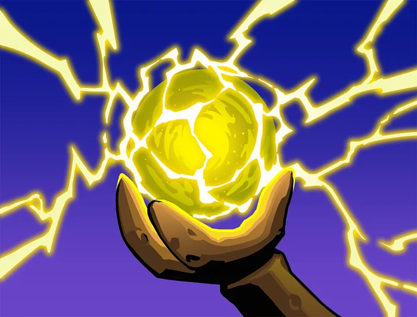 **Foudre en boule** (`BALL_LIGHTNING`) | `1` ⚡ | *Attack* | Infligez 7 dégâts. **Canalisez** 1 **Orbe kéraunique**. | Infligez 10 dégâts. **Canalisez** 1 **Orbe kéraunique**. |
| 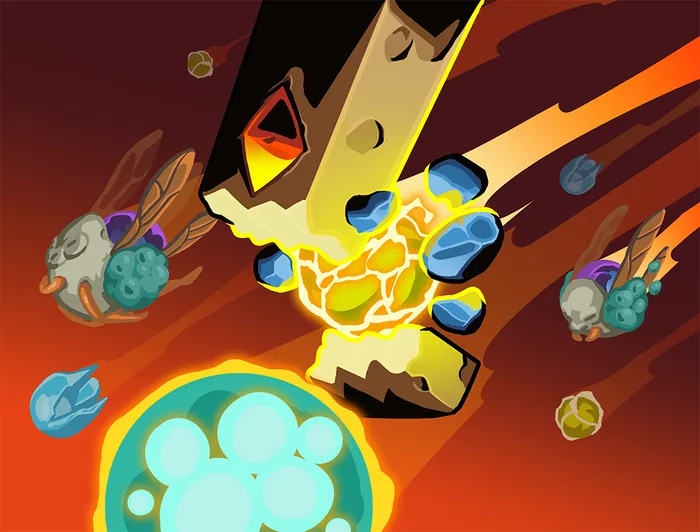 **Barrage** (`BARRAGE`) | `1` ⚡ | *Attack* | Infligez 5 dégâts pour chaque Orbe **Canalisé**. | Infligez 7 dégâts pour chaque Orbe **Canalisé**. |
| 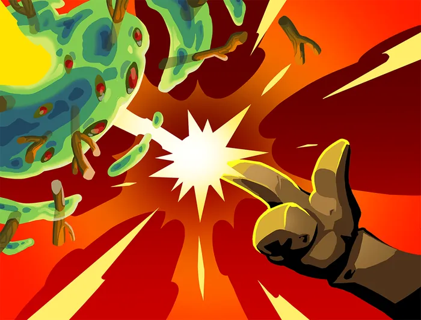 **Rayon cellulaire** (`BEAM_CELL`) | `0` ⚡ | *Attack* | Infligez 3 dégâts. Appliquez **Vulnérable** (1). | Infligez 4 dégâts. Appliquez **Vulnérable** (2). |
| 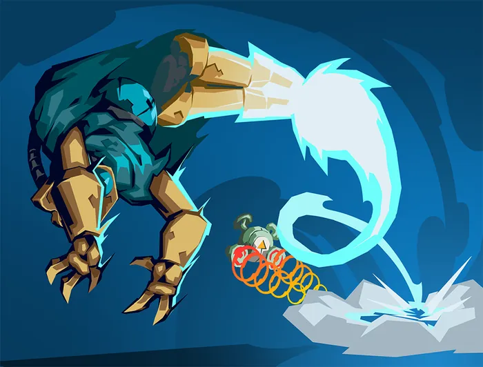 **Boost** (`BOOST_AWAY`) | `0` ⚡ | *Skill* | Gagnez 6 d'**Armure**. Ajoutez **Hébété** à votre **Défausse**. | Gagnez 9 d'**Armure**. Ajoutez **Hébété** à votre **Défausse**. |
| 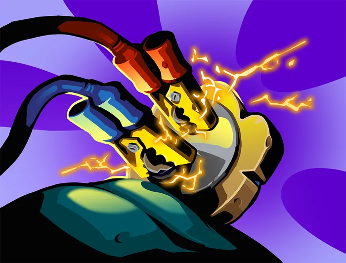 **Piles de recharge** (`CHARGE_BATTERY`) | `1` ⚡ | *Skill* | Gagnez 7 d'**Armure**. Au prochain tour, gagnez ⚡1⚡. | Gagnez 10 d'**Armure**. Au prochain tour, gagnez ⚡1⚡. |
|  **Griffure** (`CLAW`) | `0` ⚡ | *Attack* | Infligez 3 dégâts. Augmentez les dégâts de TOUTES les cartes Griffure de 2 jusqu'à la fin du combat. | Infligez 4 dégâts. Augmentez les dégâts de TOUTES les cartes Griffure de 3 jusqu'à la fin du combat. |
|  **Vague de froid** (`COLD_SNAP`) | `1` ⚡ | *Attack* | Infligez 6 dégâts. **Canalisez** 1 **Orbe glaciaire**. | Infligez 9 dégâts. **Canalisez** 1 **Orbe glaciaire**. |
| 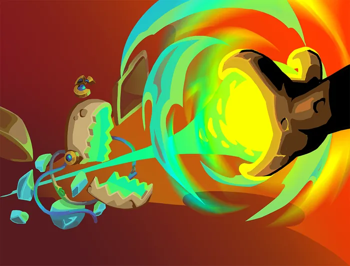 **Compilateur de pilote** (`COMPILE_DRIVER`) | `1` ⚡ | *Attack* | Infligez 7 dégâts. Piochez 1 carte pour chaque Orbe unique. | Infligez 10 dégâts. Piochez 1 carte pour chaque Orbe unique. |
|  **Sang-froid** (`COOLHEADED`) | `1` ⚡ | *Skill* | **Canalisez** 1 **Orbe glaciaire**. Piochez 1 carte. | **Canalisez** 1 **Orbe glaciaire**. Piochez 2 cartes. |
| 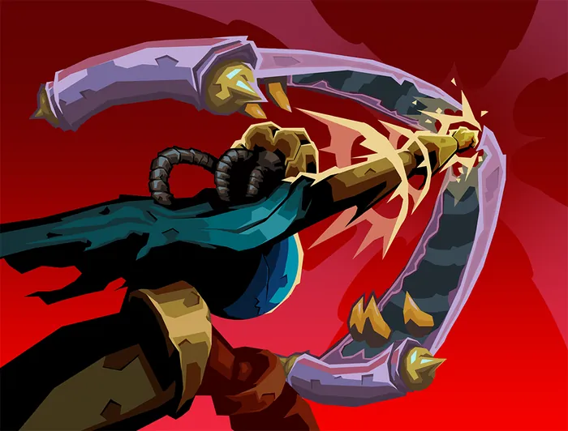 **Frappe focalisée** (`FOCUSED_STRIKE`) | `1` ⚡ | *Attack* | Infligez 9 dégâts. Gagnez 1 de **Focalisation** jusqu'à la fin du tour. | Infligez 11 dégâts. Gagnez 2 de **Focalisation** jusqu'à la fin du tour. |
|  **Viser les yeux** (`GO_FOR_THE_EYES`) | `0` ⚡ | *Attack* | Infligez 3 dégâts. Si l'ennemi s'apprête à attaquer, appliquez **Affaibli** (1). | Infligez 4 dégâts. Si l'ennemi s'apprête à attaquer, appliquez **Affaibli** (2). |
| 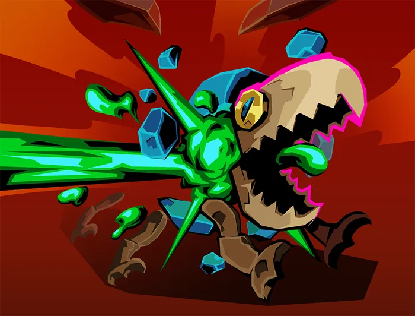 **Encrassage** (`GUNK_UP`) | `1` ⚡ | *Attack* | Infligez 4 dégâts 3 fois. Ajoutez **Englué** à votre **Défausse**. | Infligez 5 dégâts 3 fois. Ajoutez **Englué** à votre **Défausse**. |
|  **Hologramme** (`HOLOGRAM`) | `1` ⚡ | *Skill* | Gagnez 3 d'**Armure**. Placez une carte de votre **Défausse** à votre **Main**. **Épuisement**. | Gagnez 5 d'**Armure**. Placez une carte de votre **Défausse** à votre **Main**. |
|  **Correctif** (`HOTFIX`) | `0` ⚡ | *Skill* | Gagnez 2 de **Focalisation** ce tour. **Épuisement**. | Gagnez 2 de **Focalisation** ce tour. |
|  **Bond** (`LEAP`) | `1` ⚡ | *Skill* | Gagnez 9 d'**Armure**. | Gagnez 12 d'**Armure**. |
| 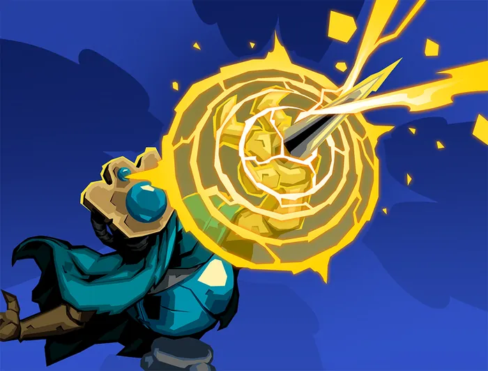 **Paratonnerre** (`LIGHTNING_ROD`) | `1` ⚡ | *Skill* | Gagnez 4 d'**Armure**. Au début de vos 2 prochains tours, **Canalisez** 1 **Orbe kéraunique**. | Gagnez 7 d'**Armure**. Au début de vos 2 prochains tours, **Canalisez** 1 **Orbe kéraunique**. |
|  **Frappe dynamique** (`MOMENTUM_STRIKE`) | `1` ⚡ | *Attack* | Infligez 11 dégâts. Réduisez le coût de cette carte à 0 ⚡. | Infligez 15 dégâts. Réduisez le coût de cette carte à 0 ⚡. |
| 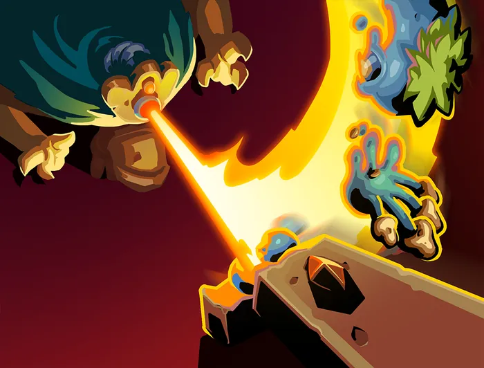 **Faisceau circulaire** (`SWEEPING_BEAM`) | `1` ⚡ | *Attack* | Infligez 6 dégâts à TOUS les ennemis. Piochez 1 carte. | Infligez 9 dégâts à TOUS les ennemis. Piochez 1 carte. |
| 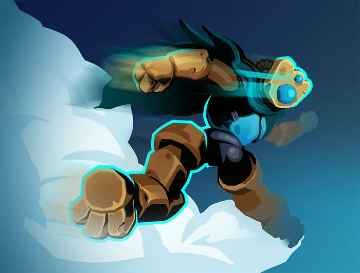 **TURBO** (`TURBO`) | `0` ⚡ | *Skill* | Gagnez ⚡2⚡. Ajoutez un **Néant** à votre **Défausse**. | Gagnez ⚡3⚡. Ajoutez un **Néant** à votre **Défausse**. |
| 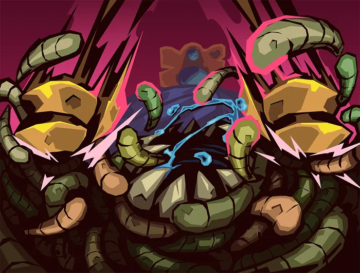 **Tumulte** (`UPROAR`) | `2` ⚡ | *Attack* | Infligez 6 dégâts 2 fois. Jouez une Attaque aléatoire depuis votre **Pioche**. | Infligez 8 dégâts 2 fois. Jouez une Attaque aléatoire depuis votre **Pioche**. |

👉 *Voir l'intégralité des 90+ cartes de Le Défectueux (Peu communes, Rares, Anciennes) dans le tome dédié :*  
[Consulter le Tome des Cartes du Défectueux](11_cartes_defect.md)

---

## ⚔️ Le Régent (Souverain Céleste Déchu — nouveau dans STS2)

* **Points de Vie de Départ :** `75 PV` (PV Max initial)
* **Or de Départ :** `99 Pièces d'or`
* **Énergie de Base :** `3 ⚡` par tour
* **Emplacements de Potions :** `3 emplacements`
* **Teinte Thématique GBA :** Or Solaire (`#E89828` / GBA: `0x03FF`) — cartouche `slay_regent.gba`, zone : Palais Souverain (teinte classique du héros : Pourpre Royal)
* **Style de Jeu & Synergies :** Accumulation d'Étoiles pour libérer des frappes cosmiques, décrets royaux modifiant les règles du tour et souveraineté absolue.

### 🏺 Relique de Départ :  Droit divin (DIVINE_RIGHT)
> Au début de chaque combat, gagnez 3 ★.

### 🃏 Deck de Départ (Starter Deck)
* **4x** `Frappe (STRIKE_REGENT)` — *Attaque de base (6 dégâts pour 1 ⚡)*
* **4x** `Défense (DEFEND_REGENT)` — *Compétence de base (5 armure pour 1 ⚡)*
* **1x** `Chute d'étoile (FALLING_STAR)` — *Attaque stellaire cosmique*
* **1x** `Vénération (VENERATE)` — *Compétence de culte et génération d'étoiles*

### 📦 Les 20 Cartes Communes Spécifiques de Le Régent
Les cartes communes forment le socle de construction de deck après chaque combat normal :

| Carte | Coût | Type | Effet de Base | Amélioration |
|---|:---:|:---:|---|---|
|  **Pulsation astrale** (`ASTRAL_PULSE`) | `0` ⚡ | *Attack* | Infligez 6 dégâts à TOUS les ennemis deux fois. | Infligez 8 dégâts à TOUS les ennemis deux fois. |
|  **HORS DE MA VUE !** (`BEGONE`) | `1` ⚡ | *Skill* | Choisissez une carte dans votre **Main** à **Transformer** en **Frappe de sbire**. | Choisissez une carte dans votre **Main** à **Transformer** en **Frappe de sbire+**. |
|  **Puissance céleste** (`CELESTIAL_MIGHT`) | `2` ⚡ | *Attack* | Infligez 6 dégâts 3 fois. | Infligez 6 dégâts 4 fois. |
|  **Manteau d'étoiles** (`CLOAK_OF_STARS`) | `0` ⚡ | *Skill* | Gagnez 7 d'**Armure**. | Gagnez 10 d'**Armure**. |
|  **Trajectoire de collision** (`COLLISION_COURSE`) | `0` ⚡ | *Attack* | Infligez 10 dégâts. Ajoutez un **Débris** à votre **Main**. | Infligez 14 dégâts. Ajoutez un **Débris** à votre **Main**. |
|  **Indifférence cosmique** (`COSMIC_INDIFFERENCE`) | `1` ⚡ | *Skill* | Gagnez 6 d'**Armure**. Placez une carte de votre **Défausse** sur le dessus de votre **Pioche**. | Gagnez 9 d'**Armure**. Placez une carte de votre **Défausse** sur le dessus de votre **Pioche**. |
|  **Croissant de lance** (`CRESCENT_SPEAR`) | `1` ⚡ | *Attack* | Infligez 8 dégâts. Inflige 2 dégâts supplémentaires pour TOUTES vos cartes coûtant des <s>1</s>. | Infligez 8 dégâts. Inflige 3 dégâts supplémentaires pour TOUTES vos cartes coûtant des <s>1</s>. |
|  **Broyer** (`CRUSH_UNDER`) | `1` ⚡ | *Attack* | Infligez 8 dégâts à TOUS les ennemis. Tous les ennemis perdent 1 de **Force** jusqu'à la fin du tour. | Infligez 9 dégâts à TOUS les ennemis. Tous les ennemis perdent 2 de **Force** jusqu'à la fin du tour. |
|  **Lumière rassemblée** (`GATHER_LIGHT`) | `1` ⚡ | *Skill* | Gagnez 8 d'**Armure**. Gagnez <s>1</s>. | Gagnez 11 d'**Armure**. Gagnez <s>1</s>. |
|  **Courant pailleté** (`GLITTERSTREAM`) | `2` ⚡ | *Skill* | Gagnez 11 d'**Armure**. Au prochain tour, gagnez 5 d'**Armure**. | Gagnez 13 d'**Armure**. Au prochain tour, gagnez 7 d'**Armure**. |
|  **Luminosité** (`GLOW`) | `1` ⚡ | *Skill* | Gagnez <s>1</s>. Piochez 1 carte. Au prochain tour, piochez 1 carte. | Gagnez <s>2</s>. Piochez 1 carte. Au prochain tour, piochez 1 carte. |
|  **Étoile directrice** (`GUIDING_STAR`) | `1` ⚡ | *Attack* | Infligez 12 dégâts. Piochez 2 cartes. | Infligez 13 dégâts. Piochez 3 cartes. |
|  **Cache secrète** (`HIDDEN_CACHE`) | `1` ⚡ | *Skill* | Gagnez <s>1</s>. Au prochain tour, gagnez <s>3</s>. | Gagnez <s>1</s>. Au prochain tour, gagnez <s>4</s>. |
|  **Hiérarchie** (`KNOW_THY_PLACE`) | `0` ⚡ | *Skill* | Appliquez **Affaibli** (1). Appliquez **Vulnérable** (1). **Épuisement**. | Appliquez **Affaibli** (1). Appliquez **Vulnérable** (1). |
|  **Petits pas** (`PATTER`) | `1` ⚡ | *Skill* | Gagnez 8 d'**Armure**. Gagnez 2 de **Vigueur**. | Gagnez 10 d'**Armure**. Gagnez 3 de **Vigueur**. |
|  **Entaille photonique** (`PHOTON_CUT`) | `1` ⚡ | *Attack* | Infligez 10 dégâts. Piochez 1 carte. Choisissez 1 carte de votre **Main** à placer sur le dessus de votre **Pioche**. | Infligez 13 dégâts. Piochez 2 cartes. Choisissez 1 carte de votre **Main** à placer sur le dessus de votre **Pioche**. |
|  **Lame lustrée** (`REFINE_BLADE`) | `1` ⚡ | *Skill* | **Forgez** pour 8. Au prochain tour, gagnez ⚡1⚡. | **Forgez** pour 12. Au prochain tour, gagnez ⚡1⚡. |
|  **Frappe solaire** (`SOLAR_STRIKE`) | `1` ⚡ | *Attack* | Infligez 9 dégâts. Gagnez <s>1</s>. | Infligez 10 dégâts. Gagnez <s>2</s>. |
|  **Butin de guerre** (`SPOILS_OF_BATTLE`) | `1` ⚡ | *Skill* | **Forgez** pour 6. Piochez 2 cartes. | **Forgez** pour 9. Piochez 2 cartes. |
|  **Forgé par la guerre** (`WROUGHT_IN_WAR`) | `1` ⚡ | *Attack* | Infligez 7 dégâts. **Forgez** pour 7. | Infligez 9 dégâts. **Forgez** pour 9. |

👉 *Voir l'intégralité des 90+ cartes de Le Régent (Peu communes, Rares, Anciennes) dans le tome dédié :*  
[Consulter le Tome des Cartes du Régent](12_cartes_regent.md)

---

## ⚔️ La Nécrolieuse (Gardienne des Morts et des Os — nouveau dans STS2)

* **Points de Vie de Départ :** `65 PV` (PV Max initial)
* **Or de Départ :** `99 Pièces d'or`
* **Énergie de Base :** `3 ⚡` par tour
* **Emplacements de Potions :** `3 emplacements`
* **Teinte Thématique GBA :** Violet Spectral (`#C860B8` / GBA: `0x4010`) — cartouche `slay_necrobinder.gba`, zone : Crypte d'Outre-Tombe
* **Style de Jeu & Synergies :** Gestion de familiers et squelettes invoqués au combat, manipulation de la réserve d'os (Bones) et pactes sacrificiels à haut risque.

### 🏺 Relique de Départ :  Phylactère enchaîné (BOUND_PHYLACTERY)
> Au début de votre tour, **Invoquez** pour 1 (renforce Titos, le familier squelette).

### 🃏 Deck de Départ (Starter Deck)
* **4x** `Frappe (STRIKE_NECROBINDER)` — *Attaque de base (6 dégâts pour 1 ⚡)*
* **4x** `Défense (DEFEND_NECROBINDER)` — *Compétence de base (5 armure pour 1 ⚡)*
* **1x** `Déchaînement (UNLEASH)` — *Attaque nécrotique dévastatrice*
* **1x** `Garde du corps (BODYGUARD)` — *Compétence d'invocation défensive*

### 📦 Les 20 Cartes Communes Spécifiques de La Nécrolieuse
Les cartes communes forment le socle de construction de deck après chaque combat normal :

| Carte | Coût | Type | Effet de Base | Amélioration |
|---|:---:|:---:|---|---|
|  **Vie après la mort** (`AFTERLIFE`) | `1` ⚡ | *Skill* | **Invoquez** pour 6. **Épuisement**. | **Invoquez** pour 9. **Épuisement**. |
| 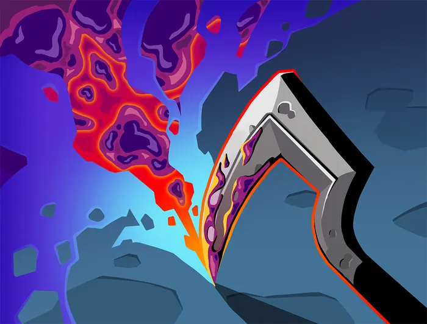 **Frappe du fléau** (`BLIGHT_STRIKE`) | `1` ⚡ | *Attack* | Infligez 8 dégâts. Appliquez un montant de **Fatalité** égal aux dégâts infligés. | Infligez 10 dégâts. Appliquez un montant de **Fatalité** égal aux dégâts infligés. |
| 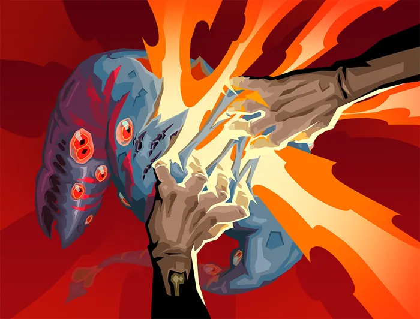 **Profanation** (`DEFILE`) | `1` ⚡ | *Attack* | **Éthéré**. Infligez 13 dégâts. | **Éthéré**. Infligez 17 dégâts. |
|  **Défi** (`DEFY`) | `1` ⚡ | *Skill* | **Éthéré**. Gagnez 6 d'**Armure**. Appliquez **Affaibli** (1). | **Éthéré**. Gagnez 9 d'**Armure**. Appliquez **Affaibli** (1). |
| 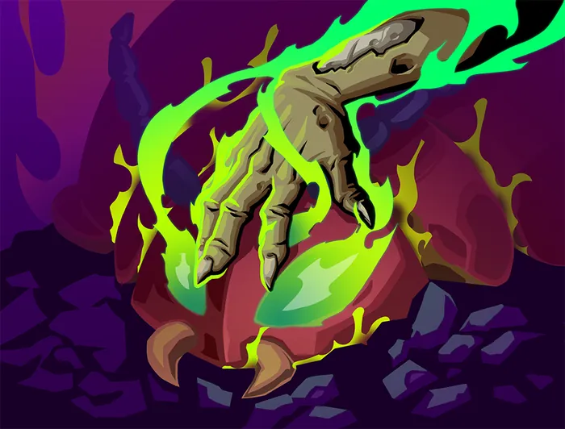 **Drain de puissance** (`DRAIN_POWER`) | `1` ⚡ | *Attack* | Infligez 10 dégâts. **Améliorez** 2 cartes aléatoires de votre **Défausse**. | Infligez 12 dégâts. **Améliorez** 3 cartes aléatoires de votre **Défausse**. |
|  **Terreur** (`FEAR`) | `1` ⚡ | *Attack* | **Éthéré**. Infligez 7 dégâts. Appliquez **Vulnérable** (1). | **Éthéré**. Infligez 8 dégâts. Appliquez **Vulnérable** (2). |
| 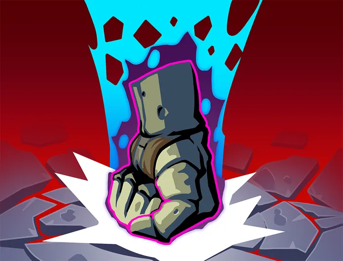 **Raser** (`FLATTEN`) | `2` ⚡ | *Attack* | **Titos** inflige 12 dégâts. Cette carte coûte 0 ⚡ si **Titos** a déjà attaqué pendant ce tour. | **Titos** inflige 16 dégâts. Cette carte coûte 0 ⚡ si **Titos** a déjà attaqué pendant ce tour. |
| 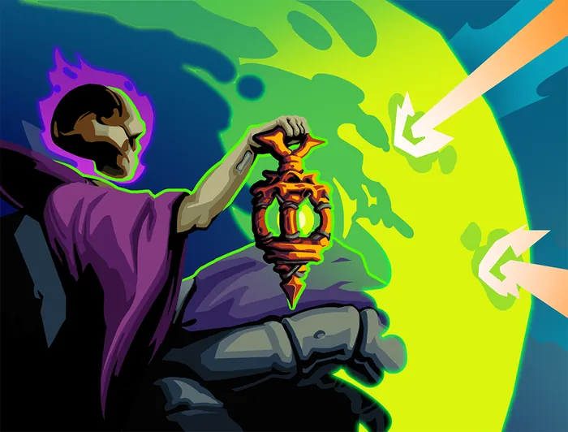 **Fossoyeur** (`GRAVE_WARDEN`) | `1` ⚡ | *Skill* | Gagnez 8 d'**Armure**. Ajoutez une **Âme** à votre **Pioche**. | Gagnez 11 d'**Armure**. Ajoutez une **Âme** à votre **Pioche**. |
| 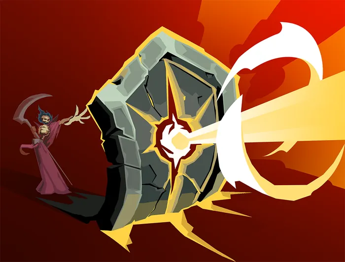 **Déflagration tombale** (`GRAVEBLAST`) | `1` ⚡ | *Attack* | Infligez 4 dégâts. Placez une carte de votre **Défausse** dans votre **Main**. **Épuisement**. | Infligez 6 dégâts. Placez une carte de votre **Défausse** dans votre **Main**. |
|  **Adjuration** (`INVOKE`) | `1` ⚡ | *Skill* | Au prochain tour, **Invoquez** pour 2 et gagnez ⚡2⚡. | Au prochain tour, **Invoquez** pour 3 et gagnez ⚡3⚡. |
| 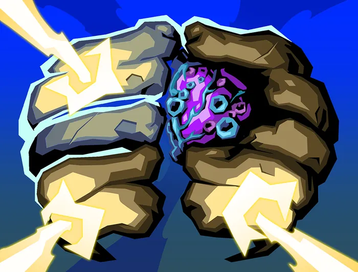 **Anti-pulsation** (`NEGATIVE_PULSE`) | `1` ⚡ | *Skill* | Gagnez 5 d'**Armure**. Appliquez 7 de **Fatalité** sur TOUS les ennemis. | Gagnez 6 d'**Armure**. Appliquez 11 de **Fatalité** sur TOUS les ennemis. |
|  **Chiquenaude** (`POKE`) | `0` ⚡ | *Attack* | **Titos** inflige 6 dégâts. | **Titos** inflige 9 dégâts. |
|  **Râblure** (`PULL_AGGRO`) | `2` ⚡ | *Skill* | **Invoquez** pour 4. Gagnez 7 d'**Armure**. | **Invoquez** pour 5. Gagnez 9 d'**Armure**. |
|  **Moisson** (`REAP`) | `3` ⚡ | *Attack* | **Retenue**. Infligez 27 dégâts. | **Retenue**. Infligez 33 dégâts. |
| 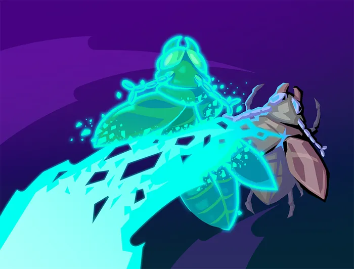 **Exaction** (`REAVE`) | `1` ⚡ | *Attack* | Infligez 10 dégâts. Ajoutez une **Âme** à votre **Pioche**. | Infligez 13 dégâts. Ajoutez une **Âme+** à votre **Pioche**. |
| 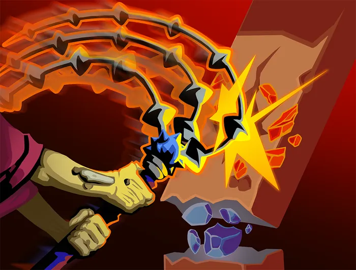 **Pestilence** (`SCOURGE`) | `1` ⚡ | *Skill* | Appliquez 13 de **Fatalité**. Piochez 1 carte. | Appliquez 16 de **Fatalité**. Piochez 2 cartes. |
|  **Frappe du sculpteur** (`SCULPTING_STRIKE`) | `1` ⚡ | *Attack* | Infligez 9 dégâts. Ajoutez **Éthéré** à une carte dans votre **Main**. | Infligez 12 dégâts. Ajoutez **Éthéré** à une carte dans votre **Main**. |
|  **Claquement de doigts** (`SNAP`) | `1` ⚡ | *Attack* | **Titos** inflige 7 dégâts. Ajoutez **Retenue** à une carte dans votre **Main**. | **Titos** inflige 10 dégâts. Ajoutez **Retenue** à une carte dans votre **Main**. |
|  **Semence** (`SOW`) | `1` ⚡ | *Attack* | **Retenue**. Infligez 8 dégâts à TOUS les ennemis. | **Retenue**. Infligez 11 dégâts à TOUS les ennemis. |
| 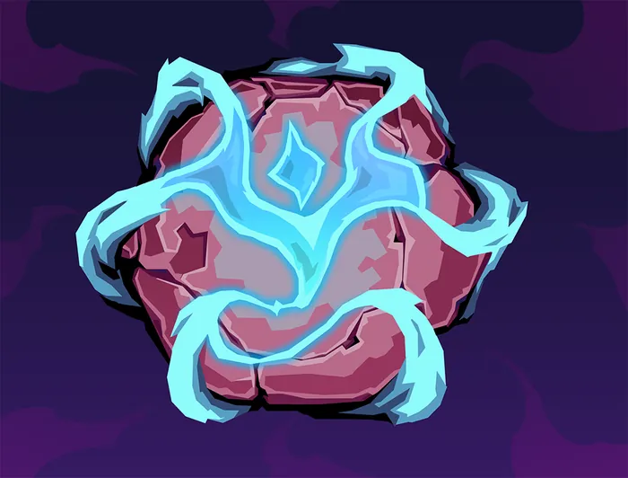 **Feu follet** (`WISP`) | `0` ⚡ | *Skill* | Gagnez ⚡1⚡. **Épuisement**. | **Retenue**. Gagnez ⚡1⚡. **Épuisement**. |

👉 *Voir l'intégralité des 90+ cartes de La Nécrolieuse (Peu communes, Rares, Anciennes) dans le tome dédié :*  
[Consulter le Tome des Cartes de La Nécrolieuse](13_cartes_necrobinder.md)

---
