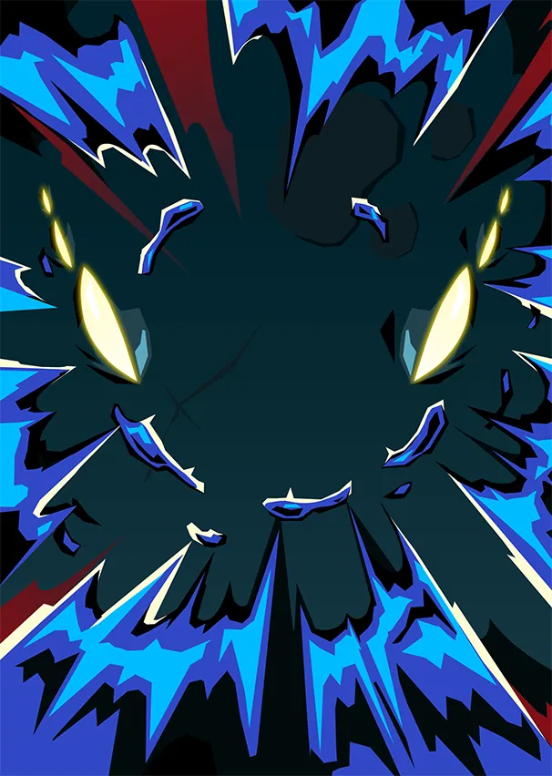
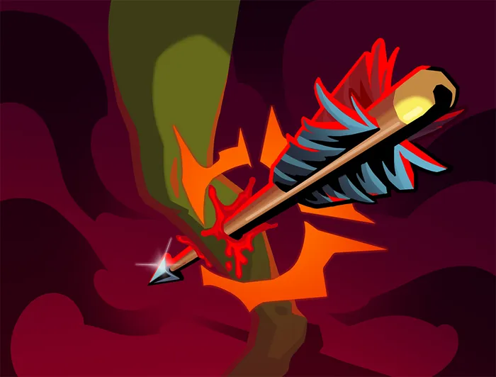
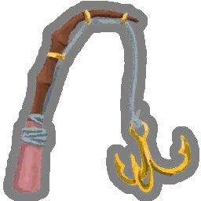
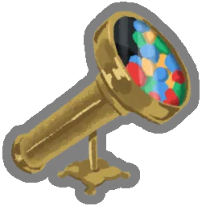
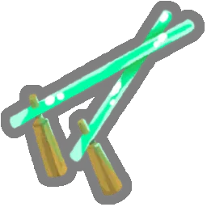
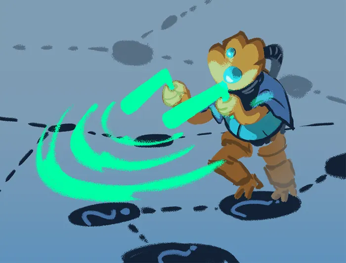
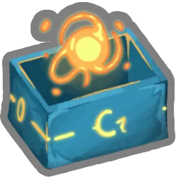
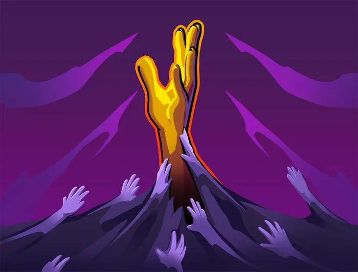
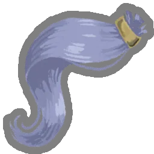

# Neow — Mère de la Résurrection (exilée)

> **Patch de Référence :** `v0.111.0 Beta` (Dernier patch officiel)
> **Acte d'apparition :** Acte 1
> **Déblocage (Epoch) :** `NeowEpoch`
> **Thème Visuel / Couleur :** `#28454F`

## 🎨 Portraits & Illustrations

| Icône Ancien | Illustration Principale |
| :---: | :---: |
|  |  |

### 🎮 Intégration Visuelle GBA (Butano)
* **Palette suggérée pour la GBA :** Teinte dominante `#28454F`. À mapper sur une palette 16 couleurs (15 couleurs + transparent) pour le BG de portrait.
* **Dimensions portrait GBA :** 64x64 pixels (mode 4 bpp tilemap) positionné à `(X: 16, Y: 24)` sur l'écran 240x160.
* **Couleur des boutons / encadrements UI :** `rgba(0, 26, 51, 0.5)` converti en code couleur GBA 15-bit BGR555.

## 📜 Rôle & Lore dans l'Ascension

**Notes de conception :**
* `neow_first_room`
* `neow_third_option`
* `neow_modifier_run`

### ⚠️ Paires de Reliques Exclusives
Certaines reliques ne peuvent pas être choisies ou générées ensemble dans un même tirage :
* ❌ `CursedPearl` et `GoldenPearl` s'excluent mutuellement.
* ❌ `HeftyTablet` et `ArcaneScroll` s'excluent mutuellement.
* ❌ `LeafyPoultice` et `NewLeaf` s'excluent mutuellement.
* ❌ `PrecariousShears` et `PreciseScissors` s'excluent mutuellement.
* ❌ `NeowsSacrifice` et `PhialHolster` s'excluent mutuellement.
* ❌ `NeowsSacrifice` et `LostCoffer` s'excluent mutuellement.

## 🎲 Règles des Slots & Choix

* **Nombre total d'options :** 30 reliques disponibles.
* **Structure des tirages :** 2 slot(s).
  * **Slot #1** (Groupe : *blessing*) : **2** choix parmi **20** reliques présentées.
  * **Slot #2** (Groupe : *curse*) : **1** choix parmi **10** reliques présentées.

## 🏆 Catalogue Complet des Reliques (Classées par Tier)

### ⭐ Tier S (4 reliques)

####  Coffret perdu (`LOST_COFFER`)

* **Tier :** `S` | **Rareté :** `Ancient`
* **Description :** Gagnez 1 récompense de carte et obtenez 1 **Potion** aléatoire.
* **Implémentation GBA C++ :** **Gestion Potion :** Ajoute une potion à l'inventaire `PotionInventory` ou modifie le nombre d'emplacements.

####  Étui à fioles (`PHIAL_HOLSTER`)

* **Tier :** `S` | **Rareté :** `Ancient`
* **Description :** Gagnez 1 nouvel emplacement de potion et obtenez 2 **Potions** aléatoires.
* **Implémentation GBA C++ :** **Gestion Potion :** Ajoute une potion à l'inventaire `PotionInventory` ou modifie le nombre d'emplacements.

####  Perle maudite (`CURSED_PEARL`)

* **Tier :** `S` | **Rareté :** `Ancient`
* **Description :** Recevez Cupidité. Obtenez 333 **Pièces d'or**.
* **Implémentation GBA C++ :** **Effet Majeur Prioritaire :** À implémenter en priorité dans le prototype MVP en raison de son fort impact stratégique.

####  Cataplasme (`LEAFY_POULTICE`)

* **Tier :** `S` | **Rareté :** `Ancient`
* **Description :** **Transformez** 1 **Frappe** et 1 **Défense** et perdez 12 PV Max.
* **Implémentation GBA C++ :** **Effet de Survie :** Modifie `PlayerEntity::heal()` ou déclenche un soin passif en début/fin de combat.

### ⭐ Tier A (6 reliques)

####  Perle dorée (`GOLDEN_PEARL`)

* **Tier :** `A` | **Rareté :** `Ancient`
* **Description :** Lorsque vous obtenez cette relique, gagnez 150 **Pièces d'or**.
* **Implémentation GBA C++ :** **Économie Run :** Incrémente `RunState::gold`. Impact direct sur les boutiques du marchand.

####  Presse-papier en plomb (`LEAD_PAPERWEIGHT`)

* **Tier :** `A` | **Rareté :** `Ancient`
* **Description :** Choisissez 1 carte Incolore parmi 2 à ajoutez à votre **Deck**.
* **Implémentation GBA C++ :** **Effet Passif :** Hook standard dans `RelicManager` avec écouteur d'événement (`ON_COMBAT_START`, `ON_TURN_START`, etc.).

####  Parchemin énorme (`MASSIVE_SCROLL`)

* **Tier :** `A` | **Rareté :** `Ancient`
* **Description :** Choisissez 1 **Carte Multijoueur** parmi 3 à ajouter à votre **Deck**.
* **Implémentation GBA C++ :** **Transformation de Cartes :** Déclenche un sous-état d'interface (`CardSelectScene`) pour transformer, épurer ou choisir des cartes.

####  Nouvelle page (`NEW_LEAF`)

* **Tier :** `A` | **Rareté :** `Ancient`
* **Description :** **Transformez** 1 carte.
* **Implémentation GBA C++ :** **Effet Passif :** Hook standard dans `RelicManager` avec écouteur d'événement (`ON_COMBAT_START`, `ON_TURN_START`, etc.).

####  Petite capsule (`SMALL_CAPSULE`)

* **Tier :** `A` | **Rareté :** `Ancient`
* **Description :** Obtenez une **Relique** aléatoire.
* **Choix Alternatif (Either/Or) :** `Pierre volcanique`
* **Implémentation GBA C++ :** **Effet Passif :** Hook standard dans `RelicManager` avec écouteur d'événement (`ON_COMBAT_START`, `ON_TURN_START`, etc.).

####  Talisman de Neow (`NEOWS_TALISMAN`)

* **Tier :** `A` | **Rareté :** `Ancient`
* **Description :** **Améliorez** 1 de vos **Frappes** et 1 de vos **Défenses**.
* **Choix Alternatif (Either/Or) :** `Pommandre`
* **Implémentation GBA C++ :** **Effet Passif :** Hook standard dans `RelicManager` avec écouteur d'événement (`ON_COMBAT_START`, `ON_TURN_START`, etc.).

### ⭐ Tier B (6 reliques)

####  Conque retentissante (`BOOMING_CONCH`)

* **Tier :** `B` | **Rareté :** `Ancient`
* **Description :** Au début des combats d'**Élite**, piochez 2 cartes supplémentaires et gagnez ⚡1⚡.
* **Implémentation GBA C++ :** **Effet Passif :** Hook standard dans `RelicManager` avec écouteur d'événement (`ON_COMBAT_START`, `ON_TURN_START`, etc.).

####  Tourment de Neow (`NEOWS_TORMENT`)

* **Tier :** `B` | **Rareté :** `Ancient`
* **Description :** Ajoutez 1 **Fureur de Neow** à votre **Deck**.
* **Implémentation GBA C++ :** **Mécanique de Deck :** Ajoute `Fureur de Neow` (NEOWS_FURY) au deck du joueur lors de la sélection. Nécessite l'enregistrement de l'ID de carte dans `CardPool`.

  **Cartes Dérivées / Associées :**

  *  **Fureur de Neow** (`NEOWS_FURY`) — *Attaque* (Coût : `1` ⚡)
    * **Effet de base :** Infligez 10 dégâts.
Placez jusqu'à 2 cartes de votre **Défausse** dans votre **Main**.
**Épuisement**.
    * **Effet amélioré :** Infligez 14 dégâts.
Placez jusqu'à 3 cartes de votre **Défausse** dans votre **Main**.
**Épuisement**.
    * **Amélioration :** `damage: +4, cards: +1`

####  Ciseaux précis (`PRECISE_SCISSORS`)

* **Tier :** `B` | **Rareté :** `Ancient`
* **Description :** Retirez 1 carte de votre **Deck**.
* **Implémentation GBA C++ :** **Effet Passif :** Hook standard dans `RelicManager` avec écouteur d'événement (`ON_COMBAT_START`, `ON_TURN_START`, etc.).

####  Pommandre (`POMANDER`)

* **Tier :** `B` | **Rareté :** `Ancient`
* **Description :** **Améliorez** une carte.
* **Choix Alternatif (Either/Or) :** `Talisman de Neow`
* **Implémentation GBA C++ :** **Effet Passif :** Hook standard dans `RelicManager` avec écouteur d'événement (`ON_COMBAT_START`, `ON_TURN_START`, etc.).

####  Tablette lourde (`HEFTY_TABLET`)

* **Tier :** `B` | **Rareté :** `Ancient`
* **Description :** Choisissez 1 carte Rare parmi 3 à ajouter à votre **Deck**. Ajoutez 1 Blessure à votre **Deck**.
* **Implémentation GBA C++ :** **Mécanique de Deck :** Ajoute `Blessure` (INJURY) au deck du joueur lors de la sélection. Nécessite l'enregistrement de l'ID de carte dans `CardPool`.

  **Cartes Dérivées / Associées :**

  *  **Blessure** (`INJURY`) — *Malédiction* (Coût : `0` ⚡)
    * **Effet de base :** **Injouable**.
    * **Effet amélioré :** **Injouable**.

####  Grande capsule (`LARGE_CAPSULE`)

* **Tier :** `B` | **Rareté :** `Ancient`
* **Description :** Obtenez 2 **Reliques aléatoires**. Ajoutez une **Frappe** et une **Défense** à votre **Deck**.
* **Implémentation GBA C++ :** **Effet Passif :** Hook standard dans `RelicManager` avec écouteur d'événement (`ON_COMBAT_START`, `ON_TURN_START`, etc.).

### ⭐ Tier C (5 reliques)

####  Parchemin arcanique (`ARCANE_SCROLL`)

* **Tier :** `C` | **Rareté :** `Ancient`
* **Description :** Obtenez une **Carte Rare** aléatoire.
* **Implémentation GBA C++ :** **Transformation de Cartes :** Déclenche un sous-état d'interface (`CardSelectScene`) pour transformer, épurer ou choisir des cartes.

####  Pierre volcanique (`LAVA_ROCK`)

* **Tier :** `C` | **Rareté :** `Ancient`
* **Description :** Le Boss de l'Acte 1 octroie 2 **Reliques** lorsqu'il est vaincu.
* **Choix Alternatif (Either/Or) :** `Petite capsule`
* **Implémentation GBA C++ :** **Effet Passif :** Hook standard dans `RelicManager` avec écouteur d'événement (`ON_COMBAT_START`, `ON_TURN_START`, etc.).

####  Osselets de Neow (`NEOWS_BONES`)

* **Tier :** `C` | **Rareté :** `Ancient`
* **Description :** Gagnez 2 **Reliques** de Neow aléatoires. Ajoutez 1 Malédiction aléatoire à votre **Deck**.
* **Implémentation GBA C++ :** **Effet Passif :** Hook standard dans `RelicManager` avec écouteur d'événement (`ON_COMBAT_START`, `ON_TURN_START`, etc.).

####  Forces précaires (`PRECARIOUS_SHEARS`)

* **Tier :** `C` | **Rareté :** `Ancient`
* **Description :** Retirez 2 cartes de votre **Deck**. Perdez 16 PV.
* **Implémentation GBA C++ :** **Effet Passif :** Hook standard dans `RelicManager` avec écouteur d'événement (`ON_COMBAT_START`, `ON_TURN_START`, etc.).

####  Creuset en argent (`SILVER_CRUCIBLE`)

* **Tier :** `C` | **Rareté :** `Ancient`
* **Description :** Vos 3 premières récompenses de carte sont **Améliorées**. Le premier Coffre trésor que vous ouvrez est vide.
* **Implémentation GBA C++ :** **Effet Passif :** Hook standard dans `RelicManager` avec écouteur d'événement (`ON_COMBAT_START`, `ON_TURN_START`, etc.).

### ⭐ Tier D (4 reliques)

####  Caisse de parchemins (`SCROLL_BOXES`)

* **Tier :** `D` | **Rareté :** `Ancient`
* **Description :** Choisissez 1 pack de cartes parmi 2 à ajouter à votre **Deck**.
* **Implémentation GBA C++ :** **Transformation de Cartes :** Déclenche un sous-état d'interface (`CardSelectScene`) pour transformer, épurer ou choisir des cartes.

####  Bottes ailées (`WINGED_BOOTS`)

* **Tier :** `D` | **Rareté :** `Ancient`
* **Description :** Vous pouvez ignorer les trajets indiqués sur la carte lorsque vous choisissez la prochaine salle 3 fois.
* **Implémentation GBA C++ :** **Effet Passif :** Hook standard dans `RelicManager` avec écouteur d'événement (`ON_COMBAT_START`, `ON_TURN_START`, etc.).

####  Huître nourrissante (`NUTRITIOUS_OYSTER`)

* **Tier :** `D` | **Rareté :** `Ancient`
* **Description :** Augmentez vos PV Max de 11.
* **Choix Alternatif (Either/Or) :** `Humidificateur en pierre`
* **Implémentation GBA C++ :** **Effet Passif :** Hook standard dans `RelicManager` avec écouteur d'événement (`ON_COMBAT_START`, `ON_TURN_START`, etc.).

####  Humidificateur en pierre (`STONE_HUMIDIFIER`)

* **Tier :** `D` | **Rareté :** `Ancient`
* **Description :** Lorsque vous vous **Reposez** à un **Site de repos**, augmentez vos PV Max de 5.
* **Choix Alternatif (Either/Or) :** `Huître nourrissante`
* **Implémentation GBA C++ :** **Effet Passif :** Hook standard dans `RelicManager` avec écouteur d'événement (`ON_COMBAT_START`, `ON_TURN_START`, etc.).

### ⭐ Non classé (Spécial) (5 reliques)

####  Canne à pêche (`FISHING_ROD`)

* **Tier :** `Untiered` | **Rareté :** `Ancient`
* **Description :** Tous les 3 combats normaux, **Améliorez** une carte aléatoire de votre **Deck**.
* **Implémentation GBA C++ :** **Effet Passif :** Hook standard dans `RelicManager` avec écouteur d'événement (`ON_COMBAT_START`, `ON_TURN_START`, etc.).

####  Kaléidoscope (`KALEIDOSCOPE`)

* **Tier :** `Untiered` | **Rareté :** `Ancient`
* **Description :** Recevez 2 récompenses de cartes d'autres personnages.
* **Implémentation GBA C++ :** **Effet Passif :** Hook standard dans `RelicManager` avec écouteur d'événement (`ON_COMBAT_START`, `ON_TURN_START`, etc.).

####  Baguette de rhabdomancie (`DOWSING_ROD`)

* **Tier :** `Untiered` | **Rareté :** `Ancient`
* **Description :** Ajoutez 1 **Rhabdomancie** à votre **Deck**.
* **Implémentation GBA C++ :** **Mécanique de Deck :** Ajoute `Rhabdomancie` (DOWSING) au deck du joueur lors de la sélection. Nécessite l'enregistrement de l'ID de carte dans `CardPool`.

  **Cartes Dérivées / Associées :**

  *  **Rhabdomancie** (`DOWSING`) — *Quête* (Coût : `0` ⚡)
    * **Effet de base :** **Injouable**.
Après avoir visité encore 5 salles **?**, se transforme en **Abondance**.
    * **Effet amélioré :** **Injouable**.
Après avoir visité encore 5 salles **?**, se transforme en **Abondance**.

####  Sacrifice de Neow (`NEOWS_SACRIFICE`)

* **Tier :** `Untiered` | **Rareté :** `Ancient`
* **Description :** Obtenez 1 **Ambre gris** et ajoutez 1 Culpabilité à votre **Deck**.
* **Implémentation GBA C++ :** **Mécanique de Deck :** Ajoute `Culpabilité` (GUILTY) au deck du joueur lors de la sélection. Nécessite l'enregistrement de l'ID de carte dans `CardPool`.

  **Cartes Dérivées / Associées :**

  *  **Culpabilité** (`GUILTY`) — *Malédiction* (Coût : `0` ⚡)
    * **Effet de base :** **Injouable**.
Retiré de votre **Deck** au bout de 5 combats.
    * **Effet amélioré :** **Injouable**.
Retiré de votre **Deck** au bout de 5 combats.

####  Tresse soyeuse (`SILKEN_TRESS`)

* **Tier :** `Untiered` | **Rareté :** `Ancient`
* **Description :** Perdez toutes vos Pièces d'or. **Envoûtez** toutes les cartes de votre première récompense de cartes avec Glamour.
* **Implémentation GBA C++ :** **Effet Passif :** Hook standard dans `RelicManager` avec écouteur d'événement (`ON_COMBAT_START`, `ON_TURN_START`, etc.).

## 💬 Dialogues & Répliques

Les dialogues s'affichent dans la boîte de dialogue inférieure (240x40 px) sur la GBA avec défilement fluide au bouton `A` :

### 🗣️ Première Rencontre (Toutes runs confondues)
* 👑 **Ancien** :
> Je t'ai... reconstitué....  
> ...va... ..monte.....

### 🗣️ Soldat de Fer (Ironclad)
* 👑 **Ancien** :
> ..lève-toi.. mon.. guerrier...  
> ..le moment est venu... de combattre...à nouveau...

* 👑 **Ancien** :
> ..encore.. sombré.. dans la rage... bien...

* 👑 **Ancien** :
> ..souviens-toi.. la.. première..fois  
> ...que tu ..vins...auprès de moi..

* 👑 **Ancien** :
> ..si..furieux...

* 👑 **Ancien** :
> ...si..utile...

### 🗣️ La Silencieuse (Silent)
* 👑 **Ancien** :
> ...de retour.. de... l'extérieur ?  
> ..je savais... que vous... reviendriez...

* 👑 **Ancien** :
> ...votre..  
>  ...trophée.. vous attend...

* 👑 **Ancien** :
> ..tous deux...connaissent..l'agonie..de la..famille...

* 👤 **SILENT** :
> ...

* 👑 **Ancien** :
> ..toujours...en quête..d'approbation...?  
> ...QUELLE SOTTISE...

### 🗣️ Le Défectueux (Defect)
* 👑 **Ancien** :
> ...assemblage.. qu'es-tu...  
> .... devenu...?

* 👑 **Ancien** :
> ...il.. peut...  
> ....vous.. ...réparer....

* 👑 **Ancien** :
> ...Je.. ne... ..peux pas...  
> ....te faire.. oublier....

* 👤 **DEFECT** :
> *<bips déterminés>*

* 👑 **Ancien** :
> ...bien....

### 🗣️ Le Régent (Regent)
* 👤 **REGENT** :
> Énorme créature bleue, je suis le futur Roi !

* 👑 **Ancien** :
> ..mon petit...  
> ...tu... me.. ..reverras... ...encore....

* 👑 **Ancien** :
> ...encore..?

* 👤 **REGENT** :
> Pourquoi je n'arrive pas à gagner ?!

* 👑 **Ancien** :
> ...reçois.. ma... ..bénédiction...

* 👤 **REGENT** :
> ...oui, merci, Neow.

### 🗣️ La Nécrolieuse (Necrobinder)
* 👑 **Ancien** :
> ...nous.... avons... ..le même... ..but....

* 👤 **NECROBINDER** :
> IL A TUÉ TOUS CEUX QUE J'AIME !!

* 👑 **Ancien** :
> ...je te donne..... mon pouvoir...

* 👑 **Ancien** :
> Il... respire.. ....encore...

* 👤 **NECROBINDER** :
> Est-ce ...même... possible...?

* 👑 **Ancien** :
> ... L'Architecte.... ..faiblit....  
> ..et nous.... plus puissantes...

### 🗣️ Générique (Tout Personnage)
* 👑 **Ancien** :
> ...salutations... ..encore.....

* 👑 **Ancien** :
> ...réveille-toi...  
> ..Réveille-toi.....

* 👑 **Ancien** :
> ..reçois.... ma....  
> ..bénédiction.. ...et pars......

* 👑 **Ancien** :
> ..Je t'ai... ..ramenée / ... ..à la vie...

* 👑 **Ancien** :
> ...tue.. l'ARCHITECTE

---
⬅️ [Retour au Sommaire de la Bible](README.md) | ⚙️ [Spécifications Techniques GBA](spec_technique_gba.md)