# Darv — L'Amasseur

> **Patch de Référence :** `v0.111.0 Beta` (Dernier patch officiel)
> **Acte d'apparition :** Tous les actes (Remplacement)
> **Déblocage (Epoch) :** `DarvEpoch`
> **Thème Visuel / Couleur :** `#512E66`

## 🎨 Portraits & Illustrations

| Icône Ancien | Illustration Principale |
| :---: | :---: |
| 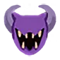 | 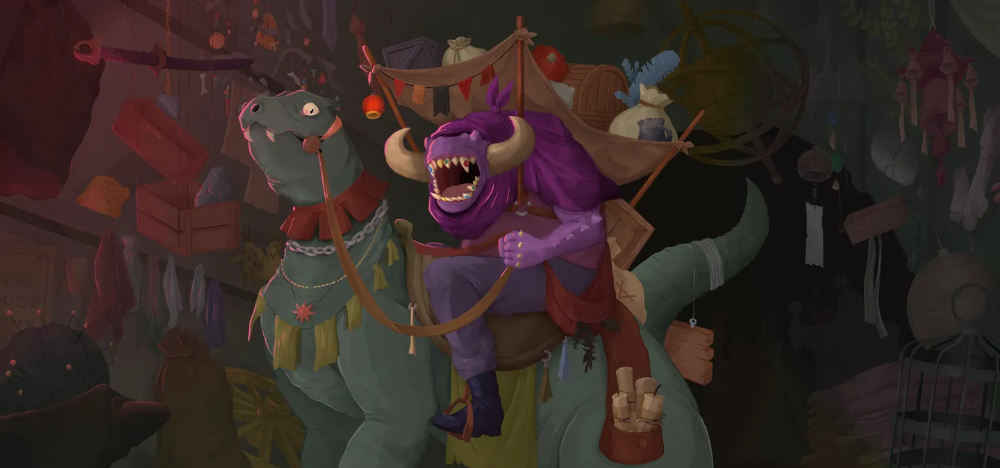 |

### 🎮 Intégration Visuelle GBA (Butano)
* **Palette suggérée pour la GBA :** Teinte dominante `#512E66`. À mapper sur une palette 16 couleurs (15 couleurs + transparent) pour le BG de portrait.
* **Dimensions portrait GBA :** 64x64 pixels (mode 4 bpp tilemap) positionné à `(X: 16, Y: 24)` sur l'écran 240x160.
* **Couleur des boutons / encadrements UI :** `rgba(15, 0, 20, 0.5)` converti en code couleur GBA 15-bit BGR555.

## 📜 Rôle & Lore dans l'Ascension

**Notes de conception :**
* `darv_any_act`
* `darv_replaces_third`

## 🎲 Règles des Slots & Choix

* **Nombre total d'options :** 12 reliques disponibles.
* **Structure des tirages :** 1 slot(s).
  * **Slot #1** : **3** choix parmi **12** reliques présentées.

## 🏆 Catalogue Complet des Reliques (Classées par Tier)

### ⭐ Tier S (2 reliques)

#### 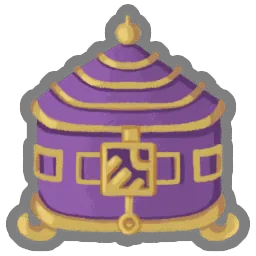 Boîte de Pandore (`PANDORAS_BOX`)

* **Tier :** `S` | **Rareté :** `Ancient`
* **Description :** **Transformez** TOUTES vos **Frappes** et vos **Défenses**.
* **Implémentation GBA C++ :** **Transformation de Cartes :** Déclenche un sous-état d'interface (`CardSelectScene`) pour transformer, épurer ou choisir des cartes.

#### 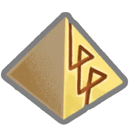 Pyramide runique (`RUNIC_PYRAMID`)

* **Tier :** `S` | **Rareté :** `Ancient`
* **Description :** À la fin de votre tour, vous ne défaussez pas votre **Main**.
* **Implémentation GBA C++ :** **Rétention de Main :** Désactive la phase de défausse automatique en fin de tour (`TurnManager::discard_phase()`).

### ⭐ Tier A (2 reliques)

#### 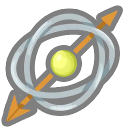 Astrolabe (`ASTROLABE`)

* **Tier :** `A` | **Rareté :** `Ancient`
* **Description :** **Transformez** 3 cartes, puis **Améliorez**-les.
* **Implémentation GBA C++ :** **Transformation de Cartes :** Déclenche un sous-état d'interface (`CardSelectScene`) pour transformer, épurer ou choisir des cartes.

#### 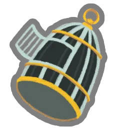 Cage vide (`EMPTY_CAGE`)

* **Tier :** `A` | **Rareté :** `Ancient`
* **Description :** Retirez 2 cartes de votre **Deck**.
* **Implémentation GBA C++ :** **Transformation de Cartes :** Déclenche un sous-état d'interface (`CardSelectScene`) pour transformer, épurer ou choisir des cartes.

### ⭐ Tier B (4 reliques)

#### 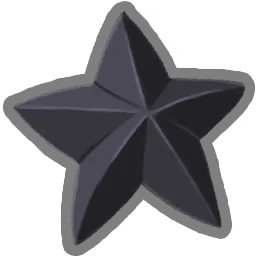 Étoile noire (`BLACK_STAR`)

* **Tier :** `B` | **Rareté :** `Ancient`
* **Description :** Les **Élites** donnent une Relique supplémentaire lorsqu'ils sont vaincus.
* **Implémentation GBA C++ :** **Effet Passif :** Hook standard dans `RelicManager` avec écouteur d'événement (`ON_COMBAT_START`, `ON_TURN_START`, etc.).

####  Œil de geckobra (`SNECKO_EYE`)

* **Tier :** `B` | **Rareté :** `Ancient`
* **Description :** Au début de votre tour, piochez 2 cartes supplémentaires. Démarrez chaque combat Désorienté.
* **Implémentation GBA C++ :** **Randomisation des Coûts :** Hook dans `CardHand::draw()` pour appliquer un coût d'énergie aléatoire [0..3] et +2 cartes par tour.

#### 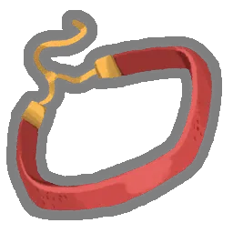 Ras du cou en velours (`VELVET_CHOKER`)

* **Tier :** `B` | **Rareté :** `Ancient`
* **Description :** Gagnez ⚡1⚡ au début de chaque tour. Vous ne pouvez pas jouer plus de 6 cartes par tour.
* **Implémentation GBA C++ :** **Effet Passif :** Hook standard dans `RelicManager` avec écouteur d'événement (`ON_COMBAT_START`, `ON_TURN_START`, etc.).

#### 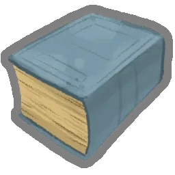 Grimoire poussiéreux (`DUSTY_TOME`)

* **Tier :** `B` | **Rareté :** `Ancient`
* **Description :** Obtenez une **Carte d'Ancien**.
* **Implémentation GBA C++ :** **Effet Passif :** Hook standard dans `RelicManager` avec écouteur d'événement (`ON_COMBAT_START`, `ON_TURN_START`, etc.).

### ⭐ Tier C (1 relique)

#### 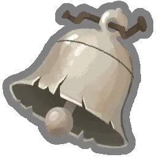 Cloche d'appel (`CALLING_BELL`)

* **Tier :** `C` | **Rareté :** `Ancient`
* **Description :** Obtenez une Malédiction spéciale et 3 **Reliques**.
* **Implémentation GBA C++ :** **Effet Passif :** Hook standard dans `RelicManager` avec écouteur d'événement (`ON_COMBAT_START`, `ON_TURN_START`, etc.).

### ⭐ Tier D (3 reliques)

####  Ectoplasme (`ECTOPLASM`)

* **Tier :** `D` | **Rareté :** `Ancient`
* **Description :** Vous ne pouvez plus obtenir de **Pièces d'or**. Gagnez ⚡1⚡ au début de chaque tour.
* **Implémentation GBA C++ :** **Ressource Combat :** Modifie l'énergie de base (`PlayerEntity::base_energy`). Nécessite la gestion des malus associés (ex: pas d'or, pas de potion).

#### 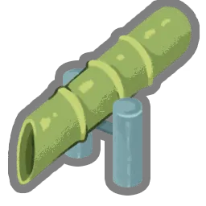 Sozu (`SOZU`)

* **Tier :** `D` | **Rareté :** `Ancient`
* **Description :** Gagnez ⚡1⚡ au début de chaque tour. Vous ne pouvez plus obtenir de **Potions**.
* **Implémentation GBA C++ :** **Ressource Combat :** Modifie l'énergie de base (`PlayerEntity::base_energy`). Nécessite la gestion des malus associés (ex: pas d'or, pas de potion).

#### 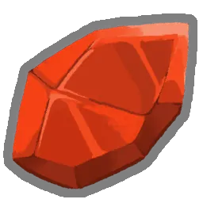 Pierre philosophale (`PHILOSOPHERS_STONE`)

* **Tier :** `D` | **Rareté :** `Ancient`
* **Description :** Gagnez ⚡1⚡ au début de chaque tour. TOUS les ennemis démarrent le combat avec 1 de **Force**.
* **Implémentation GBA C++ :** **Ressource Combat :** Modifie l'énergie de base (`PlayerEntity::base_energy`). Nécessite la gestion des malus associés (ex: pas d'or, pas de potion).

## 💬 Dialogues & Répliques

Les dialogues s'affichent dans la boîte de dialogue inférieure (240x40 px) sur la GBA avec défilement fluide au bouton `A` :

### 🗣️ Première Rencontre (Toutes runs confondues)
* 👑 **Ancien** :
> ...où ai-je mis... Oh !  
> Tu viens / Vous venez voir ma collection ?! Sers-toi / Servez-vous dans ce tas au fond, tu feras / vous ferez bon usage de ce que tu trouveras / vous trouverez !

### 🗣️ Soldat de Fer (Ironclad)
* 👑 **Ancien** :
> Le retour du guerrier flamboyant !  
> J'ai juste ce qu'il vous faut !

* 👑 **Ancien** :
> Content de voir que vous leur mettez encore la misère !

* 👑 **Ancien** :
> J'ai bien gardé votre grosse lame... mais je n'ai trouvé personne pour la remettre en état.

* 👤 **IRONCLAD** :
> *Le Soldat de Fer fixe Darv du regard.*

* 👑 **Ancien** :
> L'Architecte en sait peut-être quelque chose.

### 🗣️ La Silencieuse (Silent)
* 👑 **Ancien** :
> Vous aussi, de retour dans la Tour ?  
> Impossible de résister à tout ce butin, n'est-ce pas ?

* 👑 **Ancien** :
> Je vous échangerais bien quelque chose de sympathique contre ce joli trophée que vous baladez !

* 👑 **Ancien** :
> Bien dommage que vous ne vous souveniez pas de ma générosité !  
> Oui oui, Neow, je sais bien...

* 👤 **SILENT** :
> ...

* 👑 **Ancien** :
> Bien ! Trouvons-vous un équipement convenable pour cette confrontation finale !

### 🗣️ Le Défectueux (Defect)
* 👑 **Ancien** :
> Quelle belle pièce de pacotille / Quel beau morceau de ferraille / Quel joli bloc de bric-à-brac tu fais / vous faites !

* 👤 **DEFECT** :
> *<3*

* 👑 **Ancien** :
> Toujours en service, à ce que je vois... Voyons ce qu'on peut faire pour te mettre à jour !

* 👑 **Ancien** :
> J'ai bien conservé ce que ton ami euhh... hum.  
> Oublie ce que j'ai dit !!

* 👤 **DEFECT** :
> *<Bips interrogatifs>*

* 👑 **Ancien** :
> Ma petite ferraille, oublie ce que j'ai dit !

### 🗣️ Le Régent (Regent)
* 👑 **Ancien** :
> Qu'est-ce qui vous amène parmi nous ? Vous voulez jeter un œil à ma collection ?

* 👤 **REGENT** :
> Volontiers, je suis un amateur de biens rares...

* 👑 **Ancien** :
> Formidable !

* 👑 **Ancien** :
> Déjà de retour, votre Altesse ?!

* 👑 **Ancien** :
> J'ai quelque chose pour vous, mon nouvel ami !

* 👤 **REGENT** :
> Je suis tout ouïe !

* 👑 **Ancien** :
> Eh bien, je voudrais vous l'offrir mais l'Architecte me l'a dérobé !!  
> Vous aiderez bien un ami en détresse ?

### 🗣️ La Nécrolieuse (Necrobinder)
* 👑 **Ancien** :
> Je vois que vous n'êtes pas là pour plaisanter. Qu'est-ce que je peux faire pour vous, mademoiselle ?

* 👤 **NECROBINDER** :
> Qu'est-ce que vous avez pour m'aider à tuer un homme bien détestable ?

* 👑 **Ancien** :
> Eh bien... allez jeter un œil là-bas !

* 👑 **Ancien** :
> Toujours sur votre quête sanglante ? Ce n'est pas moi qui vais vous arrêter !

* 👑 **Ancien** :
> Ce tome paraît lié à votre âme, il est encore plus ancien que vous.

* 👤 **NECROBINDER** :
> Comment l'avez-vous obtenu ?

* 👑 **Ancien** :
> Les choses effrayantes ont une fâcheuse tendance à finir dans ma collection.

### 🗣️ Générique (Tout Personnage)
* 👑 **Ancien** :
> Tiens, emporte / Tenez, emportez une de ces gemmes oubliées avec toi / vous !

* 👑 **Ancien** :
> J'ai plein de choses à faire aujourd'hui !  
> Prends ce que tu veux / Prenez ce que vous voulez du tas là-bas !

---
⬅️ [Retour au Sommaire de la Bible](README.md) | ⚙️ [Spécifications Techniques GBA](spec_technique_gba.md)