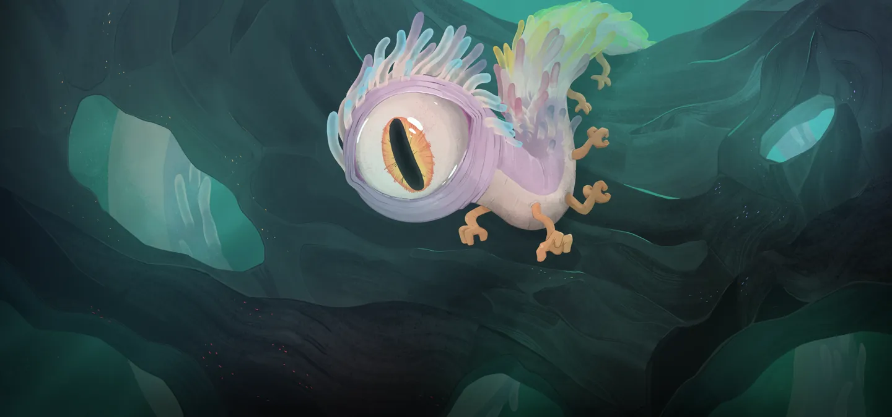
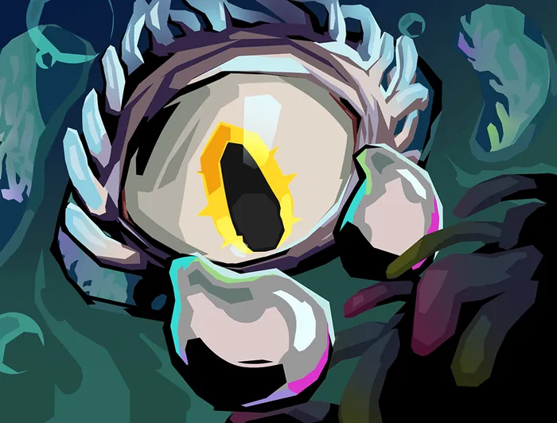
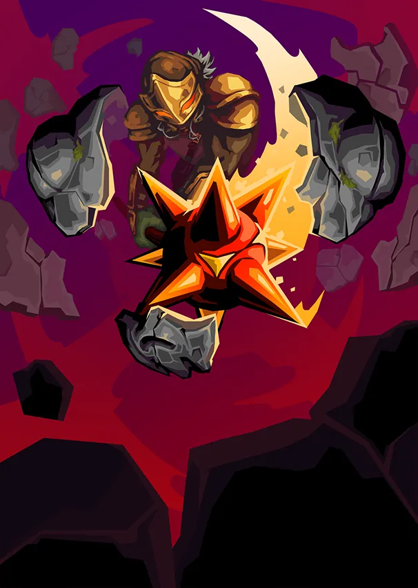
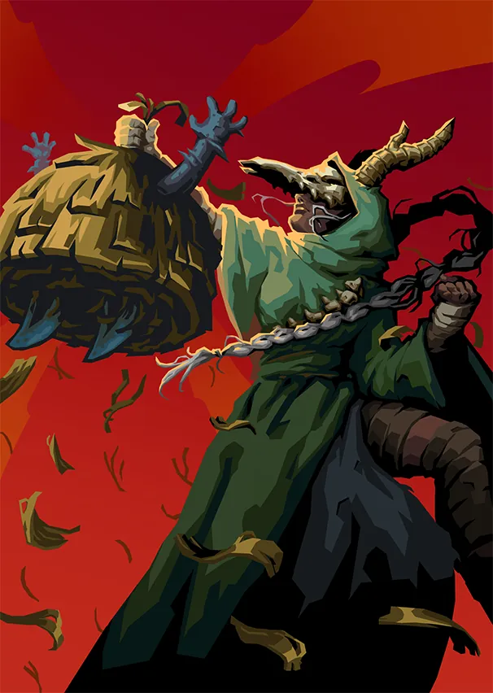
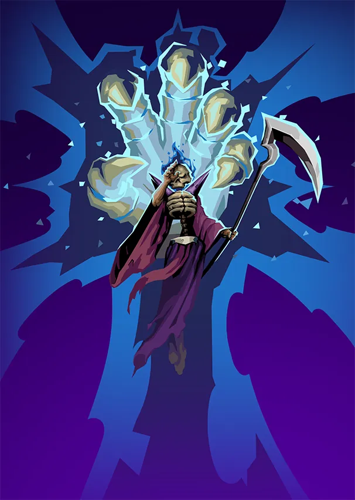
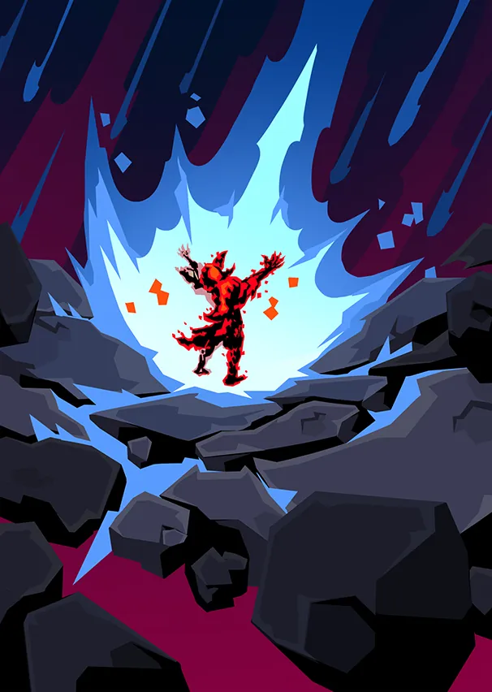
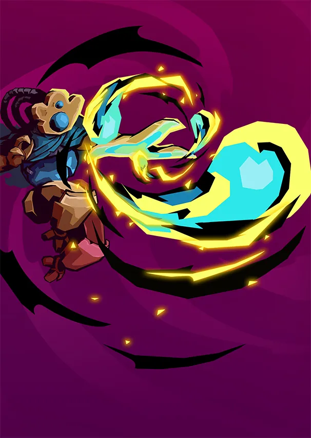

# Orobas — Arc-en-ciel Vivant

> **Patch de Référence :** `v0.111.0 Beta` (Dernier patch officiel)
> **Acte d'apparition :** Acte 2
> **Déblocage (Epoch) :** `OrobasEpoch`
> **Thème Visuel / Couleur :** `#5C5F7A`

## 🎨 Portraits & Illustrations

| Icône Ancien | Illustration Principale |
| :---: | :---: |
|  |  |

### 🎮 Intégration Visuelle GBA (Butano)
* **Palette suggérée pour la GBA :** Teinte dominante `#5C5F7A`. À mapper sur une palette 16 couleurs (15 couleurs + transparent) pour le BG de portrait.
* **Dimensions portrait GBA :** 64x64 pixels (mode 4 bpp tilemap) positionné à `(X: 16, Y: 24)` sur l'écran 240x160.
* **Couleur des boutons / encadrements UI :** `rgba(13, 0, 26, 0.35)` converti en code couleur GBA 15-bit BGR555.

## 📜 Rôle & Lore dans l'Ascension

## 🎲 Règles des Slots & Choix

* **Nombre total d'options :** 10 reliques disponibles.
* **Structure des tirages :** 3 slot(s).
  * **Slot #1** : **1** choix parmi **4** reliques présentées.
  * **Slot #2** : **1** choix parmi **4** reliques présentées.
  * **Slot #3** : **1** choix parmi **2** reliques présentées.

## 🏆 Catalogue Complet des Reliques (Classées par Tier)

### ⭐ Tier S (2 reliques)

####  Caisse d'alchimie (`ALCHEMICAL_COFFER`)

* **Tier :** `S` | **Rareté :** `Ancient`
* **Description :** Gagnez 4 emplacements de potion avec des **Potions** aléatoires.
* **Implémentation GBA C++ :** **Gestion Potion :** Ajoute une potion à l'inventaire `PotionInventory` ou modifie le nombre d'emplacements.

####  Perle radieuse (`RADIANT_PEARL`)

* **Tier :** `S` | **Rareté :** `Ancient`
* **Description :** Au début de chaque combat, ajoutez 1 **Luminescence** à votre **Main**.
* **Implémentation GBA C++ :** **Mécanique de Deck :** Ajoute `Éclat` (LUMINESCE) au deck du joueur lors de la sélection. Nécessite l'enregistrement de l'ID de carte dans `CardPool`.

  **Cartes Dérivées / Associées :**

  *  **Éclat** (`LUMINESCE`) — *Compétence* (Coût : `0` ⚡)
    * **Effet de base :** **Retenue**.
Gagnez ⚡2⚡.
**Épuisement**.
    * **Effet amélioré :** **Retenue**.
Gagnez ⚡3⚡.
**Épuisement**.
    * **Amélioration :** `energygain: +1`

### ⭐ Tier A (2 reliques)

####  Bois flotté (`DRIFTWOOD`)

* **Tier :** `A` | **Rareté :** `Ancient`
* **Description :** Vous disposez d'une relance gratuite pour chaque récompense de carte.
* **Implémentation GBA C++ :** **Effet Passif :** Hook standard dans `RelicManager` avec écouteur d'événement (`ON_COMBAT_START`, `ON_TURN_START`, etc.).

####  Dent archaïque (`ARCHAIC_TOOTH`)

* **Tier :** `A` | **Rareté :** `Ancient`
* **Description :** **Transformez** une carte de base en sa version d'Ancien.
* **Implémentation GBA C++ :** **Mécanique de Deck :** Ajoute `Briser` (BREAK), `Répression` (SUPPRESS), `Protecteur` (PROTECTOR), `Pluie de météores` (METEOR_SHOWER), `Activation quadruple` (QUADCAST) au deck du joueur lors de la sélection. Nécessite l'enregistrement de l'ID de carte dans `CardPool`.

  **Cartes Dérivées / Associées :**

  *  **Briser** (`BREAK`) — *Attaque* (Coût : `1` ⚡)
    * **Effet de base :** Infligez 20 dégâts.
Appliquez **Vulnérable** (5).
    * **Effet amélioré :** Infligez 30 dégâts.
Appliquez **Vulnérable** (7).
    * **Amélioration :** `damage: +10, vulnerable: +2`
  *  **Répression** (`SUPPRESS`) — *Attaque* (Coût : `0` ⚡)
    * **Effet de base :** **Inné**.
Infligez 11 dégâts.
Appliquez **Affaibli** (3).
    * **Effet amélioré :** **Inné**.
Infligez 17 dégâts.
Appliquez **Affaibli** (5).
    * **Amélioration :** `damage: +6, weak: +2`
  *  **Protecteur** (`PROTECTOR`) — *Attaque* (Coût : `1` ⚡)
    * **Effet de base :** **Titos** inflige 10 dégâts.
Inflige un montant de dégâts supplémentaires égal aux **PV Max** **de Titos**.
    * **Effet amélioré :** **Titos** inflige 15 dégâts.
Inflige un montant de dégâts supplémentaires égal aux **PV Max** **de Titos**.
    * **Amélioration :** `calculationbase: +5, energy: -1`
  *  **Pluie de météores** (`METEOR_SHOWER`) — *Attaque* (Coût : `0` ⚡)
    * **Effet de base :** Infligez 14 dégâts à TOUS les ennemis.
Appliquez **Affaibli** (2) et **Vulnérable** à TOUS les ennemis.
    * **Effet amélioré :** Infligez 21 dégâts à TOUS les ennemis.
Appliquez **Affaibli** (2) et **Vulnérable** à TOUS les ennemis.
    * **Amélioration :** `damage: +7`
  *  **Activation quadruple** (`QUADCAST`) — *Compétence* (Coût : `1` ⚡)
    * **Effet de base :** **Activez** votre Orbe le plus à droite 4 fois.
    * **Effet amélioré :** **Activez** votre Orbe le plus à droite 4 fois.
    * **Amélioration :** `energy: -1`

### ⭐ Tier B (2 reliques)

####  Crevaite électrique (`ELECTRIC_SHRYMP`)

* **Tier :** `B` | **Rareté :** `Ancient`
* **Description :** **Envoûtez** une Compétence avec Imprégné.
* **Implémentation GBA C++ :** **Effet Passif :** Hook standard dans `RelicManager` avec écouteur d'événement (`ON_COMBAT_START`, `ON_TURN_START`, etc.).

####  Joyau prismatique (`PRISMATIC_GEM`)

* **Tier :** `B` | **Rareté :** `Ancient`
* **Description :** Gagnez ⚡1⚡ au début de chaque tour. Les récompenses de carte contiennent désormais des cartes d'autres couleurs.
* **Choix Alternatif (Either/Or) :** `Verre marin`
* **Implémentation GBA C++ :** **Effet Passif :** Hook standard dans `RelicManager` avec écouteur d'événement (`ON_COMBAT_START`, `ON_TURN_START`, etc.).

### ⭐ Tier C (2 reliques)

####  Œil de verre (`GLASS_EYE`)

* **Tier :** `C` | **Rareté :** `Ancient`
* **Description :** Lorsque vous obtenez cette relique, obtenez 2 cartes **Communes**, 2 cartes **Inhabituelles**, et 1 carte **Rare**.
* **Implémentation GBA C++ :** **Effet Passif :** Hook standard dans `RelicManager` avec écouteur d'événement (`ON_COMBAT_START`, `ON_TURN_START`, etc.).

####  Toucher d'Orobas (`TOUCH_OF_OROBAS`)

* **Tier :** `C` | **Rareté :** `Ancient`
* **Description :** Remplacez votre **Relique** de départ par une version **Améliorée**.
* **Implémentation GBA C++ :** **Effet Passif :** Hook standard dans `RelicManager` avec écouteur d'événement (`ON_COMBAT_START`, `ON_TURN_START`, etc.).

### ⭐ Tier D (2 reliques)

####  Verre marin (`SEA_GLASS`)

* **Tier :** `D` | **Rareté :** `Ancient`
* **Description :** Consultez une sélection de 15 cartes d'un autre personnage. Ajoutez-en autant que vous souhaitez à votre **Deck**.
* **Choix Alternatif (Either/Or) :** `Joyau prismatique`
* **Implémentation GBA C++ :** **Effet Passif :** Hook standard dans `RelicManager` avec écouteur d'événement (`ON_COMBAT_START`, `ON_TURN_START`, etc.).

####  Château de sable (`SAND_CASTLE`)

* **Tier :** `D` | **Rareté :** `Ancient`
* **Description :** Lorsque vous obtenez cette relique, **Améliorez** 6 cartes aléatoires.
* **Implémentation GBA C++ :** **Effet Passif :** Hook standard dans `RelicManager` avec écouteur d'événement (`ON_COMBAT_START`, `ON_TURN_START`, etc.).

## 💬 Dialogues & Répliques

Les dialogues s'affichent dans la boîte de dialogue inférieure (240x40 px) sur la GBA avec défilement fluide au bouton `A` :

### 🗣️ Première Rencontre (Toutes runs confondues)
* 👑 **Ancien** :
> Petite marionnette !! Ici ?! Prends ça, prends ça !

### 🗣️ Soldat de Fer (Ironclad)
* 👑 **Ancien** :
> Un Soldat de Fer !? Comment possible ?? Peur. Très peur !!

* 👑 **Ancien** :
> Contrat signé ? Pourquoi ?! Mauvais choix ? Oui. Grosse erreur !

* 👑 **Ancien** :
> Te souhaite liberté !! Souhaite fort !  
> Vakuu méchant. Très méchant ! Architecte te libère ?

### 🗣️ La Silencieuse (Silent)
* 👑 **Ancien** :
> Infection... ? FLÉAU !? Prends et va-t-en !!

* 👤 **SILENT** :
> ...

* 👑 **Ancien** :
> Pas contagieuse ? Très mourante ? Architecte va t'aider ?

* 👑 **Ancien** :
> Où tes sœurs ? Sœurs méchantes !!  
> Sois bonne personne ! Pas comme sœurs !!

### 🗣️ Le Défectueux (Defect)
* 👑 **Ancien** :
> Quoi ! Serviteur assemblage ?! Encore en service !!  
> Pourquoi ici ? Pourquoi pas à l'usine ??

* 👑 **Ancien** :
> Orbes brillants ! Marchent comment ?  
> Aïe !!

* 👑 **Ancien** :
> Cœur abîmé ? Neow utiliser assemblage cassé ?  
> Manipulée ?

* 👤 **DEFECT** :
> *<bips sourds>*

* 👑 **Ancien** :
> Architecte réparer toi ?

### 🗣️ Le Régent (Regent)
* 👑 **Ancien** :
> Voyageur ! De l'espace !? Où dans l'espace ?  
> Comment depuis l'espace ? Tête pointue ! Petits copains !!

* 👤 **REGENT** :
> *Le Régent se lance dans un monologue qui dure plusieurs heures.*

* 👑 **Ancien** :
> Super ! Impressionnant !! Encore ! Encore !!!

* 👑 **Ancien** :
> Encore des histoires ! Trouvé ça pour toi !  
> Maintenant encore des histoires !!

* 👤 **REGENT** :
> Mon plus grand fan ! Orobas, cher ami !  
> Heureux de te voir encore en vie !

* 👑 **Ancien** :
> Histoires ?!

* 👤 **REGENT** :
> Bien sûr bien sûr... mais as-tu trouvé quelques breloques pour moi ?

### 🗣️ La Nécrolieuse (Necrobinder)
* 👑 **Ancien** :
> Morte ?! Pas morte ! Pourquoi marionnette ? Grosse main !!

* 👤 **NECROBINDER** :
> Je ne suis pas une marionnette. J'ai un homme à tuer.  
> Que pouvez-vous faire pour moi ?

* 👑 **Ancien** :
> Tuer pas bien !! Prends ça à la place !

* 👑 **Ancien** :
> Pas morte ! Jolis cadeaux pour toi !! Violence pas bien.

* 👑 **Ancien** :
> Pas violence ! Collecter trucs brillants à la place... Brillants !!

* 👤 **NECROBINDER** :
> Ma quête ne prendra fin que lorsque l'Architecte ne sera plus.  
> La violence est inévitable.

* 👑 **Ancien** :
> Architecte pas méchant ! Discuter ensemble ? Discuter bien !! Très bien !

### 🗣️ Générique (Tout Personnage)
* 👑 **Ancien** :
> Essaie ça !!!

* 👑 **Ancien** :
> Essaie ça !!!

---
⬅️ [Retour au Sommaire de la Bible](README.md) | ⚙️ [Spécifications Techniques GBA](spec_technique_gba.md)