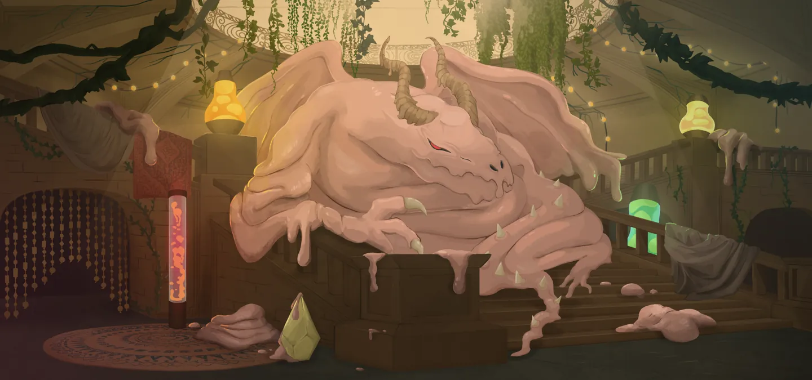
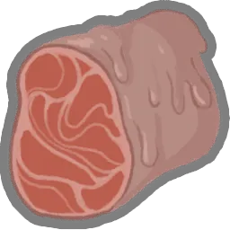
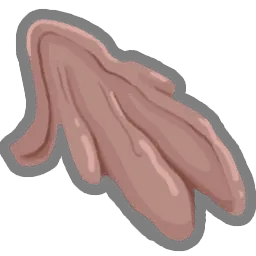
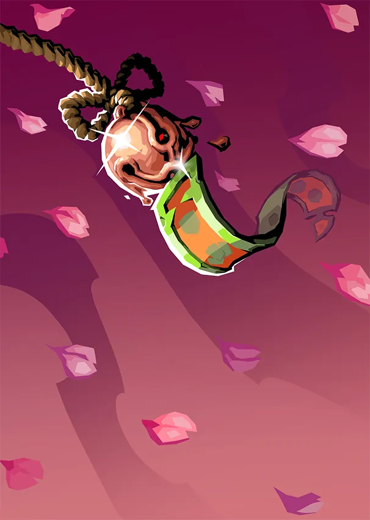

# Paël — Dragon de Cire

> **Patch de Référence :** `v0.111.0 Beta` (Dernier patch officiel)
> **Acte d'apparition :** Acte 2
> **Déblocage (Epoch) :** `None`
> **Thème Visuel / Couleur :** `#332C29`

## 🎨 Portraits & Illustrations

| Icône Ancien | Illustration Principale |
| :---: | :---: |
|  |  |

### 🎮 Intégration Visuelle GBA (Butano)
* **Palette suggérée pour la GBA :** Teinte dominante `#332C29`. À mapper sur une palette 16 couleurs (15 couleurs + transparent) pour le BG de portrait.
* **Dimensions portrait GBA :** 64x64 pixels (mode 4 bpp tilemap) positionné à `(X: 16, Y: 24)` sur l'écran 240x160.
* **Couleur des boutons / encadrements UI :** `rgba(8, 20, 0, 0.75)` converti en code couleur GBA 15-bit BGR555.

## 📜 Rôle & Lore dans l'Ascension

## 🎲 Règles des Slots & Choix

* **Nombre total d'options :** 10 reliques disponibles.
* **Structure des tirages :** 3 slot(s).
  * **Slot #1** : **1** choix parmi **3** reliques présentées.
  * **Slot #2** : **1** choix parmi **4** reliques présentées.
  * **Slot #3** : **1** choix parmi **3** reliques présentées.

## 🏆 Catalogue Complet des Reliques (Classées par Tier)

### ⭐ Tier S (3 reliques)

####  Larmes de Paël (`PAELS_TEARS`)

* **Tier :** `S` | **Rareté :** `Ancient`
* **Description :** Si vous terminez votre tour sans avoir dépensé toute votre ⚡, gagnez ⚡2⚡ supplémentaires au prochain tour.
* **Implémentation GBA C++ :** **Effet Majeur Prioritaire :** À implémenter en priorité dans le prototype MVP en raison de son fort impact stratégique.

####  Œil de Paël (`PAELS_EYE`)

* **Tier :** `S` | **Rareté :** `Ancient`
* **Description :** Lorsque vous terminez votre tour sans avoir joué de cartes pour la première fois dans un combat, **Épuisez** votre **Main**, et jouez un tour supplémentaire.
* **Implémentation GBA C++ :** **Effet Majeur Prioritaire :** À implémenter en priorité dans le prototype MVP en raison de son fort impact stratégique.

####  Sang de Paël (`PAELS_BLOOD`)

* **Tier :** `S` | **Rareté :** `Ancient`
* **Description :** Au début de votre tour, piochez 1 carte supplémentaire.
* **Implémentation GBA C++ :** **Effet Majeur Prioritaire :** À implémenter en priorité dans le prototype MVP en raison de son fort impact stratégique.

### ⭐ Tier A (2 reliques)

####  Chair de Paël (`PAELS_FLESH`)

* **Tier :** `A` | **Rareté :** `Ancient`
* **Description :** Gagnez ⚡1⚡ supplémentaire au début de votre 3ème tour et au début de chaque tour suivant.
* **Implémentation GBA C++ :** **Effet Passif :** Hook standard dans `RelicManager` avec écouteur d'événement (`ON_COMBAT_START`, `ON_TURN_START`, etc.).

####  Griffe de Paël (`PAELS_CLAW`)

* **Tier :** `A` | **Rareté :** `Ancient`
* **Description :** **Envoûtez** toutes vos **Défenses** avec Viscosité.
* **Implémentation GBA C++ :** **Effet Passif :** Hook standard dans `RelicManager` avec écouteur d'événement (`ON_COMBAT_START`, `ON_TURN_START`, etc.).

### ⭐ Tier B (2 reliques)

####  Aile de Paël (`PAELS_WING`)

* **Tier :** `B` | **Rareté :** `Ancient`
* **Description :** Vous pouvez offrir des récompenses de carte en sacrifice à Paël. Tous les 2 sacrifices, vous obtenez une **Relique**.
* **Implémentation GBA C++ :** **Effet Passif :** Hook standard dans `RelicManager` avec écouteur d'événement (`ON_COMBAT_START`, `ON_TURN_START`, etc.).

####  Excroissance de Paël (`PAELS_GROWTH`)

* **Tier :** `B` | **Rareté :** `Ancient`
* **Description :** **Envoûtez** une carte avec Clonage.
* **Implémentation GBA C++ :** **Effet Passif :** Hook standard dans `RelicManager` avec écouteur d'événement (`ON_COMBAT_START`, `ON_TURN_START`, etc.).

### ⭐ Tier C (1 relique)

####  Légion de Paël (`PAELS_LEGION`)

* **Tier :** `C` | **Rareté :** `Ancient`
* **Description :** Double l'**Armure** reçue d'une carte, puis s'endort pendant 2 tours.
* **Implémentation GBA C++ :** **Effet Passif :** Hook standard dans `RelicManager` avec écouteur d'événement (`ON_COMBAT_START`, `ON_TURN_START`, etc.).

### ⭐ Tier D (2 reliques)

####  Corne de Paël (`PAELS_HORN`)

* **Tier :** `D` | **Rareté :** `Ancient`
* **Description :** Ajoutez 2 **Relaxations** à votre **Deck**.
* **Implémentation GBA C++ :** **Mécanique de Deck :** Ajoute `Relaxation` (RELAX) au deck du joueur lors de la sélection. Nécessite l'enregistrement de l'ID de carte dans `CardPool`.

  **Cartes Dérivées / Associées :**

  *  **Relaxation** (`RELAX`) — *Compétence* (Coût : `3` ⚡)
    * **Effet de base :** Gagnez 16 d'**Armure**.
Au prochain tour, piochez 2 cartes et gagnez ⚡2⚡.
**Épuisement**.
    * **Effet amélioré :** Gagnez 18 d'**Armure**.
Au prochain tour, piochez 3 cartes et gagnez ⚡3⚡.
**Épuisement**.
    * **Amélioration :** `block: +2, cards: +1, energygain: +1`

####  Dent de Paël (`PAELS_TOOTH`)

* **Tier :** `D` | **Rareté :** `Ancient`
* **Description :** Retirez 5 cartes de votre **Deck**. Après chaque combat, récupérez-en 1 aléatoirement ; elle est **Améliorée**.
* **Implémentation GBA C++ :** **Effet Passif :** Hook standard dans `RelicManager` avec écouteur d'événement (`ON_COMBAT_START`, `ON_TURN_START`, etc.).

## 💬 Dialogues & Répliques

Les dialogues s'affichent dans la boîte de dialogue inférieure (240x40 px) sur la GBA avec défilement fluide au bouton `A` :

### 🗣️ Première Rencontre (Toutes runs confondues)
* 👑 **Ancien** :
> Une marionnette est arrivée ?  
> Pouvez-vous aller voir si Père va bien ? Je suis trop fatigué...

### 🗣️ Soldat de Fer (Ironclad)
* 👑 **Ancien** :
> Tant de rage... Croyez-moi, rechercher la paix vous fera grand bien.

* 👑 **Ancien** :
> Vous souvenez-vous ce que cela fait de rêver ?  
> Il est bon de dormir...

* 👑 **Ancien** :
> Vous devez apaiser votre feu intérieur.  
> Père peut vous libérer...

### 🗣️ La Silencieuse (Silent)
* 👑 **Ancien** :
> Créature de meurtre, nul besoin de votre violence ici.  
> Prenez une partie de mon corps et trouvez la paix...

* 👑 **Ancien** :
> En quête de trophées ? Bien sûr, prenez donc une partie de mon corps...  
> Si cela peut vous réconforter...

* 👑 **Ancien** :
> Vous m'avez empoisonné... ?  
> Qu'est-ce que... ? zZZzz...

### 🗣️ Le Défectueux (Defect)
* 👑 **Ancien** :
> Petit automate, toujours à la recherche de votre ami...  
> Laissez-moi vous aider.

* 👑 **Ancien** :
> Les automates rêvent-ils ?  
> Observez-moi et essayez de m'imiter...

* 👑 **Ancien** :
> J'ai rêvé de vous, mon ami...  
> Père peut rétablir l'Erroné...

### 🗣️ Le Régent (Regent)
* 👤 **REGENT** :
> Salutations ! Je suis le Régent.  
> Bonjour ?? ALLÔ !?

* 👑 **Ancien** :
> Cessez ce vacarme.  
> Prenez une partie de mon corps et poursuivez votre chemin...

* 👤 **REGENT** :
> Je suis de retour ! Ah, évidemment, vous êtes en train de dormir.  
> Voyons voir...

* 👤 **REGENT** :
> Pourquoi donnez-vous des morceaux de votre chair ?

* 👑 **Ancien** :
> Pourquoi ne pas partager ce dont j'abonde ?

* 👑 **Ancien** :
> Lorsque vous reviendrez, je serai entièrement renouvelé.  
> C'est l'aubaine du sommeil...

### 🗣️ La Nécrolieuse (Necrobinder)
* 👑 **Ancien** :
> Votre cœur est noyé par tant de malveillance.

* 👤 **NECROBINDER** :
> Le vôtre le serait aussi si vous connaissiez ma peine.

* 👑 **Ancien** :
> Il n'y a aucune paix sur votre chemin.  
> Prenez une partie de mon corps avec vous. Il rendra votre fardeau plus supportable...

* 👑 **Ancien** :
> Vous et la Main êtes de retour ?  
> Que de souvenirs douloureux. Prenez ma force et partez...

* 👑 **Ancien** :
> Tuer Père ne vous apportera pas la paix.

* 👤 **NECROBINDER** :
> Cette chose est votre père !?

* 👑 **Ancien** :
> Personne ne choisit sa famille..

### 🗣️ Générique (Tout Personnage)
* 👑 **Ancien** :
> Heureux de vous revoir, mon ami. Prenez un peu de ma chair pour vous aider...

* 👑 **Ancien** :
> *Paël est endormi. Ses ronflements font trembler la pièce.*

---
⬅️ [Retour au Sommaire de la Bible](README.md) | ⚙️ [Spécifications Techniques GBA](spec_technique_gba.md)