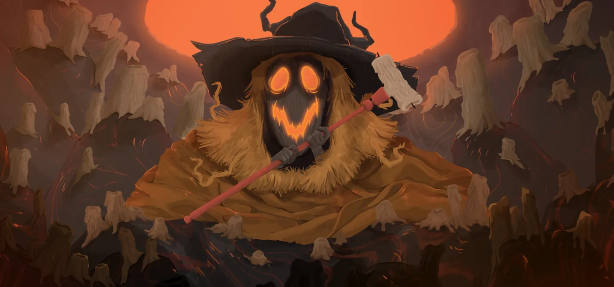
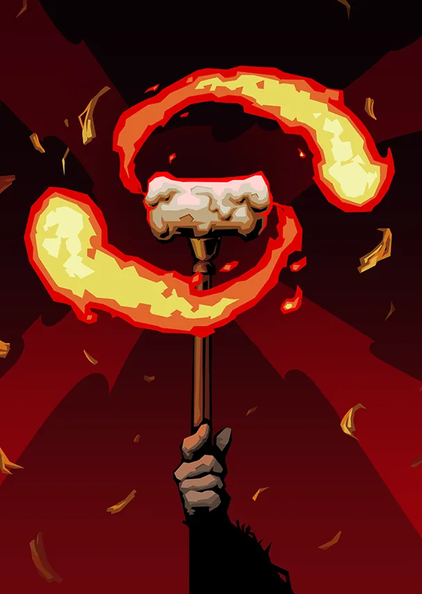
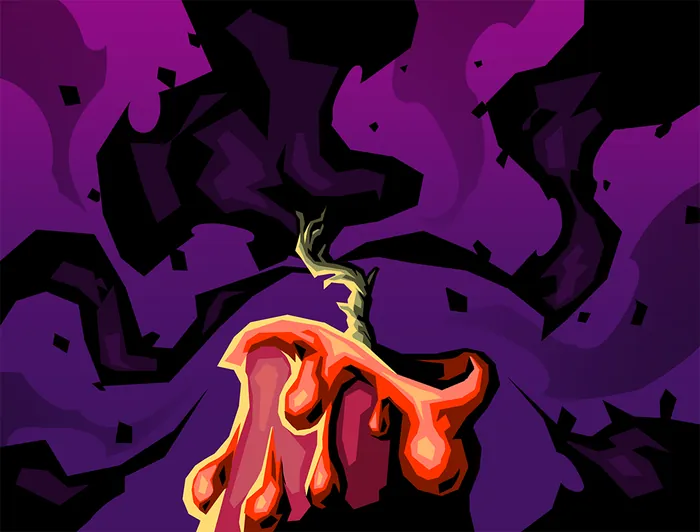

# Tezcatara — Nourricière de la Flamme

> **Patch de Référence :** `v0.111.0 Beta` (Dernier patch officiel)
> **Acte d'apparition :** Acte 2
> **Déblocage (Epoch) :** `None`
> **Thème Visuel / Couleur :** `#33251E`

## 🎨 Portraits & Illustrations

| Icône Ancien | Illustration Principale |
| :---: | :---: |
|  |  |

### 🎮 Intégration Visuelle GBA (Butano)
* **Palette suggérée pour la GBA :** Teinte dominante `#33251E`. À mapper sur une palette 16 couleurs (15 couleurs + transparent) pour le BG de portrait.
* **Dimensions portrait GBA :** 64x64 pixels (mode 4 bpp tilemap) positionné à `(X: 16, Y: 24)` sur l'écran 240x160.
* **Couleur des boutons / encadrements UI :** `rgba(20, 10, 0, 0.75)` converti en code couleur GBA 15-bit BGR555.

## 📜 Rôle & Lore dans l'Ascension

## 🎲 Règles des Slots & Choix

* **Nombre total d'options :** 10 reliques disponibles.
* **Structure des tirages :** 3 slot(s).
  * **Slot #1** : **1** choix parmi **3** reliques présentées.
  * **Slot #2** : **1** choix parmi **3** reliques présentées.
  * **Slot #3** : **1** choix parmi **4** reliques présentées.

## 🏆 Catalogue Complet des Reliques (Classées par Tier)

### ⭐ Tier S (1 relique)

####  Livre d'histoires (`STORYBOOK`)

* **Tier :** `S` | **Rareté :** `Ancient`
* **Description :** Ajoutez 1 **Flamme éclatante** à votre **Deck**.
* **Implémentation GBA C++ :** **Mécanique de Deck :** Ajoute `Flamme éclatante` (BRIGHTEST_FLAME) au deck du joueur lors de la sélection. Nécessite l'enregistrement de l'ID de carte dans `CardPool`.

  **Cartes Dérivées / Associées :**

  *  **Flamme éclatante** (`BRIGHTEST_FLAME`) — *Compétence* (Coût : `0` ⚡)
    * **Effet de base :** Gagnez ⚡2⚡.
Piochez 2 cartes.
Perdez 2 PV Max.
    * **Effet amélioré :** Gagnez ⚡3⚡.
Piochez 3 cartes.
Perdez 2 PV Max.
    * **Amélioration :** `energygain: +1, cards: +1`

### ⭐ Tier A (3 reliques)

####  Délicieux biscuit (`YUMMY_COOKIE`)

* **Tier :** `A` | **Rareté :** `Ancient`
* **Description :** **Améliorez** 4 cartes.
* **Implémentation GBA C++ :** **Effet Passif :** Hook standard dans `RelicManager` avec écouteur d'événement (`ON_COMBAT_START`, `ON_TURN_START`, etc.).

####  Grooos câlin (`BIIIG_HUG`)

* **Tier :** `A` | **Rareté :** `Ancient`
* **Description :** Retirez 4 cartes de votre **Deck**. Lorsque vous mélangez votre **Pioche**, ajoutez une **Suie** à votre **Pioche**.
* **Implémentation GBA C++ :** **Mécanique de Deck :** Ajoute `Suie` (SOOT) au deck du joueur lors de la sélection. Nécessite l'enregistrement de l'ID de carte dans `CardPool`.

  **Cartes Dérivées / Associées :**

  *  **Suie** (`SOOT`) — *Statut* (Coût : `0` ⚡)
    * **Effet de base :** **Injouable**.
    * **Effet amélioré :** **Injouable**.

####  Boussole dorée (`GOLDEN_COMPASS`)

* **Tier :** `A` | **Rareté :** `Ancient`
* **Description :** Remplacez la carte de l'**Acte** 2 par un chemin unique.
* **Implémentation GBA C++ :** **Économie Run :** Incrémente `RunState::gold`. Impact direct sur les boutiques du marchand.

### ⭐ Tier B (2 reliques)

####  Chocolat très chaud (`VERY_HOT_COCOA`)

* **Tier :** `B` | **Rareté :** `Ancient`
* **Description :** Démarrez chaque combat avec ⚡4⚡ supplémentaires.
* **Implémentation GBA C++ :** **Effet Passif :** Hook standard dans `RelicManager` avec écouteur d'événement (`ON_COMBAT_START`, `ON_TURN_START`, etc.).

####  Soupe nourrissante (`NUTRITIOUS_SOUP`)

* **Tier :** `B` | **Rareté :** `Ancient`
* **Description :** **Envoûtez** toutes les **Frappes** dans votre **Deck** avec Braise de Tezcatara.
* **Implémentation GBA C++ :** **Effet de Survie :** Modifie `PlayerEntity::heal()` ou déclenche un soin passif en début/fin de combat.

### ⭐ Tier C (2 reliques)

####  Lanterne-citrouille (`PUMPKIN_CANDLE`)

* **Tier :** `C` | **Rareté :** `Ancient`
* **Description :** Gagnez ⚡1⚡ au début de chaque tour. S'éteint après 5 combats. Peut être **Ravivée** aux **Sites de repos**.
* **Implémentation GBA C++ :** **Effet Passif :** Hook standard dans `RelicManager` avec écouteur d'événement (`ON_COMBAT_START`, `ON_TURN_START`, etc.).

####  Sceau doré (`SEAL_OF_GOLD`)

* **Tier :** `C` | **Rareté :** `Ancient`
* **Description :** Au début de votre tour, dépensez 3 **Pièces d'or** pour gagner ⚡1⚡.
* **Implémentation GBA C++ :** **Économie Run :** Incrémente `RunState::gold`. Impact direct sur les boutiques du marchand.

### ⭐ Tier D (2 reliques)

####  Mitaines réchauffantes (`TOASTY_MITTENS`)

* **Tier :** `D` | **Rareté :** `Ancient`
* **Description :** Au début de votre tour, **Épuisez** 1 carte de votre **Main** et gagnez 1 de **Force**.
* **Implémentation GBA C++ :** **Effet Passif :** Hook standard dans `RelicManager` avec écouteur d'événement (`ON_COMBAT_START`, `ON_TURN_START`, etc.).

####  Caisse à jouets (`TOY_BOX`)

* **Tier :** `D` | **Rareté :** `Ancient`
* **Description :** Obtenez 5 **Reliques de cire**. Tous les 3 combats, la **Relique de cire** le plus à gauche fondra.
* **Implémentation GBA C++ :** **Effet Passif :** Hook standard dans `RelicManager` avec écouteur d'événement (`ON_COMBAT_START`, `ON_TURN_START`, etc.).

## 💬 Dialogues & Répliques

Les dialogues s'affichent dans la boîte de dialogue inférieure (240x40 px) sur la GBA avec défilement fluide au bouton `A` :

### 🗣️ Première Rencontre (Toutes runs confondues)
* 👑 **Ancien** :
> Oh, de la visite ! Entre, ma puce / mon chou, entre !  
> Qu'est-ce que Tezcatara peut faire pour toi ?

### 🗣️ Soldat de Fer (Ironclad)
* 👑 **Ancien** :
> Tu flamboies avec tant d'éclat ! Entre, entre !

* 👑 **Ancien** :
> Tu es un si grand garçon ! Viens donc manger quelque chose.  
> On ne fait pas de massacre le ventre vide !

* 👑 **Ancien** :
> Ohh, l'Architecte est encore en vie ? Tue-le rapidement pour moi.  
> Je t'attends !

### 🗣️ La Silencieuse (Silent)
* 👑 **Ancien** :
> Approche donc, timide fillette. Je ne vois pas très bien...

* 👤 **SILENT** :
> ...

* 👑 **Ancien** :
> Tu peux me faire confiance.

* 👑 **Ancien** :
> Quelle méchante infection. On va prendre soin de toi.

* 👑 **Ancien** :
> Tu sais, j'ai rencontré tes sœurs. Quelles gentilles fillettes.

* 👤 **SILENT** :
> ...

* 👑 **Ancien** :
> Oh... tu as l'air de t'être bagarrée.

### 🗣️ Le Défectueux (Defect)
* 👤 **DEFECT** :
> *<bips de salutations>*

* 👑 **Ancien** :
> Tu n'es pas venu pour m'embêter ? Quel drôle de petit automate...

* 👑 **Ancien** :
> Comme ce serait drôle si c'était l'un des siens qui le menait à sa perte !

* 👑 **Ancien** :
> Tu es sûr que tu veux que je te répare ?

* 👤 **DEFECT** :
> *<bips interrogatifs>*

* 👑 **Ancien** :
> Eh bien, du moment que tu en es vraiment certain.

### 🗣️ Le Régent (Regent)
* 👑 **Ancien** :
> Oh, un visiteur si exotique ! Qui es-tu donc, mon chou ?

* 👤 **REGENT** :
> Je ne suis pas un chou ! Parle-moi avec respect, énorme... chose !

* 👑 **Ancien** :
> Mais où sont mes manières ?  
> *Tezcatara ricane avec joie.*

* 👑 **Ancien** :
> Toi et tes amis êtes déjà de retour ?  
> Je vous ai préparé quelques gâteries !

* 👑 **Ancien** :
> Contente de te revoir, mon garçon royal ! On dirait que les choses se passent formidablement bien pour toi.

* 👤 **REGENT** :
> Oui bien sûr ! Juste quelques petits contretemps aux niveaux supérieurs... comme par exemple mourir.

* 👑 **Ancien** :
> On apprend tous de nos erreurs.

### 🗣️ La Nécrolieuse (Necrobinder)
* 👑 **Ancien** :
> Que fait un squelette à l'intérieur de ces murs ?

* 👤 **NECROBINDER** :
> Mon objectif est simple. La vengeance pour ma famille.  
> J'atteindrai le sommet, et je le ferai payer.

* 👑 **Ancien** :
> Merveilleux !

* 👑 **Ancien** :
> Entre, entre ! Faisons flamber tes flammes.

* 👑 **Ancien** :
> Cette flamme autour de toi me fait penser à une chose interdite.

* 👤 **NECROBINDER** :
> Que savez-vous ?

* 👑 **Ancien** :
> Je sais qui a écrit ce tome.

### 🗣️ Générique (Tout Personnage)
* 👑 **Ancien** :
> De retour, ma petite / mon petit ? Ma flamme te purifiera de tes défauts.

* 👑 **Ancien** :
> Entre donc, ma puce / mon chou. Que peut Tezcatara pour toi aujourd'hui ?

---
⬅️ [Retour au Sommaire de la Bible](README.md) | ⚙️ [Spécifications Techniques GBA](spec_technique_gba.md)