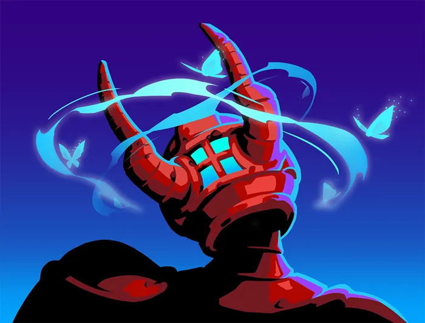

# Nonupeipée — Incarnation de la Fortune

> **Patch de Référence :** `v0.111.0 Beta` (Dernier patch officiel)
> **Acte d'apparition :** Acte 3
> **Déblocage (Epoch) :** `None`
> **Thème Visuel / Couleur :** `#0A494D`

## 🎨 Portraits & Illustrations

| Icône Ancien | Illustration Principale |
| :---: | :---: |
|  |  |

### 🎮 Intégration Visuelle GBA (Butano)
* **Palette suggérée pour la GBA :** Teinte dominante `#0A494D`. À mapper sur une palette 16 couleurs (15 couleurs + transparent) pour le BG de portrait.
* **Dimensions portrait GBA :** 64x64 pixels (mode 4 bpp tilemap) positionné à `(X: 16, Y: 24)` sur l'écran 240x160.
* **Couleur des boutons / encadrements UI :** `rgba(0, 26, 41, 0.75)` converti en code couleur GBA 15-bit BGR555.

## 📜 Rôle & Lore dans l'Ascension

## 🎲 Règles des Slots & Choix

* **Nombre total d'options :** 10 reliques disponibles.
* **Structure des tirages :** 1 slot(s).
  * **Slot #1** : **3** choix parmi **10** reliques présentées.

## 🏆 Catalogue Complet des Reliques (Classées par Tier)

### ⭐ Tier S (1 relique)

####  Diadème de diamant (`DIAMOND_DIADEM`)

* **Tier :** `S` | **Rareté :** `Ancient`
* **Description :** Démarrez chaque combat avec 20 d'**Armure**. Vous ne perdez pas votre **Armure** au début de votre 2ème tour.
* **Implémentation GBA C++ :** **Économie Run :** Incrémente `RunState::gold`. Impact direct sur les boutiques du marchand.

### ⭐ Tier A (3 reliques)

####  Fougère délicate (`DELICATE_FROND`)

* **Tier :** `A` | **Rareté :** `Ancient`
* **Description :** Au début de chaque combat, remplissez vos emplacements de potion vides avec des **Potions** aléatoires.
* **Implémentation GBA C++ :** **Effet Passif :** Hook standard dans `RelicManager` avec écouteur d'événement (`ON_COMBAT_START`, `ON_TURN_START`, etc.).

####  Coffre à bijoux (`JEWELRY_BOX`)

* **Tier :** `A` | **Rareté :** `Ancient`
* **Description :** Ajoutez 1 **Apothéose** à votre **Deck**.
* **Implémentation GBA C++ :** **Mécanique de Deck :** Ajoute `Apothéose` (APOTHEOSIS) au deck du joueur lors de la sélection. Nécessite l'enregistrement de l'ID de carte dans `CardPool`.

  **Cartes Dérivées / Associées :**

  *  **Apothéose** (`APOTHEOSIS`) — *Compétence* (Coût : `2` ⚡)
    * **Effet de base :** **Inné**.
**Améliorez** TOUTES vos cartes.
**Épuisement**.
    * **Effet amélioré :** **Inné**.
**Améliorez** TOUTES vos cartes.
**Épuisement**.
    * **Amélioration :** `energy: -1`

####  Anneau à signet (`SIGNET_RING`)

* **Tier :** `A` | **Rareté :** `Ancient`
* **Description :** Lorsque vous obtenez cette relique, obtenez 888 **Pièces d'or**.
* **Implémentation GBA C++ :** **Effet Passif :** Hook standard dans `RelicManager` avec écouteur d'événement (`ON_COMBAT_START`, `ON_TURN_START`, etc.).

### ⭐ Tier B (3 reliques)

####  Bois bénis (`BLESSED_ANTLER`)

* **Tier :** `B` | **Rareté :** `Ancient`
* **Description :** Gagnez ⚡1⚡ au début de chaque tour. Au début de chaque combat, ajoutez 3 **Hébété** à votre **Pioche**.
* **Implémentation GBA C++ :** **Mécanique de Deck :** Ajoute `Hébété` (DAZED) au deck du joueur lors de la sélection. Nécessite l'enregistrement de l'ID de carte dans `CardPool`.

  **Cartes Dérivées / Associées :**

  *  **Hébété** (`DAZED`) — *Statut* (Coût : `0` ⚡)
    * **Effet de base :** **Injouable**.
**Éthéré**.
    * **Effet amélioré :** **Injouable**.
**Éthéré**.

####  Écharpe étincelante (`BRILLIANT_SCARF`)

* **Tier :** `B` | **Rareté :** `Ancient`
* **Description :** La 5ème carte jouée depuis votre main chaque tour peut être jouée sans coût.
* **Implémentation GBA C++ :** **Effet Passif :** Hook standard dans `RelicManager` avec écouteur d'événement (`ON_COMBAT_START`, `ON_TURN_START`, etc.).

####  Bracelet brillant (`BEAUTIFUL_BRACELET`)

* **Tier :** `B` | **Rareté :** `Ancient`
* **Description :** Choisissez 4 cartes dans votre **Deck**. **Envoûtez**-les avec Célérité 2.
* **Implémentation GBA C++ :** **Effet Passif :** Hook standard dans `RelicManager` avec écouteur d'événement (`ON_COMBAT_START`, `ON_TURN_START`, etc.).

### ⭐ Tier C (2 reliques)

####  Paillettes (`GLITTER`)

* **Tier :** `C` | **Rareté :** `Ancient`
* **Description :** **Envoûtez** toutes les récompenses de carte avec Glamour.
* **Implémentation GBA C++ :** **Effet Passif :** Hook standard dans `RelicManager` avec écouteur d'événement (`ON_COMBAT_START`, `ON_TURN_START`, etc.).

####  Fruits exotiques (`LOOMING_FRUIT`)

* **Tier :** `C` | **Rareté :** `Ancient`
* **Description :** Augmentez vos PV Max de 31.
* **Implémentation GBA C++ :** **Effet Passif :** Hook standard dans `RelicManager` avec écouteur d'événement (`ON_COMBAT_START`, `ON_TURN_START`, etc.).

### ⭐ Tier D (1 relique)

####  Manteau de fourrure (`FUR_COAT`)

* **Tier :** `D` | **Rareté :** `Ancient`
* **Description :** Marquez 8 combats aléatoires sur la Carte. Les ennemis dans ces salles ont 1 PV.
* **Implémentation GBA C++ :** **Effet Passif :** Hook standard dans `RelicManager` avec écouteur d'événement (`ON_COMBAT_START`, `ON_TURN_START`, etc.).

## 💬 Dialogues & Répliques

Les dialogues s'affichent dans la boîte de dialogue inférieure (240x40 px) sur la GBA avec défilement fluide au bouton `A` :

### 🗣️ Première Rencontre (Toutes runs confondues)
* 👑 **Ancien** :
> Cela fait un millénaire que je n'ai pas eu de visite !  
> Vous m'avez l'air bien terne, venez, trouvons-vous quelque chose d'élégant à porter.

### 🗣️ Soldat de Fer (Ironclad)
* 👑 **Ancien** :
> Ah, le Soldat de Fer se présente enfin à moi.  
> Approchez, et je vous octroierai mon pouvoir.

* 👑 **Ancien** :
> Soldat de Fer... la faveur dont je vous ai béni n'a-t-elle pas suffi ?

* 👑 **Ancien** :
> Vous êtes de retour, mon champion ? Combien de fois encore ?  
> N'étiez-vous pourtant pas suffisamment puissant pour anéantir des clans entiers, autrefois ?

### 🗣️ La Silencieuse (Silent)
* 👑 **Ancien** :
> Une petite larronnesse s'est glissée dans mon domaine ?  
> Ne croyez pas que je ne vous ai pas vue. Sortez donc !

* 👤 **SILENT** :
> *La Silencieuse sort de l'obscurité...*

* 👑 **Ancien** :
> Une chasseresse... Qu'est-ce qui vous pousse à revenir dans la Tour ?  
> Approchez, enfilez donc ma bénédiction.

* 👑 **Ancien** :
> Je vous ai préparé des cadeaux, petite assassine, ne soyez pas timide.

* 👑 **Ancien** :
> De toutes ses marionnettes, c'est vous qui m'intriguez le plus.

* 👤 **SILENT** :
> ...

* 👑 **Ancien** :
> Qu'est-ce qui a mis fin à votre première vie ? C'est Neow qui vous a trouvée ?  
> Bien dommage que vous ne parliez pas.

### 🗣️ Le Défectueux (Defect)
* 👑 **Ancien** :
> Un simple assemblage peut-il réellement être digne de ma bénédiction ?  
> Avance, Défectueux. De tous les automates, tu seras le plus ravissant.

* 👑 **Ancien** :
> Pauvre machine, tout usée. Laisse-moi te requinquer.

* 👑 **Ancien** :
> D'habitude, je n'aime pas les affaires de l'Architecte. Mais j'avoue que tu commences à me plaire.

* 👤 **DEFECT** :
> *<bip d'embarras>*

### 🗣️ Le Régent (Regent)
* 👤 **REGENT** :
> Je demande une audience avec Nonupeipée !

* 👑 **Ancien** :
> Que de beaux accoutrements de contrées si lointaines !  
> Laissez approcher vos sbires, et je vous donnerai ma bénédiction.

* 👑 **Ancien** :
> Une bénédiction royale pour un visiteur royal.  
> Serviteurs ! Apportez-nous le thé.

* 👑 **Ancien** :
> L'Architecte a perdu la tête ! Si seulement un noble champion pouvait venir à notre secours...

* 👤 **REGENT** :
> N'ayez crainte ! Moi, le Régent, je mettrai fin à cette tyrannie !  
> Mais d'abord, le thé !

### 🗣️ La Nécrolieuse (Necrobinder)
* 👤 **NECROBINDER** :
> Je suis venue à bout de vos gardiens. Les rumeurs disent que vous octroyez des bénédictions à ceux qui veulent la mort de l'Architecte.

* 👑 **Ancien** :
> Je suis sensible à vos capacités, et vous offre une partie de mon pouvoir.  
> La prochaine fois, laissez mes gardiens tranquilles.

* 👑 **Ancien** :
> Une magicienne a besoin d'accoutrements de qualité pour combattre. Approchez, Tisse-Mage.

* 👑 **Ancien** :
> L'Architecte sera bien contrarié de voir ce petit à vos côtés.

* 👤 **NECROBINDER** :
> Titos ? C'est lui qui livrera le coup de grâce.

### 🗣️ Générique (Tout Personnage)
* 👑 **Ancien** :
> La fureur t' / vous attend au sommet. Vêts-toi / Vêtissez-vous de ma puissance et sors-en / sortez-en victorieuse / x.

* 👑 **Ancien** :
> Tu as / Vous avez fait tant de chemin pour venir me voir !  
> Approche / Approchez donc, et reçois / recevez ma bénédiction.

---
⬅️ [Retour au Sommaire de la Bible](README.md) | ⚙️ [Spécifications Techniques GBA](spec_technique_gba.md)