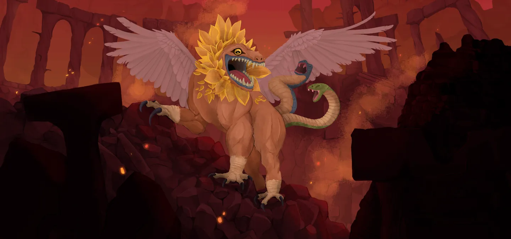
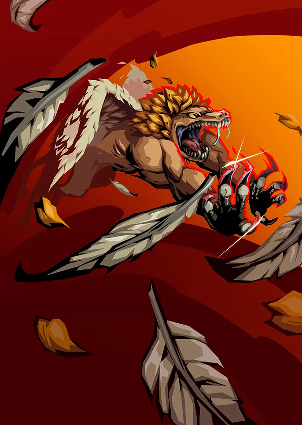
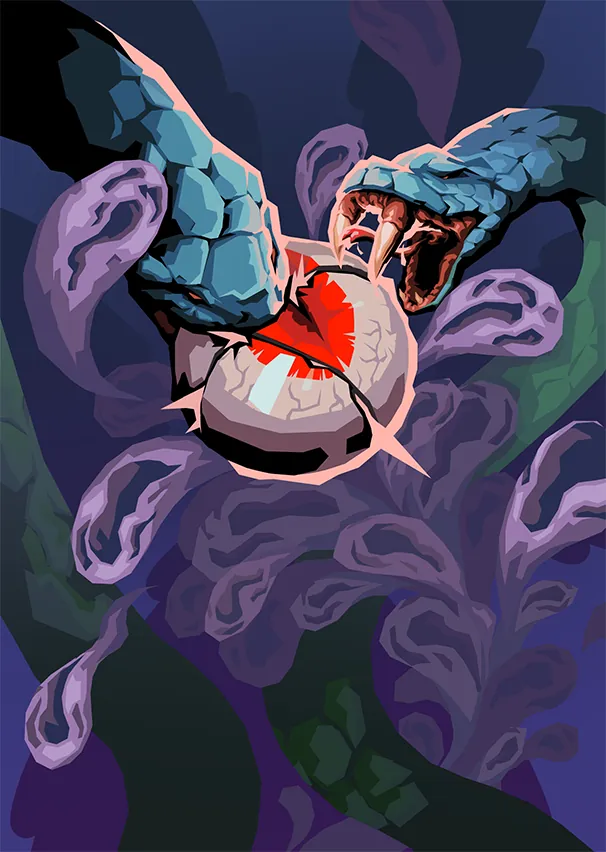

# Tanx — Roi Chimère

> **Patch de Référence :** `v0.111.0 Beta` (Dernier patch officiel)
> **Acte d'apparition :** Acte 3
> **Déblocage (Epoch) :** `None`
> **Thème Visuel / Couleur :** `#731717`

## 🎨 Portraits & Illustrations

| Icône Ancien | Illustration Principale |
| :---: | :---: |
|  |  |

### 🎮 Intégration Visuelle GBA (Butano)
* **Palette suggérée pour la GBA :** Teinte dominante `#731717`. À mapper sur une palette 16 couleurs (15 couleurs + transparent) pour le BG de portrait.
* **Dimensions portrait GBA :** 64x64 pixels (mode 4 bpp tilemap) positionné à `(X: 16, Y: 24)` sur l'écran 240x160.
* **Couleur des boutons / encadrements UI :** `rgba(13, 5, 0, 0.5)` converti en code couleur GBA 15-bit BGR555.

## 📜 Rôle & Lore dans l'Ascension

## 🎲 Règles des Slots & Choix

* **Nombre total d'options :** 10 reliques disponibles.
* **Structure des tirages :** 1 slot(s).
  * **Slot #1** : **3** choix parmi **10** reliques présentées.

## 🏆 Catalogue Complet des Reliques (Classées par Tier)

### ⭐ Tier S (2 reliques)

####  Couperet à viande (`MEAT_CLEAVER`)

* **Tier :** `S` | **Rareté :** `Ancient`
* **Description :** Vous pouvez **Cuisiner** aux Sites de Repos.
* **Implémentation GBA C++ :** **Effet Majeur Prioritaire :** À implémenter en priorité dans le prototype MVP en raison de son fort impact stratégique.

####  Saï (`SAI`)

* **Tier :** `S` | **Rareté :** `Ancient`
* **Description :** Au début de votre tour, gagnez 7 d'**Armure**.
* **Implémentation GBA C++ :** **Effet Majeur Prioritaire :** À implémenter en priorité dans le prototype MVP en raison de son fort impact stratégique.

### ⭐ Tier A (4 reliques)

####  Gourdin de fer (`IRON_CLUB`)

* **Tier :** `A` | **Rareté :** `Ancient`
* **Description :** Toutes les 4 cartes jouées, vous piochez 1 carte.
* **Implémentation GBA C++ :** **Effet Passif :** Hook standard dans `RelicManager` avec écouteur d'événement (`ON_COMBAT_START`, `ON_TURN_START`, etc.).

####  Sifflet de Tanx (`TANXS_WHISTLE`)

* **Tier :** `A` | **Rareté :** `Ancient`
* **Description :** Ajoutez 1 **Sifflet** à votre **Deck**.
* **Implémentation GBA C++ :** **Mécanique de Deck :** Ajoute `Sifflet` (WHISTLE) au deck du joueur lors de la sélection. Nécessite l'enregistrement de l'ID de carte dans `CardPool`.

  **Cartes Dérivées / Associées :**

  *  **Sifflet** (`WHISTLE`) — *Attaque* (Coût : `2` ⚡)
    * **Effet de base :** Infligez 33 dégâts.
**Étourdissez** l'ennemi.
**Épuisement**.
    * **Effet amélioré :** Infligez 44 dégâts.
**Étourdissez** l'ennemi.
**Épuisement**.
    * **Amélioration :** `damage: +11`

####  Hache de lancer (`THROWING_AXE`)

* **Tier :** `A` | **Rareté :** `Ancient`
* **Description :** La première carte que vous jouez chaque combat est jouée une fois de plus.
* **Implémentation GBA C++ :** **Effet Passif :** Hook standard dans `RelicManager` avec écouteur d'événement (`ON_COMBAT_START`, `ON_TURN_START`, etc.).

####  Tri-boomerang (`TRI_BOOMERANG`)

* **Tier :** `A` | **Rareté :** `Ancient`
* **Description :** Choisissez 3 Attaques de votre **Deck**. **Envoûtez**-les avec Instinct.
* **Implémentation GBA C++ :** **Effet Passif :** Hook standard dans `RelicManager` avec écouteur d'événement (`ON_COMBAT_START`, `ON_TURN_START`, etc.).

### ⭐ Tier B (1 relique)

####  Griffes (`CLAWS`)

* **Tier :** `B` | **Rareté :** `Ancient`
* **Description :** **Transformez** jusqu'à 6 cartes en **Mutilation**.
* **Implémentation GBA C++ :** **Mécanique de Deck :** Ajoute `Mutilation` (MAUL) au deck du joueur lors de la sélection. Nécessite l'enregistrement de l'ID de carte dans `CardPool`.

  **Cartes Dérivées / Associées :**

  *  **Mutilation** (`MAUL`) — *Attaque* (Coût : `1` ⚡)
    * **Effet de base :** Infligez 5 dégâts 2 fois.
Augmentez les dégâts de TOUTES les cartes Mutilation de 2 jusqu'à la fin du combat.
    * **Effet amélioré :** Infligez 6 dégâts 2 fois.
Augmentez les dégâts de TOUTES les cartes Mutilation de 3 jusqu'à la fin du combat.
    * **Amélioration :** `damage: +1, increase: +1`

### ⭐ Tier C (1 relique)

####  Arbalète (`CROSSBOW`)

* **Tier :** `C` | **Rareté :** `Ancient`
* **Description :** Au début de votre tour, ajoutez une **Attaque** aléatoire à votre **Main**. Elle coûte 0 ce tour.
* **Implémentation GBA C++ :** **Effet Passif :** Hook standard dans `RelicManager` avec écouteur d'événement (`ON_COMBAT_START`, `ON_TURN_START`, etc.).

### ⭐ Tier D (2 reliques)

####  Gantelets à pointes (`SPIKED_GAUNTLETS`)

* **Tier :** `D` | **Rareté :** `Ancient`
* **Description :** Gagnez ⚡1⚡ au début de chaque tour. Les Pouvoirs coûtent 1 ⚡ supplémentaire.
* **Implémentation GBA C++ :** **Effet Passif :** Hook standard dans `RelicManager` avec écouteur d'événement (`ON_COMBAT_START`, `ON_TURN_START`, etc.).

####  Marteau de guerre (`WAR_HAMMER`)

* **Tier :** `D` | **Rareté :** `Ancient`
* **Description :** Lorsque vous tuez un **Élite**, **Améliorez** 4 cartes aléatoires.
* **Implémentation GBA C++ :** **Effet Passif :** Hook standard dans `RelicManager` avec écouteur d'événement (`ON_COMBAT_START`, `ON_TURN_START`, etc.).

## 💬 Dialogues & Répliques

Les dialogues s'affichent dans la boîte de dialogue inférieure (240x40 px) sur la GBA avec défilement fluide au bouton `A` :

### 🗣️ Première Rencontre (Toutes runs confondues)
* 👑 **Ancien** :
> SI FAIBLE ! MAIS TANT DE POTENTIEL !  
> PRENDS CETTE ARME !!

### 🗣️ Soldat de Fer (Ironclad)
* 👑 **Ancien** :
> QUELLE IMPRESSIONNANTE ÉPÉE, GUERRIER ! TU FERAIS BON USAGE DE PLUS D'ARMES ENCORE !

* 👑 **Ancien** :
> DES ARMES POUR LE GUERRIER ! CHOISIS TON ARME ! ET AU COMBAT !

* 👑 **Ancien** :
> AU COMBAT, SOLDAT DE FER !!

* 👤 **IRONCLAD** :
> *Le Soldat de Fer affronte Tanx.*

* 👑 **Ancien** :
> OUIII !! UN GLORIEUX COMBAT, EMPORTE DONC UNE ARME AVEC TOI !

### 🗣️ La Silencieuse (Silent)
* 👑 **Ancien** :
> UNE CHASSERESSE ! JE VAIS AIGUISER TES GRIFFES !!

* 👑 **Ancien** :
> POURQUOI DES COUTEAUX !! SI PEU PUISSANT !

* 👑 **Ancien** :
> TU ES SI PETITE ! JE VAIS TE MUSCLER !

* 👤 **SILENT** :
> *La Silencieuse s'échappe furtivement, emportant avec elle une arme.*

* 👑 **Ancien** :
> OÙ ES-TU PASSÉE !!!

### 🗣️ Le Défectueux (Defect)
* 👑 **Ancien** :
> PUISSANT ASSEMBLAGE ! JE VAIS TE RENDRE ENCORE PLUS PUISSANT !

* 👑 **Ancien** :
> TES ORBES NE SONT PAS DE VRAIES ARMES !!

* 👑 **Ancien** :
> AU COMBAT, DÉFECTUEUX !!

* 👤 **DEFECT** :
> *Le Défectueux combat avec vaillance.*

* 👑 **Ancien** :
> TES ORBES SONT DES ARMES !?

### 🗣️ Le Régent (Regent)
* 👑 **Ancien** :
> ORANGE !? COMMENT UN ÊTRE VIVANT PEUT-IL ÊTRE ORANGE !??

* 👤 **REGENT** :
> Tout le monde sait que l'orange est la couleur royale par excellence !

* 👑 **Ancien** :
> INCROYABLE ! SI PUISSANT !!

* 👑 **Ancien** :
> ÊTRE ORANGE !! CHOISIS TON ARME !

* 👑 **Ancien** :
> AU COMBAT, RÉGENT!!

* 👤 **REGENT** :
> Non ! Nous avons combattu la dernière fois que j'étais ici !

* 👑 **Ancien** :
> ENCORE UN COMBAT !!

### 🗣️ La Nécrolieuse (Necrobinder)
* 👑 **Ancien** :
> QUELLE FAUX IMPRESSIONNANTE !

* 👤 **NECROBINDER** :
> Oui, spécialement fabriquée dans un but de vengeance.

* 👑 **Ancien** :
> LA MAIN DÉSIRE-T-ELLE UNE ARME !?

* 👑 **Ancien** :
> AU COMBAT, TITOS !!

* 👑 **Ancien** :
> AU COMBAT, TISSE-MORT !!

* 👤 **NECROBINDER** :
> *La Tisse-Mort et Titos se bagarrent avec Tanx.*

* 👑 **Ancien** :
> QUEL FORMIDABLE TRAVAIL D'ÉQUIPE !! EMPORTEZ DONC UNE ARME !

### 🗣️ Générique (Tout Personnage)
* 👑 **Ancien** :
> ENTRAÎNE-TOI POUR QU'ON PUISSE SE BATTRE !!!

* 👑 **Ancien** :
> ENTRAÎNE-TOI POUR QUE NOUS PUISSIONS NOUS BATTRE !!!

---
⬅️ [Retour au Sommaire de la Bible](README.md) | ⚙️ [Spécifications Techniques GBA](spec_technique_gba.md)