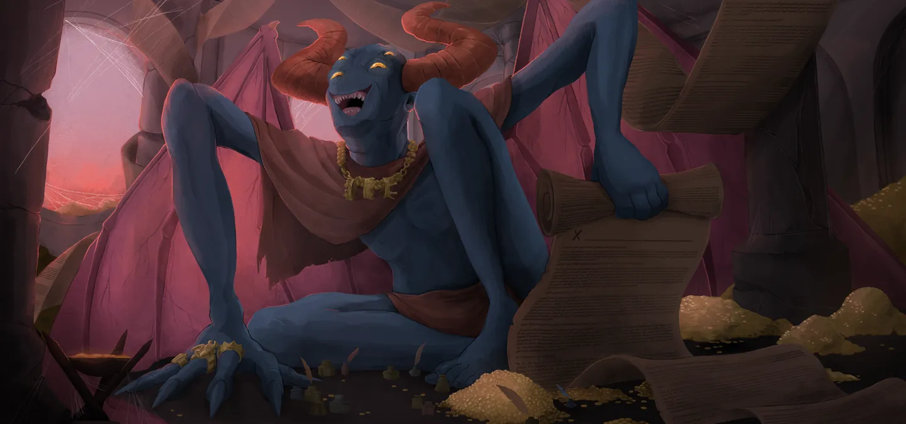
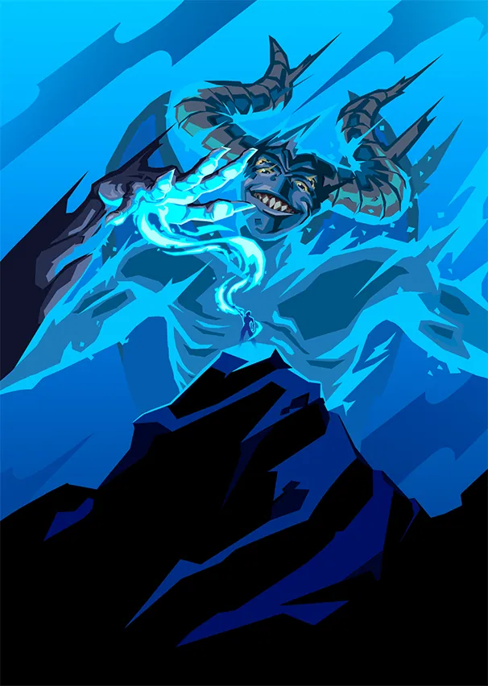
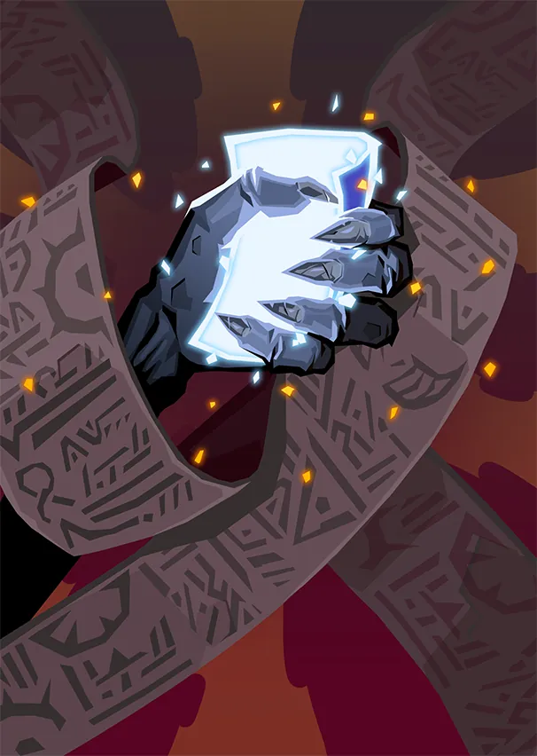

# Vakuu — Le Premier Démon

> **Patch de Référence :** `v0.111.0 Beta` (Dernier patch officiel)
> **Acte d'apparition :** Acte 3
> **Déblocage (Epoch) :** `None`
> **Thème Visuel / Couleur :** `#3C1931`

## 🎨 Portraits & Illustrations

| Icône Ancien | Illustration Principale |
| :---: | :---: |
|  |  |

### 🎮 Intégration Visuelle GBA (Butano)
* **Palette suggérée pour la GBA :** Teinte dominante `#3C1931`. À mapper sur une palette 16 couleurs (15 couleurs + transparent) pour le BG de portrait.
* **Dimensions portrait GBA :** 64x64 pixels (mode 4 bpp tilemap) positionné à `(X: 16, Y: 24)` sur l'écran 240x160.
* **Couleur des boutons / encadrements UI :** `rgba(13, 15, 31, 0.8)` converti en code couleur GBA 15-bit BGR555.

## 📜 Rôle & Lore dans l'Ascension

## 🎲 Règles des Slots & Choix

* **Nombre total d'options :** 10 reliques disponibles.
* **Structure des tirages :** 3 slot(s).
  * **Slot #1** : **1** choix parmi **3** reliques présentées.
  * **Slot #2** : **1** choix parmi **3** reliques présentées.
  * **Slot #3** : **1** choix parmi **4** reliques présentées.

## 🏆 Catalogue Complet des Reliques (Classées par Tier)

### ⭐ Tier S (2 reliques)

####  Cape distinguée (`DISTINGUISHED_CAPE`)

* **Tier :** `S` | **Rareté :** `Ancient`
* **Description :** Ajoutez 2 Malédictions aléatoires et 3 **Apparitions** à votre **Deck**.
* **Implémentation GBA C++ :** **Mécanique de Deck :** Ajoute `Apparition` (APPARITION) au deck du joueur lors de la sélection. Nécessite l'enregistrement de l'ID de carte dans `CardPool`.

  **Cartes Dérivées / Associées :**

  *  **Apparition** (`APPARITION`) — *Compétence* (Coût : `1` ⚡)
    * **Effet de base :** **Éthéré**.
Gagnez **Intangible** (1).
**Épuisement**.
    * **Effet amélioré :** Gagnez **Intangible** (1).
**Épuisement**.
    * **Amélioration :** `keywordsRemoved: ['Ethereal']`

####  Masque serti (`JEWELED_MASK`)

* **Tier :** `S` | **Rareté :** `Ancient`
* **Description :** Au début de chaque combat, placez un Pouvoir aléatoire de votre **Pioche** dans votre **Main**. Il coûte 0 ce combat.
* **Implémentation GBA C++ :** **Effet Majeur Prioritaire :** À implémenter en priorité dans le prototype MVP en raison de son fort impact stratégique.

### ⭐ Tier A (3 reliques)

####  Boucle d'oreille susurrante (`WHISPERING_EARRING`)

* **Tier :** `A` | **Rareté :** `Ancient`
* **Description :** Gagnez ⚡1⚡ au début de chaque tour. Vakuu joue votre premier tour à votre place.
* **Implémentation GBA C++ :** **Effet Passif :** Hook standard dans `RelicManager` avec écouteur d'événement (`ON_COMBAT_START`, `ON_TURN_START`, etc.).

####  Brouillard en conserve (`PRESERVED_FOG`)

* **Tier :** `A` | **Rareté :** `Ancient`
* **Description :** Retirez 3 cartes de votre **Deck**. Ajoutez Hubris à votre Deck.
* **Implémentation GBA C++ :** **Effet Passif :** Hook standard dans `RelicManager` avec écouteur d'événement (`ON_COMBAT_START`, `ON_TURN_START`, etc.).

####  Embarras du choix (`CHOICES_PARADOX`)

* **Tier :** `A` | **Rareté :** `Ancient`
* **Description :** Au début de chaque combat, ajoutez 1 carte parmi 5 cartes aléatoires à votre **Main**. Ajoutez **Retenue** à la carte choisie.
* **Implémentation GBA C++ :** **Effet Passif :** Hook standard dans `RelicManager` avec écouteur d'événement (`ON_COMBAT_START`, `ON_TURN_START`, etc.).

### ⭐ Tier B (2 reliques)

####  Serre desséchée (`SERE_TALON`)

* **Tier :** `B` | **Rareté :** `Ancient`
* **Description :** Perdez 9 PV Max. Ajoutez 3 Vœux à votre **Deck**.
* **Implémentation GBA C++ :** **Mécanique de Deck :** Ajoute `Vœu` (WISH) au deck du joueur lors de la sélection. Nécessite l'enregistrement de l'ID de carte dans `CardPool`.

  **Cartes Dérivées / Associées :**

  *  **Vœu** (`WISH`) — *Compétence* (Coût : `0` ⚡)
    * **Effet de base :** Placez une carte de votre **Pioche** dans votre **Main**.
**Épuisement**.
    * **Effet amélioré :** **Retenue**.
Placez une carte de votre **Pioche** dans votre **Main**.
**Épuisement**.
    * **Amélioration :** `keywords: ['Retain']`

####  Boîte à musique (`MUSIC_BOX`)

* **Tier :** `B` | **Rareté :** `Ancient`
* **Description :** Vous créez une copie **Éthérée** de la première Attaque que vous jouez chaque tour.
* **Implémentation GBA C++ :** **Effet Passif :** Hook standard dans `RelicManager` avec écouteur d'événement (`ON_COMBAT_START`, `ON_TURN_START`, etc.).

### ⭐ Tier C (1 relique)

####  Rose sanguinolente (`BLOOD_SOAKED_ROSE`)

* **Tier :** `C` | **Rareté :** `Ancient`
* **Description :** Ajoutez 1 Assuétude à votre **Deck**. Gagnez ⚡1⚡ au début de chaque tour.
* **Implémentation GBA C++ :** **Effet Passif :** Hook standard dans `RelicManager` avec écouteur d'événement (`ON_COMBAT_START`, `ON_TURN_START`, etc.).

### ⭐ Tier D (2 reliques)

####  Violon (`FIDDLE`)

* **Tier :** `D` | **Rareté :** `Ancient`
* **Description :** Au début de chaque tour, piochez 2 cartes supplémentaires. Vous ne pouvez plus piocher de cartes pendant votre tour.
* **Implémentation GBA C++ :** **Effet Passif :** Hook standard dans `RelicManager` avec écouteur d'événement (`ON_COMBAT_START`, `ON_TURN_START`, etc.).

####  Parasol seigneurial (`LORDS_PARASOL`)

* **Tier :** `D` | **Rareté :** `Ancient`
* **Description :** Lorsque vous passez chez le **Marchand**, vous obtenez immédiatement TOUT ce qu'il propose.
* **Implémentation GBA C++ :** **Effet Passif :** Hook standard dans `RelicManager` avec écouteur d'événement (`ON_COMBAT_START`, `ON_TURN_START`, etc.).

## 💬 Dialogues & Répliques

Les dialogues s'affichent dans la boîte de dialogue inférieure (240x40 px) sur la GBA avec défilement fluide au bouton `A` :

### 🗣️ Première Rencontre (Toutes runs confondues)
* 👑 **Ancien** :
> Offre-moi ton âme, et tous te craindront comme ils me craignent...

### 🗣️ Soldat de Fer (Ironclad)
* 👑 **Ancien** :
> Après si longtemps, nous nous retrouvons...

* 👤 **IRONCLAD** :
> DÉMON SACRÉ !  
> Que m'as-tu fait !?

* 👑 **Ancien** :
> Ni plus ni moins que le marché que nous avons conclu.

* 👑 **Ancien** :
> Les clans que tu as anéantis pèsent-ils sur ton âme...?  
> *Vakuu rit aux éclats.*

* 👑 **Ancien** :
> Ma plus grande marionnette... pourquoi n'as-tu pas encore tué l'Architecte ?

* 👤 **IRONCLAD** :
> Après avoir tué l'Architecte, c'est TOI que je tuerai !

* 👑 **Ancien** :
> *Baîllement*  
> J'ai hâte de te regarder échouer.

### 🗣️ La Silencieuse (Silent)
* 👑 **Ancien** :
> Meurtrière.

* 👤 **SILENT** :
> ...

* 👑 **Ancien** :
> Ça finira mal pour toi.

* 👑 **Ancien** :
> *Vakuu montre à la Silencieuse son étalage de contrats.*

* 👑 **Ancien** :
> L'Architecte ne suffira pas, tu dois tuer tes sœurs également !

* 👤 **SILENT** :
> ...

* 👑 **Ancien** :
> Pas besoin des mots. Nous sommes pareils, toi et moi.

### 🗣️ Le Défectueux (Defect)
* 👑 **Ancien** :
> Petit être brisé, laisse-moi te parfaire.

* 👑 **Ancien** :
> Ne trouves-tu pas étrange que tes camarades les assemblages veuillent ta perte ?

* 👑 **Ancien** :
> Apporte-moi le cœur de l'Architecte, et je rétablirai ton compagnon.

* 👤 **DEFECT** :
> *<bips craintifs>*

* 👑 **Ancien** :
> Qui est plus important ? Ton créateur, ou ton ami ?

### 🗣️ Le Régent (Regent)
* 👑 **Ancien** :
> Un habitant des étoiles ? À l'intérieur de ces murs maudits ?

* 👤 **REGENT** :
> Vous avez entendu parler de moi ?

* 👑 **Ancien** :
> Oui, je crois que nous pouvons nous aider mutuellement.

* 👑 **Ancien** :
> Je peux t'octroyer encore plus de pouvoir, en échange de quelque prix.

* 👤 **REGENT** :
> Je ne sais pas si c'était une bonne affaire. Je ne me sens pas très bien...

* 👑 **Ancien** :
> Tu as bien lu les contrats, pourtant ?  
> Tu les as bien signés, volontairement, et en toute connaissance de cause ?

* 👑 **Ancien** :
> Ne tiendras-tu alors pas ta part de notre accord ?  
> Un autre contrat sinon ? Oui, ça va mieux maintenant, n'est-ce pas ?

### 🗣️ La Nécrolieuse (Necrobinder)
* 👑 **Ancien** :
> Nous sommes tous deux en quête de vengeance. Mais il faudra en payer le prix.

* 👤 **NECROBINDER** :
> J'en paierai le prix. N'importe quel prix pour sa mort.

* 👑 **Ancien** :
> Je sais où vous avez eu cette Main.

* 👑 **Ancien** :
> L'Architecte nous a grièvement lésés, tous deux.

* 👤 **NECROBINDER** :
> Allons-y, démon. Montrez-moi les contrats que nous pouvons conclure.

* 👑 **Ancien** :
> Tu ne perds pas de temps. Très bien...

### 🗣️ Générique (Tout Personnage)
* 👑 **Ancien** :
> Comme ça, tu cherches à atteindre la gloire ? J'ai quelques propositions pour toi...

* 👑 **Ancien** :
> {Visits}. {Visits} fois que tu passes ici.

* 👑 **Ancien** :
> Tu as bien compris que ça ne finira jamais ?

---
⬅️ [Retour au Sommaire de la Bible](README.md) | ⚙️ [Spécifications Techniques GBA](spec_technique_gba.md)