# 🃏 Cartes — Soldat de Fer (Ironclad)

> **Total :** 90 cartes | **Patch :** `v0.111.0 Beta`  
> Cartes rouges axées sur la force brute, les attaques lourdes, le blocage et les synergies de sacrifice de PV.

---

## ⭐ Rareté : Basic (3 cartes)

### 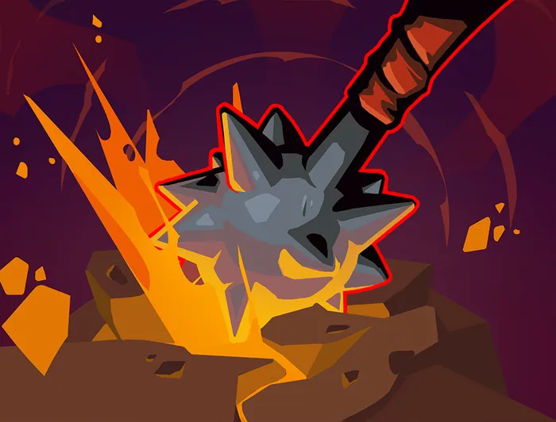 Heurt (`BASH`)
* **Type :** *Attack* | **Coût :** `2` ⚡ | **Rareté :** `Basic`
* **Effet Normal :** Infligez 8 dégâts.
Appliquez **Vulnérable** (2).
* **Effet Amélioré :** Infligez 10 dégâts.
Appliquez **Vulnérable** (3).
* **Amélioration :** `damage: +2, vulnerable: +1`

### 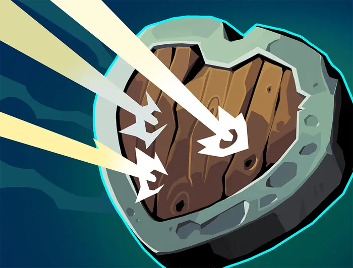 Défense (`DEFEND_IRONCLAD`)
* **Type :** *Skill* | **Coût :** `1` ⚡ | **Rareté :** `Basic`
* **Effet Normal :** Gagnez 5 d'**Armure**.
* **Effet Amélioré :** Gagnez 8 d'**Armure**.
* **Amélioration :** `block: +3`

### 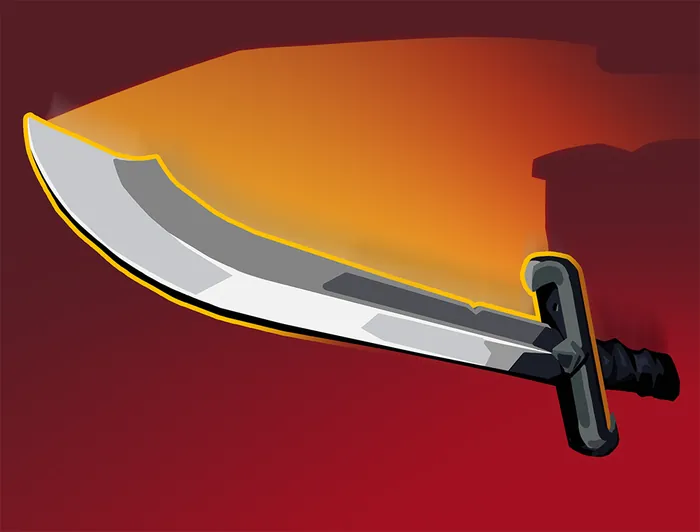 Frappe (`STRIKE_IRONCLAD`)
* **Type :** *Attack* | **Coût :** `1` ⚡ | **Rareté :** `Basic`
* **Effet Normal :** Infligez 6 dégâts.
* **Effet Amélioré :** Infligez 9 dégâts.
* **Amélioration :** `damage: +3`

## ⭐ Rareté : Common (20 cartes)

###  Colère (`ANGER`)
* **Type :** *Attack* | **Coût :** `0` ⚡ | **Rareté :** `Common`
* **Effet Normal :** Infligez 6 dégâts.
Ajoutez une copie de cette carte à votre **Défausse**.
* **Effet Amélioré :** Infligez 8 dégâts.
Ajoutez une copie de cette carte à votre **Défausse**.
* **Amélioration :** `damage: +2`

###  Armement (`ARMAMENTS`)
* **Type :** *Skill* | **Coût :** `1` ⚡ | **Rareté :** `Common`
* **Effet Normal :** Gagnez 5 d'**Armure**.
**Améliorez** une carte dans votre **Main**.
* **Effet Amélioré :** Gagnez 5 d'**Armure**.
**Améliorez** TOUTES les cartes dans votre **Main**.

###  Mur de sang (`BLOOD_WALL`)
* **Type :** *Skill* | **Coût :** `2` ⚡ | **Rareté :** `Common`
* **Effet Normal :** Perdez 2 PV.
Gagnez 16 d'**Armure**.
* **Effet Amélioré :** Perdez 2 PV.
Gagnez 20 d'**Armure**.
* **Amélioration :** `block: +4`

###  Plaquage (`BODY_SLAM`)
* **Type :** *Attack* | **Coût :** `1` ⚡ | **Rareté :** `Common`
* **Effet Normal :** Infligez un montant de dégâts égal à votre **Armure**.
* **Effet Amélioré :** Infligez un montant de dégâts égal à votre **Armure**.
* **Amélioration :** `energy: -1`

###  Percée (`BREAKTHROUGH`)
* **Type :** *Attack* | **Coût :** `1` ⚡ | **Rareté :** `Common`
* **Effet Normal :** Perdez 1 PV.
Infligez 9 dégâts à TOUS les ennemis.
* **Effet Amélioré :** Perdez 1 PV.
Infligez 13 dégâts à TOUS les ennemis.
* **Amélioration :** `damage: +4`

###  Scorie (`CINDER`)
* **Type :** *Attack* | **Coût :** `2` ⚡ | **Rareté :** `Common`
* **Effet Normal :** Infligez 18 dégâts.
**Épuisez** une carte aléatoire.
* **Effet Amélioré :** Infligez 24 dégâts.
**Épuisez** une carte aléatoire.
* **Amélioration :** `damage: +6`

###  Ravage (`HAVOC`)
* **Type :** *Skill* | **Coût :** `1` ⚡ | **Rareté :** `Common`
* **Effet Normal :** Jouez la carte du dessus de votre **Pioche** et **Épuisez**-la.
* **Effet Amélioré :** Jouez la carte du dessus de votre **Pioche** et **Épuisez**-la.
* **Amélioration :** `energy: -1`

###  Coup de boule (`HEADBUTT`)
* **Type :** *Attack* | **Coût :** `1` ⚡ | **Rareté :** `Common`
* **Effet Normal :** Infligez 9 dégâts.
Placez une carte de votre **Défausse** sur le dessus de votre **Pioche**.
* **Effet Amélioré :** Infligez 12 dégâts.
Placez une carte de votre **Défausse** sur le dessus de votre **Pioche**.
* **Amélioration :** `damage: +3`

###  Vague de fer (`IRON_WAVE`)
* **Type :** *Attack* | **Coût :** `1` ⚡ | **Rareté :** `Common`
* **Effet Normal :** Gagnez 5 d'**Armure**.
Infligez 5 dégâts.
* **Effet Amélioré :** Gagnez 7 d'**Armure**.
Infligez 7 dégâts.
* **Amélioration :** `damage: +2, block: +2`

###  Poing en fusion (`MOLTEN_FIST`)
* **Type :** *Attack* | **Coût :** `1` ⚡ | **Rareté :** `Common`
* **Effet Normal :** Infligez 10 dégâts.
Doublez le nombre d'incidences de **Vulnérable** sur l'ennemi.
**Épuisement**.
* **Effet Amélioré :** Infligez 14 dégâts.
Doublez le nombre d'incidences de **Vulnérable** sur l'ennemi.
**Épuisement**.
* **Amélioration :** `damage: +4`

###  Frappe perfectionnée (`PERFECTED_STRIKE`)
* **Type :** *Attack* | **Coût :** `2` ⚡ | **Rareté :** `Common`
* **Effet Normal :** Infligez 6 dégâts.
Inflige 2 dégâts supplémentaires pour CHACUNE de vos cartes contenant « Frappe ».
* **Effet Amélioré :** Infligez 6 dégâts.
Inflige 3 dégâts supplémentaires pour CHACUNE de vos cartes contenant « Frappe ».
* **Amélioration :** `extradamage: +1`

###  Frappe du pommeau (`POMMEL_STRIKE`)
* **Type :** *Attack* | **Coût :** `1` ⚡ | **Rareté :** `Common`
* **Effet Normal :** Infligez 9 dégâts.
Piochez 1 carte.
* **Effet Amélioré :** Infligez 10 dégâts.
Piochez 2 cartes.
* **Amélioration :** `damage: +1, cards: +1`

###  Frappe préparatoire (`SETUP_STRIKE`)
* **Type :** *Attack* | **Coût :** `1` ⚡ | **Rareté :** `Common`
* **Effet Normal :** Infligez 7 dégâts.
Gagnez 3 de **Force** jusqu'à la fin du tour.
* **Effet Amélioré :** Infligez 9 dégâts.
Gagnez 4 de **Force** jusqu'à la fin du tour.
* **Amélioration :** `damage: +2, strength: +1`

###  Même pas mal (`SHRUG_IT_OFF`)
* **Type :** *Skill* | **Coût :** `1` ⚡ | **Rareté :** `Common`
* **Effet Normal :** Gagnez 8 d'**Armure**.
Piochez 1 carte.
* **Effet Amélioré :** Gagnez 11 d'**Armure**.
Piochez 1 carte.
* **Amélioration :** `block: +3`

###  Épée boomerang (`SWORD_BOOMERANG`)
* **Type :** *Attack* | **Coût :** `1` ⚡ | **Rareté :** `Common`
* **Effet Normal :** Infligez 3 dégâts à un ennemi aléatoire 3 fois.
* **Effet Amélioré :** Infligez 3 dégâts à un ennemi aléatoire 4 fois.
* **Amélioration :** `repeat: +1`

###  Provocation (`TAUNT`)
* **Type :** *Skill* | **Coût :** `1` ⚡ | **Rareté :** `Common`
* **Effet Normal :** Gagnez 6 d'**Armure**.
Appliquez **Vulnérable** (1).
* **Effet Amélioré :** Gagnez 7 d'**Armure**.
Appliquez **Vulnérable** (2).
* **Amélioration :** `block: +1, vulnerable: +1`

###  Coup de tonnerre (`THUNDERCLAP`)
* **Type :** *Attack* | **Coût :** `1` ⚡ | **Rareté :** `Common`
* **Effet Normal :** Infligez 4 dégâts et appliquez **Vulnérable** (1) à TOUS les ennemis.
* **Effet Amélioré :** Infligez 7 dégâts et appliquez **Vulnérable** (1) à TOUS les ennemis.
* **Amélioration :** `damage: +3`

###  Intimidation (`TREMBLE`)
* **Type :** *Skill* | **Coût :** `1` ⚡ | **Rareté :** `Common`
* **Effet Normal :** Appliquez **Vulnérable** (3).
**Épuisement**.
* **Effet Amélioré :** Appliquez **Vulnérable** (4).
**Épuisement**.
* **Amélioration :** `vulnerable: +1`

###  Virilité (`TRUE_GRIT`)
* **Type :** *Skill* | **Coût :** `1` ⚡ | **Rareté :** `Common`
* **Effet Normal :** Gagnez 7 d'**Armure**.
**Épuisez** 1 carte au hasard.
* **Effet Amélioré :** Gagnez 9 d'**Armure**.
**Épuisez** 1 carte.
* **Amélioration :** `block: +2`

###  Frappe jumelée (`TWIN_STRIKE`)
* **Type :** *Attack* | **Coût :** `1` ⚡ | **Rareté :** `Common`
* **Effet Normal :** Infligez 5 dégâts 2 fois.
* **Effet Amélioré :** Infligez 7 dégâts 2 fois.
* **Amélioration :** `damage: +2`

## ⭐ Rareté : Uncommon (38 cartes)

### 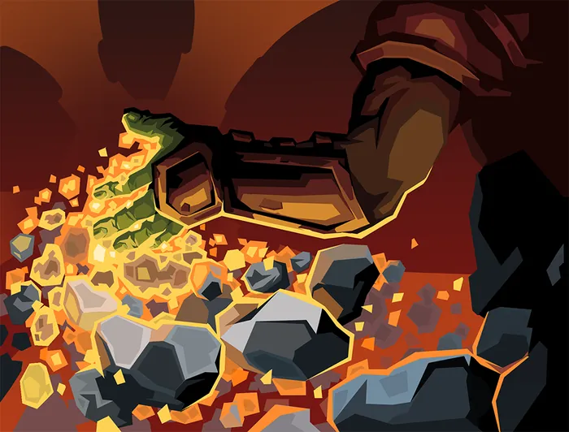 Frappe cendrée (`ASHEN_STRIKE`)
* **Type :** *Attack* | **Coût :** `1` ⚡ | **Rareté :** `Uncommon`
* **Effet Normal :** Infligez 6 dégâts.
Inflige 3 dégâts supplémentaires pour chaque carte **Épuisée**.
* **Effet Amélioré :** Infligez 6 dégâts.
Inflige 4 dégâts supplémentaires pour chaque carte **Épuisée**.
* **Amélioration :** `extradamage: +1`

### 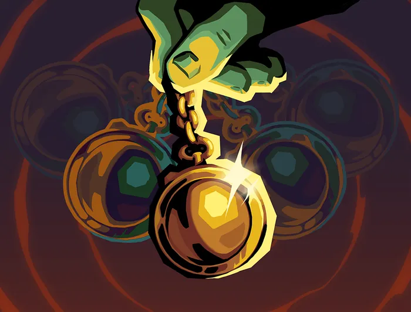 Ivresse du combat (`BATTLE_TRANCE`)
* **Type :** *Skill* | **Coût :** `0` ⚡ | **Rareté :** `Uncommon`
* **Effet Normal :** Piochez 3 cartes.
Vous ne pouvez plus piocher de cartes jusqu'à la fin du tour.
* **Effet Amélioré :** Piochez 4 cartes.
Vous ne pouvez plus piocher de cartes jusqu'à la fin du tour.
* **Amélioration :** `cards: +1`

### 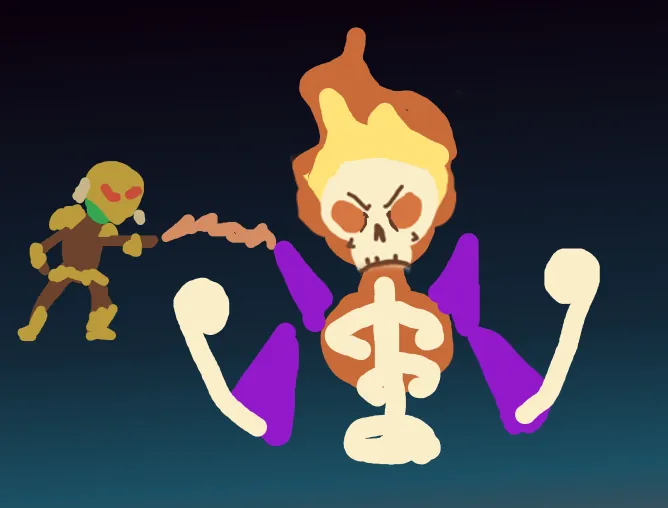 Embrasement (`BLAZE`)
* **Type :** *Skill* | **Coût :** `2` ⚡ | **Rareté :** `Uncommon`
* **Effet Normal :** Donnez 5 de **Force** à un autre joueur.
* **Effet Amélioré :** Donnez 7 de **Force** à un autre joueur.
* **Amélioration :** `strength: +2`

### 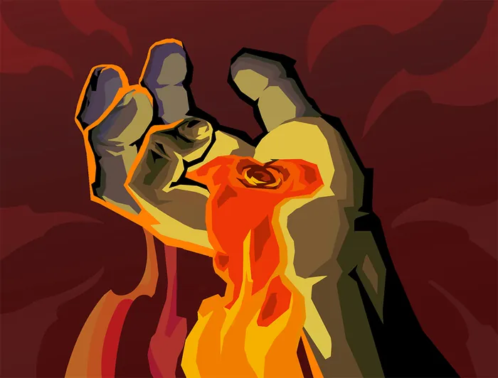 Saignée (`BLOODLETTING`)
* **Type :** *Skill* | **Coût :** `0` ⚡ | **Rareté :** `Uncommon`
* **Effet Normal :** Perdez 3 PV.
Gagnez ⚡2⚡.
* **Effet Amélioré :** Perdez 3 PV.
Gagnez ⚡3⚡.
* **Amélioration :** `energygain: +1`

### 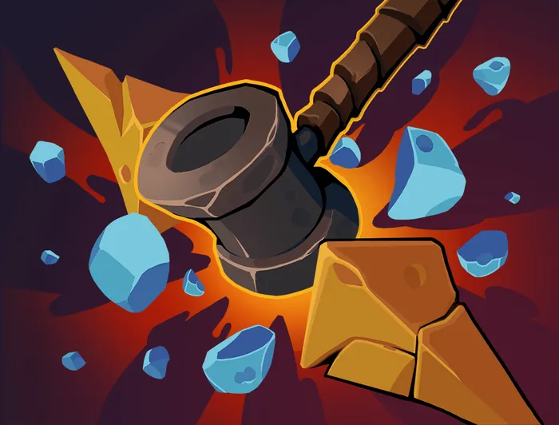 Gourdin (`BLUDGEON`)
* **Type :** *Attack* | **Coût :** `3` ⚡ | **Rareté :** `Uncommon`
* **Effet Normal :** Infligez 32 dégâts.
* **Effet Amélioré :** Infligez 42 dégâts.
* **Amélioration :** `damage: +10`

### 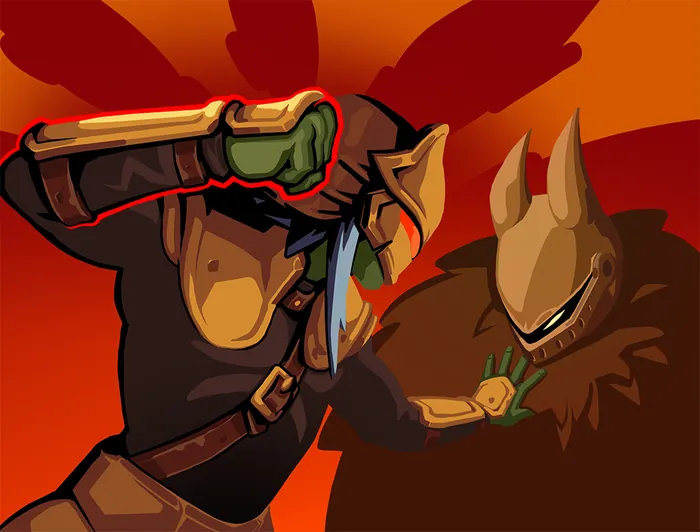 Harcèlement (`BULLY`)
* **Type :** *Attack* | **Coût :** `0` ⚡ | **Rareté :** `Uncommon`
* **Effet Normal :** Infligez 4 dégâts.
Inflige 2 dégâts supplémentaires pour chaque incidence de **Vulnérable** sur l'ennemi.
* **Effet Amélioré :** Infligez 4 dégâts.
Inflige 3 dégâts supplémentaires pour chaque incidence de **Vulnérable** sur l'ennemi.
* **Amélioration :** `extradamage: +1`

###  Pacte brûlant (`BURNING_PACT`)
* **Type :** *Skill* | **Coût :** `1` ⚡ | **Rareté :** `Uncommon`
* **Effet Normal :** **Épuisez** 1 carte.
Piochez 2 cartes.
* **Effet Amélioré :** **Épuisez** 1 carte.
Piochez 3 cartes.
* **Amélioration :** `cards: +1`

### 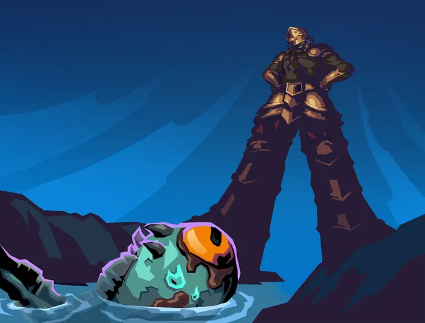 Colosse (`COLOSSUS`)
* **Type :** *Skill* | **Coût :** `1` ⚡ | **Rareté :** `Uncommon`
* **Effet Normal :** Gagnez 4 d'**Armure**.
Vous subissez 50% de dégâts en moins des ennemis **Vulnérables** pendant ce tour.
* **Effet Amélioré :** Gagnez 7 d'**Armure**.
Vous subissez 50% de dégâts en moins des ennemis **Vulnérables** pendant ce tour.
* **Amélioration :** `block: +3`

### 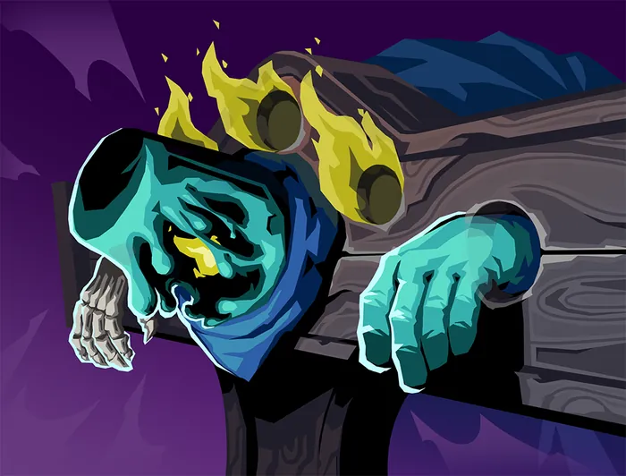 Cruauté (`CRUELTY`)
* **Type :** *Power* | **Coût :** `1` ⚡ | **Rareté :** `Uncommon`
* **Effet Normal :** Les ennemis **Vulnérables** subissent 25% de dégâts supplémentaires.
* **Effet Amélioré :** Les ennemis **Vulnérables** subissent 50% de dégâts supplémentaires.
* **Amélioration :** `crueltypower: +25`

### 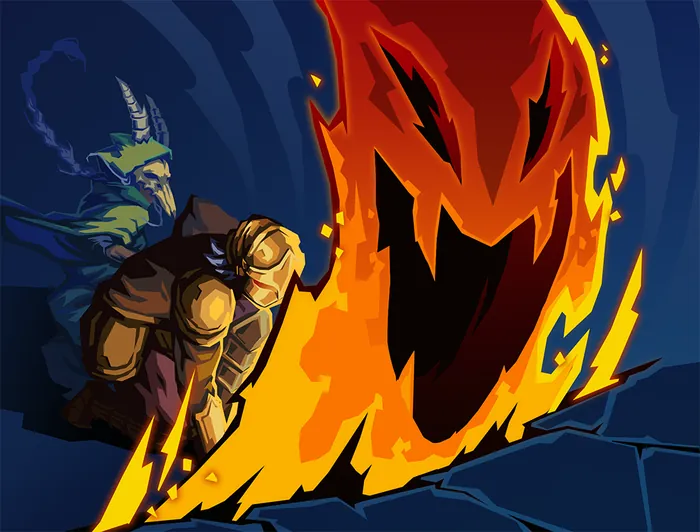 Bouclier démoniaque (`DEMONIC_SHIELD`)
* **Type :** *Skill* | **Coût :** `0` ⚡ | **Rareté :** `Uncommon`
* **Effet Normal :** Perdez 1 PV.
Octroyez à un autre joueur un montant d'**Armure** égal à votre **Armure**.
**Épuisement**.
* **Effet Amélioré :** Perdez 1 PV.
Octroyez à un autre joueur un montant d'**Armure** égal à votre **Armure**.
* **Amélioration :** `keywordsRemoved: ['Exhaust']`

### 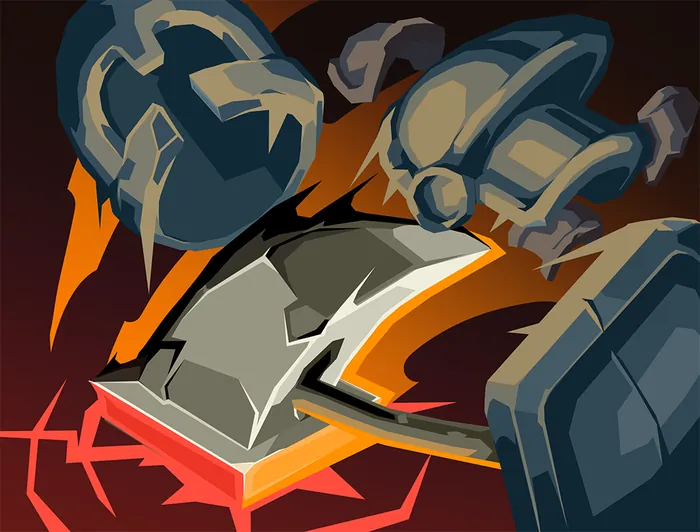 Démantèlement (`DISMANTLE`)
* **Type :** *Attack* | **Coût :** `1` ⚡ | **Rareté :** `Uncommon`
* **Effet Normal :** Infligez 8 dégâts.
Si l'ennemi est **Vulnérable**, infligez ces dégâts 2 fois.
* **Effet Amélioré :** Infligez 10 dégâts.
Si l'ennemi est **Vulnérable**, infligez ces dégâts 2 fois.
* **Amélioration :** `damage: +2`

### 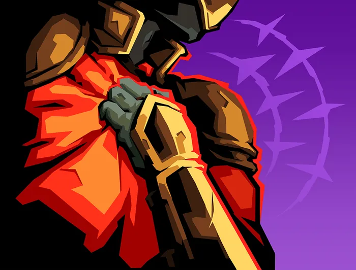 Tambour de guerre (`DRUM_OF_BATTLE`)
* **Type :** *Skill* | **Coût :** `1` ⚡ | **Rareté :** `Uncommon`
* **Effet Normal :** Piochez 2 cartes.
Lorsque cette carte est **Épuisée**, gagnez ⚡2⚡.
* **Effet Amélioré :** Piochez 2 cartes.
Lorsque cette carte est **Épuisée**, gagnez ⚡3⚡.
* **Amélioration :** `energygain: +1`

### 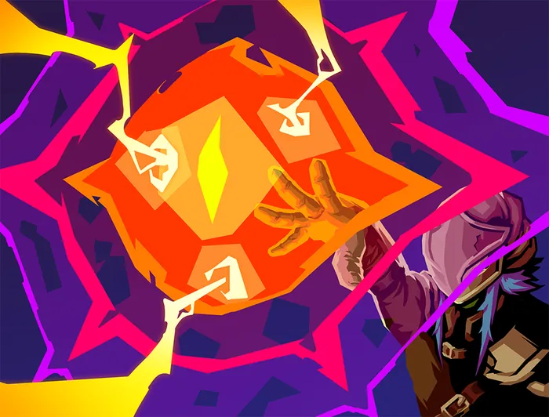 Mauvais œil (`EVIL_EYE`)
* **Type :** *Skill* | **Coût :** `1` ⚡ | **Rareté :** `Uncommon`
* **Effet Normal :** Gagnez 8 d'**Armure**.
Gagnez 8 d'**Armure** de nouveau si vous avez **Épuisé** une carte pendant ce tour.
* **Effet Amélioré :** Gagnez 11 d'**Armure**.
Gagnez 11 d'**Armure** de nouveau si vous avez **Épuisé** une carte pendant ce tour.
* **Amélioration :** `block: +3`

### 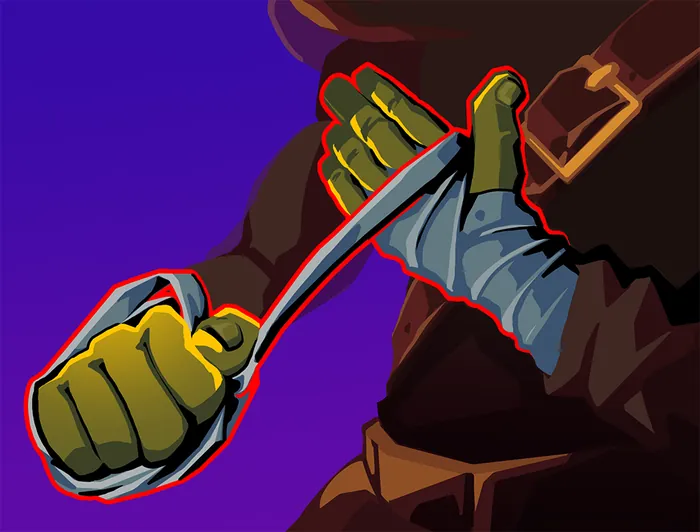 Paré au combat (`EXPECT_A_FIGHT`)
* **Type :** *Skill* | **Coût :** `3` ⚡ | **Rareté :** `Uncommon`
* **Effet Normal :** Gain 15 **Block**.
Gains 5 additional **Block** for each **Strength** you have.
* **Effet Amélioré :** Gain 16 **Block**.
Gains 8 additional **Block** for each **Strength** you have.
* **Amélioration :** `calculationbase: +1, calculationextra: +3`

### 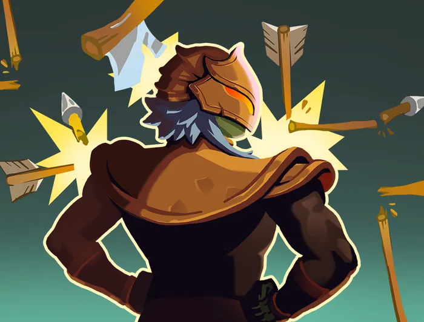 Ignorer la douleur (`FEEL_NO_PAIN`)
* **Type :** *Power* | **Coût :** `1` ⚡ | **Rareté :** `Uncommon`
* **Effet Normal :** Lorsqu'une carte est **Épuisée**, gagnez 3 d'**Armure**.
* **Effet Amélioré :** Lorsqu'une carte est **Épuisée**, gagnez 4 d'**Armure**.
* **Amélioration :** `power: +1`

### 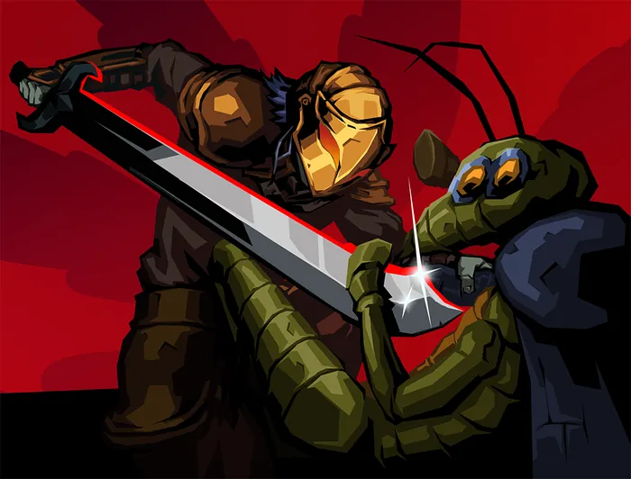 Viens te battre  ! (`FIGHT_ME`)
* **Type :** *Attack* | **Coût :** `2` ⚡ | **Rareté :** `Uncommon`
* **Effet Normal :** Infligez 5 dégâts 2 fois.
Gagnez 3 de **Force**.
L'ennemi gagne 1 de **Force**.
* **Effet Amélioré :** Infligez 6 dégâts 2 fois.
Gagnez 4 de **Force**.
L'ennemi gagne 1 de **Force**.
* **Amélioration :** `damage: +1, strength: +1`

### 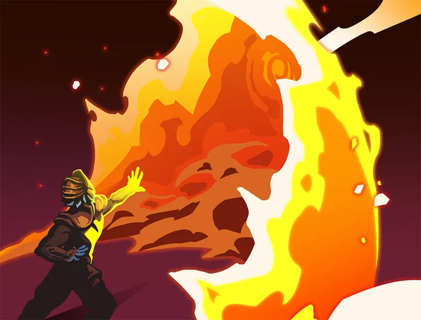 Barrière de flammes (`FLAME_BARRIER`)
* **Type :** *Skill* | **Coût :** `2` ⚡ | **Rareté :** `Uncommon`
* **Effet Normal :** Gagnez 12 d'**Armure**.
Lorsque vous vous faites attaquer pendant ce tour, infligez 4 dégâts en retour.
* **Effet Amélioré :** Gagnez 16 d'**Armure**.
Lorsque vous vous faites attaquer pendant ce tour, infligez 6 dégâts en retour.
* **Amélioration :** `block: +4, damageback: +2`

### 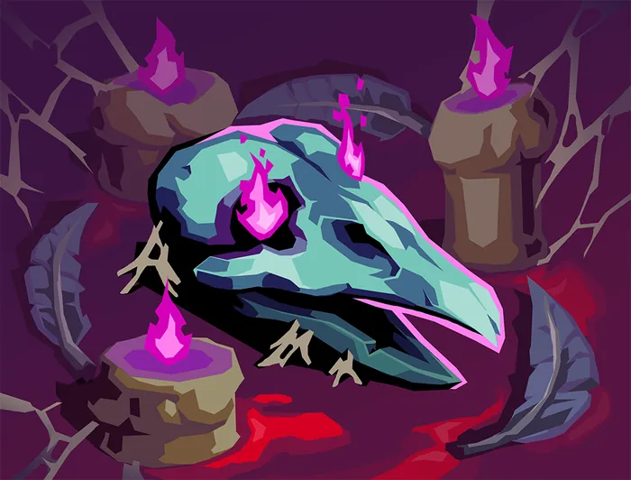 Rituel oublié (`FORGOTTEN_RITUAL`)
* **Type :** *Skill* | **Coût :** `1` ⚡ | **Rareté :** `Uncommon`
* **Effet Normal :** Si vous avez **Épuisé** une carte ce tour, gagnez ⚡3⚡.
**Épuisement**.
* **Effet Amélioré :** Si vous avez **Épuisé** une carte ce tour, gagnez ⚡4⚡.
**Épuisement**.
* **Amélioration :** `energygain: +1`

### 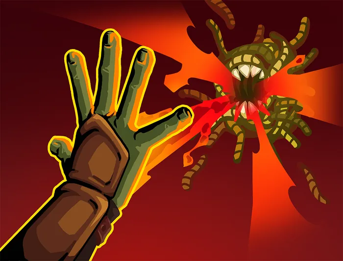 Hémokinésie (`HEMOKINESIS`)
* **Type :** *Attack* | **Coût :** `1` ⚡ | **Rareté :** `Uncommon`
* **Effet Normal :** Perdez 2 PV.
Infligez 15 dégâts.
* **Effet Amélioré :** Perdez 2 PV.
Infligez 20 dégâts.
* **Amélioration :** `damage: +5`

###  Rugissement de l'au-delà (`HOWL_FROM_BEYOND`)
* **Type :** *Attack* | **Coût :** `3` ⚡ | **Rareté :** `Uncommon`
* **Effet Normal :** Infligez 18 dégâts à TOUS les ennemis.
À la fin de votre tour, si cette carte est dans votre pile de cartes **Épuisées**, jouez-la.
* **Effet Amélioré :** Infligez 24 dégâts à TOUS les ennemis.
À la fin de votre tour, si cette carte est dans votre pile de cartes **Épuisées**, jouez-la.
* **Amélioration :** `damage: +6`

### 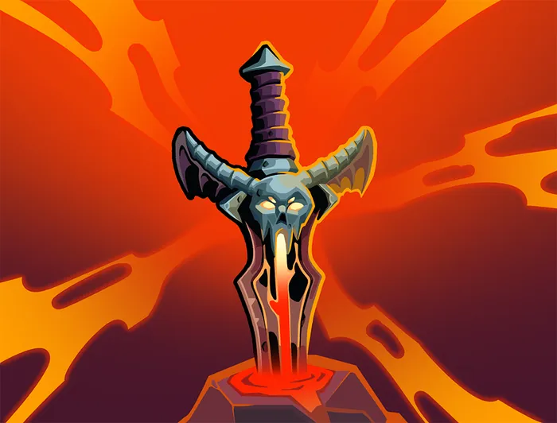 Lame infernale (`INFERNAL_BLADE`)
* **Type :** *Skill* | **Coût :** `1` ⚡ | **Rareté :** `Uncommon`
* **Effet Normal :** Ajoutez une Attaque aléatoire à votre **Main**. Elle coûte 0 ce tour.
**Épuisement**.
* **Effet Amélioré :** Ajoutez une Attaque aléatoire à votre **Main**. Elle coûte 0 ce tour.
**Épuisement**.
* **Amélioration :** `energy: -1`

### 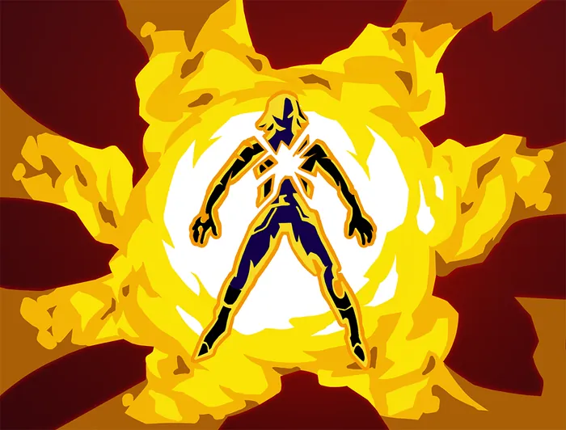 Brasier (`INFERNO`)
* **Type :** *Power* | **Coût :** `1` ⚡ | **Rareté :** `Uncommon`
* **Effet Normal :** Au début de votre tour, perdez 1 PV.
Lorsque vous perdez des PV durant votre tour, infligez 6 dégâts à TOUS les ennemis.
* **Effet Amélioré :** Au début de votre tour, perdez 1 PV.
Lorsque vous perdez des PV durant votre tour, infligez 9 dégâts à TOUS les ennemis.
* **Amélioration :** `infernopower: +3`

### 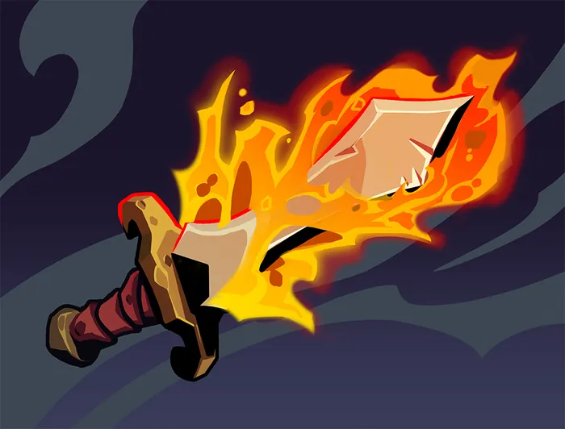 Enflammer (`INFLAME`)
* **Type :** *Power* | **Coût :** `1` ⚡ | **Rareté :** `Uncommon`
* **Effet Normal :** Gagnez 2 de **Force**.
* **Effet Amélioré :** Gagnez 3 de **Force**.
* **Amélioration :** `strengthpower: +1`

### 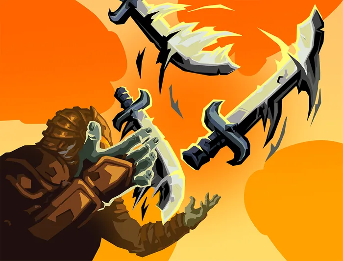 Jonglage (`JUGGLING`)
* **Type :** *Power* | **Coût :** `1` ⚡ | **Rareté :** `Uncommon`
* **Effet Normal :** Ajoutez une copie de la troisième **Attaque** que vous jouez chaque tour à votre **Main**.
* **Effet Amélioré :** **Inné**.
Ajoutez une copie de la troisième **Attaque** que vous jouez chaque tour à votre **Main**.
* **Amélioration :** `keywords: ['Innate']`

### 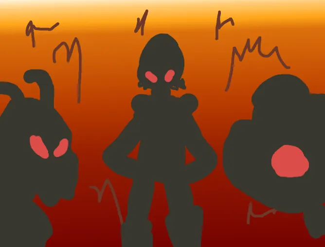 Scandale (`OUTRAGE`)
* **Type :** *Attack* | **Coût :** `0` ⚡ | **Rareté :** `Uncommon`
* **Effet Normal :** Inflige z9 dégâts.
Ajoutez une copie de cette carte dans la **Défausse** de TOUS LES JOUEURS.
* **Effet Amélioré :** Inflige z13 dégâts.
Ajoutez une copie de cette carte dans la **Défausse** de TOUS LES JOUEURS.
* **Amélioration :** `damage: +4`

### 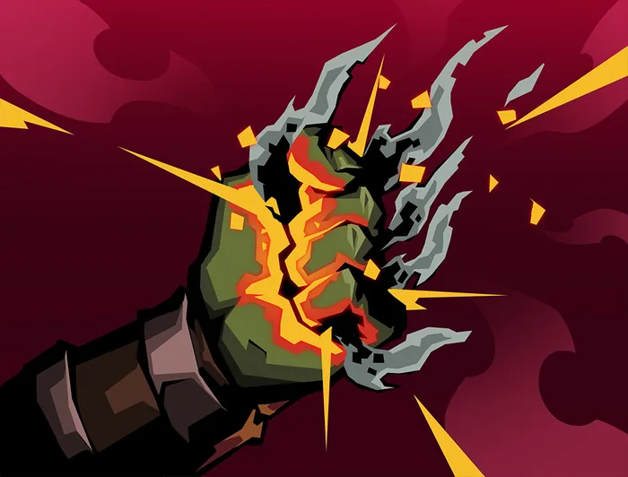 Pillage (`PILLAGE`)
* **Type :** *Attack* | **Coût :** `1` ⚡ | **Rareté :** `Uncommon`
* **Effet Normal :** Infligez 6 dégâts.
Piochez des cartes jusqu'à piocher une carte qui n'est pas une Attaque.
* **Effet Amélioré :** Infligez 9 dégâts.
Piochez des cartes jusqu'à piocher une carte qui n'est pas une Attaque.
* **Amélioration :** `damage: +3`

### 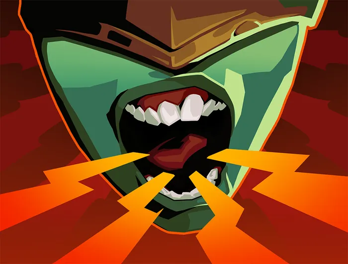 Rage (`RAGE`)
* **Type :** *Skill* | **Coût :** `0` ⚡ | **Rareté :** `Uncommon`
* **Effet Normal :** Lorsque vous jouez une Attaque pendant ce tour, gagnez 3 d'**Armure**.
* **Effet Amélioré :** Lorsque vous jouez une Attaque pendant ce tour, gagnez 5 d'**Armure**.
* **Amélioration :** `power: +2`

###  Saccage (`RAMPAGE`)
* **Type :** *Attack* | **Coût :** `1` ⚡ | **Rareté :** `Uncommon`
* **Effet Normal :** Infligez 10 dégâts.
Augmentez les dégâts de cette carte de 5 jusqu'à la fin du combat.
* **Effet Amélioré :** Infligez 10 dégâts.
Augmentez les dégâts de cette carte de 10 jusqu'à la fin du combat.
* **Amélioration :** `increase: +5`

### 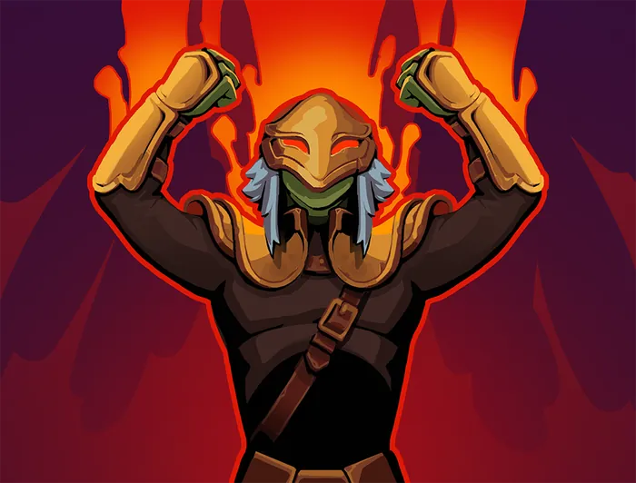 Rupture (`RUPTURE`)
* **Type :** *Power* | **Coût :** `1` ⚡ | **Rareté :** `Uncommon`
* **Effet Normal :** Lorsque vous perdez des PV pendant votre tour, gagnez 1 de **Force**.
* **Effet Amélioré :** Lorsque vous perdez des PV pendant votre tour, gagnez 2 de **Force**.
* **Amélioration :** `strength: +1`

###  Second souffle (`SECOND_WIND`)
* **Type :** *Skill* | **Coût :** `1` ⚡ | **Rareté :** `Uncommon`
* **Effet Normal :** **Épuisez** toutes les cartes de votre **Main** qui ne sont pas des Attaques. Gagnez 5 d'**Armure** pour chaque carte **Épuisée**.
* **Effet Amélioré :** **Épuisez** toutes les cartes de votre **Main** qui ne sont pas des Attaques. Gagnez 7 d'**Armure** pour chaque carte **Épuisée**.
* **Amélioration :** `block: +2`

### 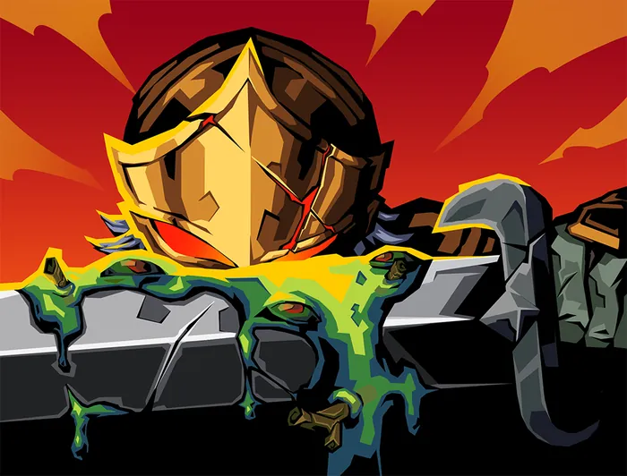 Rancune (`SPITE`)
* **Type :** *Attack* | **Coût :** `0` ⚡ | **Rareté :** `Uncommon`
* **Effet Normal :** Infligez 5 dégâts.
Si vous avez perdu des PV pendant ce tour, cette attaque touche l'ennemi 2 fois.
* **Effet Amélioré :** Infligez 5 dégâts.
Si vous avez perdu des PV pendant ce tour, cette attaque touche l'ennemi 3 fois.
* **Amélioration :** `repeat: +1`

###  Ruée (`STAMPEDE`)
* **Type :** *Power* | **Coût :** `2` ⚡ | **Rareté :** `Uncommon`
* **Effet Normal :** À la fin de votre tour, 1 Attaque aléatoire de votre **Main** est jouée sur un ennemi aléatoire.
* **Effet Amélioré :** À la fin de votre tour, 1 Attaque aléatoire de votre **Main** est jouée sur un ennemi aléatoire.
* **Amélioration :** `energy: -1`

### 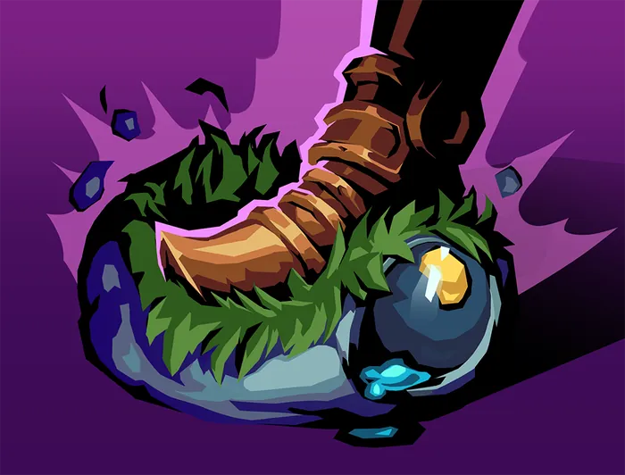 Piétinement (`STOMP`)
* **Type :** *Attack* | **Coût :** `3` ⚡ | **Rareté :** `Uncommon`
* **Effet Normal :** Infligez 12 dégâts à TOUS les ennemis.
Coûte 1 ⚡ en moins pour chaque Attaque déjà jouée pendant ce tour.
* **Effet Amélioré :** Infligez 15 dégâts à TOUS les ennemis.
Coûte 1 ⚡ en moins pour chaque Attaque déjà jouée pendant ce tour.
* **Amélioration :** `damage: +3`

### 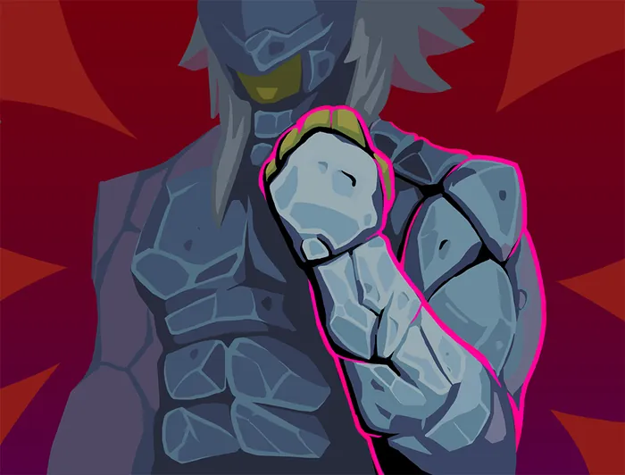 Armure de pierre (`STONE_ARMOR`)
* **Type :** *Power* | **Coût :** `1` ⚡ | **Rareté :** `Uncommon`
* **Effet Normal :** Gagnez 4 de **Blindage**.
* **Effet Amélioré :** Gagnez 6 de **Blindage**.
* **Amélioration :** `platingpower: +2`

### 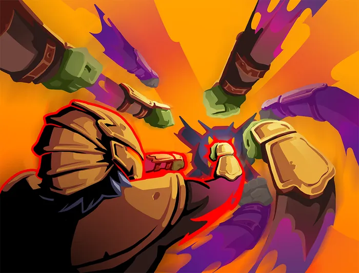 Acharnement (`UNRELENTING`)
* **Type :** *Attack* | **Coût :** `2` ⚡ | **Rareté :** `Uncommon`
* **Effet Normal :** Infligez 14 dégâts.
La prochaine Attaque que vous jouez coûte 0 ⚡.
* **Effet Amélioré :** Infligez 20 dégâts.
La prochaine Attaque que vous jouez coûte 0 ⚡.
* **Amélioration :** `damage: +6`

###  Uppercut (`UPPERCUT`)
* **Type :** *Attack* | **Coût :** `2` ⚡ | **Rareté :** `Uncommon`
* **Effet Normal :** Infligez 13 dégâts.
Appliquez **Affaibli** (1).
Appliquez **Vulnérable** (1).
* **Effet Amélioré :** Infligez 13 dégâts.
Appliquez **Affaibli** (2).
Appliquez **Vulnérable** (2).
* **Amélioration :** `power: +1`

### 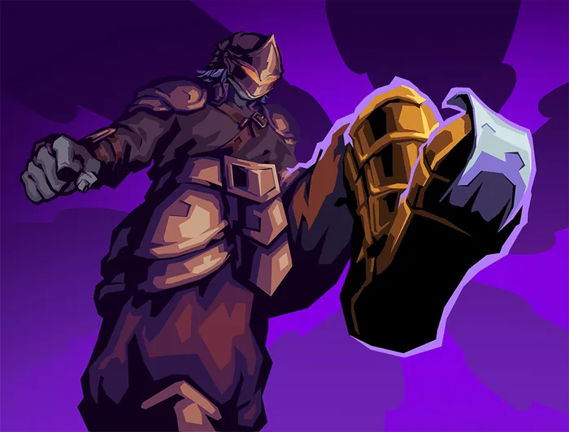 Vicieux (`VICIOUS`)
* **Type :** *Power* | **Coût :** `1` ⚡ | **Rareté :** `Uncommon`
* **Effet Normal :** Lorsque vous appliquez **Vulnérable**, piochez 1 carte.
* **Effet Amélioré :** Lorsque vous appliquez **Vulnérable**, piochez 2 cartes.
* **Amélioration :** `cards: +1`

### 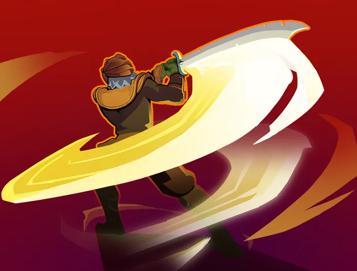 Tourbillon (`WHIRLWIND`)
* **Type :** *Attack* | **Coût :** `-1` ⚡ | **Rareté :** `Uncommon`
* **Effet Normal :** Infligez 5 dégâts à TOUS les ennemis X fois.
* **Effet Amélioré :** Infligez 8 dégâts à TOUS les ennemis X fois.
* **Amélioration :** `damage: +3`

## ⭐ Rareté : Rare (27 cartes)

### 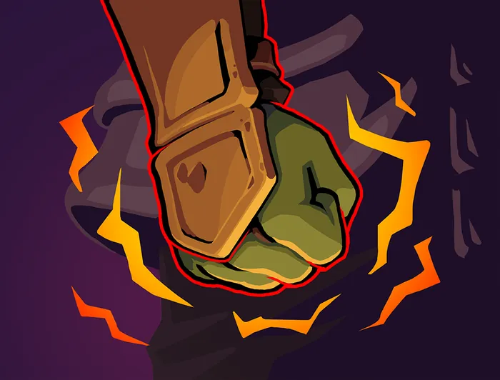 Agression (`AGGRESSION`)
* **Type :** *Power* | **Coût :** `1` ⚡ | **Rareté :** `Rare`
* **Effet Normal :** Au début de votre tour, placez une Attaque aléatoire de votre **Défausse** dans votre **Main** et **Améliorez**-la.
* **Effet Amélioré :** **Inné**.
Au début de votre tour, placez une Attaque aléatoire de votre **Défausse** dans votre **Main** et **Améliorez**-la.
* **Amélioration :** `keywords: ['Innate']`

### 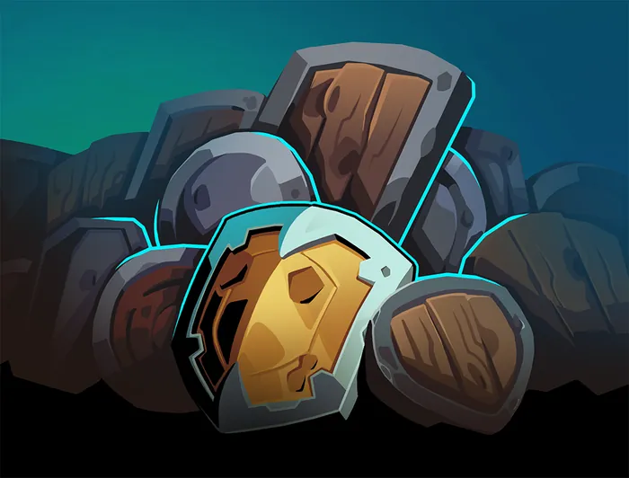 Barricade (`BARRICADE`)
* **Type :** *Power* | **Coût :** `3` ⚡ | **Rareté :** `Rare`
* **Effet Normal :** Vous ne perdez plus votre **Armure** au début de votre tour.
* **Effet Amélioré :** Vous ne perdez plus votre **Armure** au début de votre tour.
* **Amélioration :** `energy: -1`

### 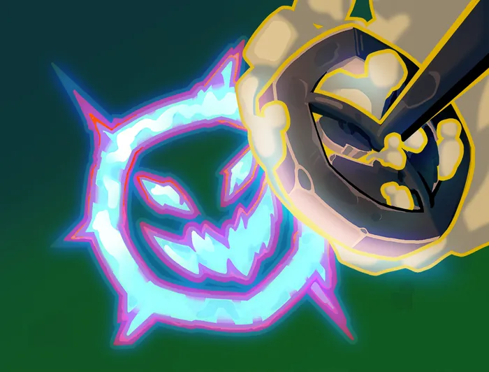 Marqué au fer rouge (`BRAND`)
* **Type :** *Skill* | **Coût :** `0` ⚡ | **Rareté :** `Rare`
* **Effet Normal :** Perdez 1 PV.
**Épuisez** 1 carte.
Gagnez 1 de **Force**.
* **Effet Amélioré :** Perdez 1 PV.
**Épuisez** 1 carte.
Gagnez 2 de **Force**.
* **Amélioration :** `strength: +1`

### 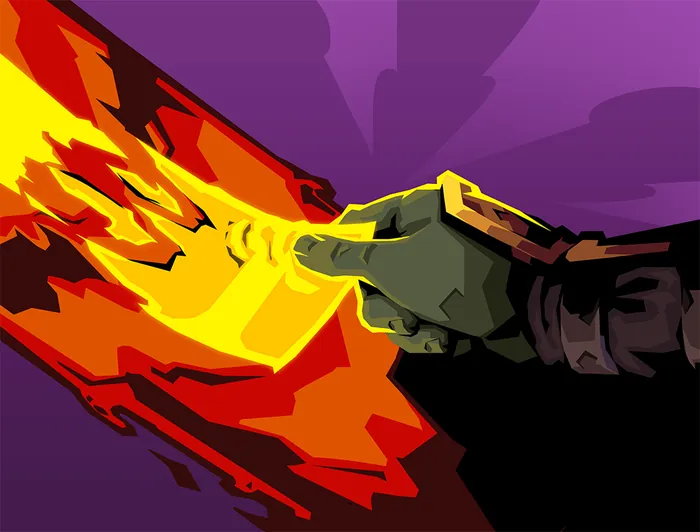 Cascade (`CASCADE`)
* **Type :** *Skill* | **Coût :** `-1` ⚡ | **Rareté :** `Rare`
* **Effet Normal :** Jouez les X cartes du dessus de votre **Pioche**.
* **Effet Amélioré :** Jouez les X+1 cartes du dessus de votre **Pioche**.

### 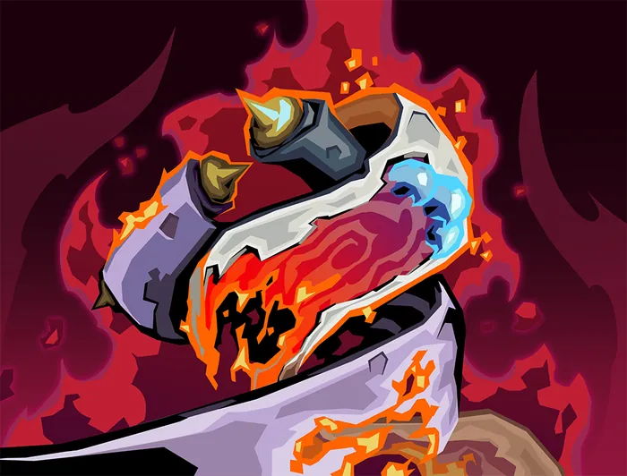 Incendie (`CONFLAGRATION`)
* **Type :** *Attack* | **Coût :** `1` ⚡ | **Rareté :** `Rare`
* **Effet Normal :** Infligez 2 dégâts à TOUS les ennemis 4 fois.
* **Effet Amélioré :** Infligez 2 dégâts à TOUS les ennemis 5 fois.
* **Amélioration :** `repeat: +1`

### 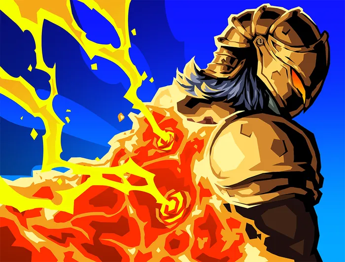 Manteau pourpre (`CRIMSON_MANTLE`)
* **Type :** *Power* | **Coût :** `1` ⚡ | **Rareté :** `Rare`
* **Effet Normal :** Au début de votre tour, perdez 1 PV et gagnez 7 d'**Armure**.
* **Effet Amélioré :** Au début de votre tour, perdez 1 PV et gagnez 10 d'**Armure**.
* **Amélioration :** `crimsonmantlepower: +3`

### 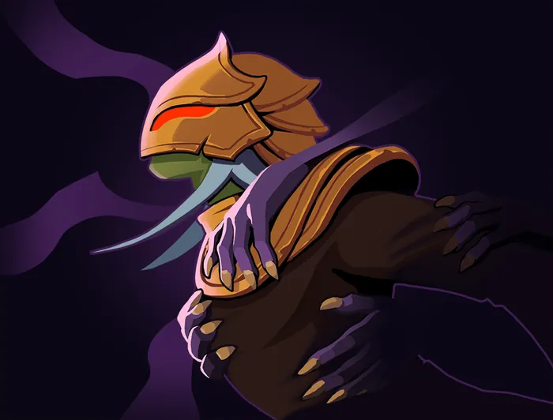 Sombre étreinte (`DARK_EMBRACE`)
* **Type :** *Power* | **Coût :** `2` ⚡ | **Rareté :** `Rare`
* **Effet Normal :** Lorsqu'une carte est **Épuisée**,
piochez 1 carte.
* **Effet Amélioré :** Lorsqu'une carte est **Épuisée**,
piochez 1 carte.
* **Amélioration :** `energy: -1`

### 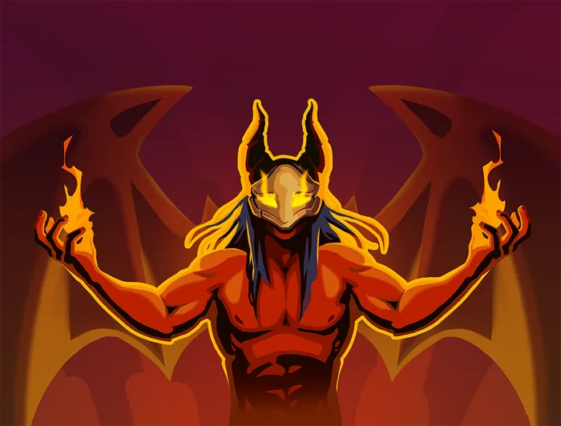 Forme démoniaque (`DEMON_FORM`)
* **Type :** *Power* | **Coût :** `3` ⚡ | **Rareté :** `Rare`
* **Effet Normal :** Au début de votre tour, gagnez 3 de **Force**.
* **Effet Amélioré :** Au début de votre tour, gagnez 4 de **Force**.
* **Amélioration :** `strengthpower: +1`

### 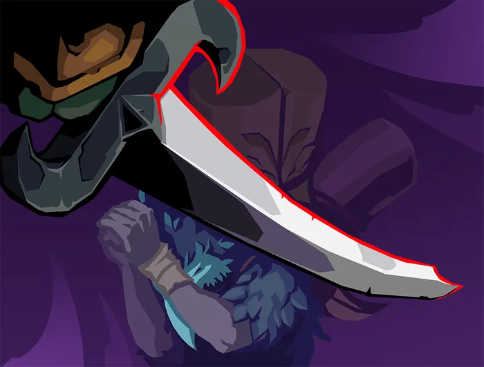 Domination (`DOMINATE`)
* **Type :** *Skill* | **Coût :** `1` ⚡ | **Rareté :** `Rare`
* **Effet Normal :** Appliquez **Vulnérable** (1).
Gagnez 1 de **Force** pour chaque incidence de **Vulnérable** sur l'ennemi.
**Épuisement**.
* **Effet Amélioré :** Appliquez **Vulnérable** (2).
Gagnez 1 de **Force** pour chaque incidence de **Vulnérable** sur l'ennemi.
**Épuisement**.
* **Amélioration :** `vulnerablepower: +1`

### 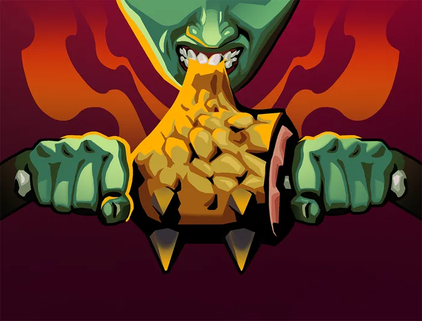 Appétit (`FEED`)
* **Type :** *Attack* | **Coût :** `1` ⚡ | **Rareté :** `Rare`
* **Effet Normal :** Infligez 10 dégâts.
**Coup de grâce** : augmentez vos PV Max de 3.
**Épuisement**.
* **Effet Amélioré :** Infligez 12 dégâts.
**Coup de grâce** : augmentez vos PV Max de 4.
**Épuisement**.
* **Amélioration :** `damage: +2, maxhp: +1`

### 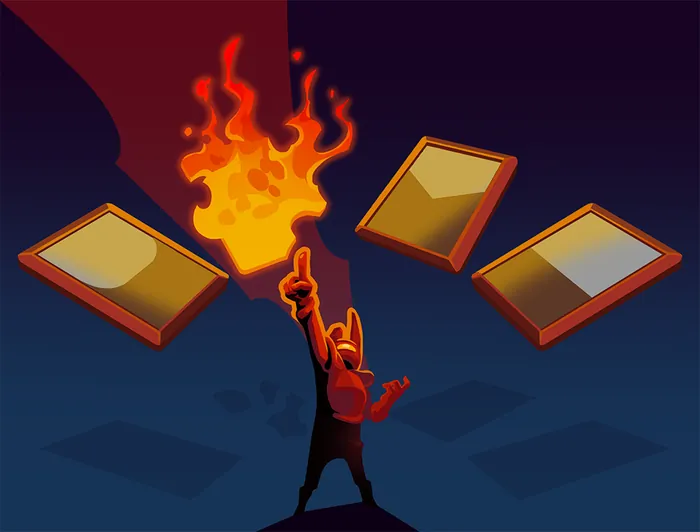 Feu démoniaque (`FIEND_FIRE`)
* **Type :** *Attack* | **Coût :** `2` ⚡ | **Rareté :** `Rare`
* **Effet Normal :** **Épuisez** votre **Main**.
Infligez 7 dégâts pour chaque carte **Épuisée** ainsi.
**Épuisement**.
* **Effet Amélioré :** **Épuisez** votre **Main**.
Infligez 10 dégâts pour chaque carte **Épuisée** ainsi.
**Épuisement**.
* **Amélioration :** `damage: +3`

### 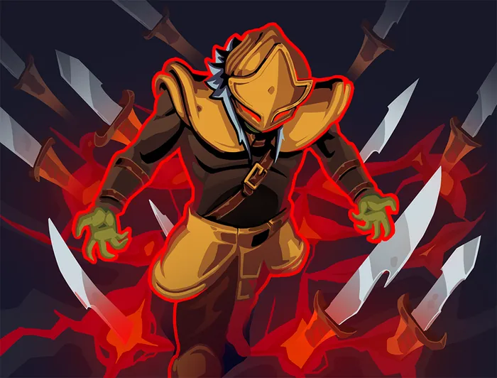 Soulèvement infernal (`HELLRAISER`)
* **Type :** *Power* | **Coût :** `2` ⚡ | **Rareté :** `Rare`
* **Effet Normal :** Lorsque vous piochez une carte contenant « Frappe », elle est immédiatement jouée sur un ennemi aléatoire.
* **Effet Amélioré :** Lorsque vous piochez une carte contenant « Frappe », elle est immédiatement jouée sur un ennemi aléatoire.
* **Amélioration :** `energy: -1`

### 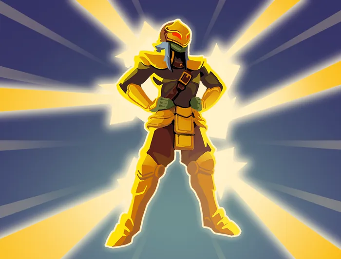 Insensible (`IMPERVIOUS`)
* **Type :** *Skill* | **Coût :** `2` ⚡ | **Rareté :** `Rare`
* **Effet Normal :** Gagnez 30 d'**Armure**.
**Épuisement**.
* **Effet Amélioré :** Gagnez 40 d'**Armure**.
**Épuisement**.
* **Amélioration :** `block: +10`

### 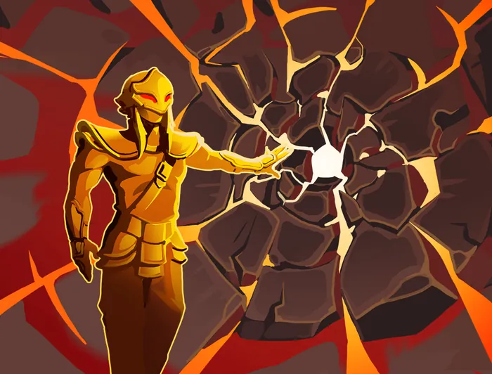 Juggernaut (`JUGGERNAUT`)
* **Type :** *Power* | **Coût :** `2` ⚡ | **Rareté :** `Rare`
* **Effet Normal :** Lorsque vous gagnez de l'**Armure**, infligez 6 dégâts à un ennemi aléatoire.
* **Effet Amélioré :** Lorsque vous gagnez de l'**Armure**, infligez 8 dégâts à un ennemi aléatoire.
* **Amélioration :** `juggernautpower: +2`

### 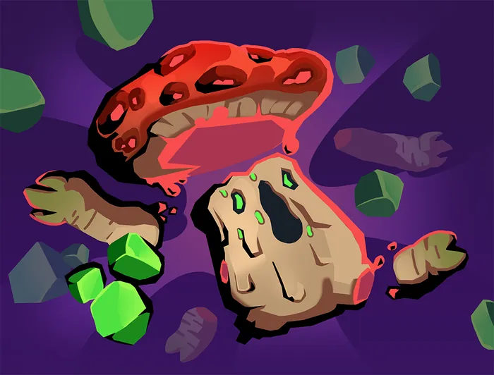 Estropier (`MANGLE`)
* **Type :** *Attack* | **Coût :** `3` ⚡ | **Rareté :** `Rare`
* **Effet Normal :** Infligez 20 dégâts.
L'ennemi perd 10 de **Force** jusqu'à la fin du tour.
* **Effet Amélioré :** Infligez 26 dégâts.
L'ennemi perd 15 de **Force** jusqu'à la fin du tour.
* **Amélioration :** `damage: +6, strengthloss: +5`

###  Minuit (`MIDNIGHT`)
* **Type :** *Attack* | **Coût :** `12` ⚡ | **Rareté :** `Rare`
* **Effet Normal :** Infligez 60 dégâts.
Coûte ⚡ en moins par carte **Épuisée** par N'IMPORTE QUI pendant ce combat.
* **Effet Amélioré :** Infligez 72 dégâts.
Coûte ⚡ en moins par carte **Épuisée** par N'IMPORTE QUI pendant ce combat.
* **Amélioration :** `damage: +12`

###  Pas encore (`NOT_YET`)
* **Type :** *Skill* | **Coût :** `2` ⚡ | **Rareté :** `Rare`
* **Effet Normal :** Récupérez 10 PV.
**Épuisement**.
* **Effet Amélioré :** Récupérez 13 PV.
**Épuisement**.
* **Amélioration :** `heal: +3`

###  Offrande (`OFFERING`)
* **Type :** *Skill* | **Coût :** `0` ⚡ | **Rareté :** `Rare`
* **Effet Normal :** Perdez 6 PV.
Gagnez ⚡2⚡.
Piochez 3 cartes.
**Épuisement**.
* **Effet Amélioré :** Perdez 6 PV.
Gagnez ⚡2⚡.
Piochez 5 cartes.
**Épuisement**.
* **Amélioration :** `cards: +2`

###  Droite-gauche (`ONE_TWO_PUNCH`)
* **Type :** *Skill* | **Coût :** `1` ⚡ | **Rareté :** `Rare`
* **Effet Normal :** La prochaine Attaque que vous jouez ce tour sera jouée une fois supplémentaire.
* **Effet Amélioré :** Les 2 prochaines Attaques que vous jouez ce tour seront jouées une fois supplémentaire.
* **Amélioration :** `attacks: +1`

###  Pacte conclu (`PACTS_END`)
* **Type :** *Attack* | **Coût :** `0` ⚡ | **Rareté :** `Rare`
* **Effet Normal :** Si votre pile de cartes **Épuisées** contient 3 cartes ou plus, infligez 18 dégâts à TOUS les ennemis.
* **Effet Amélioré :** Si votre pile de cartes **Épuisées** contient 3 cartes ou plus, infligez 24 dégâts à TOUS les ennemis.
* **Amélioration :** `damage: +6`

###  Force primitive (`PRIMAL_FORCE`)
* **Type :** *Skill* | **Coût :** `0` ⚡ | **Rareté :** `Rare`
* **Effet Normal :** Transformez toutes les Attaques de votre **Main** en **Rocher gigantesque**.
* **Effet Amélioré :** Transformez toutes les Attaques de votre **Main** en **Rocher gigantesque+**.

###  Bûcher (`PYRE`)
* **Type :** *Power* | **Coût :** `2` ⚡ | **Rareté :** `Rare`
* **Effet Normal :** Gagnez ⚡1⚡ au début de chaque tour.
* **Effet Amélioré :** Gagnez ⚡2⚡ au début de chaque tour.
* **Amélioration :** `energygain: +1`

###  Attiser les flammes (`STOKE`)
* **Type :** *Skill* | **Coût :** `1` ⚡ | **Rareté :** `Rare`
* **Effet Normal :** **Épuisez** votre **Main**.
Ajoutez une carte aléatoire à votre **Main** pour chaque carte **Épuisée**.
* **Effet Amélioré :** **Épuisez** votre **Main**.
Ajoutez une carte aléatoire **Améliorée** à votre **Main** pour chaque carte **Épuisée**.

###  Tank (`TANK`)
* **Type :** *Power* | **Coût :** `1` ⚡ | **Rareté :** `Rare`
* **Effet Normal :** Subissez % de dégâts en plus de la part des ennemis.
Vos alliés subissent % de dégâts en moins de la part des ennemis.
* **Effet Amélioré :** Subissez % de dégâts en plus de la part des ennemis.
Vos alliés subissent % de dégâts en moins de la part des ennemis.
* **Amélioration :** `energy: -1`

###  En miettes (`TEAR_ASUNDER`)
* **Type :** *Attack* | **Coût :** `2` ⚡ | **Rareté :** `Rare`
* **Effet Normal :** Infligez 5 dégâts.
Se déclenche autant de fois supplémentaires que de fois où vous avez perdu des PV pendant ce combat.
* **Effet Amélioré :** Infligez 7 dégâts.
Se déclenche autant de fois supplémentaires que de fois où vous avez perdu des PV pendant ce combat.
* **Amélioration :** `damage: +2`

###  Furie (`THRASH`)
* **Type :** *Attack* | **Coût :** `1` ⚡ | **Rareté :** `Rare`
* **Effet Normal :** Infligez 4 dégâts 2 fois.
**Épuisez** une Attaque aléatoire de votre **Main** et ajoutez ses dégâts à ceux de cette carte.
* **Effet Amélioré :** Infligez 6 dégâts 2 fois.
**Épuisez** une Attaque aléatoire de votre **Main** et ajoutez ses dégâts à ceux de cette carte.
* **Amélioration :** `damage: +2`

###  Inflexible (`UNMOVABLE`)
* **Type :** *Power* | **Coût :** `2` ⚡ | **Rareté :** `Rare`
* **Effet Normal :** La première fois de chaque tour qu'une carte vous confère de l'**Armure**, doublez-en la quantité gagnée.
* **Effet Amélioré :** La première fois de chaque tour qu'une carte vous confère de l'**Armure**, doublez-en la quantité gagnée.
* **Amélioration :** `energy: -1`
