# 🃏 Cartes — La Silencieuse (Silent)

> **Total :** 91 cartes | **Patch :** `v0.111.0 Beta`  
> Cartes vertes axées sur le poison, les surins (Shivs), la pioche et l'agilité défensive.

---

## ⭐ Rareté : Basic (4 cartes)

### 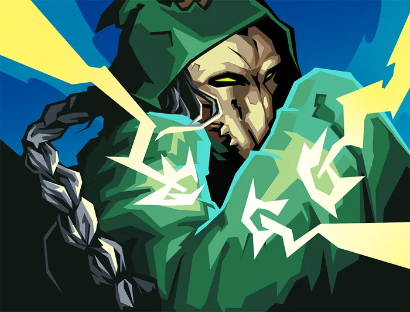 Défense (`DEFEND_SILENT`)
* **Type :** *Skill* | **Coût :** `1` ⚡ | **Rareté :** `Basic`
* **Effet Normal :** Gagnez 5 d'**Armure**.
* **Effet Amélioré :** Gagnez 8 d'**Armure**.
* **Amélioration :** `block: +3`

###  Neutralisation (`NEUTRALIZE`)
* **Type :** *Attack* | **Coût :** `0` ⚡ | **Rareté :** `Basic`
* **Effet Normal :** Infligez 3 dégâts.
Appliquez **Affaibli** (1).
* **Effet Amélioré :** Infligez 4 dégâts.
Appliquez **Affaibli** (2).
* **Amélioration :** `damage: +1, weak: +1`

### 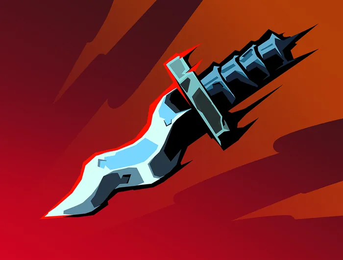 Frappe (`STRIKE_SILENT`)
* **Type :** *Attack* | **Coût :** `1` ⚡ | **Rareté :** `Basic`
* **Effet Normal :** Infligez 6 dégâts.
* **Effet Amélioré :** Infligez 9 dégâts.
* **Amélioration :** `damage: +3`

### 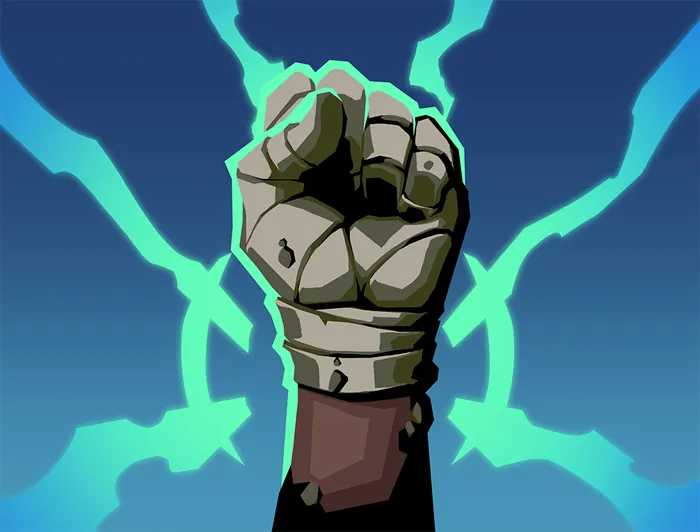 Survivant (`SURVIVOR`)
* **Type :** *Skill* | **Coût :** `1` ⚡ | **Rareté :** `Basic`
* **Effet Normal :** Gagnez 8 d'**Armure**.
Défaussez 1 carte.
* **Effet Amélioré :** Gagnez 11 d'**Armure**.
Défaussez 1 carte.
* **Amélioration :** `block: +3`

## ⭐ Rareté : Common (20 cartes)

###  Anticipation (`ANTICIPATE`)
* **Type :** *Skill* | **Coût :** `0` ⚡ | **Rareté :** `Common`
* **Effet Normal :** Gagnez 2 de **Dextérité** jusqu'à la fin du tour.
* **Effet Amélioré :** Gagnez 4 de **Dextérité** jusqu'à la fin du tour.
* **Amélioration :** `dexterity: +2`

###  Salto arrière (`BACKFLIP`)
* **Type :** *Skill* | **Coût :** `1` ⚡ | **Rareté :** `Common`
* **Effet Normal :** Gagnez 5 d'**Armure**.
Piochez 2 cartes.
* **Effet Amélioré :** Gagnez 8 d'**Armure**.
Piochez 2 cartes.
* **Amélioration :** `block: +3`

###  Danse des lames (`BLADE_DANCE`)
* **Type :** *Skill* | **Coût :** `1` ⚡ | **Rareté :** `Common`
* **Effet Normal :** Ajoutez 3 **Surins** à votre **Main**.
**Épuisement**.
* **Effet Amélioré :** Ajoutez 4 **Surins** à votre **Main**.
**Épuisement**.
* **Amélioration :** `cards: +1`

###  Cape et épée (`CLOAK_AND_DAGGER`)
* **Type :** *Skill* | **Coût :** `1` ⚡ | **Rareté :** `Common`
* **Effet Normal :** Gagnez 6 d'**Armure**.
Ajoutez 1 **Surin** à votre **Main**.
* **Effet Amélioré :** Gagnez 6 d'**Armure**.
Ajoutez 2 **Surins** à votre **Main**.
* **Amélioration :** `cards: +1`

###  Pluie de couteaux (`DAGGER_SPRAY`)
* **Type :** *Attack* | **Coût :** `1` ⚡ | **Rareté :** `Common`
* **Effet Normal :** Infligez 4 dégâts à TOUS les ennemis 2 fois.
* **Effet Amélioré :** Infligez 6 dégâts à TOUS les ennemis 2 fois.
* **Amélioration :** `damage: +2`

###  Lancer de couteau (`DAGGER_THROW`)
* **Type :** *Attack* | **Coût :** `1` ⚡ | **Rareté :** `Common`
* **Effet Normal :** Infligez 9 dégâts.
Piochez 1 carte.
Défaussez 1 carte.
* **Effet Amélioré :** Infligez 12 dégâts.
Piochez 1 carte.
Défaussez 1 carte.
* **Amélioration :** `damage: +3`

###  Poison mortel (`DEADLY_POISON`)
* **Type :** *Skill* | **Coût :** `1` ⚡ | **Rareté :** `Common`
* **Effet Normal :** Appliquez 5 de **Poison**.
* **Effet Amélioré :** Appliquez 7 de **Poison**.
* **Amélioration :** `poison: +2`

###  Déviation (`DEFLECT`)
* **Type :** *Skill* | **Coût :** `0` ⚡ | **Rareté :** `Common`
* **Effet Normal :** Gagnez 4 d'**Armure**.
* **Effet Amélioré :** Gagnez 7 d'**Armure**.
* **Amélioration :** `block: +3`

###  Dérobade (`DODGE_AND_ROLL`)
* **Type :** *Skill* | **Coût :** `1` ⚡ | **Rareté :** `Common`
* **Effet Normal :** Gagnez 4 d'**Armure**.
Au prochain tour, gagnez 4 d'**Armure**.
* **Effet Amélioré :** Gagnez 6 d'**Armure**.
Au prochain tour, gagnez 6 d'**Armure**.
* **Amélioration :** `block: +2`

###  Tic tac (`FLICK_FLACK`)
* **Type :** *Attack* | **Coût :** `1` ⚡ | **Rareté :** `Common`
* **Effet Normal :** **Ruse**.
Infligez 7 dégâts à TOUS les ennemis.
* **Effet Amélioré :** **Ruse**.
Infligez 9 dégâts à TOUS les ennemis.
* **Amélioration :** `damage: +2`

###  Frappe initiale (`LEADING_STRIKE`)
* **Type :** *Attack* | **Coût :** `1` ⚡ | **Rareté :** `Common`
* **Effet Normal :** Infligez 3 dégâts.
Ajoutez 2 **Surins** à votre **Main**.
* **Effet Amélioré :** Infligez 6 dégâts.
Ajoutez 2 **Surins** à votre **Main**.
* **Amélioration :** `damage: +3`

###  Hurlement perçant (`PIERCING_WAIL`)
* **Type :** *Skill* | **Coût :** `1` ⚡ | **Rareté :** `Common`
* **Effet Normal :** TOUS les ennemis perdent 6 de **Force** jusqu'à la fin du tour.
**Épuisement**.
* **Effet Amélioré :** TOUS les ennemis perdent 8 de **Force** jusqu'à la fin du tour.
**Épuisement**.
* **Amélioration :** `strengthloss: +2`

###  Poignard empoisonné (`POISONED_STAB`)
* **Type :** *Attack* | **Coût :** `1` ⚡ | **Rareté :** `Common`
* **Effet Normal :** Infligez 6 dégâts.
Appliquez 3 de **Poison**.
* **Effet Amélioré :** Infligez 8 dégâts.
Appliquez 4 de **Poison**.
* **Amélioration :** `damage: +2, poison: +1`

###  Prédateur (`PREDATOR`)
* **Type :** *Attack* | **Coût :** `2` ⚡ | **Rareté :** `Common`
* **Effet Normal :** Infligez 15 dégâts.
Au prochain tour, piochez 2 cartes.
* **Effet Amélioré :** Infligez 20 dégâts.
Au prochain tour, piochez 2 cartes.
* **Amélioration :** `damage: +5`

###  Préparatifs (`PREPARED`)
* **Type :** *Skill* | **Coût :** `0` ⚡ | **Rareté :** `Common`
* **Effet Normal :** Piochez 1 carte.
Défaussez 1 carte.
* **Effet Amélioré :** Piochez 2 cartes.
Défaussez 2 cartes.
* **Amélioration :** `cards: +1`

###  Ricochet (`RICOCHET`)
* **Type :** *Attack* | **Coût :** `2` ⚡ | **Rareté :** `Common`
* **Effet Normal :** **Ruse**.
Infligez 3 dégâts à un ennemi aléatoire 4 fois.
* **Effet Amélioré :** **Ruse**.
Infligez 3 dégâts à un ennemi aléatoire 5 fois.
* **Amélioration :** `repeat: +1`

###  Trancher (`SLICE`)
* **Type :** *Attack* | **Coût :** `0` ⚡ | **Rareté :** `Common`
* **Effet Normal :** Infligez 6 dégâts.
* **Effet Amélioré :** Infligez 9 dégâts.
* **Amélioration :** `damage: +3`

###  Morsure de serpent (`SNAKEBITE`)
* **Type :** *Skill* | **Coût :** `2` ⚡ | **Rareté :** `Common`
* **Effet Normal :** **Retenue**.
Appliquez 7 de **Poison**.
* **Effet Amélioré :** **Retenue**.
Appliquez 10 de **Poison**.
* **Amélioration :** `poison: +3`

###  Coup bas (`SUCKER_PUNCH`)
* **Type :** *Attack* | **Coût :** `1` ⚡ | **Rareté :** `Common`
* **Effet Normal :** Infligez 8 dégâts.
Appliquez **Affaibli** (1).
* **Effet Amélioré :** Infligez 10 dégâts.
Appliquez **Affaibli** (2).
* **Amélioration :** `damage: +2, weak: +1`

###  Intouchable (`UNTOUCHABLE`)
* **Type :** *Skill* | **Coût :** `2` ⚡ | **Rareté :** `Common`
* **Effet Normal :** **Ruse**.
Gagnez 6 d'**Armure**.
* **Effet Amélioré :** **Ruse**.
Gagnez 9 d'**Armure**.
* **Amélioration :** `block: +3`

## ⭐ Rareté : Uncommon (38 cartes)

### 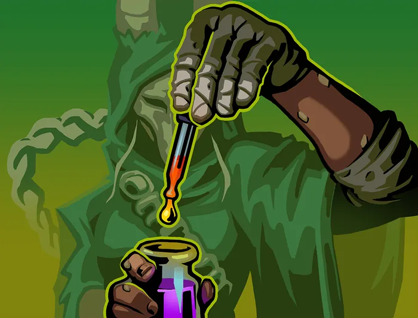 Accélérant (`ACCELERANT`)
* **Type :** *Power* | **Coût :** `1` ⚡ | **Rareté :** `Uncommon`
* **Effet Normal :** Les effets du **Poison** se déclenchent 1 fois supplémentaire.
* **Effet Amélioré :** Les effets du **Poison** se déclenchent 2 fois supplémentaires.
* **Amélioration :** `accelerant: +1`

### 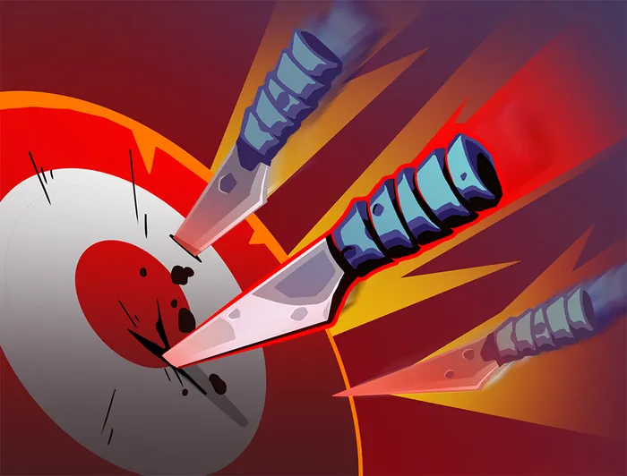 Précision (`ACCURACY`)
* **Type :** *Power* | **Coût :** `1` ⚡ | **Rareté :** `Uncommon`
* **Effet Normal :** Les **Surins** infligent 4 dégâts supplémentaires.
* **Effet Amélioré :** Les **Surins** infligent 6 dégâts supplémentaires.
* **Amélioration :** `accuracypower: +2`

### 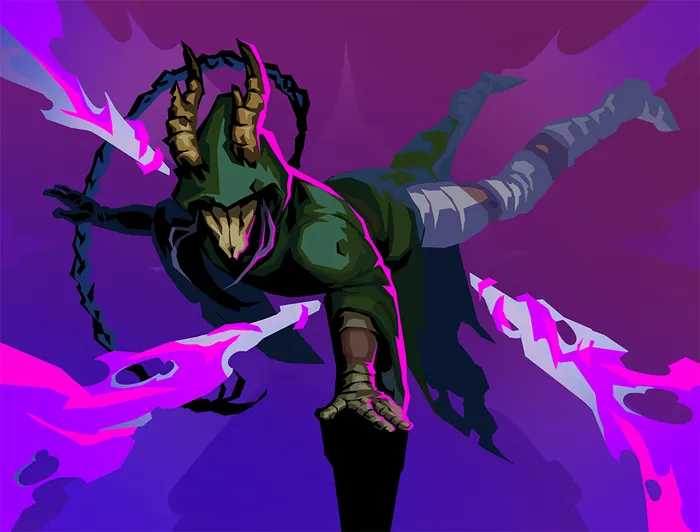 Acrobaties (`ACROBATICS`)
* **Type :** *Skill* | **Coût :** `1` ⚡ | **Rareté :** `Uncommon`
* **Effet Normal :** Piochez 3 cartes.
Défaussez 1 carte.
* **Effet Amélioré :** Piochez 4 cartes.
Défaussez 1 carte.
* **Amélioration :** `cards: +1`

### 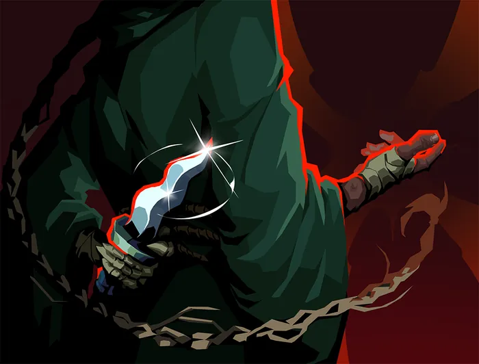 Coup sournois (`BACKSTAB`)
* **Type :** *Attack* | **Coût :** `0` ⚡ | **Rareté :** `Uncommon`
* **Effet Normal :** **Inné**.
Infligez 11 dégâts.
**Épuisement**.
* **Effet Amélioré :** **Inné**.
Infligez 15 dégâts.
**Épuisement**.
* **Amélioration :** `damage: +4`

### 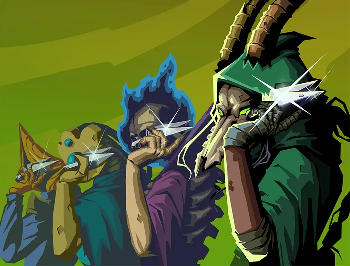 Symphonie de lames (`BLADE_SYMPHONY`)
* **Type :** *Skill* | **Coût :** `2` ⚡ | **Rareté :** `Uncommon`
* **Effet Normal :** Ajoutez 2 **Surins** à la **Main** de TOUS les joueurs.
* **Effet Amélioré :** Ajoutez 2 **Surins** à la **Main** de TOUS les joueurs.
* **Amélioration :** `energy: -1`

### 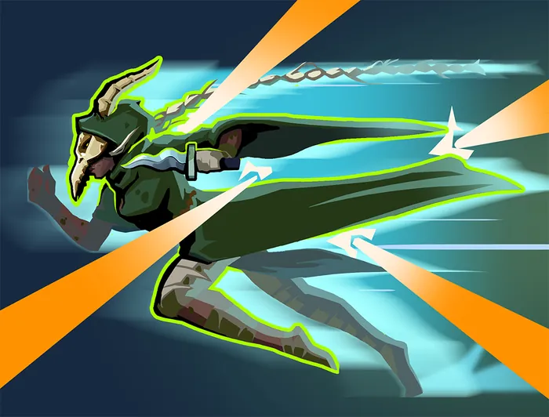 Vision trouble (`BLUR`)
* **Type :** *Skill* | **Coût :** `1` ⚡ | **Rareté :** `Uncommon`
* **Effet Normal :** Gagnez 5 d'**Armure**.
Vous ne perdez pas votre **Armure** au début de votre prochain tour.
* **Effet Amélioré :** Gagnez 8 d'**Armure**.
Vous ne perdez pas votre **Armure** au début de votre prochain tour.
* **Amélioration :** `block: +3`

### 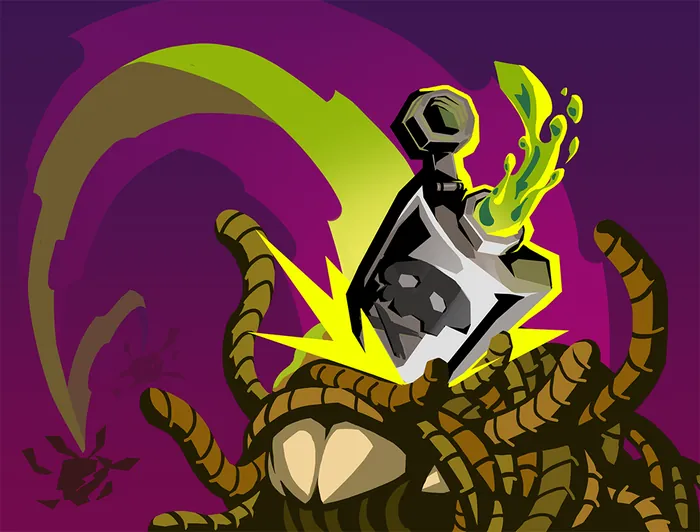 Fiole rebondissante (`BOUNCING_FLASK`)
* **Type :** *Skill* | **Coût :** `2` ⚡ | **Rareté :** `Uncommon`
* **Effet Normal :** Appliquez 3 de **Poison** à un ennemi aléatoire 3 fois.
* **Effet Amélioré :** Appliquez 3 de **Poison** à un ennemi aléatoire 4 fois.
* **Amélioration :** `repeat: +1`

### 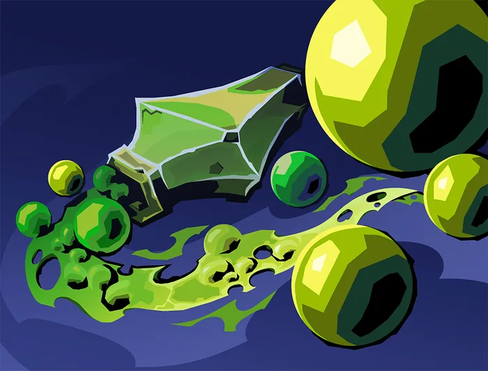 Venin mousseux (`BUBBLE_BUBBLE`)
* **Type :** *Skill* | **Coût :** `1` ⚡ | **Rareté :** `Uncommon`
* **Effet Normal :** Si l'ennemi est affligé de **Poison**, appliquez 9 de **Poison**.
* **Effet Amélioré :** Si l'ennemi est affligé de **Poison**, appliquez 12 de **Poison**.
* **Amélioration :** `poison: +3`

### 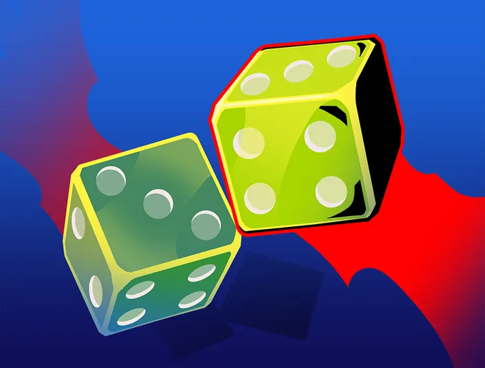 Coup de poker (`CALCULATED_GAMBLE`)
* **Type :** *Skill* | **Coût :** `0` ⚡ | **Rareté :** `Uncommon`
* **Effet Normal :** Défaussez votre **Main**,
puis piochez le même nombre de cartes que vous avez défaussé.
**Épuisement**.
* **Effet Amélioré :** **Retenue**.
Défaussez votre **Main**,
puis piochez le même nombre de cartes que vous avez défaussé.
**Épuisement**.
* **Amélioration :** `keywords: ['Retain']`

### 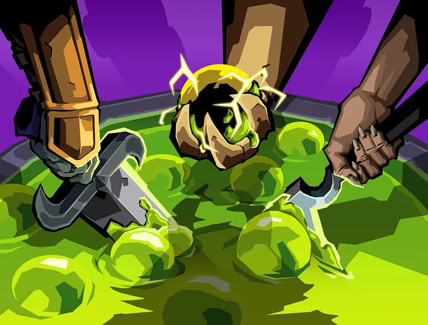 Décoction (`CONCOCT`)
* **Type :** *Skill* | **Coût :** `0` ⚡ | **Rareté :** `Uncommon`
* **Effet Normal :** Choisissez un autre joueur. Lorsque ses Attaques infligent des dégâts non-bloqués par l'Armure pendant ce tour, elles appliquent 3 de **Poison**.
* **Effet Amélioré :** Choisissez un autre joueur. Lorsque ses Attaques infligent des dégâts non-bloqués par l'Armure pendant ce tour, elles appliquent 4 de **Poison**.
* **Amélioration :** `concoctpower: +1`

### 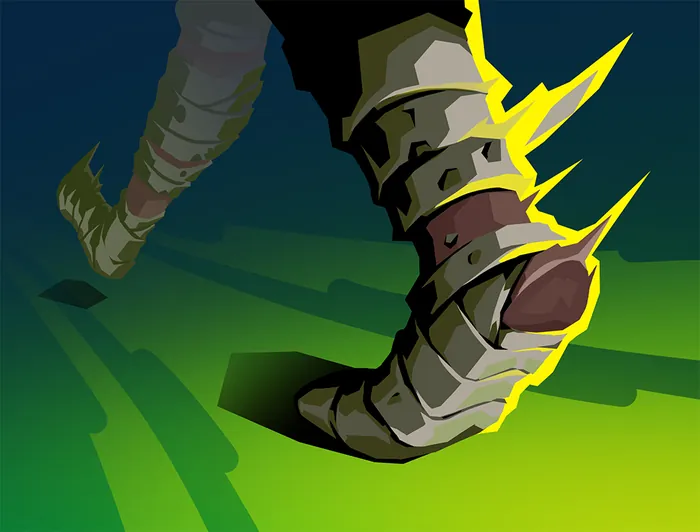 Précipitation (`DASH`)
* **Type :** *Attack* | **Coût :** `2` ⚡ | **Rareté :** `Uncommon`
* **Effet Normal :** Gagnez 10 d'**Armure**.
Infligez 10 dégâts.
* **Effet Amélioré :** Gagnez 13 d'**Armure**.
Infligez 13 dégâts.
* **Amélioration :** `damage: +3, block: +3`

### 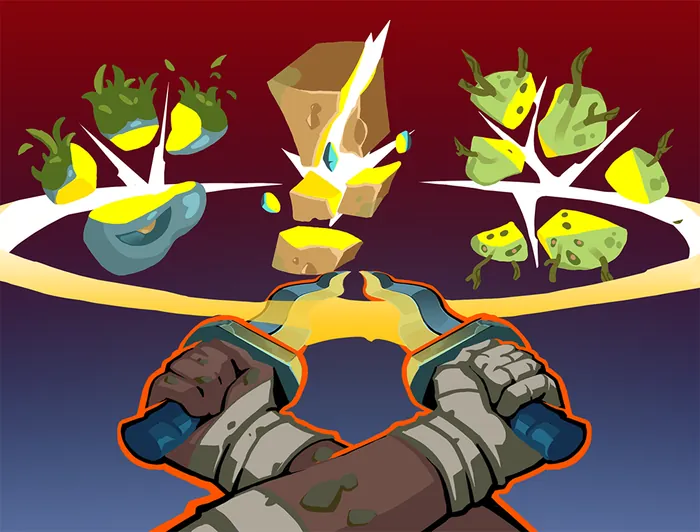 Coup résonnant (`ECHOING_SLASH`)
* **Type :** *Attack* | **Coût :** `1` ⚡ | **Rareté :** `Uncommon`
* **Effet Normal :** Infligez 10 dégâts à TOUS les ennemis.
Répétez cet effet pour chaque ennemi tué.
* **Effet Amélioré :** Infligez 13 dégâts à TOUS les ennemis.
Répétez cet effet pour chaque ennemi tué.
* **Amélioration :** `damage: +3`

### 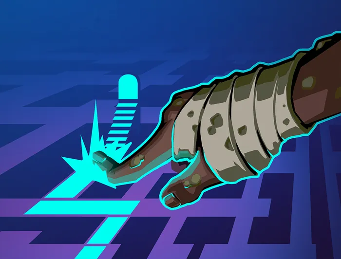 Plan d'évasion (`ESCAPE_PLAN`)
* **Type :** *Skill* | **Coût :** `0` ⚡ | **Rareté :** `Uncommon`
* **Effet Normal :** Piochez 1 carte.
Si vous piochez une Compétence, gagnez 3 d'**Armure**.
* **Effet Amélioré :** Piochez 1 carte.
Si vous piochez une Compétence, gagnez 5 d'**Armure**.
* **Amélioration :** `block: +2`

### 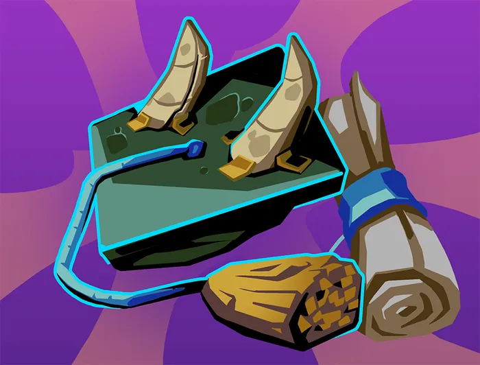 Expertise (`EXPERTISE`)
* **Type :** *Skill* | **Coût :** `1` ⚡ | **Rareté :** `Uncommon`
* **Effet Normal :** Piochez 2 cartes.
Elles sont **Retenues** pendant ce tour.
* **Effet Amélioré :** Piochez 3 cartes.
Elles sont **Retenues** pendant ce tour.
* **Amélioration :** `cards: +1`

### 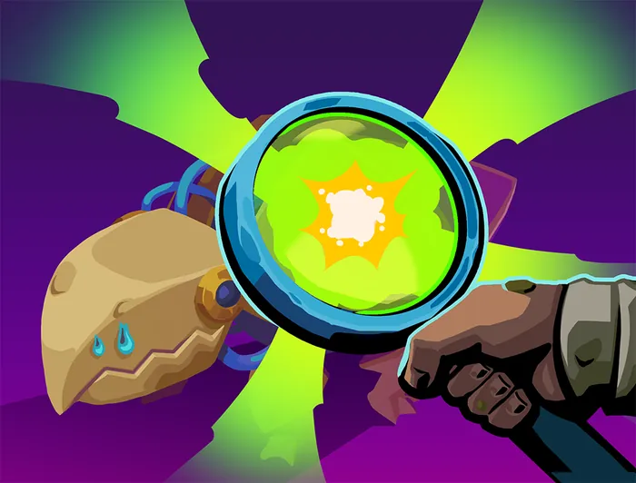 Point faible (`EXPOSE`)
* **Type :** *Skill* | **Coût :** `0` ⚡ | **Rareté :** `Uncommon`
* **Effet Normal :** Retirez tous les **Artéfacts** et toute l'**Armure** de l'ennemi.
Appliquez **Vulnérable** (2).
**Épuisement**.
* **Effet Amélioré :** Retirez tous les **Artéfacts** et toute l'**Armure** de l'ennemi.
Appliquez **Vulnérable** (3).
**Épuisement**.
* **Amélioration :** `power: +1`

### 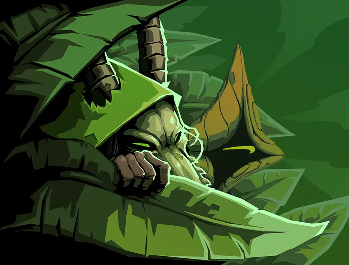 Oubli (`FADE`)
* **Type :** *Skill* | **Coût :** `0` ⚡ | **Rareté :** `Uncommon`
* **Effet Normal :** **Retenue**.
Un autre joueur gagne 6 de **Dextérité** pendant ce tour.
* **Effet Amélioré :** **Retenue**.
Un autre joueur gagne 9 de **Dextérité** pendant ce tour.
* **Amélioration :** `dexterity: +3`

### 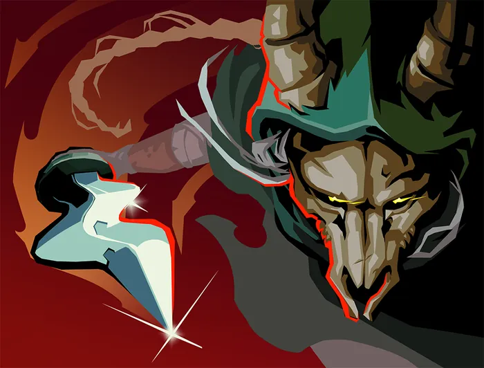 Coup décisif (`FINISHER`)
* **Type :** *Attack* | **Coût :** `1` ⚡ | **Rareté :** `Uncommon`
* **Effet Normal :** Infligez 6 dégâts pour chaque Attaque déjà jouée ce tour.
* **Effet Amélioré :** Infligez 8 dégâts pour chaque Attaque déjà jouée ce tour.
* **Amélioration :** `damage: +2`

### 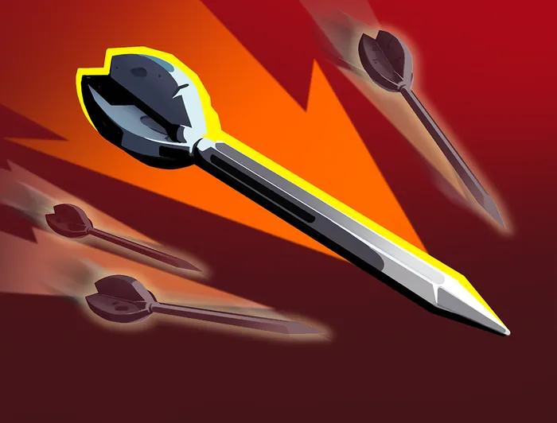 Fléchettes (`FLECHETTES`)
* **Type :** *Attack* | **Coût :** `1` ⚡ | **Rareté :** `Uncommon`
* **Effet Normal :** Infligez 5 dégâts pour chaque Compétence dans votre **Main**.
* **Effet Amélioré :** Infligez 7 dégâts pour chaque Compétence dans votre **Main**.
* **Amélioration :** `damage: +2`

### 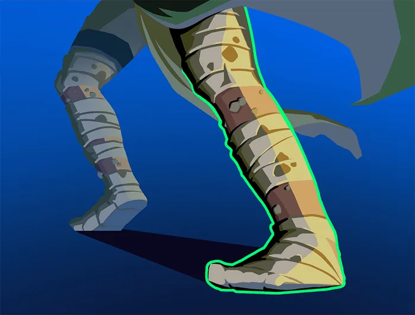 Jeu de jambes (`FOOTWORK`)
* **Type :** *Power* | **Coût :** `1` ⚡ | **Rareté :** `Uncommon`
* **Effet Normal :** Gagnez 2 de **Dextérité**.
* **Effet Amélioré :** Gagnez 3 de **Dextérité**.
* **Amélioration :** `dexterity: +1`

### 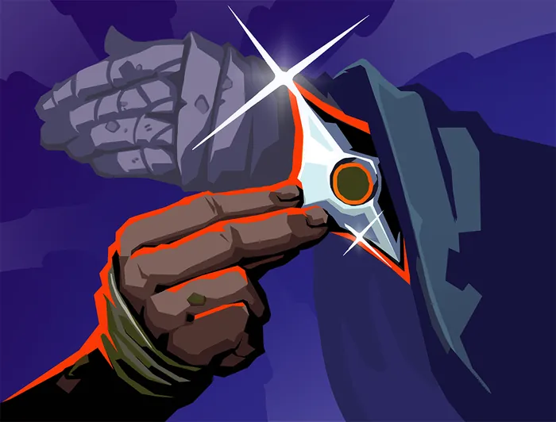 Trucage (`HAND_TRICK`)
* **Type :** *Skill* | **Coût :** `1` ⚡ | **Rareté :** `Uncommon`
* **Effet Normal :** Gagnez 7 d'**Armure**.
Ajoutez **Ruse** à une Compétence dans votre **Main** jusqu'à la fin du tour.
* **Effet Amélioré :** Gagnez 10 d'**Armure**.
Ajoutez **Ruse** à une Compétence dans votre **Main** jusqu'à la fin du tour.
* **Amélioration :** `block: +3`

### 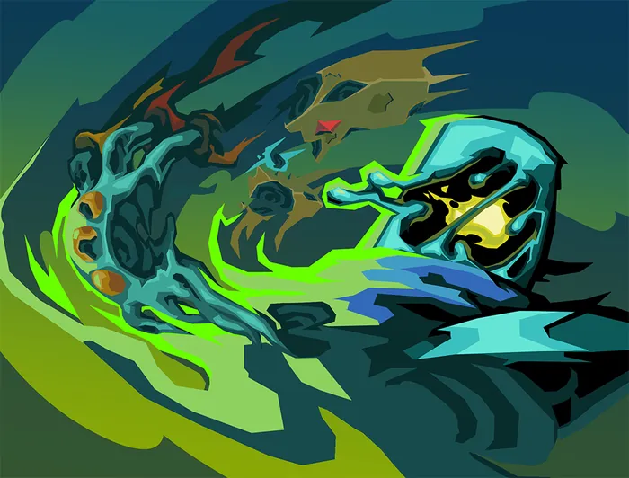 Brouillard (`HAZE`)
* **Type :** *Skill* | **Coût :** `2` ⚡ | **Rareté :** `Uncommon`
* **Effet Normal :** Appliquez 4 de **Poison** et **Affaibli** (1) à TOUS les ennemis.
* **Effet Amélioré :** Appliquez 6 de **Poison** et **Affaibli** (2) à TOUS les ennemis.
* **Amélioration :** `poison: +2, weak: +1`

### 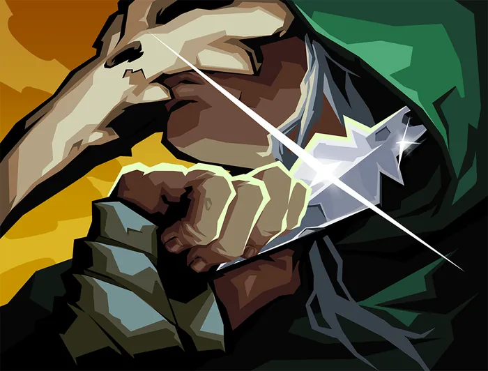 Poignards dissimulés (`HIDDEN_DAGGERS`)
* **Type :** *Skill* | **Coût :** `0` ⚡ | **Rareté :** `Uncommon`
* **Effet Normal :** Défaussez 2 cartes.
Ajoutez 2 **Surins** à votre **Main**.
* **Effet Amélioré :** Défaussez 2 cartes.
Ajoutez 2 **Surins+** à votre **Main**.

### 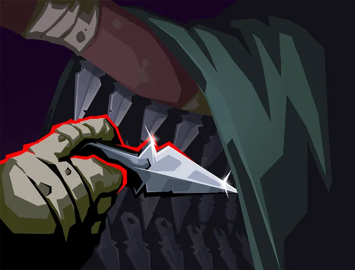 Lames infinies (`INFINITE_BLADES`)
* **Type :** *Power* | **Coût :** `1` ⚡ | **Rareté :** `Uncommon`
* **Effet Normal :** Au début de votre tour, ajoutez 1 **Surin** à votre **Main**.
* **Effet Amélioré :** **Inné**.
Au début de votre tour, ajoutez 1 **Surin** à votre **Main**.
* **Amélioration :** `keywords: ['Innate']`

### 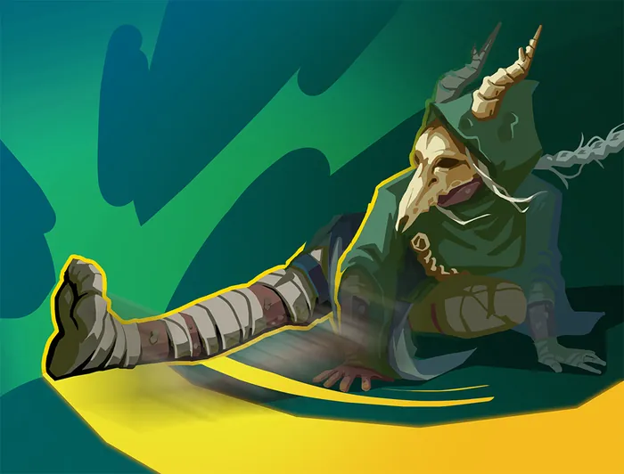 Balayage (`LEG_SWEEP`)
* **Type :** *Skill* | **Coût :** `2` ⚡ | **Rareté :** `Uncommon`
* **Effet Normal :** Appliquez **Affaibli** (2).
Gagnez 11 d'**Armure**.
* **Effet Amélioré :** Appliquez **Affaibli** (3).
Gagnez 14 d'**Armure**.
* **Amélioration :** `block: +3, weak: +1`

### 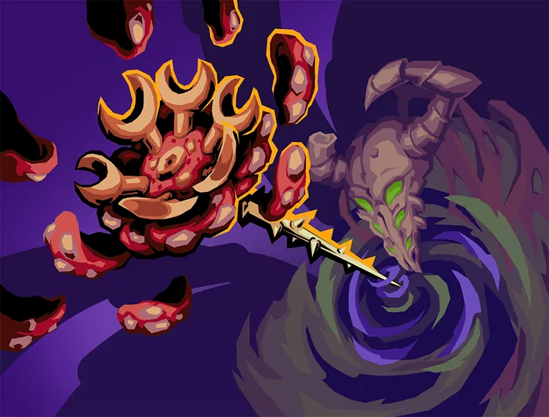 Memento mori (`MEMENTO_MORI`)
* **Type :** *Attack* | **Coût :** `1` ⚡ | **Rareté :** `Uncommon`
* **Effet Normal :** Infligez 9 dégâts.
Inflige 4 dégâts supplémentaires pour chaque carte défaussée ce tour.
* **Effet Amélioré :** Infligez 11 dégâts.
Inflige 5 dégâts supplémentaires pour chaque carte défaussée ce tour.
* **Amélioration :** `calculationbase: +2, extradamage: +1`

### 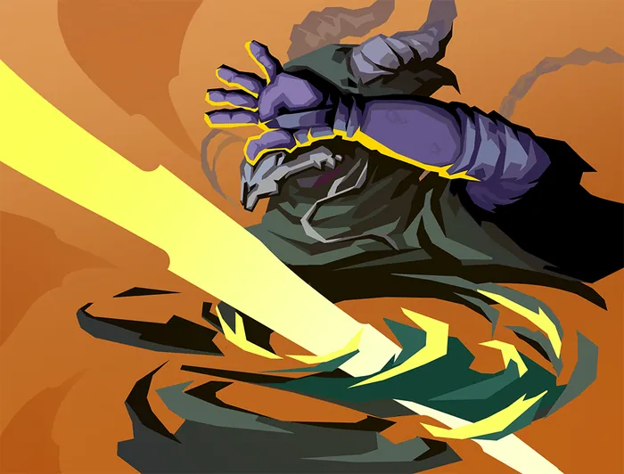 Mirage (`MIRAGE`)
* **Type :** *Skill* | **Coût :** `1` ⚡ | **Rareté :** `Uncommon`
* **Effet Normal :** Gagnez un montant d'**Armure** égal au **Poison** présent sur TOUS les ennemis.
**Épuisement**.
* **Effet Amélioré :** Gagnez un montant d'**Armure** égal au **Poison** présent sur TOUS les ennemis.
* **Amélioration :** `keywordsRemoved: ['Exhaust']`

###  Vapeurs toxiques (`NOXIOUS_FUMES`)
* **Type :** *Power* | **Coût :** `1` ⚡ | **Rareté :** `Uncommon`
* **Effet Normal :** Au début de votre tour, appliquez 2 de **Poison** à TOUS les ennemis.
* **Effet Amélioré :** Au début de votre tour, appliquez 3 de **Poison** à TOUS les ennemis.
* **Amélioration :** `poisonperturn: +1`

### 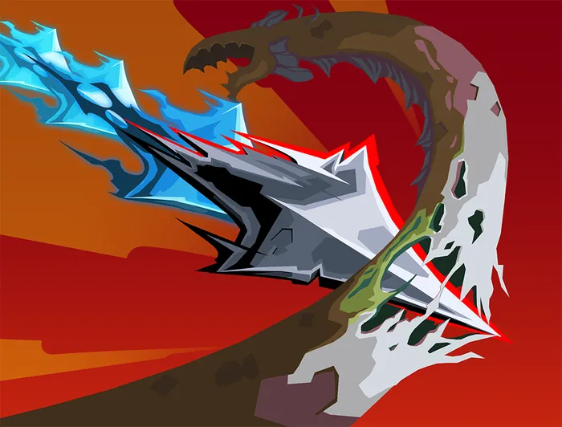 Lames fantomatiques (`PHANTOM_BLADES`)
* **Type :** *Power* | **Coût :** `1` ⚡ | **Rareté :** `Uncommon`
* **Effet Normal :** Vos **Surins** gagnent **Retenue**.
Le premier **Surin** que vous jouez chaque tour inflige 9 dégâts supplémentaires.
* **Effet Amélioré :** Vos **Surins** gagnent **Retenue**.
Le premier **Surin** que vous jouez chaque tour inflige 12 dégâts supplémentaires.
* **Amélioration :** `phantombladespower: +3`

### 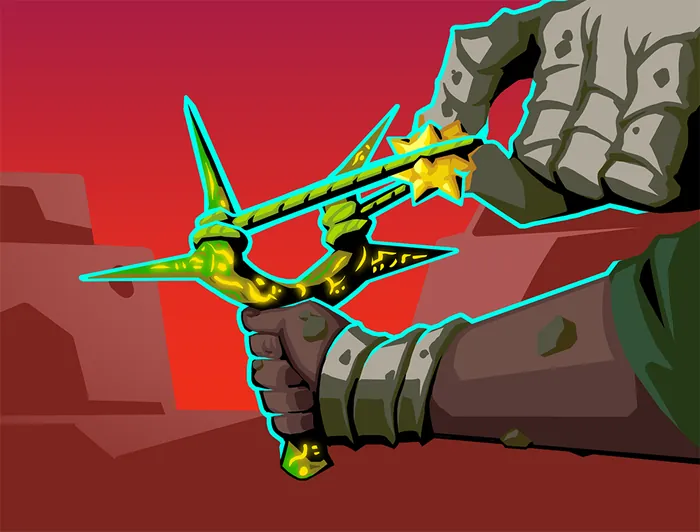 Localisation (`PINPOINT`)
* **Type :** *Attack* | **Coût :** `3` ⚡ | **Rareté :** `Uncommon`
* **Effet Normal :** Infligez 15 dégâts.
Coûte 1 ⚡ en moins pour chaque Compétence jouée pendant ce tour.
* **Effet Amélioré :** Infligez 19 dégâts.
Coûte 1 ⚡ en moins pour chaque Compétence jouée pendant ce tour.
* **Amélioration :** `damage: +4`

### 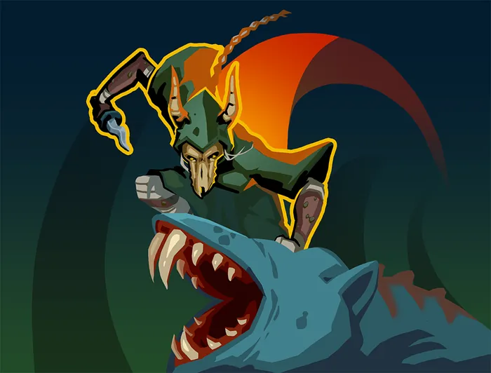 Surgissement (`POUNCE`)
* **Type :** *Attack* | **Coût :** `2` ⚡ | **Rareté :** `Uncommon`
* **Effet Normal :** Infligez 14 dégâts.
La prochaine Compétence que vous jouez coûte 0 ⚡.
* **Effet Amélioré :** Infligez 20 dégâts.
La prochaine Compétence que vous jouez coûte 0 ⚡.
* **Amélioration :** `damage: +6`

### 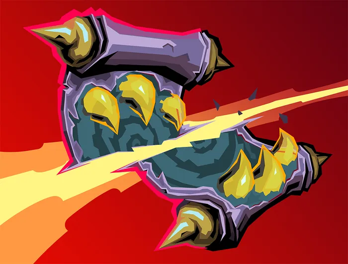 Entaille (`PRECISE_CUT`)
* **Type :** *Attack* | **Coût :** `0` ⚡ | **Rareté :** `Uncommon`
* **Effet Normal :** Infligez 13 dégâts.
Inflige 2 dégâts en moins pour chaque autre carte dans votre **Main**.
* **Effet Amélioré :** Infligez 16 dégâts.
Inflige 2 dégâts en moins pour chaque autre carte dans votre **Main**.
* **Amélioration :** `calculationbase: +3`

### 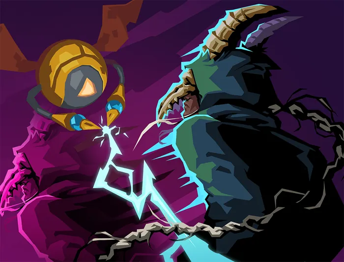 Réflexes (`REFLEX`)
* **Type :** *Skill* | **Coût :** `3` ⚡ | **Rareté :** `Uncommon`
* **Effet Normal :** **Ruse**.
Piochez 2 cartes.
* **Effet Amélioré :** **Ruse**.
Piochez 3 cartes.
* **Amélioration :** `cards: +1`

### 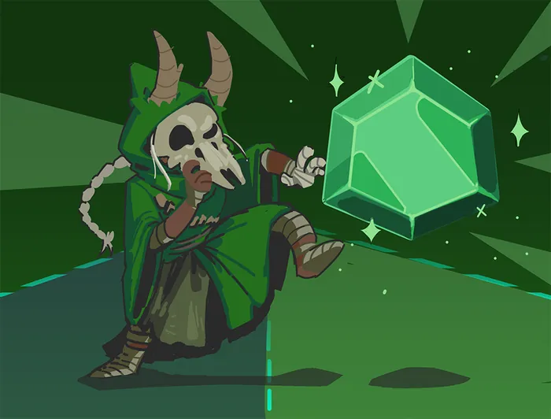 Pas de côté (`SIDESTEP`)
* **Type :** *Skill* | **Coût :** `0` ⚡ | **Rareté :** `Uncommon`
* **Effet Normal :** Au prochain tour, gagnez ⚡1⚡.
* **Effet Amélioré :** Au prochain tour, gagnez ⚡2⚡.
* **Amélioration :** `energygain: +1`

### 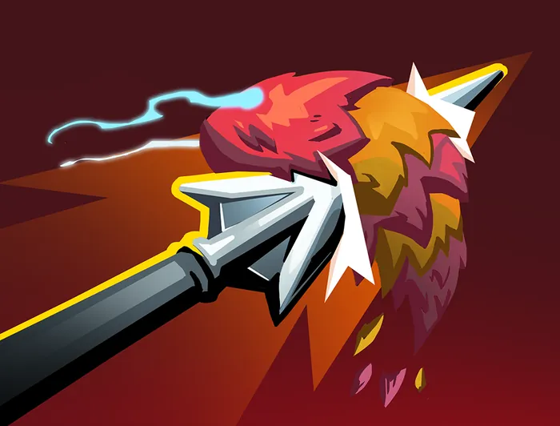 Embrocher (`SKEWER`)
* **Type :** *Attack* | **Coût :** `-1` ⚡ | **Rareté :** `Uncommon`
* **Effet Normal :** Infligez 8 dégâts X fois.
* **Effet Amélioré :** Infligez 11 dégâts X fois.
* **Amélioration :** `damage: +3`

### 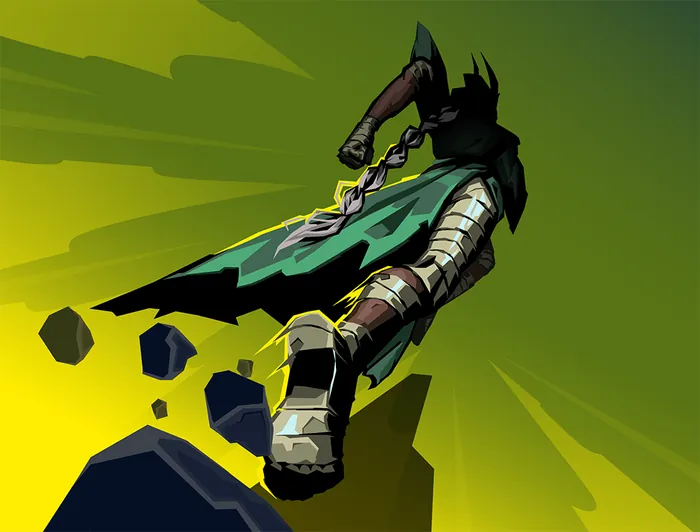 Excès de vitesse (`SPEEDSTER`)
* **Type :** *Power* | **Coût :** `2` ⚡ | **Rareté :** `Uncommon`
* **Effet Normal :** Lorsque vous piochez une carte pendant votre tour, infligez 2 dégâts à TOUS les ennemis.
* **Effet Amélioré :** **Inné**.
Lorsque vous piochez une carte pendant votre tour, infligez 2 dégâts à TOUS les ennemis.
* **Amélioration :** `keywords: ['Innate']`

### 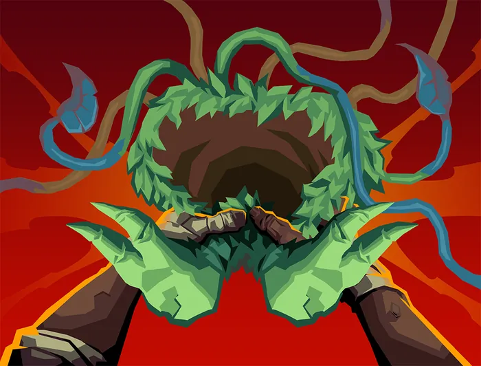 Strangulation (`STRANGLE`)
* **Type :** *Attack* | **Coût :** `1` ⚡ | **Rareté :** `Uncommon`
* **Effet Normal :** Infligez 8 dégâts.
Lorsque vous jouez une carte pendant ce tour, l'ennemi perd 2 PV.
* **Effet Amélioré :** Infligez 10 dégâts.
Lorsque vous jouez une carte pendant ce tour, l'ennemi perd 3 PV.
* **Amélioration :** `damage: +2, stranglepower: +1`

### 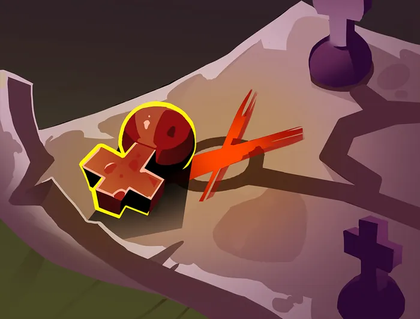 Tactique (`TACTICIAN`)
* **Type :** *Skill* | **Coût :** `3` ⚡ | **Rareté :** `Uncommon`
* **Effet Normal :** **Ruse**.
Gagnez ⚡1⚡.
* **Effet Amélioré :** **Ruse**.
Gagnez ⚡2⚡.
* **Amélioration :** `energygain: +1`

### 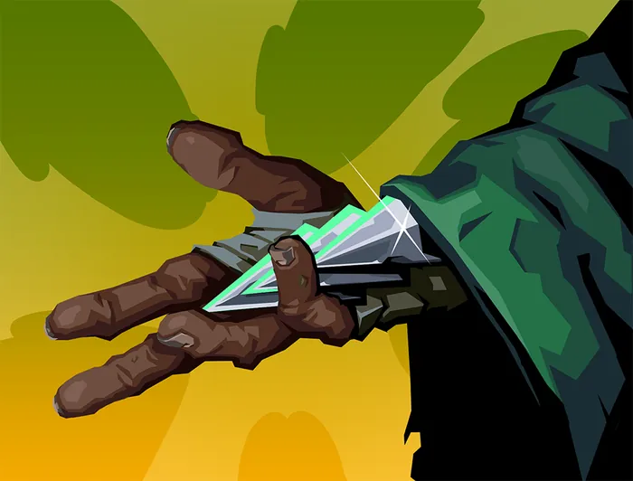 Passe-passe (`UP_MY_SLEEVE`)
* **Type :** *Skill* | **Coût :** `2` ⚡ | **Rareté :** `Uncommon`
* **Effet Normal :** Ajoutez 3 **Surins** à votre **Main**.
Réduisez le coût de cette carte de 1.
* **Effet Amélioré :** Ajoutez 4 **Surins** à votre **Main**.
Réduisez le coût de cette carte de 1.
* **Amélioration :** `cards: +1`

## ⭐ Rareté : Rare (27 cartes)

### 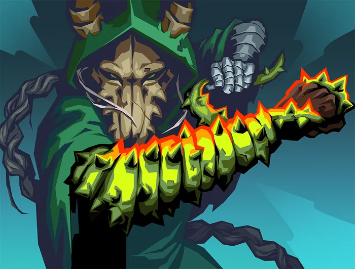 Abrasif (`ABRASIVE`)
* **Type :** *Power* | **Coût :** `3` ⚡ | **Rareté :** `Rare`
* **Effet Normal :** **Ruse**.
Gagnez 1 de **Dextérité**.
Gagnez 4 **Épines**.
* **Effet Amélioré :** **Ruse**.
Gagnez 1 de **Dextérité**.
Gagnez 6 **Épines**.
* **Amélioration :** `thornspower: +2`

###  Adrénaline (`ADRENALINE`)
* **Type :** *Skill* | **Coût :** `0` ⚡ | **Rareté :** `Rare`
* **Effet Normal :** Gagnez ⚡1⚡.
Piochez 2 cartes.
**Épuisement**.
* **Effet Amélioré :** Gagnez ⚡2⚡.
Piochez 2 cartes.
**Épuisement**.
* **Amélioration :** `energygain: +1`

### 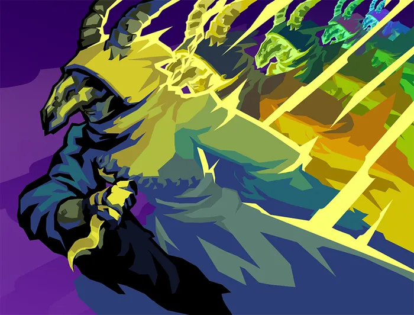 Image rémanente (`AFTERIMAGE`)
* **Type :** *Power* | **Coût :** `1` ⚡ | **Rareté :** `Rare`
* **Effet Normal :** Lorsque vous jouez une carte, gagnez 1 d'**Armure**.
* **Effet Amélioré :** **Inné**.
Lorsque vous jouez une carte, gagnez 1 d'**Armure**.
* **Amélioration :** `keywords: ['Innate']`

### 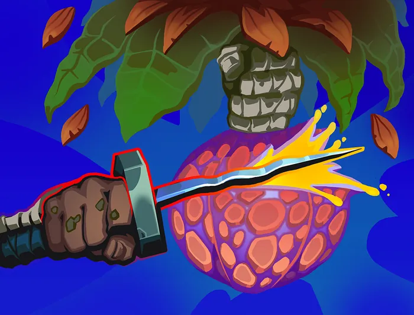 Assassiner (`ASSASSINATE`)
* **Type :** *Attack* | **Coût :** `0` ⚡ | **Rareté :** `Rare`
* **Effet Normal :** **Inné**.
Infligez 10 dégâts.
Appliquez **Vulnérable** (1).
**Épuisement**.
* **Effet Amélioré :** **Inné**.
Infligez 13 dégâts.
Appliquez **Vulnérable** (2).
**Épuisement**.
* **Amélioration :** `damage: +3, vulnerable: +1`

### 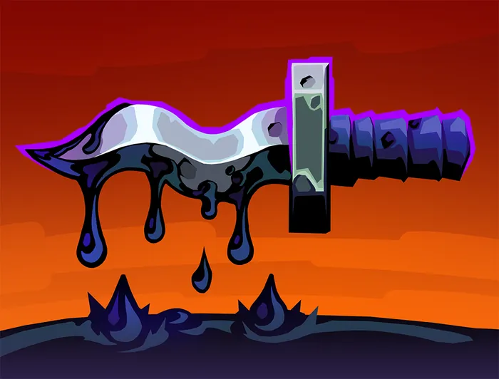 Lame d'encre (`BLADE_OF_INK`)
* **Type :** *Skill* | **Coût :** `1` ⚡ | **Rareté :** `Rare`
* **Effet Normal :** Ajoutez 2 **Surins** Encrés à votre **Main**.
* **Effet Amélioré :** Ajoutez 3 **Surins** Encrés à votre **Main**.
* **Amélioration :** `cards: +1`

### 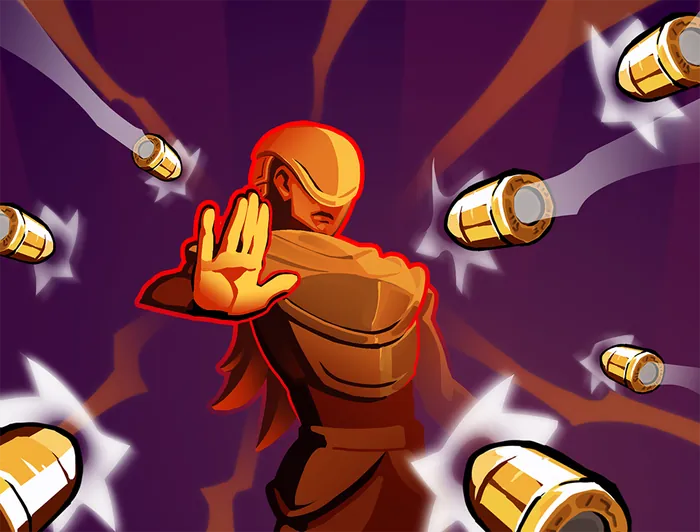 Bullet Time (`BULLET_TIME`)
* **Type :** *Skill* | **Coût :** `3` ⚡ | **Rareté :** `Rare`
* **Effet Normal :** Vous ne pouvez plus piocher de cartes pendant ce tour. TOUTES les cartes de votre **Main** coûtent 0 jusqu'à la fin du tour.
* **Effet Amélioré :** Vous ne pouvez plus piocher de cartes pendant ce tour. TOUTES les cartes de votre **Main** coûtent 0 jusqu'à la fin du tour.
* **Amélioration :** `energy: -1`

### 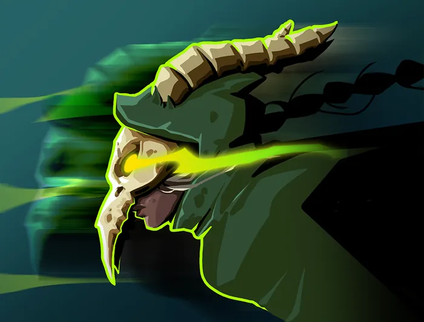 Déflagration (`BURST`)
* **Type :** *Skill* | **Coût :** `1` ⚡ | **Rareté :** `Rare`
* **Effet Normal :** La prochaine compétence que vous jouez ce tour sera jouée une fois supplémentaire.
* **Effet Amélioré :** Les 2 prochaines compétences que vous jouez ce tour seront jouées une fois supplémentaire.
* **Amélioration :** `skills: +1`

### 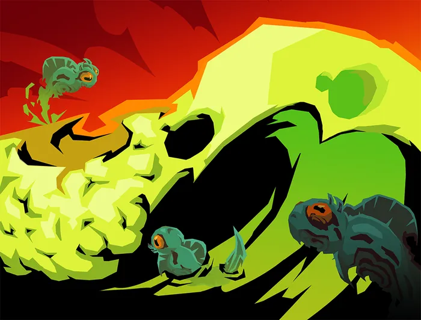 Vague corrosive (`CORROSIVE_WAVE`)
* **Type :** *Skill* | **Coût :** `1` ⚡ | **Rareté :** `Rare`
* **Effet Normal :** Lorsque vous piochez une carte ce tour, appliquez 2 de **Poison** à TOUS les ennemis.
* **Effet Amélioré :** Lorsque vous piochez une carte ce tour, appliquez 3 de **Poison** à TOUS les ennemis.
* **Amélioration :** `corrosivewave: +1`

### 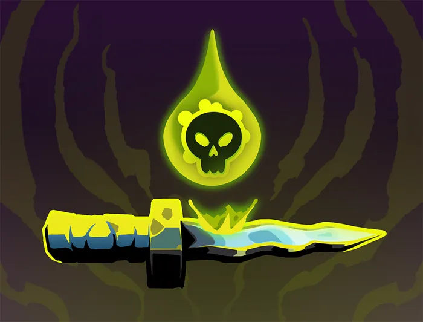 Envenimer (`ENVENOM`)
* **Type :** *Power* | **Coût :** `2` ⚡ | **Rareté :** `Rare`
* **Effet Normal :** Chaque fois qu'une Attaque inflige des dégâts non bloqués, appliquez 1 de **Poison**.
* **Effet Amélioré :** Chaque fois qu'une Attaque inflige des dégâts non bloqués, appliquez 2 de **Poison**.
* **Amélioration :** `envenompower: +1`

### 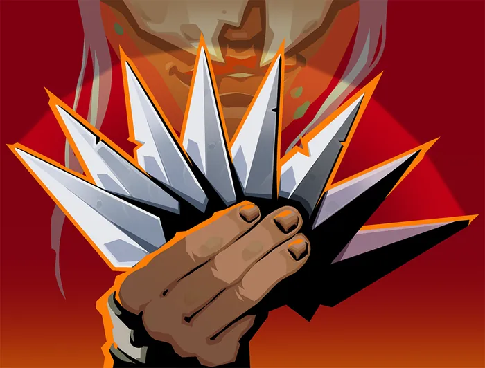 Éventail de couteaux (`FAN_OF_KNIVES`)
* **Type :** *Power* | **Coût :** `2` ⚡ | **Rareté :** `Rare`
* **Effet Normal :** Les **Surins** touchent désormais TOUS les ennemis.
Ajoutez 4 **Surins** à votre **Main**.
* **Effet Amélioré :** Les **Surins** touchent désormais TOUS les ennemis.
Ajoutez 5 **Surins** à votre **Main**.
* **Amélioration :** `shivs: +1`

### 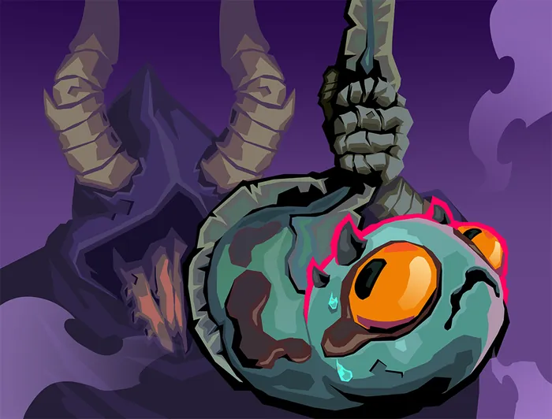 Encerclement (`FLANKING`)
* **Type :** *Skill* | **Coût :** `2` ⚡ | **Rareté :** `Rare`
* **Effet Normal :** L'ennemi subit le double des dégâts d'attaque infligés par les autres joueurs jusqu'à la fin du tour.
* **Effet Amélioré :** L'ennemi subit le double des dégâts d'attaque infligés par les autres joueurs jusqu'à la fin du tour.
* **Amélioration :** `energy: -1`

###  Clou du spectacle (`GRAND_FINALE`)
* **Type :** *Attack* | **Coût :** `0` ⚡ | **Rareté :** `Rare`
* **Effet Normal :** Ne peut être joué que si votre **Pioche** est vide. Infligez 60 dégâts à TOUS les ennemis.
* **Effet Amélioré :** Ne peut être joué que si votre **Pioche** est vide. Infligez 75 dégâts à TOUS les ennemis.
* **Amélioration :** `damage: +15`

###  Piège à poignards (`KNIFE_TRAP`)
* **Type :** *Skill* | **Coût :** `2` ⚡ | **Rareté :** `Rare`
* **Effet Normal :** Jouez chaque **Surin** depuis votre pile de cartes **Épuisées** sur l'ennemi.
* **Effet Amélioré :** **Améliorez** et jouez chaque **Surin** depuis votre pile de cartes **Épuisées** sur l'ennemi.

###  Malaise (`MALAISE`)
* **Type :** *Skill* | **Coût :** `-1` ⚡ | **Rareté :** `Rare`
* **Effet Normal :** L'ennemi perd X de **Force**. Appliquez **Affaibli** (X).
**Épuisement**.
* **Effet Amélioré :** L'ennemi perd X+1 de **Force**. Appliquez **Affaibli** (X+1).
**Épuisement**.

###  Grands desseins (`MASTER_PLANNER`)
* **Type :** *Power* | **Coût :** `2` ⚡ | **Rareté :** `Rare`
* **Effet Normal :** Lorsque vous jouez une Compétence, elle gagne **Ruse**.
* **Effet Amélioré :** Lorsque vous jouez une Compétence, elle gagne **Ruse**.
* **Amélioration :** `energy: -1`

###  Meurtre (`MURDER`)
* **Type :** *Attack* | **Coût :** `3` ⚡ | **Rareté :** `Rare`
* **Effet Normal :** Infligez 1 dégâts.
Inflige 1 dégâts supplémentaires pour chaque carte piochée pendant ce combat.
* **Effet Amélioré :** Infligez 1 dégâts.
Inflige 1 dégâts supplémentaires pour chaque carte piochée pendant ce combat.
* **Amélioration :** `energy: -1`

###  Cauchemar (`NIGHTMARE`)
* **Type :** *Skill* | **Coût :** `3` ⚡ | **Rareté :** `Rare`
* **Effet Normal :** Choisissez une carte.
Au prochain tour, ajoutez 3 copies de cette carte à votre **Main**.
**Épuisement**.
* **Effet Amélioré :** Choisissez une carte.
Au prochain tour, ajoutez 3 copies de cette carte à votre **Main**.
**Épuisement**.
* **Amélioration :** `energy: -1`

###  Épidémie (`OUTBREAK`)
* **Type :** *Skill* | **Coût :** `3` ⚡ | **Rareté :** `Rare`
* **Effet Normal :** Appliquez 9 de **Poison** sur TOUS les ennemis.
Le **Poison** se déclenche immédiatement.
* **Effet Amélioré :** Appliquez 12 de **Poison** sur TOUS les ennemis.
Le **Poison** se déclenche immédiatement.
* **Amélioration :** `poison: +3`

###  Forme du serpent (`SERPENT_FORM`)
* **Type :** *Power* | **Coût :** `3` ⚡ | **Rareté :** `Rare`
* **Effet Normal :** Lorsque vous jouez une carte, infligez 4 dégâts à un ennemi aléatoire.
* **Effet Amélioré :** Lorsque vous jouez une carte, infligez 6 dégâts à un ennemi aléatoire.
* **Amélioration :** `serpentformpower: +2`

###  Pas de l'ombre (`SHADOW_STEP`)
* **Type :** *Skill* | **Coût :** `1` ⚡ | **Rareté :** `Rare`
* **Effet Normal :** Défaussez votre **Main**.
Au prochain tour, les Attaques infligent le double de dégâts.
* **Effet Amélioré :** Défaussez votre **Main**.
Au prochain tour, les Attaques infligent le double de dégâts.
* **Amélioration :** `energy: -1`

###  Camouflage (`SHADOWMELD`)
* **Type :** *Skill* | **Coût :** `1` ⚡ | **Rareté :** `Rare`
* **Effet Normal :** Double les quantités d'**Armure** que vous gagnez pendant ce tour.
* **Effet Amélioré :** Double les quantités d'**Armure** que vous gagnez pendant ce tour.
* **Amélioration :** `energy: -1`

###  Furtif (`SNEAKY`)
* **Type :** *Power* | **Coût :** `2` ⚡ | **Rareté :** `Rare`
* **Effet Normal :** **Ruse**.
Lorsqu'un autre joueur attaque un ennemi, gagnez 1 d'**Armure**.
* **Effet Amélioré :** **Ruse**.
Lorsqu'un autre joueur attaque un ennemi, gagnez 2 d'**Armure**.
* **Amélioration :** `sneakypower: +1`

###  Tempête d'acier (`STORM_OF_STEEL`)
* **Type :** *Skill* | **Coût :** `1` ⚡ | **Rareté :** `Rare`
* **Effet Normal :** Défaussez votre **Main**.
Ajoutez autant de **Surins** à votre **Main** que de cartes défaussées.
* **Effet Amélioré :** Défaussez votre **Main**.
Ajoutez autant de **Surins+** à votre **Main** que de cartes défaussées.

###  La traque (`THE_HUNT`)
* **Type :** *Attack* | **Coût :** `1` ⚡ | **Rareté :** `Rare`
* **Effet Normal :** Infligez 10 dégâts.
**Coup de grâce** : obtenez une récompense de carte supplémentaire.
**Épuisement**.
* **Effet Amélioré :** Infligez 15 dégâts.
**Coup de grâce** : obtenez une récompense de carte supplémentaire.
**Épuisement**.
* **Amélioration :** `damage: +5`

###  Savoir-faire (`TOOLS_OF_THE_TRADE`)
* **Type :** *Power* | **Coût :** `1` ⚡ | **Rareté :** `Rare`
* **Effet Normal :** Au début de votre tour, piochez 1 carte et défaussez 1 carte.
* **Effet Amélioré :** Au début de votre tour, piochez 1 carte et défaussez 1 carte.
* **Amélioration :** `energy: -1`

###  Pistage (`TRACKING`)
* **Type :** *Power* | **Coût :** `2` ⚡ | **Rareté :** `Rare`
* **Effet Normal :** Les ennemis **Affaiblis** subissent 50% des dégâts infligés par les Attaques en plus.
* **Effet Amélioré :** Les ennemis **Affaiblis** subissent 50% des dégâts infligés par les Attaques en plus.
* **Amélioration :** `energy: -1`

###  Préméditation (`WELL_LAID_PLANS`)
* **Type :** *Power* | **Coût :** `2` ⚡ | **Rareté :** `Rare`
* **Effet Normal :** À la fin de votre tour, vous ne défaussez plus votre **Main**.
* **Effet Amélioré :** À la fin de votre tour, vous ne défaussez plus votre **Main**.
* **Amélioration :** `energy: -1`
