# 🃏 Cartes — Le Défectueux (Defect)

> **Total :** 91 cartes | **Patch :** `v0.111.0 Beta`  
> Cartes bleues manipulant les orbes élémentaires (Foudre, Glace, Obscurité, Plasma) et les algorithmes.

---

## ⭐ Rareté : Basic (4 cartes)

### 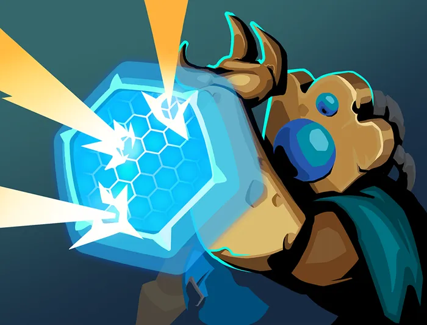 Défense (`DEFEND_DEFECT`)
* **Type :** *Skill* | **Coût :** `1` ⚡ | **Rareté :** `Basic`
* **Effet Normal :** Gagnez 5 d'**Armure**.
* **Effet Amélioré :** Gagnez 8 d'**Armure**.
* **Amélioration :** `block: +3`

### 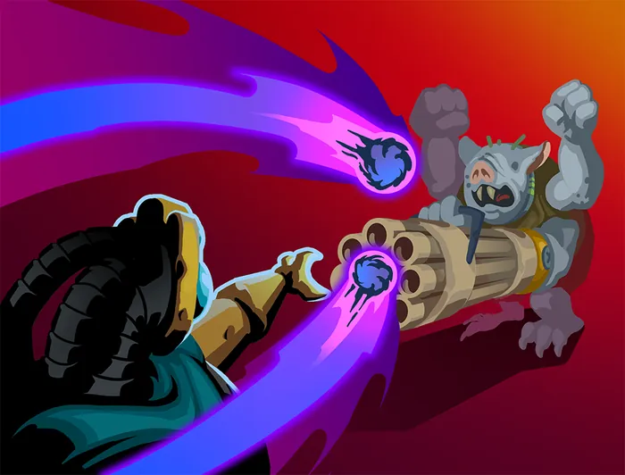 Activation double (`DUALCAST`)
* **Type :** *Skill* | **Coût :** `1` ⚡ | **Rareté :** `Basic`
* **Effet Normal :** **Activez** votre Orbe le plus à droite 2 fois.
* **Effet Amélioré :** **Activez** votre Orbe le plus à droite 2 fois.
* **Amélioration :** `energy: -1`

### 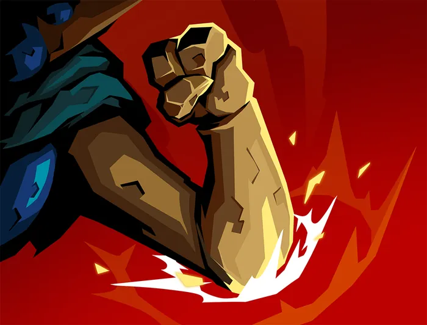 Frappe (`STRIKE_DEFECT`)
* **Type :** *Attack* | **Coût :** `1` ⚡ | **Rareté :** `Basic`
* **Effet Normal :** Infligez 6 dégâts.
* **Effet Amélioré :** Infligez 9 dégâts.
* **Amélioration :** `damage: +3`

### 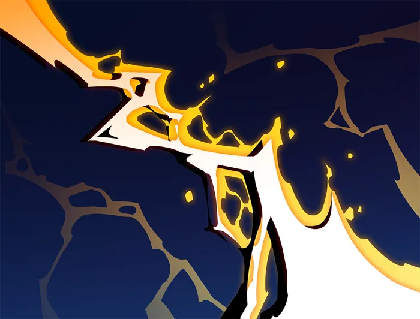 Éclair (`ZAP`)
* **Type :** *Skill* | **Coût :** `1` ⚡ | **Rareté :** `Basic`
* **Effet Normal :** **Canalisez** 1 **Orbe kéraunique**.
* **Effet Amélioré :** **Canalisez** 1 **Orbe kéraunique**.
* **Amélioration :** `energy: -1`

## ⭐ Rareté : Common (20 cartes)

###  Foudre en boule (`BALL_LIGHTNING`)
* **Type :** *Attack* | **Coût :** `1` ⚡ | **Rareté :** `Common`
* **Effet Normal :** Infligez 7 dégâts.
**Canalisez** 1 **Orbe kéraunique**.
* **Effet Amélioré :** Infligez 10 dégâts.
**Canalisez** 1 **Orbe kéraunique**.
* **Amélioration :** `damage: +3`

###  Barrage (`BARRAGE`)
* **Type :** *Attack* | **Coût :** `1` ⚡ | **Rareté :** `Common`
* **Effet Normal :** Infligez 5 dégâts pour chaque Orbe **Canalisé**.
* **Effet Amélioré :** Infligez 7 dégâts pour chaque Orbe **Canalisé**.
* **Amélioration :** `damage: +2`

###  Rayon cellulaire (`BEAM_CELL`)
* **Type :** *Attack* | **Coût :** `0` ⚡ | **Rareté :** `Common`
* **Effet Normal :** Infligez 3 dégâts.
Appliquez **Vulnérable** (1).
* **Effet Amélioré :** Infligez 4 dégâts.
Appliquez **Vulnérable** (2).
* **Amélioration :** `damage: +1, vulnerable: +1`

###  Boost (`BOOST_AWAY`)
* **Type :** *Skill* | **Coût :** `0` ⚡ | **Rareté :** `Common`
* **Effet Normal :** Gagnez 6 d'**Armure**.
Ajoutez **Hébété** à votre **Défausse**.
* **Effet Amélioré :** Gagnez 9 d'**Armure**.
Ajoutez **Hébété** à votre **Défausse**.
* **Amélioration :** `block: +3`

###  Piles de recharge (`CHARGE_BATTERY`)
* **Type :** *Skill* | **Coût :** `1` ⚡ | **Rareté :** `Common`
* **Effet Normal :** Gagnez 7 d'**Armure**.
Au prochain tour, gagnez ⚡1⚡.
* **Effet Amélioré :** Gagnez 10 d'**Armure**.
Au prochain tour, gagnez ⚡1⚡.
* **Amélioration :** `block: +3`

###  Griffure (`CLAW`)
* **Type :** *Attack* | **Coût :** `0` ⚡ | **Rareté :** `Common`
* **Effet Normal :** Infligez 3 dégâts.
Augmentez les dégâts de TOUTES les cartes Griffure de 2 jusqu'à la fin du combat.
* **Effet Amélioré :** Infligez 4 dégâts.
Augmentez les dégâts de TOUTES les cartes Griffure de 3 jusqu'à la fin du combat.
* **Amélioration :** `damage: +1, increase: +1`

###  Vague de froid (`COLD_SNAP`)
* **Type :** *Attack* | **Coût :** `1` ⚡ | **Rareté :** `Common`
* **Effet Normal :** Infligez 6 dégâts.
**Canalisez** 1 **Orbe glaciaire**.
* **Effet Amélioré :** Infligez 9 dégâts.
**Canalisez** 1 **Orbe glaciaire**.
* **Amélioration :** `damage: +3`

###  Compilateur de pilote (`COMPILE_DRIVER`)
* **Type :** *Attack* | **Coût :** `1` ⚡ | **Rareté :** `Common`
* **Effet Normal :** Infligez 7 dégâts.
Piochez 1 carte pour chaque Orbe unique.
* **Effet Amélioré :** Infligez 10 dégâts.
Piochez 1 carte pour chaque Orbe unique.
* **Amélioration :** `damage: +3`

###  Sang-froid (`COOLHEADED`)
* **Type :** *Skill* | **Coût :** `1` ⚡ | **Rareté :** `Common`
* **Effet Normal :** **Canalisez** 1 **Orbe glaciaire**.
Piochez 1 carte.
* **Effet Amélioré :** **Canalisez** 1 **Orbe glaciaire**.
Piochez 2 cartes.
* **Amélioration :** `cards: +1`

###  Frappe focalisée (`FOCUSED_STRIKE`)
* **Type :** *Attack* | **Coût :** `1` ⚡ | **Rareté :** `Common`
* **Effet Normal :** Infligez 9 dégâts.
Gagnez 1 de **Focalisation** jusqu'à la fin du tour.
* **Effet Amélioré :** Infligez 11 dégâts.
Gagnez 2 de **Focalisation** jusqu'à la fin du tour.
* **Amélioration :** `damage: +2, focuspower: +1`

###  Viser les yeux (`GO_FOR_THE_EYES`)
* **Type :** *Attack* | **Coût :** `0` ⚡ | **Rareté :** `Common`
* **Effet Normal :** Infligez 3 dégâts.
Si l'ennemi s'apprête à attaquer, appliquez **Affaibli** (1).
* **Effet Amélioré :** Infligez 4 dégâts.
Si l'ennemi s'apprête à attaquer, appliquez **Affaibli** (2).
* **Amélioration :** `damage: +1, weak: +1`

###  Encrassage (`GUNK_UP`)
* **Type :** *Attack* | **Coût :** `1` ⚡ | **Rareté :** `Common`
* **Effet Normal :** Infligez 4 dégâts 3 fois.
Ajoutez **Englué** à votre **Défausse**.
* **Effet Amélioré :** Infligez 5 dégâts 3 fois.
Ajoutez **Englué** à votre **Défausse**.
* **Amélioration :** `damage: +1`

###  Hologramme (`HOLOGRAM`)
* **Type :** *Skill* | **Coût :** `1` ⚡ | **Rareté :** `Common`
* **Effet Normal :** Gagnez 3 d'**Armure**.
Placez une carte de votre **Défausse** à votre **Main**.
**Épuisement**.
* **Effet Amélioré :** Gagnez 5 d'**Armure**.
Placez une carte de votre **Défausse** à votre **Main**.
* **Amélioration :** `block: +2, keywordsRemoved: ['Exhaust']`

###  Correctif (`HOTFIX`)
* **Type :** *Skill* | **Coût :** `0` ⚡ | **Rareté :** `Common`
* **Effet Normal :** Gagnez 2 de **Focalisation** ce tour.
**Épuisement**.
* **Effet Amélioré :** Gagnez 2 de **Focalisation** ce tour.
* **Amélioration :** `keywordsRemoved: ['Exhaust']`

###  Bond (`LEAP`)
* **Type :** *Skill* | **Coût :** `1` ⚡ | **Rareté :** `Common`
* **Effet Normal :** Gagnez 9 d'**Armure**.
* **Effet Amélioré :** Gagnez 12 d'**Armure**.
* **Amélioration :** `block: +3`

###  Paratonnerre (`LIGHTNING_ROD`)
* **Type :** *Skill* | **Coût :** `1` ⚡ | **Rareté :** `Common`
* **Effet Normal :** Gagnez 4 d'**Armure**.
Au début de vos 2 prochains tours, **Canalisez** 1 **Orbe kéraunique**.
* **Effet Amélioré :** Gagnez 7 d'**Armure**.
Au début de vos 2 prochains tours, **Canalisez** 1 **Orbe kéraunique**.
* **Amélioration :** `block: +3`

###  Frappe dynamique (`MOMENTUM_STRIKE`)
* **Type :** *Attack* | **Coût :** `1` ⚡ | **Rareté :** `Common`
* **Effet Normal :** Infligez 11 dégâts.
Réduisez le coût de cette carte à 0 ⚡.
* **Effet Amélioré :** Infligez 15 dégâts.
Réduisez le coût de cette carte à 0 ⚡.
* **Amélioration :** `damage: +4`

###  Faisceau circulaire (`SWEEPING_BEAM`)
* **Type :** *Attack* | **Coût :** `1` ⚡ | **Rareté :** `Common`
* **Effet Normal :** Infligez 6 dégâts à TOUS les ennemis.
Piochez 1 carte.
* **Effet Amélioré :** Infligez 9 dégâts à TOUS les ennemis.
Piochez 1 carte.
* **Amélioration :** `damage: +3`

###  TURBO (`TURBO`)
* **Type :** *Skill* | **Coût :** `0` ⚡ | **Rareté :** `Common`
* **Effet Normal :** Gagnez ⚡2⚡.
Ajoutez un **Néant** à votre **Défausse**.
* **Effet Amélioré :** Gagnez ⚡3⚡.
Ajoutez un **Néant** à votre **Défausse**.
* **Amélioration :** `energygain: +1`

###  Tumulte (`UPROAR`)
* **Type :** *Attack* | **Coût :** `2` ⚡ | **Rareté :** `Common`
* **Effet Normal :** Infligez 6 dégâts 2 fois.
Jouez une Attaque aléatoire depuis votre **Pioche**.
* **Effet Amélioré :** Infligez 8 dégâts 2 fois.
Jouez une Attaque aléatoire depuis votre **Pioche**.
* **Amélioration :** `damage: +2`

## ⭐ Rareté : Uncommon (38 cartes)

### 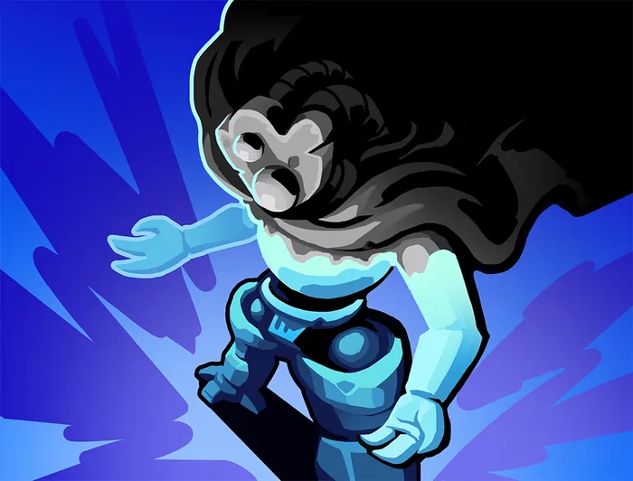 Programme de démarrage (`BOOT_SEQUENCE`)
* **Type :** *Skill* | **Coût :** `0` ⚡ | **Rareté :** `Uncommon`
* **Effet Normal :** **Inné**.
Gagnez 10 d'**Armure**.
**Épuisement**.
* **Effet Amélioré :** **Inné**.
Gagnez 13 d'**Armure**.
**Épuisement**.
* **Amélioration :** `block: +3`

### 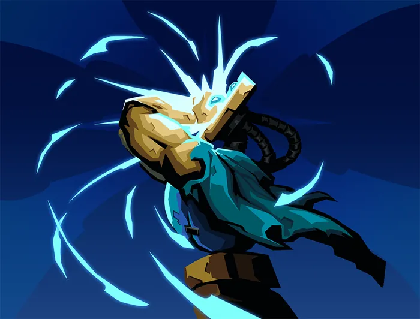 Prise de masse (`BULK_UP`)
* **Type :** *Power* | **Coût :** `2` ⚡ | **Rareté :** `Uncommon`
* **Effet Normal :** Perdez 1 Emplacement d'Orbe.
Gagnez 2 de **Force**.
Gagnez 2 de **Dextérité**.
* **Effet Amélioré :** Perdez 1 Emplacement d'Orbe.
Gagnez 3 de **Force**.
Gagnez 3 de **Dextérité**.
* **Amélioration :** `strength: +1, dexterity: +1`

### 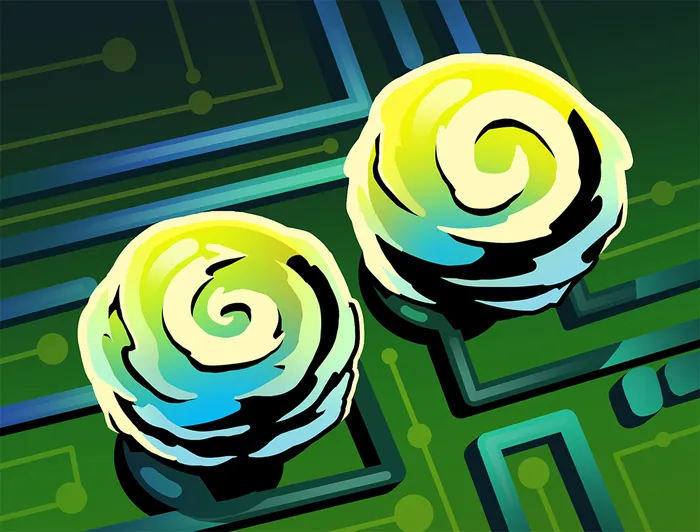 Condensateur (`CAPACITOR`)
* **Type :** *Power* | **Coût :** `1` ⚡ | **Rareté :** `Uncommon`
* **Effet Normal :** Gagnez 2 Emplacements d'Orbe.
* **Effet Amélioré :** Gagnez 3 Emplacements d'Orbe.
* **Amélioration :** `repeat: +1`

### 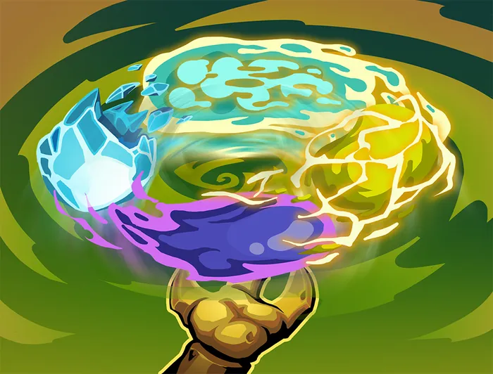 Chaos (`CHAOS`)
* **Type :** *Skill* | **Coût :** `1` ⚡ | **Rareté :** `Uncommon`
* **Effet Normal :** **Canalisez** 1 Orbe aléatoire.
* **Effet Amélioré :** **Canalisez** 2 Orbes aléatoires.
* **Amélioration :** `repeat: +1`

### 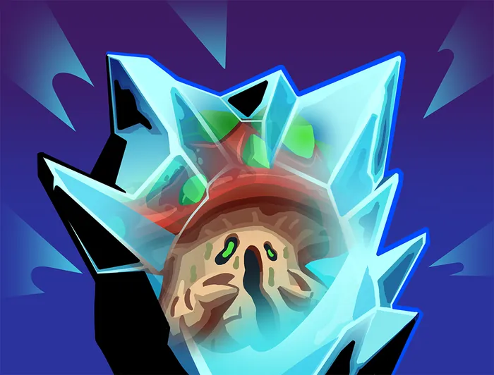 Frisson (`CHILL`)
* **Type :** *Skill* | **Coût :** `0` ⚡ | **Rareté :** `Uncommon`
* **Effet Normal :** **Canalisez** 1 **Orbe glaciaire** pour chaque ennemi.
**Épuisement**.
* **Effet Amélioré :** **Canalisez** 1 **Orbe glaciaire** pour chaque ennemi.
* **Amélioration :** `keywordsRemoved: ['Exhaust']`

### 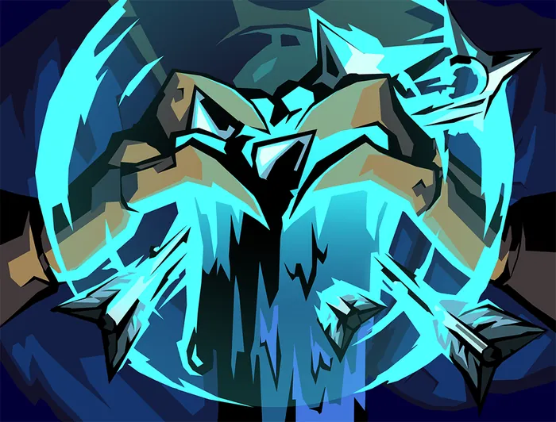 Compactage (`COMPACT`)
* **Type :** *Skill* | **Coût :** `1` ⚡ | **Rareté :** `Uncommon`
* **Effet Normal :** Gagnez 6 d'**Armure**.
**Transformez** toutes les cartes Statut de votre **Main** en **Combustible**.
* **Effet Amélioré :** Gagnez 7 d'**Armure**.
**Transformez** toutes les cartes Statut de votre **Main** en **Combustible+**.
* **Amélioration :** `block: +1`

### 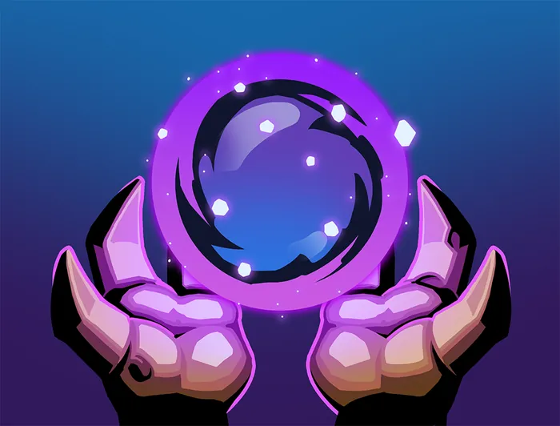 Ténèbres (`DARKNESS`)
* **Type :** *Skill* | **Coût :** `1` ⚡ | **Rareté :** `Uncommon`
* **Effet Normal :** **Canalisez** 1 **Orbe ténébreux**.
Déclenchez la capacité passive de tous vos **Orbes ténébreux**.
* **Effet Amélioré :** **Canalisez** 1 **Orbe ténébreux**.
Déclenchez la capacité passive de tous vos **Orbes ténébreux** 2 fois.

### 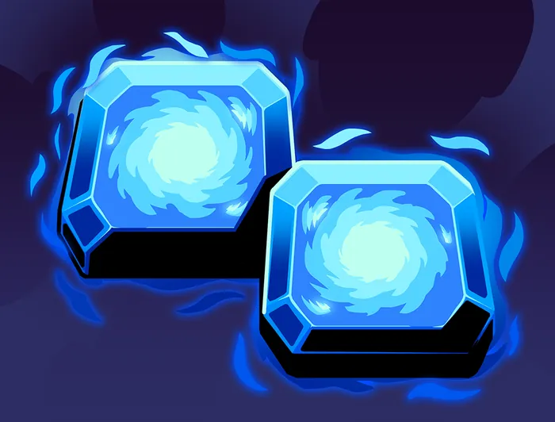 Énergie double (`DOUBLE_ENERGY`)
* **Type :** *Skill* | **Coût :** `1` ⚡ | **Rareté :** `Uncommon`
* **Effet Normal :** Doublez votre Énergie.
**Épuisement**.
* **Effet Amélioré :** Doublez votre Énergie.
**Épuisement**.
* **Amélioration :** `energy: -1`

### 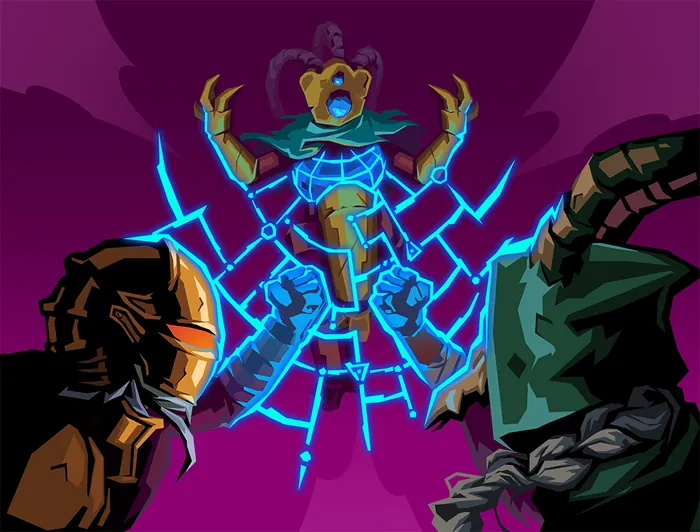 Flux d'énergie (`ENERGY_SURGE`)
* **Type :** *Skill* | **Coût :** `1` ⚡ | **Rareté :** `Uncommon`
* **Effet Normal :** TOUS les joueurs gagnent ⚡2⚡.
**Épuisement**.
* **Effet Amélioré :** TOUS les joueurs gagnent ⚡3⚡.
**Épuisement**.
* **Amélioration :** `energygain: +1`

### 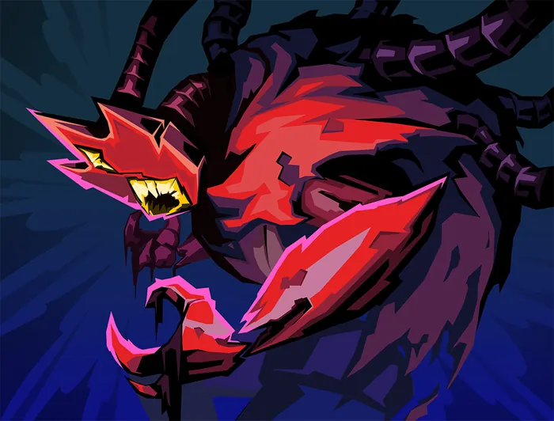 Sauvagerie (`FERAL`)
* **Type :** *Power* | **Coût :** `2` ⚡ | **Rareté :** `Uncommon`
* **Effet Normal :** La première fois de chaque tour que vous jouez une
Attaque coûtant 0 ⚡,
celle-ci retourne dans votre **Main**.
* **Effet Amélioré :** La première fois de chaque tour que vous jouez une
Attaque coûtant 0 ⚡,
celle-ci retourne dans votre **Main**.
* **Amélioration :** `energy: -1`

### 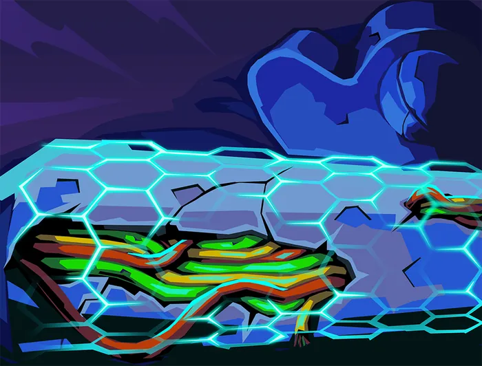 Lutte (`FIGHT_THROUGH`)
* **Type :** *Skill* | **Coût :** `1` ⚡ | **Rareté :** `Uncommon`
* **Effet Normal :** Gagnez 13 d'**Armure**.
Ajoutez 2 **Plaies** à votre **Défausse**.
* **Effet Amélioré :** Gagnez 17 d'**Armure**.
Ajoutez 2 **Plaies** à votre **Défausse**.
* **Amélioration :** `block: +4`

### 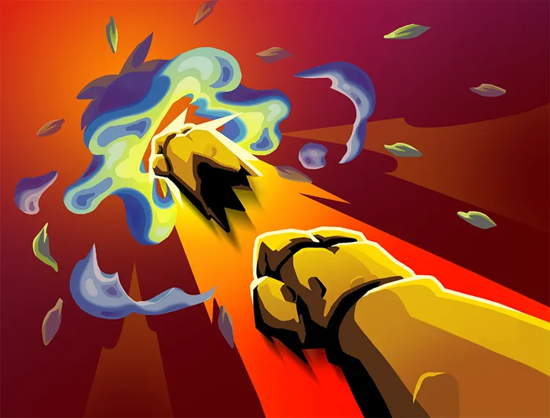 FTL (`FTL`)
* **Type :** *Attack* | **Coût :** `0` ⚡ | **Rareté :** `Uncommon`
* **Effet Normal :** Infligez 5 dégâts.
Si vous avez joué moins de 3 cartes ce tour, piochez 1 carte.
* **Effet Amélioré :** Infligez 6 dégâts.
Si vous avez joué moins de 4 cartes ce tour, piochez 1 carte.
* **Amélioration :** `damage: +1, playmax: +1`

### 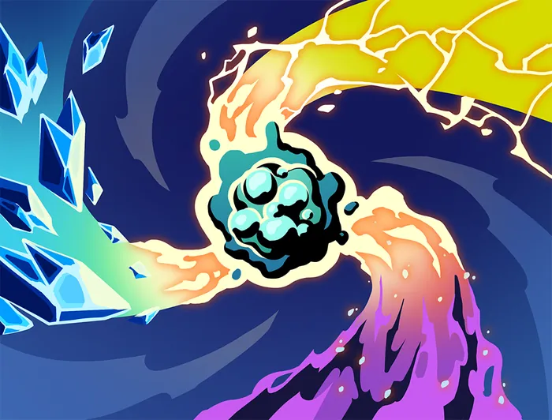 Fusion (`FUSION`)
* **Type :** *Skill* | **Coût :** `1` ⚡ | **Rareté :** `Uncommon`
* **Effet Normal :** **Canalisez** 1 **Orbe plasmique**.
**Épuisement**.
* **Effet Amélioré :** **Canalisez** 1 **Orbe plasmique**.
* **Amélioration :** `keywordsRemoved: ['Exhaust']`

### 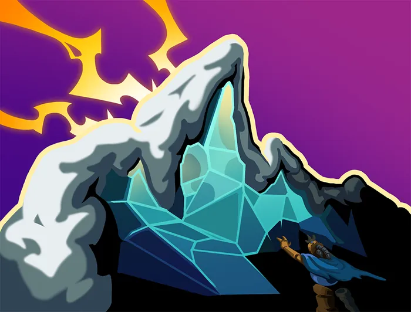 Glacier (`GLACIER`)
* **Type :** *Skill* | **Coût :** `2` ⚡ | **Rareté :** `Uncommon`
* **Effet Normal :** Gagnez 6 d'**Armure**.
**Canalisez** 2 **Orbes glaciaires**.
* **Effet Amélioré :** Gagnez 9 d'**Armure**.
**Canalisez** 2 **Orbes glaciaires**.
* **Amélioration :** `block: +3`

### 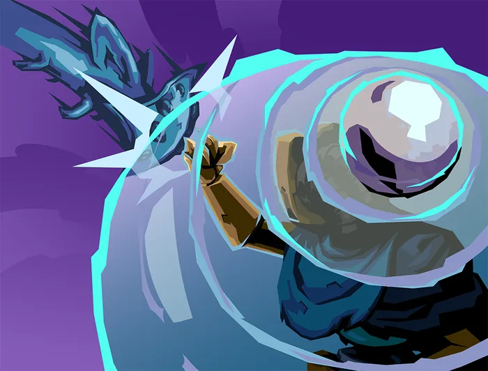 Verrerie (`GLASSWORK`)
* **Type :** *Skill* | **Coût :** `1` ⚡ | **Rareté :** `Uncommon`
* **Effet Normal :** Gagnez 5 d'**Armure**.
**Canalisez** 1 **Orbe vitreux**.
* **Effet Amélioré :** Gagnez 8 d'**Armure**.
**Canalisez** 1 **Orbe vitreux**.
* **Amélioration :** `block: +3`

### 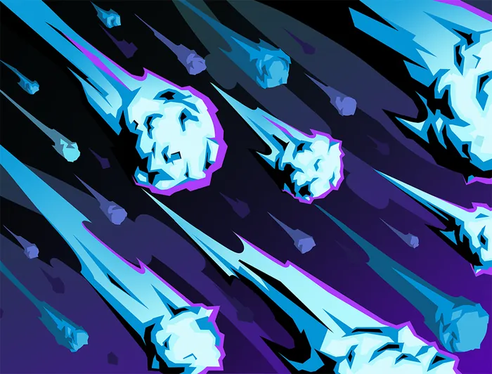 Pluie de grêlons (`HAILSTORM`)
* **Type :** *Power* | **Coût :** `1` ⚡ | **Rareté :** `Uncommon`
* **Effet Normal :** À la fin de votre tour, si vous avez un **Orbe glaciaire**, infligez 6 dégâts à TOUS les ennemis.
* **Effet Amélioré :** À la fin de votre tour, si vous avez un **Orbe glaciaire**, infligez 8 dégâts à TOUS les ennemis.
* **Amélioration :** `hailstormpower: +2`

### 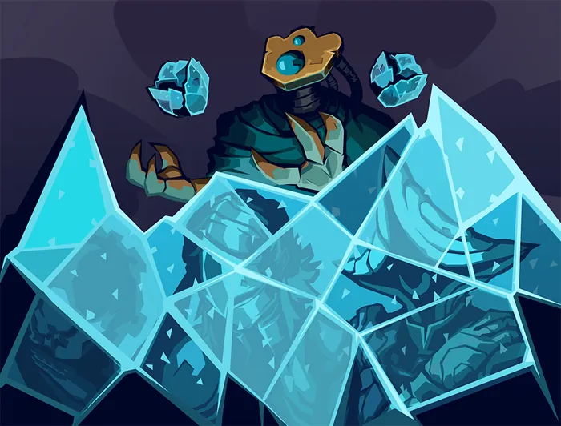 Hibernation (`HIBERNATE`)
* **Type :** *Skill* | **Coût :** `2` ⚡ | **Rareté :** `Uncommon`
* **Effet Normal :** Ce tour, vos **Orbes glaciaires** confèrent de l'**Armure** à TOUS les alliés.
Canalisez 2 **Orbes glaciaires**.
* **Effet Amélioré :** Ce tour, vos **Orbes glaciaires** confèrent de l'**Armure** à TOUS les alliés.
Canalisez 3 **Orbes glaciaires**.
* **Amélioration :** `repeat: +1`

### 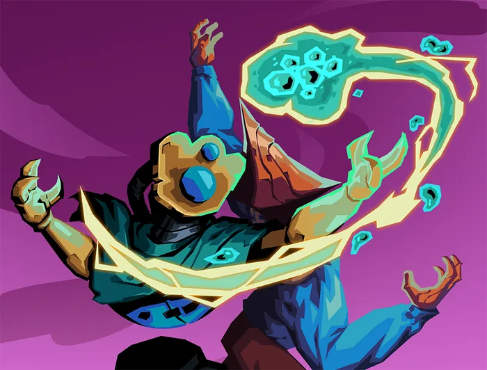 Allumage (`IGNITION`)
* **Type :** *Skill* | **Coût :** `1` ⚡ | **Rareté :** `Uncommon`
* **Effet Normal :** Un autre joueur **Canalise** un **Orbe plasmique**.
**Épuisement**.
* **Effet Amélioré :** Un autre joueur **Canalise** un **Orbe plasmique**.
* **Amélioration :** `keywordsRemoved: ['Exhaust']`

### 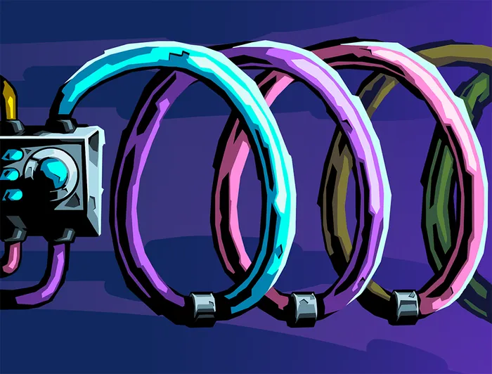 Itération (`ITERATION`)
* **Type :** *Power* | **Coût :** `1` ⚡ | **Rareté :** `Uncommon`
* **Effet Normal :** La première fois de chaque tour que vous piochez une carte Statut, piochez 2 cartes.
* **Effet Amélioré :** La première fois de chaque tour que vous piochez une carte Statut, piochez 3 cartes.
* **Amélioration :** `iterationpower: +1`

###  Boucle (`LOOP`)
* **Type :** *Power* | **Coût :** `1` ⚡ | **Rareté :** `Uncommon`
* **Effet Normal :** Au début de votre tour, déclenchez la capacité passive de votre Orbe le plus à droite.
* **Effet Amélioré :** Au début de votre tour, déclenchez la capacité passive de votre Orbe le plus à droite 2 fois.
* **Amélioration :** `loop: +1`

### 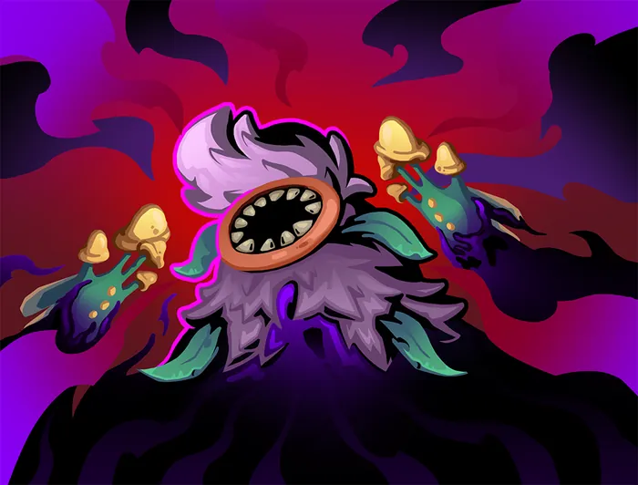 Valeur nulle (`NULL`)
* **Type :** *Attack* | **Coût :** `2` ⚡ | **Rareté :** `Uncommon`
* **Effet Normal :** Infligez 10 dégâts.
Appliquez **Affaibli** (1).
**Canalisez** 1 **Orbe ténébreux**.
* **Effet Amélioré :** Infligez 13 dégâts.
Appliquez **Affaibli** (2).
**Canalisez** 1 **Orbe ténébreux**.
* **Amélioration :** `damage: +3, weak: +1`

### 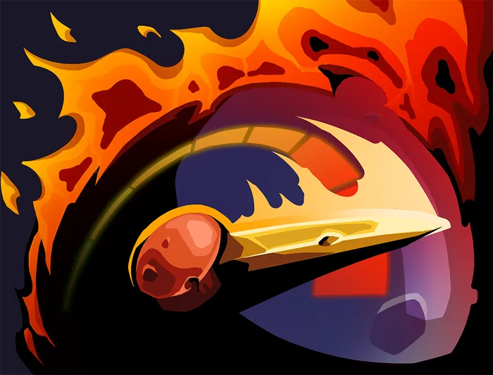 Overclocking (`OVERCLOCK`)
* **Type :** *Skill* | **Coût :** `0` ⚡ | **Rareté :** `Uncommon`
* **Effet Normal :** Piochez 2 cartes.
Ajoutez une **Brûlure** à votre **Défausse**.
* **Effet Amélioré :** Piochez 3 cartes.
Ajoutez une **Brûlure** à votre **Défausse**.
* **Amélioration :** `cards: +1`

### 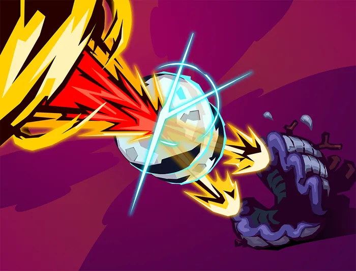 Réfraction (`REFRACT`)
* **Type :** *Attack* | **Coût :** `3` ⚡ | **Rareté :** `Uncommon`
* **Effet Normal :** Infligez 10 dégâts 2 fois.
**Canalisez** 2 **Orbes vitreux**.
* **Effet Amélioré :** Infligez 13 dégâts 2 fois.
**Canalisez** 2 **Orbes vitreux**.
* **Amélioration :** `damage: +3`

### 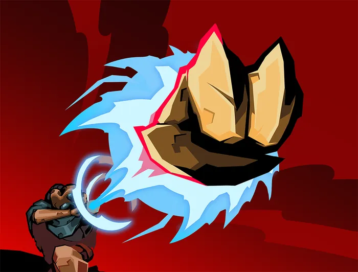 Poing roquette (`ROCKET_PUNCH`)
* **Type :** *Attack* | **Coût :** `2` ⚡ | **Rareté :** `Uncommon`
* **Effet Normal :** Infligez 13 dégâts.
Piochez 1 carte.
Lorsque vous créez une carte Statut, réduisez le coût de cette carte de 1 ⚡ jusqu'à ce qu'elle soit jouée.
* **Effet Amélioré :** Infligez 14 dégâts.
Piochez 2 cartes.
Lorsque vous créez une carte Statut, réduisez le coût de cette carte de 1 ⚡ jusqu'à ce qu'elle soit jouée.
* **Amélioration :** `damage: +1, cards: +1`

### 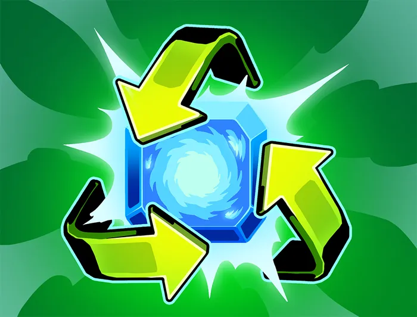 Récupération (`SCAVENGE`)
* **Type :** *Skill* | **Coût :** `1` ⚡ | **Rareté :** `Uncommon`
* **Effet Normal :** **Épuisez** une carte.
Au prochain tour, gagnez ⚡2⚡.
* **Effet Amélioré :** **Épuisez** une carte.
Au prochain tour, gagnez ⚡3⚡.
* **Amélioration :** `energygain: +1`

### 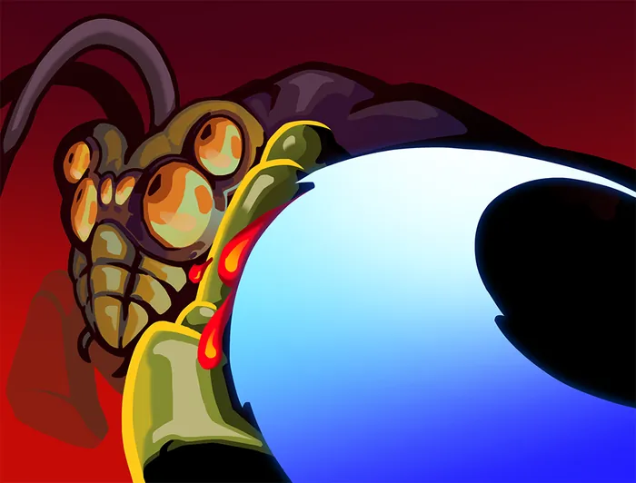 Éraflure (`SCRAPE`)
* **Type :** *Attack* | **Coût :** `1` ⚡ | **Rareté :** `Uncommon`
* **Effet Normal :** Infligez 7 dégâts.
Piochez 4 cartes.
Défaussez toutes les cartes ainsi piochées qui ne coûtent pas 0 ⚡.
* **Effet Amélioré :** Infligez 10 dégâts.
Piochez 5 cartes.
Défaussez toutes les cartes ainsi piochées qui ne coûtent pas 0 ⚡.
* **Amélioration :** `damage: +3, cards: +1`

### 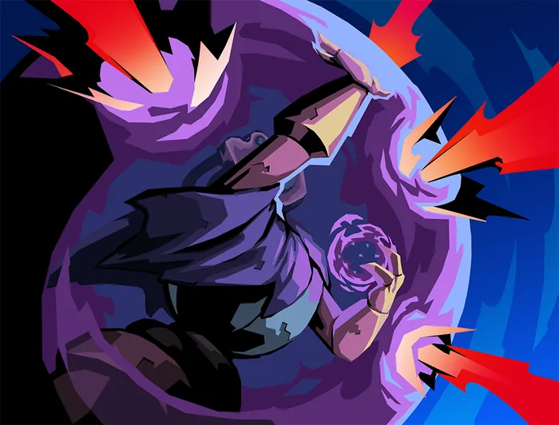 Bouclier ténébreux (`SHADOW_SHIELD`)
* **Type :** *Skill* | **Coût :** `2` ⚡ | **Rareté :** `Uncommon`
* **Effet Normal :** Gagnez 11 d'**Armure**.
**Canalisez** 1 **Orbe ténébreux**.
* **Effet Amélioré :** Gagnez 15 d'**Armure**.
**Canalisez** 1 **Orbe ténébreux**.
* **Amélioration :** `block: +4`

### 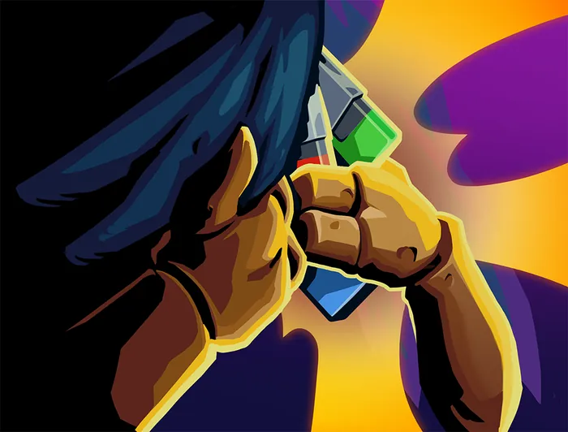 Parcourir (`SKIM`)
* **Type :** *Skill* | **Coût :** `1` ⚡ | **Rareté :** `Uncommon`
* **Effet Normal :** Piochez 3 cartes.
* **Effet Amélioré :** Piochez 4 cartes.
* **Amélioration :** `cards: +1`

### 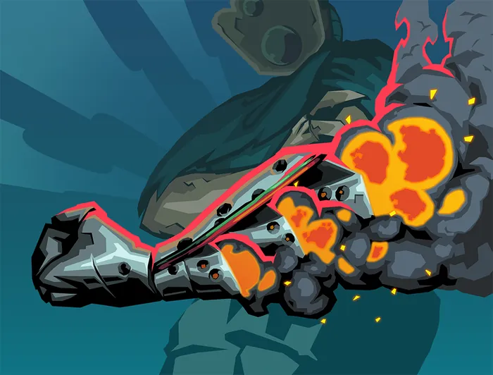 Cheminée (`SMOKESTACK`)
* **Type :** *Power* | **Coût :** `1` ⚡ | **Rareté :** `Uncommon`
* **Effet Normal :** Lorsque vous créez un Statut, infligez 5 dégâts à TOUS les ennemis.
* **Effet Amélioré :** Lorsque vous créez un Statut, infligez 7 dégâts à TOUS les ennemis.
* **Amélioration :** `smokestackpower: +2`

### 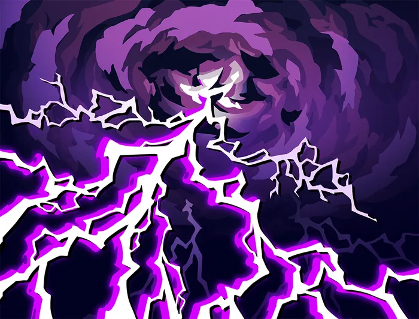 Orage (`STORM`)
* **Type :** *Power* | **Coût :** `1` ⚡ | **Rareté :** `Uncommon`
* **Effet Normal :** Lorsque vous jouez un Pouvoir, **Canalisez** 1 **Orbe kéraunique**.
* **Effet Amélioré :** Lorsque vous jouez un Pouvoir, **Canalisez** 2 **Orbes kérauniques**.
* **Amélioration :** `stormpower: +1`

### 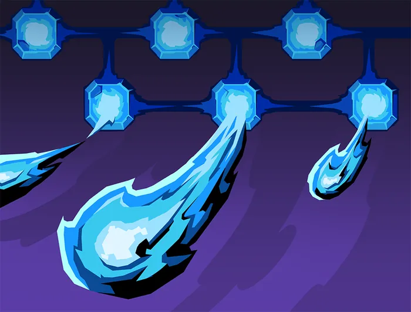 Sous-programme (`SUBROUTINE`)
* **Type :** *Power* | **Coût :** `1` ⚡ | **Rareté :** `Uncommon`
* **Effet Normal :** Lorsque vous jouez un Pouvoir, gagnez ⚡.
* **Effet Amélioré :** Lorsque vous jouez un Pouvoir, gagnez ⚡.
* **Amélioration :** `energy: -1`

### 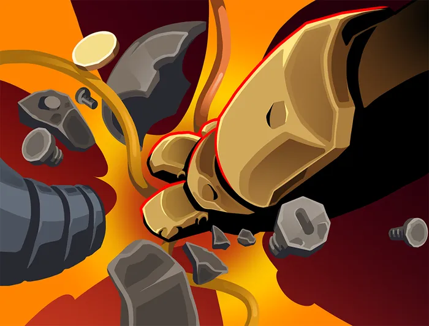 Scission (`SUNDER`)
* **Type :** *Attack* | **Coût :** `3` ⚡ | **Rareté :** `Uncommon`
* **Effet Normal :** Infligez 26 dégâts.
Si ceci tue un ennemi, gagnez ⚡3⚡.
* **Effet Amélioré :** Infligez 34 dégâts.
Si ceci tue un ennemi, gagnez ⚡3⚡.
* **Amélioration :** `damage: +8`

### 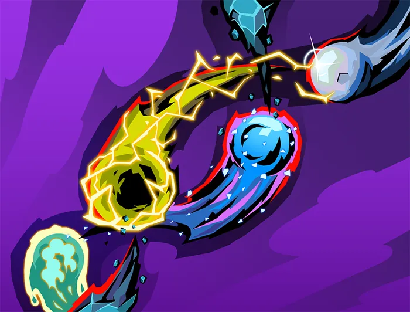 Synchronisation (`SYNCHRONIZE`)
* **Type :** *Skill* | **Coût :** `1` ⚡ | **Rareté :** `Uncommon`
* **Effet Normal :** Gagnez 1 de **Focalisation** jusqu'à la fin du tour pour chaque Orbe unique que vous avez.
* **Effet Amélioré :** Gagnez 2 de **Focalisation** jusqu'à la fin du tour pour chaque Orbe unique que vous avez.
* **Amélioration :** `calculationextra: +1`

### 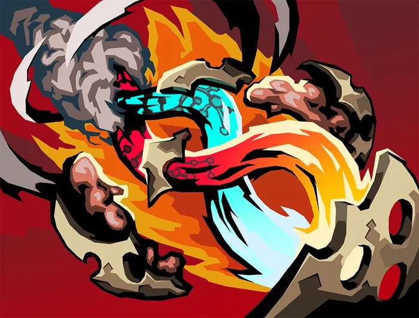 Synthèse (`SYNTHESIS`)
* **Type :** *Attack* | **Coût :** `2` ⚡ | **Rareté :** `Uncommon`
* **Effet Normal :** Infligez 14 dégâts.
Le prochain Pouvoir que vous jouez coûte 0 ⚡.
* **Effet Amélioré :** Infligez 20 dégâts.
Le prochain Pouvoir que vous jouez coûte 0 ⚡.
* **Amélioration :** `damage: +6`

### 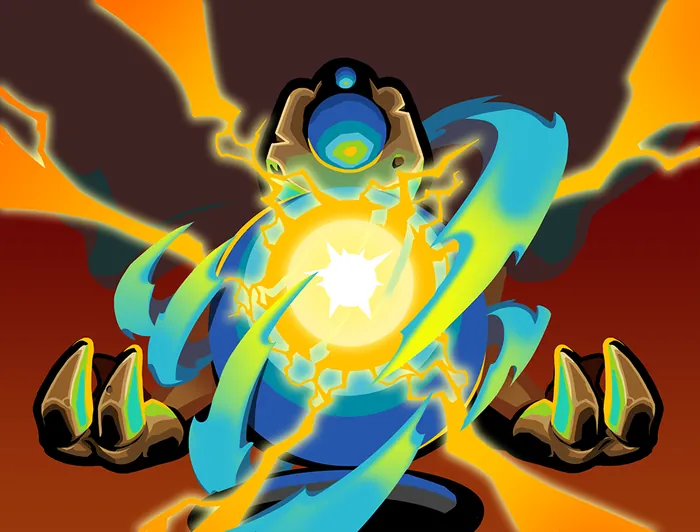 Tempête (`TEMPEST`)
* **Type :** *Skill* | **Coût :** `-1` ⚡ | **Rareté :** `Uncommon`
* **Effet Normal :** **Canalisez** X **Orbes kérauniques**.
* **Effet Amélioré :** **Canalisez** X+1 **Orbes kérauniques**.

### 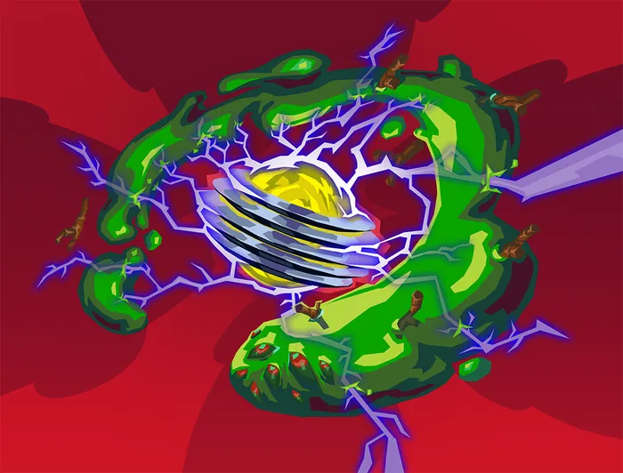 Bobine Tesla (`TESLA_COIL`)
* **Type :** *Attack* | **Coût :** `0` ⚡ | **Rareté :** `Uncommon`
* **Effet Normal :** Infligez 3 dégâts.
Déclenchez la capacité passive de tous vos **Orbes kérauniques** sur l'ennemi.
* **Effet Amélioré :** Infligez 4 dégâts.
Déclenchez deux fois la capacité passive de tous vos **Orbes kérauniques** sur l'ennemi.
* **Amélioration :** `damage: +1`

### 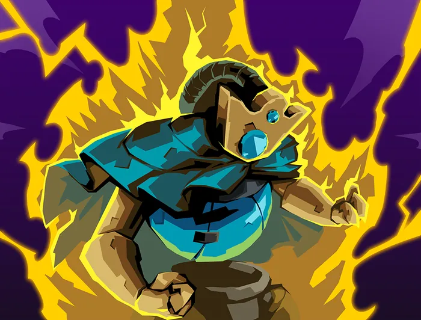 Tonnerre (`THUNDER`)
* **Type :** *Power* | **Coût :** `1` ⚡ | **Rareté :** `Uncommon`
* **Effet Normal :** Lorsque vous **Activez** vos **Orbes kérauniques**, infligez 8 dégâts à chaque ennemi touché.
* **Effet Amélioré :** Lorsque vous **Activez** vos **Orbes kérauniques**, infligez 11 dégâts à chaque ennemi touché.
* **Amélioration :** `thunderpower: +3`

### 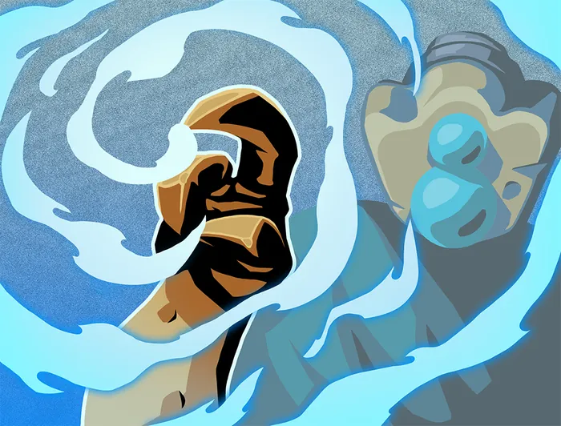 Bruit blanc (`WHITE_NOISE`)
* **Type :** *Skill* | **Coût :** `1` ⚡ | **Rareté :** `Uncommon`
* **Effet Normal :** Ajoutez un Pouvoir aléatoire à votre **Main**. Il coûte 0 ce tour.
**Épuisement**.
* **Effet Amélioré :** Ajoutez un Pouvoir aléatoire à votre **Main**. Il coûte 0 ce tour.
**Épuisement**.
* **Amélioration :** `energy: -1`

## ⭐ Rareté : Rare (27 cartes)

### 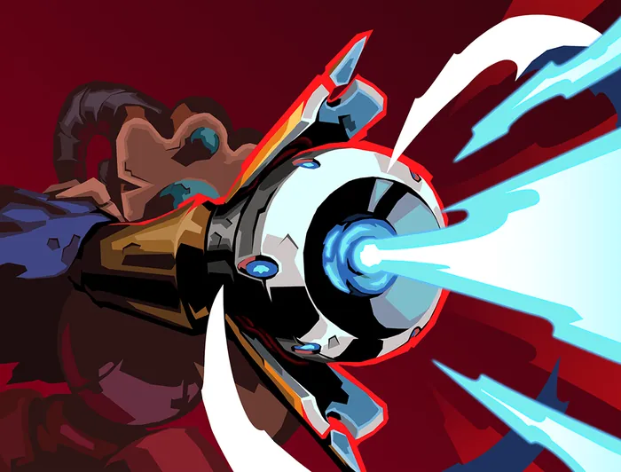 Frappe adaptative (`ADAPTIVE_STRIKE`)
* **Type :** *Attack* | **Coût :** `2` ⚡ | **Rareté :** `Rare`
* **Effet Normal :** Infligez 18 dégâts.
Ajoutez une copie de cette carte coûtant 0 ⚡ à votre **Défausse**.
* **Effet Amélioré :** Infligez 23 dégâts.
Ajoutez une copie de cette carte coûtant 0 ⚡ à votre **Défausse**.
* **Amélioration :** `damage: +5`

### 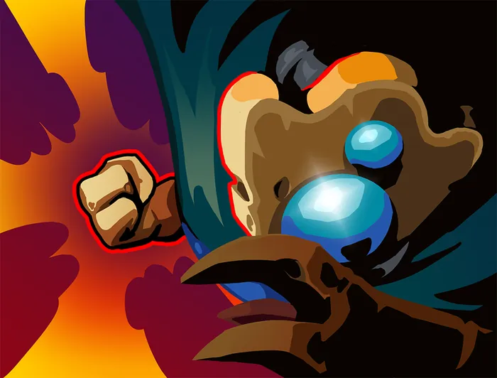 Tous pour un (`ALL_FOR_ONE`)
* **Type :** *Attack* | **Coût :** `2` ⚡ | **Rareté :** `Rare`
* **Effet Normal :** Infligez 10 dégâts.
Placez TOUTES les cartes coûtant 0 ⚡ de votre **Défausse** dans votre **Main**.
* **Effet Amélioré :** Infligez 14 dégâts.
Placez TOUTES les cartes coûtant 0 ⚡ de votre **Défausse** dans votre **Main**.
* **Amélioration :** `damage: +4`

###  Tampon (`BUFFER`)
* **Type :** *Power* | **Coût :** `2` ⚡ | **Rareté :** `Rare`
* **Effet Normal :** Intercepte la prochaine perte de PV.
* **Effet Amélioré :** Intercepte les 2 prochaines pertes de PV.
* **Amélioration :** `bufferpower: +1`

### 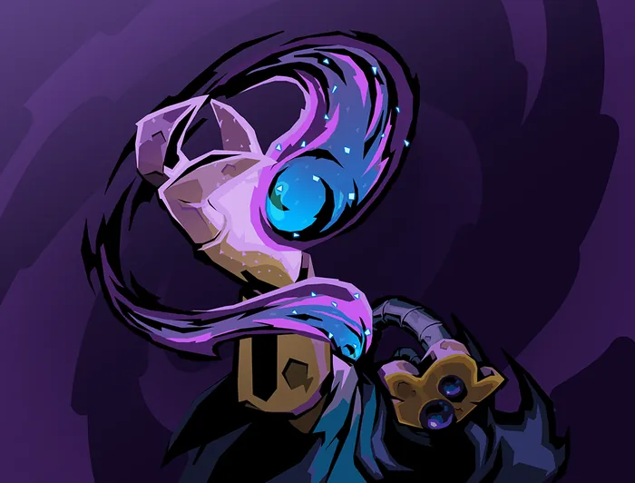 Ombre dévorante (`CONSUMING_SHADOW`)
* **Type :** *Power* | **Coût :** `2` ⚡ | **Rareté :** `Rare`
* **Effet Normal :** **Canalisez** 2 **Orbes ténébreux**.
À la fin de votre tour, **Activez** votre Orbe le plus à gauche.
* **Effet Amélioré :** **Canalisez** 3 **Orbes ténébreux**.
À la fin de votre tour, **Activez** votre Orbe le plus à gauche.
* **Amélioration :** `repeat: +1`

### 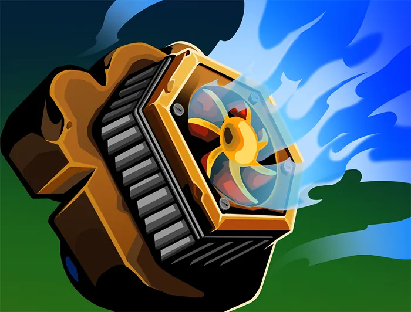 Ventilation (`COOLANT`)
* **Type :** *Power* | **Coût :** `1` ⚡ | **Rareté :** `Rare`
* **Effet Normal :** Au début de votre tour, gagnez 2 d'**Armure** pour chaque Orbe unique.
* **Effet Amélioré :** Au début de votre tour, gagnez 3 d'**Armure** pour chaque Orbe unique.
* **Amélioration :** `coolantpower: +1`

### 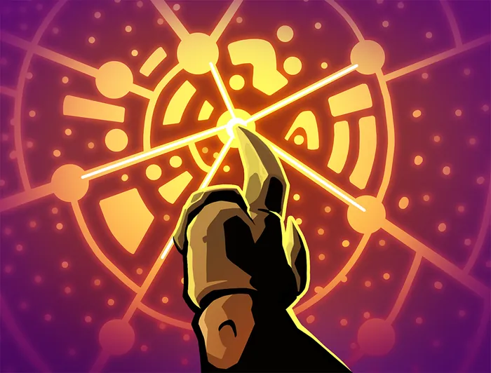 IA créative (`CREATIVE_AI`)
* **Type :** *Power* | **Coût :** `3` ⚡ | **Rareté :** `Rare`
* **Effet Normal :** Au début de votre tour, ajoutez un Pouvoir aléatoire à votre **Main**.
* **Effet Amélioré :** Au début de votre tour, ajoutez un Pouvoir aléatoire à votre **Main**.
* **Amélioration :** `energy: -1`

### 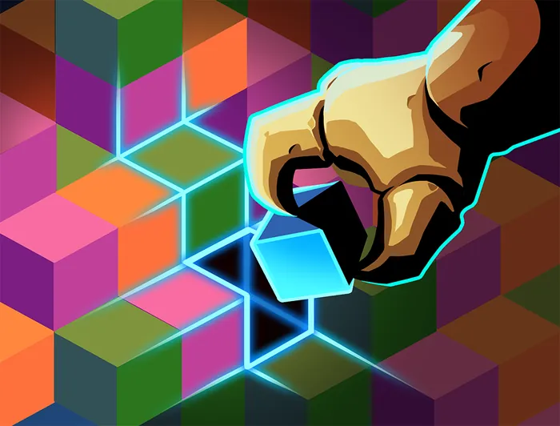 Défragmentation (`DEFRAGMENT`)
* **Type :** *Power* | **Coût :** `1` ⚡ | **Rareté :** `Rare`
* **Effet Normal :** Gagnez 1 de **Focalisation**.
* **Effet Amélioré :** Gagnez 2 de **Focalisation**.
* **Amélioration :** `focuspower: +1`

### 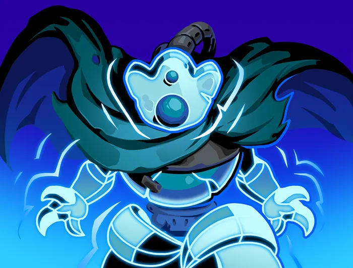 Forme résonnante (`ECHO_FORM`)
* **Type :** *Power* | **Coût :** `3` ⚡ | **Rareté :** `Rare`
* **Effet Normal :** **Éthéré**.
La première carte que vous jouez chaque tour est jouée une fois supplémentaire.
* **Effet Amélioré :** La première carte que vous jouez chaque tour est jouée une fois supplémentaire.
* **Amélioration :** `keywordsRemoved: ['Ethereal']`

### 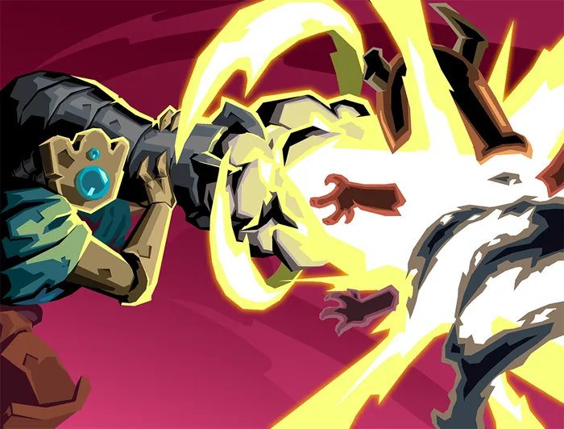 Canon anti-aérien (`FLAK_CANNON`)
* **Type :** *Attack* | **Coût :** `2` ⚡ | **Rareté :** `Rare`
* **Effet Normal :** **Épuisez** TOUTES vos cartes Statut.
Infligez 8 dégâts à un ennemi aléatoire pour chaque carte **Épuisée**.
* **Effet Amélioré :** **Épuisez** TOUTES vos cartes Statut.
Infligez 11 dégâts à un ennemi aléatoire pour chaque carte **Épuisée**.
* **Amélioration :** `damage: +3`

### 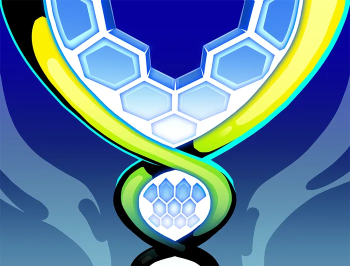 Algorithme génétique (`GENETIC_ALGORITHM`)
* **Type :** *Skill* | **Coût :** `1` ⚡ | **Rareté :** `Rare`
* **Effet Normal :** Gagnez 1 d'**Armure**.
Augmentez l'**Armure** conférée par cette carte de 3 de façon permanente.
**Épuisement**.
* **Effet Amélioré :** Gagnez 1 d'**Armure**.
Augmentez l'**Armure** conférée par cette carte de 4 de façon permanente.
**Épuisement**.
* **Amélioration :** `increase: +1`

###  Perceuse hélicoïdale (`HELIX_DRILL`)
* **Type :** *Attack* | **Coût :** `0` ⚡ | **Rareté :** `Rare`
* **Effet Normal :** Infligez 3 dégâts pour chaque ⚡ dépensé pour jouer d'autres cartes ce tour.
* **Effet Amélioré :** Infligez 5 dégâts pour chaque ⚡ dépensé pour jouer d'autres cartes ce tour.
* **Amélioration :** `damage: +2`

###  Ultralaser (`HYPERBEAM`)
* **Type :** *Attack* | **Coût :** `2` ⚡ | **Rareté :** `Rare`
* **Effet Normal :** Infligez 24 dégâts à TOUS les ennemis.
Perdez 3 de **Focalisation**.
* **Effet Amélioré :** Infligez 30 dégâts à TOUS les ennemis.
Perdez 3 de **Focalisation**.
* **Amélioration :** `damage: +6`

###  Javelot de glace (`ICE_LANCE`)
* **Type :** *Attack* | **Coût :** `3` ⚡ | **Rareté :** `Rare`
* **Effet Normal :** Infligez 19 dégâts.
**Canalisez** 3 **Orbes glaciaires**.
* **Effet Amélioré :** Infligez 24 dégâts.
**Canalisez** 3 **Orbes glaciaires**.
* **Amélioration :** `damage: +5`

###  Apprentissage guidé (`IMITATION_LEARNING`)
* **Type :** *Skill* | **Coût :** `1` ⚡ | **Rareté :** `Rare`
* **Effet Normal :** Choisissez un autre joueur.
Les 2 prochaines fois qu'il joue un Pouvoir, jouez-en une copie.
**Épuisement**.
* **Effet Amélioré :** Choisissez un autre joueur.
Les 3 prochaines fois qu'il joue un Pouvoir, jouez-en une copie.
**Épuisement**.
* **Amélioration :** `imitationlearningpower: +1`

###  Machine Learning (`MACHINE_LEARNING`)
* **Type :** *Power* | **Coût :** `1` ⚡ | **Rareté :** `Rare`
* **Effet Normal :** Au début de votre tour, piochez 1 carte supplémentaire.
* **Effet Amélioré :** **Inné**.
Au début de votre tour, piochez 1 carte supplémentaire.
* **Amélioration :** `keywords: ['Innate']`

###  Frappe météorique (`METEOR_STRIKE`)
* **Type :** *Attack* | **Coût :** `5` ⚡ | **Rareté :** `Rare`
* **Effet Normal :** Infligez 24 dégâts.
**Canalisez** 3 **Orbes plasmiques**.
* **Effet Amélioré :** Infligez 30 dégâts.
**Canalisez** 3 **Orbes plasmiques**.
* **Amélioration :** `damage: +6`

###  Modificateurs (`MODDED`)
* **Type :** *Skill* | **Coût :** `0` ⚡ | **Rareté :** `Rare`
* **Effet Normal :** Gagnez 1 Emplacement d'Orbe.
Piochez 1 carte. Augmentez le coût de cette carte de 1.
* **Effet Amélioré :** Gagnez 1 Emplacement d'Orbe.
Piochez 2 cartes. Augmentez le coût de cette carte de 1.
* **Amélioration :** `cards: +1`

###  Activation multiple (`MULTI_CAST`)
* **Type :** *Skill* | **Coût :** `-1` ⚡ | **Rareté :** `Rare`
* **Effet Normal :** **Activez** votre Orbe le plus à droite X fois.
* **Effet Amélioré :** **Activez** votre Orbe le plus à droite X+1 fois.

###  Un pour tous (`ONE_FOR_ALL`)
* **Type :** *Power* | **Coût :** `1` ⚡ | **Rareté :** `Rare`
* **Effet Normal :** Les Attaques coûtant 0 ⚡ de TOUS LES JOUEURS infligent 3 dégâts supplémentaires.
* **Effet Amélioré :** Les Attaques coûtant 0 ⚡ de TOUS LES JOUEURS infligent 4 dégâts supplémentaires.
* **Amélioration :** `oneforallpower: +1`

###  Arc-en-ciel (`RAINBOW`)
* **Type :** *Skill* | **Coût :** `2` ⚡ | **Rareté :** `Rare`
* **Effet Normal :** **Canalisez** 1 **Orbe kéraunique**.
**Canalisez** 1 **Orbe glaciaire**.
**Canalisez** 1 **Orbe ténébreux**.
**Épuisement**.
* **Effet Amélioré :** **Canalisez** 1 **Orbe kéraunique**.
**Canalisez** 1 **Orbe glaciaire**.
**Canalisez** 1 **Orbe ténébreux**.
* **Amélioration :** `keywordsRemoved: ['Exhaust']`

###  Redémarrage (`REBOOT`)
* **Type :** *Skill* | **Coût :** `0` ⚡ | **Rareté :** `Rare`
* **Effet Normal :** Mélangez TOUTES vos cartes dans votre **Pioche**.
Piochez 4 cartes.
**Épuisement**.
* **Effet Amélioré :** Mélangez TOUTES vos cartes dans votre **Pioche**.
Piochez 6 cartes.
**Épuisement**.
* **Amélioration :** `cards: +2`

###  Détonation (`SHATTER`)
* **Type :** *Attack* | **Coût :** `1` ⚡ | **Rareté :** `Rare`
* **Effet Normal :** Infligez 7 dégâts à TOUS les ennemis.
**Activez** tous vos Orbes deux fois.
**Épuisement**.
* **Effet Amélioré :** Infligez 11 dégâts à TOUS les ennemis.
**Activez** tous vos Orbes deux fois.
**Épuisement**.
* **Amélioration :** `damage: +4`

###  Amplification du signal (`SIGNAL_BOOST`)
* **Type :** *Skill* | **Coût :** `1` ⚡ | **Rareté :** `Rare`
* **Effet Normal :** Le prochain Pouvoir que vous jouez est joué une fois supplémentaire.
**Épuisement**.
* **Effet Amélioré :** Le prochain Pouvoir que vous jouez est joué une fois supplémentaire.
**Épuisement**.
* **Amélioration :** `energy: -1`

###  Toupie (`SPINNER`)
* **Type :** *Power* | **Coût :** `1` ⚡ | **Rareté :** `Rare`
* **Effet Normal :** Au début de votre tour, **Canalisez** 1 **Orbe vitreux**.
* **Effet Amélioré :** **Canalisez** 1 **Orbe vitreux**.
Au début de votre tour, **Canalisez** 1 **Orbe vitreux**.

###  Supercritique (`SUPERCRITICAL`)
* **Type :** *Skill* | **Coût :** `0` ⚡ | **Rareté :** `Rare`
* **Effet Normal :** Gagnez ⚡4⚡.
**Épuisement**.
* **Effet Amélioré :** Gagnez ⚡6⚡.
**Épuisement**.
* **Amélioration :** `energygain: +2`

###  Revalorisation (`TRASH_TO_TREASURE`)
* **Type :** *Power* | **Coût :** `1` ⚡ | **Rareté :** `Rare`
* **Effet Normal :** Lorsque vous créez une carte Statut, **Canalisez** 1 Orbe aléatoire.
* **Effet Amélioré :** Lorsque vous créez une carte Statut, **Canalisez** 1 Orbe aléatoire.
* **Amélioration :** `energy: -1`

###  Voltaïque (`VOLTAIC`)
* **Type :** *Skill* | **Coût :** `3` ⚡ | **Rareté :** `Rare`
* **Effet Normal :** **Canalisez** un nombre d'**Orbes kérauniques** égal au nombre d'**Orbes kérauniques** que vous avez déjà **Canalisés** pendant ce combat.
**Épuisement**.
* **Effet Amélioré :** **Canalisez** un nombre d'**Orbes kérauniques** égal au nombre d'**Orbes kérauniques** que vous avez déjà **Canalisés** pendant ce combat.
* **Amélioration :** `keywordsRemoved: ['Exhaust']`
