# 🃏 Cartes — Le Régent (Regent)

> **Total :** 91 cartes | **Patch :** `v0.111.0 Beta`  
> Nouveau personnage de STS2 : mécanique de commandement et de contrôle royal.

---

## ⭐ Rareté : Basic (4 cartes)

### 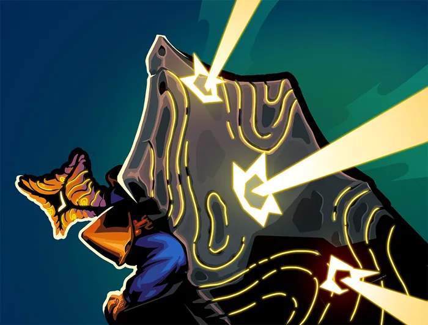 Défense (`DEFEND_REGENT`)
* **Type :** *Skill* | **Coût :** `1` ⚡ | **Rareté :** `Basic`
* **Effet Normal :** Gagnez 5 d'**Armure**.
* **Effet Amélioré :** Gagnez 8 d'**Armure**.
* **Amélioration :** `block: +3`

###  Chute d'étoile (`FALLING_STAR`)
* **Type :** *Attack* | **Coût :** `0` ⚡ | **Rareté :** `Basic`
* **Effet Normal :** Infligez 8 dégâts.
Appliquez **Affaibli** (1).
Appliquez **Vulnérable** (1).
* **Effet Amélioré :** Infligez 12 dégâts.
Appliquez **Affaibli** (1).
Appliquez **Vulnérable** (1).
* **Amélioration :** `damage: +4`

### 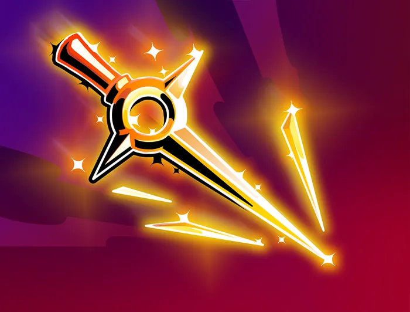 Frappe (`STRIKE_REGENT`)
* **Type :** *Attack* | **Coût :** `1` ⚡ | **Rareté :** `Basic`
* **Effet Normal :** Infligez 6 dégâts.
* **Effet Amélioré :** Infligez 9 dégâts.
* **Amélioration :** `damage: +3`

###  Vénération (`VENERATE`)
* **Type :** *Skill* | **Coût :** `1` ⚡ | **Rareté :** `Basic`
* **Effet Normal :** Gagnez <s>2</s>.
* **Effet Amélioré :** Gagnez <s>3</s>.
* **Amélioration :** `stars: +1`

## ⭐ Rareté : Common (20 cartes)

###  Pulsation astrale (`ASTRAL_PULSE`)
* **Type :** *Attack* | **Coût :** `0` ⚡ | **Rareté :** `Common`
* **Effet Normal :** Infligez 6 dégâts à TOUS les ennemis deux fois.
* **Effet Amélioré :** Infligez 8 dégâts à TOUS les ennemis deux fois.
* **Amélioration :** `damage: +2`

###  HORS DE MA VUE ! (`BEGONE`)
* **Type :** *Skill* | **Coût :** `1` ⚡ | **Rareté :** `Common`
* **Effet Normal :** Choisissez une carte dans votre **Main** à **Transformer** en **Frappe de sbire**.
* **Effet Amélioré :** Choisissez une carte dans votre **Main** à **Transformer** en **Frappe de sbire+**.

###  Puissance céleste (`CELESTIAL_MIGHT`)
* **Type :** *Attack* | **Coût :** `2` ⚡ | **Rareté :** `Common`
* **Effet Normal :** Infligez 6 dégâts 3 fois.
* **Effet Amélioré :** Infligez 6 dégâts 4 fois.
* **Amélioration :** `repeat: +1`

###  Manteau d'étoiles (`CLOAK_OF_STARS`)
* **Type :** *Skill* | **Coût :** `0` ⚡ | **Rareté :** `Common`
* **Effet Normal :** Gagnez 7 d'**Armure**.
* **Effet Amélioré :** Gagnez 10 d'**Armure**.
* **Amélioration :** `block: +3`

###  Trajectoire de collision (`COLLISION_COURSE`)
* **Type :** *Attack* | **Coût :** `0` ⚡ | **Rareté :** `Common`
* **Effet Normal :** Infligez 10 dégâts.
Ajoutez un **Débris** à votre **Main**.
* **Effet Amélioré :** Infligez 14 dégâts.
Ajoutez un **Débris** à votre **Main**.
* **Amélioration :** `damage: +4`

###  Indifférence cosmique (`COSMIC_INDIFFERENCE`)
* **Type :** *Skill* | **Coût :** `1` ⚡ | **Rareté :** `Common`
* **Effet Normal :** Gagnez 6 d'**Armure**.
Placez une carte de votre **Défausse** sur le dessus de votre **Pioche**.
* **Effet Amélioré :** Gagnez 9 d'**Armure**.
Placez une carte de votre **Défausse** sur le dessus de votre **Pioche**.
* **Amélioration :** `block: +3`

###  Croissant de lance (`CRESCENT_SPEAR`)
* **Type :** *Attack* | **Coût :** `1` ⚡ | **Rareté :** `Common`
* **Effet Normal :** Infligez 8 dégâts.
Inflige 2 dégâts supplémentaires pour TOUTES vos cartes coûtant des <s>1</s>.
* **Effet Amélioré :** Infligez 8 dégâts.
Inflige 3 dégâts supplémentaires pour TOUTES vos cartes coûtant des <s>1</s>.
* **Amélioration :** `extradamage: +1`

###  Broyer (`CRUSH_UNDER`)
* **Type :** *Attack* | **Coût :** `1` ⚡ | **Rareté :** `Common`
* **Effet Normal :** Infligez 8 dégâts à TOUS les ennemis. Tous les ennemis perdent 1 de **Force** jusqu'à la fin du tour.
* **Effet Amélioré :** Infligez 9 dégâts à TOUS les ennemis. Tous les ennemis perdent 2 de **Force** jusqu'à la fin du tour.
* **Amélioration :** `damage: +1, strengthloss: +1`

###  Lumière rassemblée (`GATHER_LIGHT`)
* **Type :** *Skill* | **Coût :** `1` ⚡ | **Rareté :** `Common`
* **Effet Normal :** Gagnez 8 d'**Armure**.
Gagnez <s>1</s>.
* **Effet Amélioré :** Gagnez 11 d'**Armure**.
Gagnez <s>1</s>.
* **Amélioration :** `block: +3`

###  Courant pailleté (`GLITTERSTREAM`)
* **Type :** *Skill* | **Coût :** `2` ⚡ | **Rareté :** `Common`
* **Effet Normal :** Gagnez 11 d'**Armure**.
Au prochain tour, gagnez 5 d'**Armure**.
* **Effet Amélioré :** Gagnez 13 d'**Armure**.
Au prochain tour, gagnez 7 d'**Armure**.
* **Amélioration :** `block: +2, blocknextturn: +2`

###  Luminosité (`GLOW`)
* **Type :** *Skill* | **Coût :** `1` ⚡ | **Rareté :** `Common`
* **Effet Normal :** Gagnez <s>1</s>.
Piochez 1 carte.
Au prochain tour, piochez 1 carte.
* **Effet Amélioré :** Gagnez <s>2</s>.
Piochez 1 carte.
Au prochain tour, piochez 1 carte.
* **Amélioration :** `stars: +1`

###  Étoile directrice (`GUIDING_STAR`)
* **Type :** *Attack* | **Coût :** `1` ⚡ | **Rareté :** `Common`
* **Effet Normal :** Infligez 12 dégâts.
Piochez 2 cartes.
* **Effet Amélioré :** Infligez 13 dégâts.
Piochez 3 cartes.
* **Amélioration :** `damage: +1, cards: +1`

###  Cache secrète (`HIDDEN_CACHE`)
* **Type :** *Skill* | **Coût :** `1` ⚡ | **Rareté :** `Common`
* **Effet Normal :** Gagnez <s>1</s>.
Au prochain tour, gagnez <s>3</s>.
* **Effet Amélioré :** Gagnez <s>1</s>.
Au prochain tour, gagnez <s>4</s>.
* **Amélioration :** `starnextturnpower: +1`

###  Hiérarchie (`KNOW_THY_PLACE`)
* **Type :** *Skill* | **Coût :** `0` ⚡ | **Rareté :** `Common`
* **Effet Normal :** Appliquez **Affaibli** (1).
Appliquez **Vulnérable** (1).
**Épuisement**.
* **Effet Amélioré :** Appliquez **Affaibli** (1).
Appliquez **Vulnérable** (1).
* **Amélioration :** `keywordsRemoved: ['Exhaust']`

###  Petits pas (`PATTER`)
* **Type :** *Skill* | **Coût :** `1` ⚡ | **Rareté :** `Common`
* **Effet Normal :** Gagnez 8 d'**Armure**.
Gagnez 2 de **Vigueur**.
* **Effet Amélioré :** Gagnez 10 d'**Armure**.
Gagnez 3 de **Vigueur**.
* **Amélioration :** `block: +2, vigorpower: +1`

###  Entaille photonique (`PHOTON_CUT`)
* **Type :** *Attack* | **Coût :** `1` ⚡ | **Rareté :** `Common`
* **Effet Normal :** Infligez 10 dégâts.
Piochez 1 carte.
Choisissez 1 carte de votre **Main** à placer sur le dessus de votre **Pioche**.
* **Effet Amélioré :** Infligez 13 dégâts.
Piochez 2 cartes.
Choisissez 1 carte de votre **Main** à placer sur le dessus de votre **Pioche**.
* **Amélioration :** `damage: +3, cards: +1`

###  Lame lustrée (`REFINE_BLADE`)
* **Type :** *Skill* | **Coût :** `1` ⚡ | **Rareté :** `Common`
* **Effet Normal :** **Forgez** pour 8.
Au prochain tour, gagnez ⚡1⚡.
* **Effet Amélioré :** **Forgez** pour 12.
Au prochain tour, gagnez ⚡1⚡.
* **Amélioration :** `forge: +4`

###  Frappe solaire (`SOLAR_STRIKE`)
* **Type :** *Attack* | **Coût :** `1` ⚡ | **Rareté :** `Common`
* **Effet Normal :** Infligez 9 dégâts.
Gagnez <s>1</s>.
* **Effet Amélioré :** Infligez 10 dégâts.
Gagnez <s>2</s>.
* **Amélioration :** `damage: +1, stars: +1`

###  Butin de guerre (`SPOILS_OF_BATTLE`)
* **Type :** *Skill* | **Coût :** `1` ⚡ | **Rareté :** `Common`
* **Effet Normal :** **Forgez** pour 6.
Piochez 2 cartes.
* **Effet Amélioré :** **Forgez** pour 9.
Piochez 2 cartes.
* **Amélioration :** `forge: +3`

###  Forgé par la guerre (`WROUGHT_IN_WAR`)
* **Type :** *Attack* | **Coût :** `1` ⚡ | **Rareté :** `Common`
* **Effet Normal :** Infligez 7 dégâts.
**Forgez** pour 7.
* **Effet Amélioré :** Infligez 9 dégâts.
**Forgez** pour 9.
* **Amélioration :** `damage: +2, forge: +2`

## ⭐ Rareté : Uncommon (38 cartes)

###  Alignement (`ALIGNMENT`)
* **Type :** *Skill* | **Coût :** `0` ⚡ | **Rareté :** `Uncommon`
* **Effet Normal :** Gagnez ⚡2⚡.
* **Effet Amélioré :** Gagnez ⚡3⚡.
* **Amélioration :** `energygain: +1`

### 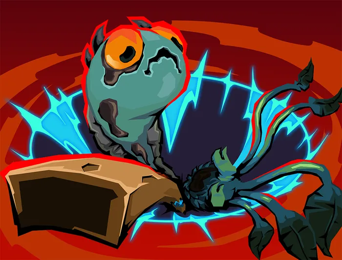 Trou noir (`BLACK_HOLE`)
* **Type :** *Power* | **Coût :** `1` ⚡ | **Rareté :** `Uncommon`
* **Effet Normal :** Lorsque vous gagnez ou dépensez des <s>1</s>, infligez 3 dégâts à TOUS les ennemis.
* **Effet Amélioré :** Lorsque vous gagnez ou dépensez des <s>1</s>, infligez 4 dégâts à TOUS les ennemis.
* **Amélioration :** `blackholepower: +1`

### 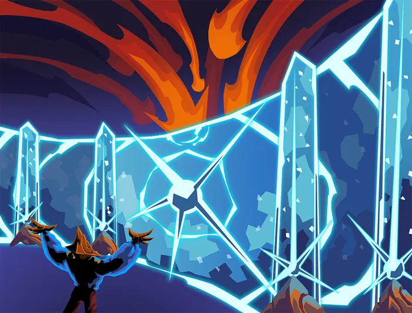 Rempart (`BULWARK`)
* **Type :** *Skill* | **Coût :** `2` ⚡ | **Rareté :** `Uncommon`
* **Effet Normal :** Gagnez 12 d'**Armure**.
**Forgez** pour 10.
* **Effet Amélioré :** Gagnez 15 d'**Armure**.
**Forgez** pour 13.
* **Amélioration :** `block: +3, forge: +3`

### 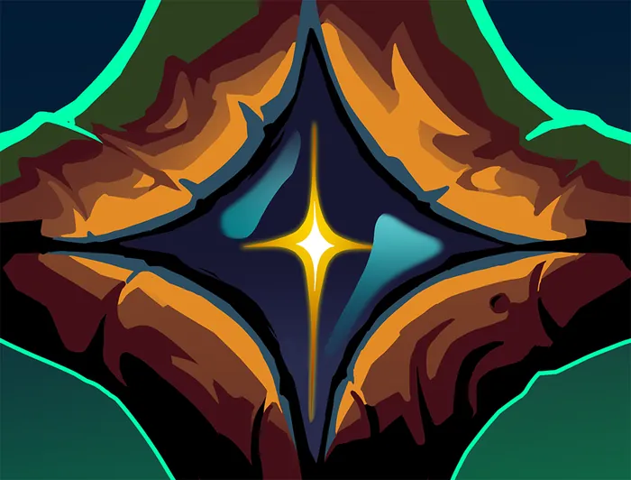 CHARGEZ !! (`CHARGE`)
* **Type :** *Skill* | **Coût :** `1` ⚡ | **Rareté :** `Uncommon`
* **Effet Normal :** Sélectionnez 2 cartes de votre **Pioche** à **Transformer** en **Sbires en piqué**.
* **Effet Amélioré :** Sélectionnez 2 cartes de votre **Pioche** à **Transformer** en **Sbires en piqué+**.

### 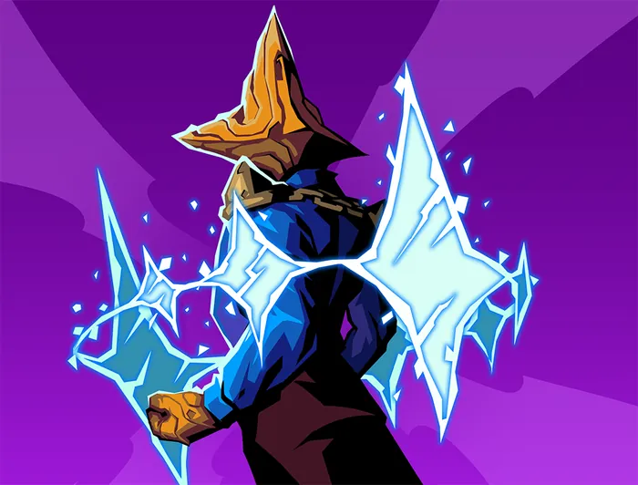 Enfant des étoiles (`CHILD_OF_THE_STARS`)
* **Type :** *Power* | **Coût :** `1` ⚡ | **Rareté :** `Uncommon`
* **Effet Normal :** Lorsque vous dépensez <s>1</s>, gagnez 2 d'**Armure** pour chaque <s>1</s> dépensée.
* **Effet Amélioré :** Lorsque vous dépensez <s>1</s>, gagnez 3 d'**Armure** pour chaque <s>1</s> dépensée.
* **Amélioration :** `blockforstars: +1`

###  Conquérant (`CONQUEROR`)
* **Type :** *Skill* | **Coût :** `1` ⚡ | **Rareté :** `Uncommon`
* **Effet Normal :** **Forgez** pour 3.
**Lame souveraine** inflige le double de dégâts à l'ennemi pendant ce tour.
* **Effet Amélioré :** **Forgez** pour 5.
**Lame souveraine** inflige le double de dégâts à l'ennemi pendant ce tour.
* **Amélioration :** `forge: +2`

### 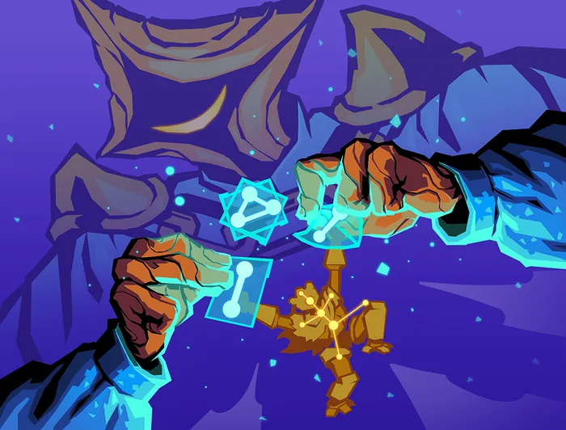 Constellation (`CONSTELLATION`)
* **Type :** *Skill* | **Coût :** `0` ⚡ | **Rareté :** `Uncommon`
* **Effet Normal :** Un autre joueur pioche 1 carte, gagne ⚡1⚡, et gagne 9 d'**Armure**.
* **Effet Amélioré :** Un autre joueur pioche 1 carte, gagne ⚡1⚡, et gagne 12 d'**Armure**.
* **Amélioration :** `block: +3`

### 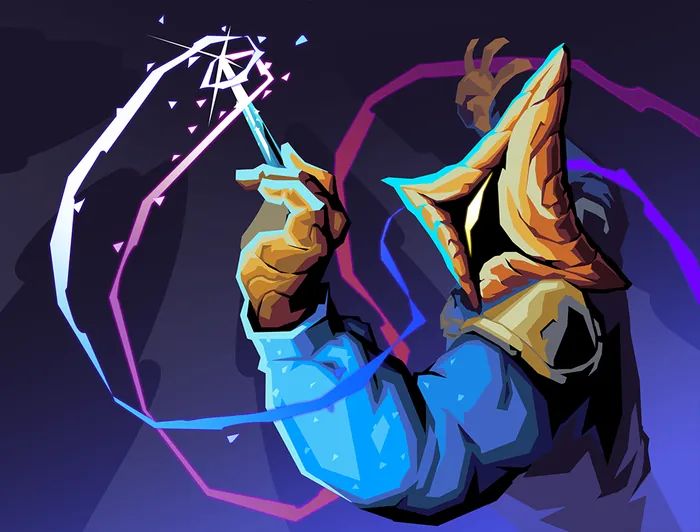 Convergence (`CONVERGENCE`)
* **Type :** *Skill* | **Coût :** `1` ⚡ | **Rareté :** `Uncommon`
* **Effet Normal :** Au prochain tour,
gagnez ⚡1⚡ et <s>1</s>.
**Retenez** votre **Main** jusqu'au tour suivant.
* **Effet Amélioré :** Au prochain tour,
gagnez ⚡1⚡ et <s>2</s>.
**Retenez** votre **Main** jusqu'au tour suivant.
* **Amélioration :** `stars: +1`

### 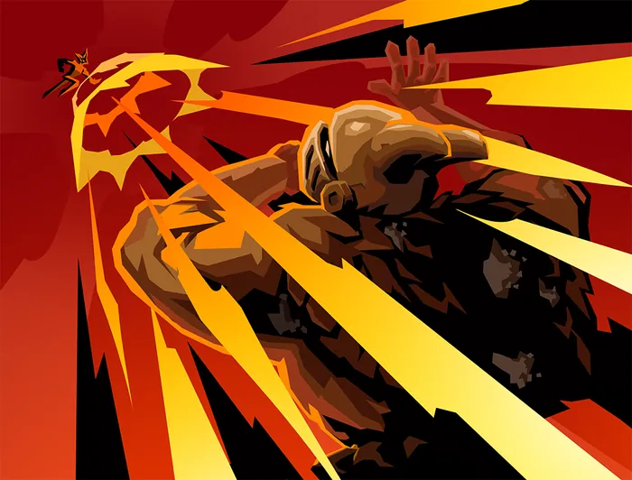 Dévastation (`DEVASTATE`)
* **Type :** *Attack* | **Coût :** `1` ⚡ | **Rareté :** `Uncommon`
* **Effet Normal :** Infligez 35 dégâts.
* **Effet Amélioré :** Infligez 45 dégâts.
* **Amélioration :** `damage: +10`

### 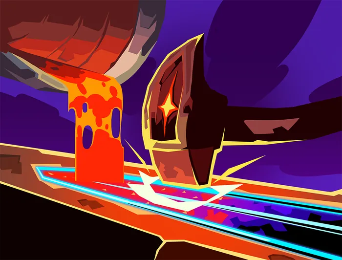 Fournaise (`FURNACE`)
* **Type :** *Power* | **Coût :** `1` ⚡ | **Rareté :** `Uncommon`
* **Effet Normal :** Au début de votre tour, **Forgez** pour 5.
* **Effet Amélioré :** Au début de votre tour, **Forgez** pour 7.
* **Amélioration :** `forge: +2`

###  Déflagration gamma (`GAMMA_BLAST`)
* **Type :** *Attack* | **Coût :** `0` ⚡ | **Rareté :** `Uncommon`
* **Effet Normal :** Infligez 13 dégâts.
Appliquez **Affaibli** (2).
Appliquez **Vulnérable** (2).
* **Effet Amélioré :** Infligez 18 dégâts.
Appliquez **Affaibli** (2).
Appliquez **Vulnérable** (2).
* **Amélioration :** `damage: +5`

###  Lueur (`GLIMMER`)
* **Type :** *Skill* | **Coût :** `1` ⚡ | **Rareté :** `Uncommon`
* **Effet Normal :** Piochez 3 cartes.
Placez 1 carte de votre **Main** sur le dessus de votre **Pioche**.
* **Effet Amélioré :** Piochez 4 cartes.
Placez 1 carte de votre **Main** sur le dessus de votre **Pioche**.
* **Amélioration :** `cards: +1`

### 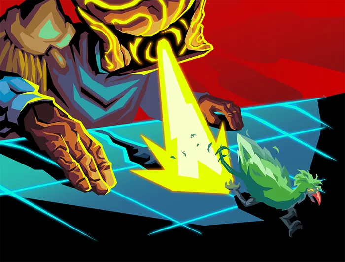 Hégémonie (`HEGEMONY`)
* **Type :** *Attack* | **Coût :** `2` ⚡ | **Rareté :** `Uncommon`
* **Effet Normal :** Infligez 15 dégâts.
Au prochain tour, gagnez ⚡2⚡.
* **Effet Amélioré :** Infligez 18 dégâts.
Au prochain tour, gagnez ⚡3⚡.
* **Amélioration :** `damage: +3, energygain: +1`

### 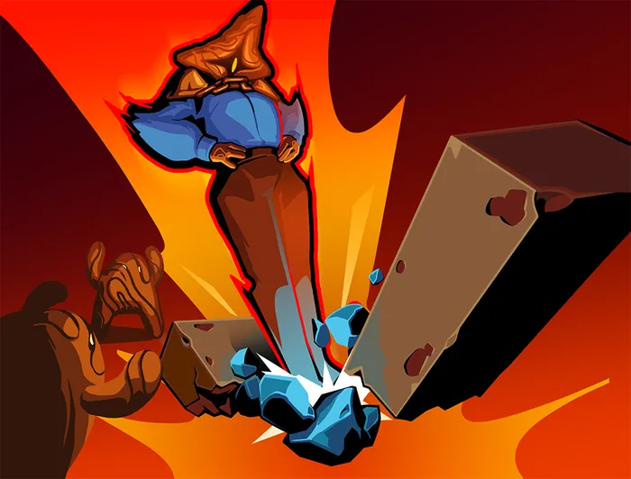 Coup de pied royal (`KINGLY_KICK`)
* **Type :** *Attack* | **Coût :** `4` ⚡ | **Rareté :** `Uncommon`
* **Effet Normal :** Infligez 27 dégâts.
Lorsque vous piochez cette carte, réduisez son coût de 1.
* **Effet Amélioré :** Infligez 35 dégâts.
Lorsque vous piochez cette carte, réduisez son coût de 1.
* **Amélioration :** `damage: +8`

### 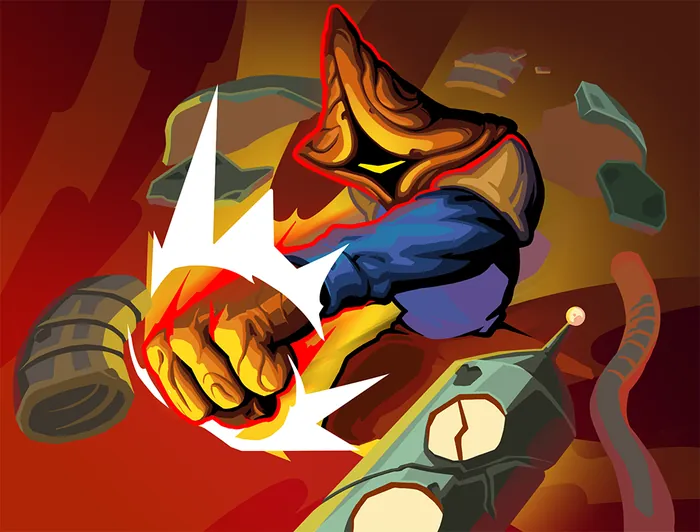 Coup de poing royal (`KINGLY_PUNCH`)
* **Type :** *Attack* | **Coût :** `1` ⚡ | **Rareté :** `Uncommon`
* **Effet Normal :** Infligez 8 dégâts.
Lorsque vous piochez cette carte, augmentez les dégâts qu'elle inflige de 4 jusqu'à la fin du combat.
* **Effet Amélioré :** Infligez 10 dégâts.
Lorsque vous piochez cette carte, augmentez les dégâts qu'elle inflige de 6 jusqu'à la fin du combat.
* **Amélioration :** `damage: +2, increase: +2`

### 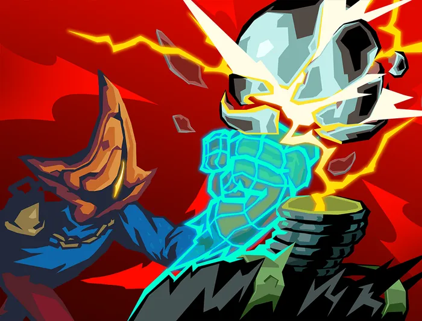 Hors d'état (`KNOCKOUT_BLOW`)
* **Type :** *Attack* | **Coût :** `3` ⚡ | **Rareté :** `Uncommon`
* **Effet Normal :** Infligez 30 dégâts.
Si vous tuez un ennemi ainsi, gagnez <s>5</s>.
* **Effet Amélioré :** Infligez 38 dégâts.
Si vous tuez un ennemi ainsi, gagnez <s>5</s>.
* **Amélioration :** `damage: +8`

### 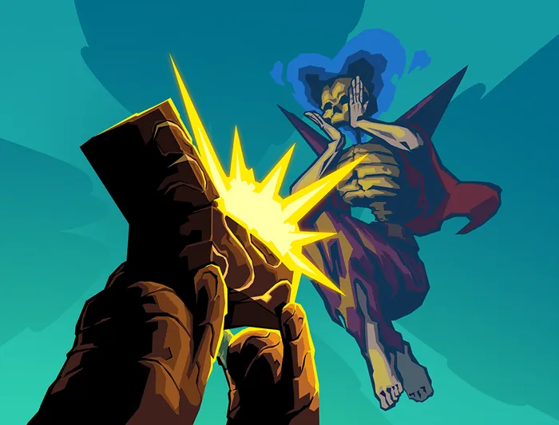 Largesse (`LARGESSE`)
* **Type :** *Skill* | **Coût :** `0` ⚡ | **Rareté :** `Uncommon`
* **Effet Normal :** Un autre joueur ajoute 1 carte Incolore à sa **Main**.
* **Effet Amélioré :** Un autre joueur ajoute 1 carte Incolore **Améliorée** à sa **Main**.

### 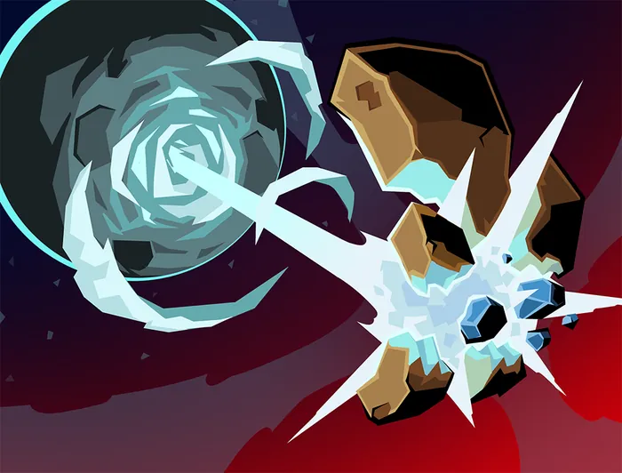 Déflagration lunaire (`LUNAR_BLAST`)
* **Type :** *Attack* | **Coût :** `0` ⚡ | **Rareté :** `Uncommon`
* **Effet Normal :** Infligez 4 dégâts pour chaque Compétence déjà jouée pendant ce tour.
* **Effet Amélioré :** Infligez 5 dégâts pour chaque Compétence déjà jouée pendant ce tour.
* **Amélioration :** `damage: +1`

### 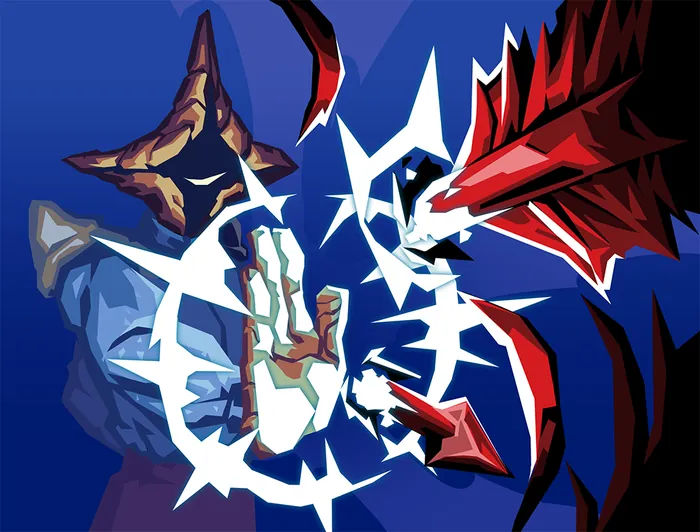 Autorité manifeste (`MANIFEST_AUTHORITY`)
* **Type :** *Skill* | **Coût :** `1` ⚡ | **Rareté :** `Uncommon`
* **Effet Normal :** Gagnez 7 d'**Armure**.
Ajoutez 1 carte Incolore aléatoire à votre **Main**.
* **Effet Amélioré :** Gagnez 8 d'**Armure**.
Ajoutez 1 carte Incolore aléatoire **Améliorée** à votre **Main**.
* **Amélioration :** `block: +1`

###  Monologue (`MONOLOGUE`)
* **Type :** *Skill* | **Coût :** `0` ⚡ | **Rareté :** `Uncommon`
* **Effet Normal :** Chaque fois que vous jouez une carte pendant ce tour, gagnez 1 de **Force** jusqu'à la fin du tour.
* **Effet Amélioré :** **Retenue**.
Chaque fois que vous jouez une carte pendant ce tour, gagnez 1 de **Force** jusqu'à la fin du tour.
* **Amélioration :** `keywords: ['Retain']`

### 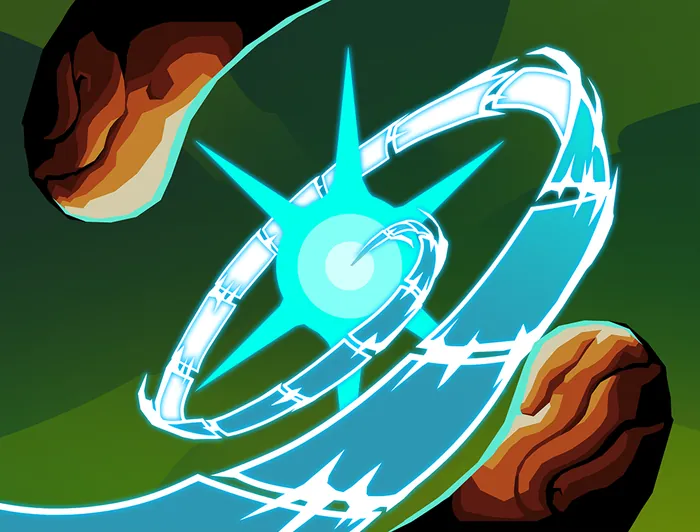 Orbite (`ORBIT`)
* **Type :** *Power* | **Coût :** `2` ⚡ | **Rareté :** `Uncommon`
* **Effet Normal :** Pour tous les ⚡ que vous dépensez,
vous gagnez ⚡1⚡.
* **Effet Amélioré :** Pour tous les ⚡ que vous dépensez,
vous gagnez ⚡1⚡.
* **Amélioration :** `energy: -1`

### 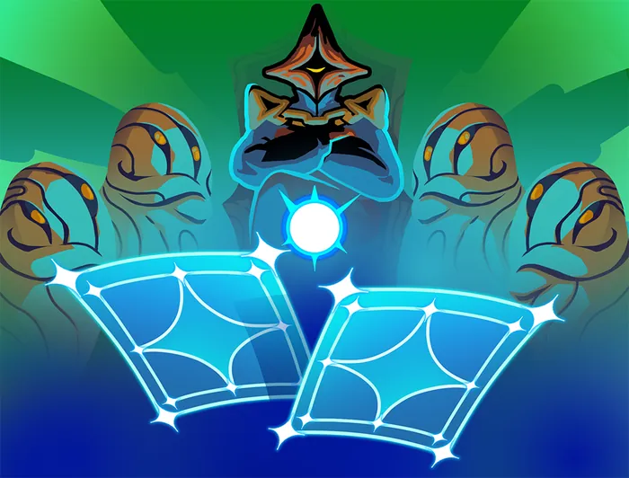 Point bleu pâle (`PALE_BLUE_DOT`)
* **Type :** *Power* | **Coût :** `1` ⚡ | **Rareté :** `Uncommon`
* **Effet Normal :** Si vous jouez cartes ou plus en un tour, piochez 1 carte au début du tour suivant.
* **Effet Amélioré :** Si vous jouez cartes ou plus en un tour, piochez 2 cartes au début du tour suivant.
* **Amélioration :** `cards: +1`

### 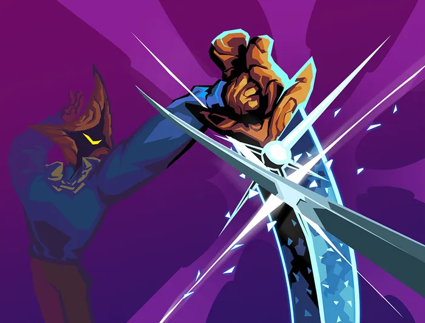 Parade (`PARRY`)
* **Type :** *Power* | **Coût :** `1` ⚡ | **Rareté :** `Uncommon`
* **Effet Normal :** **Lame souveraine** confère désormais 10 d'**Armure**.
* **Effet Amélioré :** **Lame souveraine** confère désormais 14 d'**Armure**.
* **Amélioration :** `parrypower: +4`

### 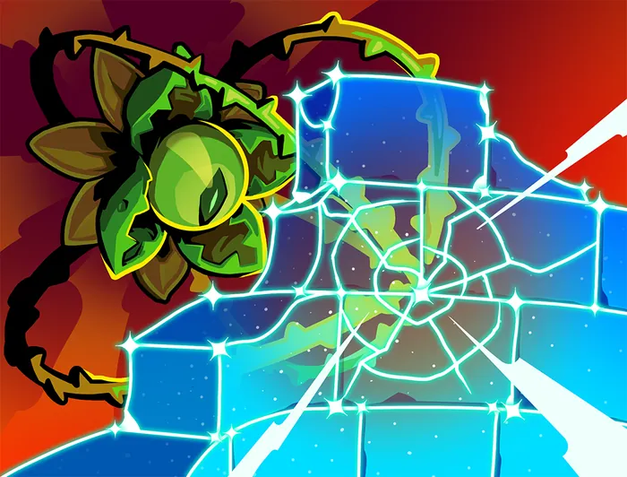 Mur de particules (`PARTICLE_WALL`)
* **Type :** *Skill* | **Coût :** `0` ⚡ | **Rareté :** `Uncommon`
* **Effet Normal :** Gagnez 9 d'**Armure**.
Cette carte retourne dans votre **Main**.
* **Effet Amélioré :** Gagnez 12 d'**Armure**.
Cette carte retourne dans votre **Main**.
* **Amélioration :** `block: +3`

### 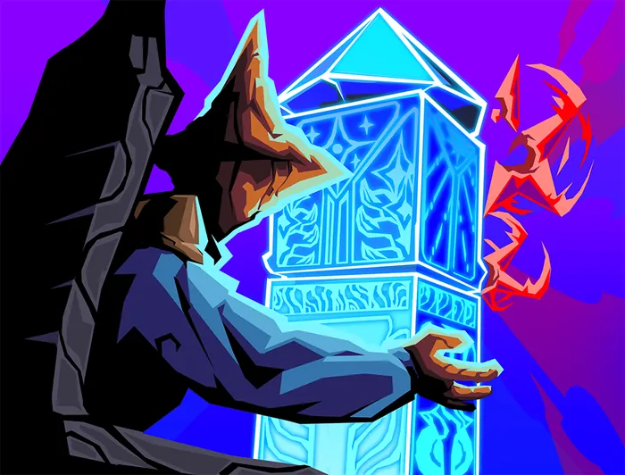 Pilier de la création (`PILLAR_OF_CREATION`)
* **Type :** *Power* | **Coût :** `1` ⚡ | **Rareté :** `Uncommon`
* **Effet Normal :** Lorsque vous créez une carte, gagnez 2 d'**Armure**.
* **Effet Amélioré :** Lorsque vous créez une carte, gagnez 3 d'**Armure**.
* **Amélioration :** `block: +1`

### 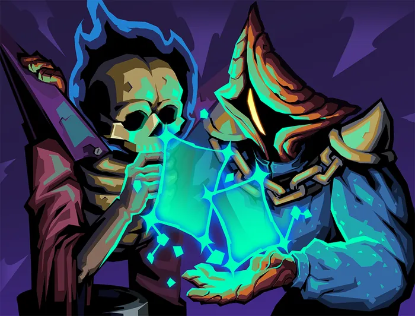 Esquisse (`PLOT`)
* **Type :** *Skill* | **Coût :** `1` ⚡ | **Rareté :** `Uncommon`
* **Effet Normal :** Au prochain tour, TOUS les joueurs piochent 2 cartes.
* **Effet Amélioré :** Au prochain tour, TOUS les joueurs piochent 3 cartes.
* **Amélioration :** `cards: +1`

### 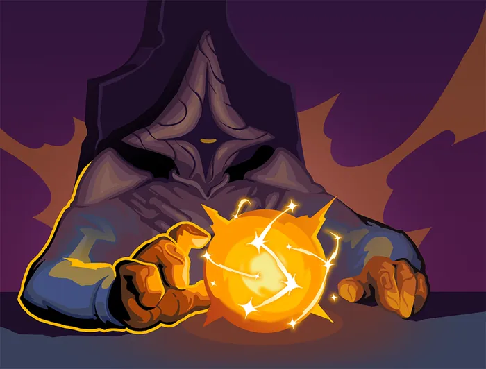 Prophétie (`PROPHESIZE`)
* **Type :** *Skill* | **Coût :** `2` ⚡ | **Rareté :** `Uncommon`
* **Effet Normal :** Piochez 6 cartes.
* **Effet Amélioré :** Piochez 9 cartes.
* **Amélioration :** `cards: +3`

### 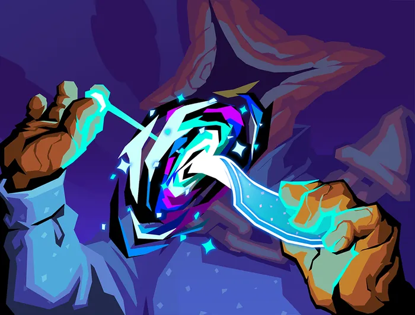 Quasar (`QUASAR`)
* **Type :** *Skill* | **Coût :** `0` ⚡ | **Rareté :** `Uncommon`
* **Effet Normal :** Choisissez 1 carte Incolore parmi 3 aléatoires à ajouter à votre **Main**.
* **Effet Amélioré :** Choisissez 1 carte Incolore **Améliorée** parmi 3 aléatoires à ajouter à votre **Main**.

### 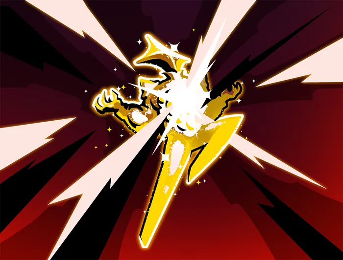 Rayonnement (`RADIATE`)
* **Type :** *Attack* | **Coût :** `0` ⚡ | **Rareté :** `Uncommon`
* **Effet Normal :** Infligez 3 dégâts à TOUS les ennemis pour chaque <s>1</s> gagnée ce tour.
* **Effet Amélioré :** Infligez 4 dégâts à TOUS les ennemis pour chaque <s>1</s> gagnée ce tour.
* **Amélioration :** `damage: +1`

### 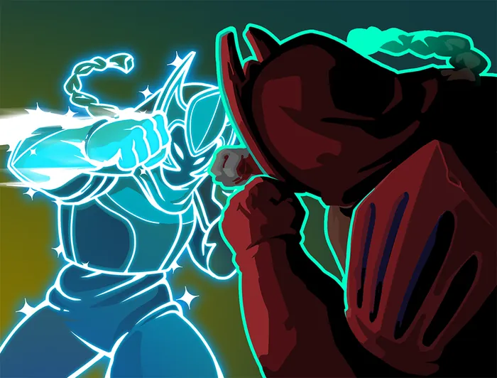 Reflet miroir (`REFLECT`)
* **Type :** *Skill* | **Coût :** `1` ⚡ | **Rareté :** `Uncommon`
* **Effet Normal :** Gagnez 15 d'**Armure**.
Les dégâts d'attaque bloqués par l'**Armure** sont renvoyés à l'attaquant pendant ce tour.
* **Effet Amélioré :** Gagnez 20 d'**Armure**.
Les dégâts d'attaque bloqués par l'**Armure** sont renvoyés à l'attaquant pendant ce tour.
* **Amélioration :** `block: +5`

### 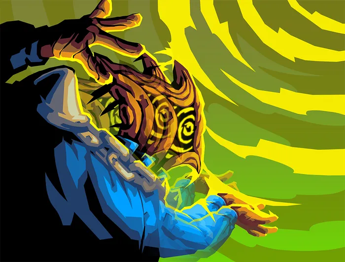 Résonance (`RESONANCE`)
* **Type :** *Skill* | **Coût :** `1` ⚡ | **Rareté :** `Uncommon`
* **Effet Normal :** Gagnez 1 de **Force**. TOUS les ennemis perdent 1 de **Force**.
* **Effet Amélioré :** Gagnez 2 de **Force**. TOUS les ennemis perdent 1 de **Force**.
* **Amélioration :** `strengthpower: +1`

### 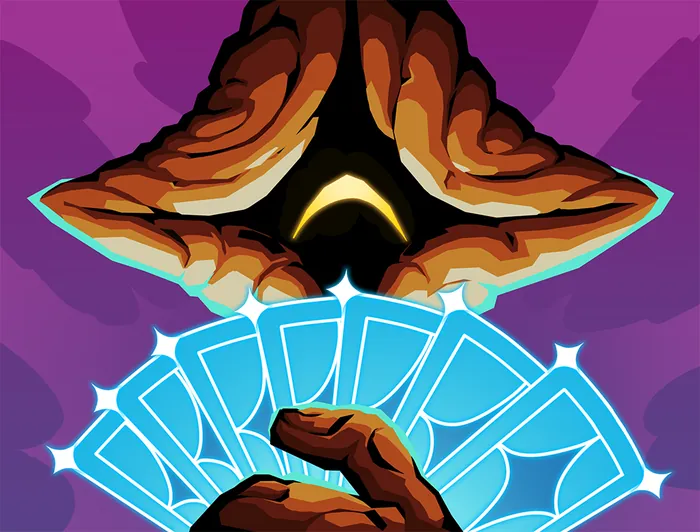 Pari royal (`ROYAL_GAMBLE`)
* **Type :** *Skill* | **Coût :** `0` ⚡ | **Rareté :** `Uncommon`
* **Effet Normal :** Gagnez 9 <s>1</s>.
**Épuisement**.
* **Effet Amélioré :** **Retenue**.
Gagnez 9 <s>1</s>.
**Épuisement**.
* **Amélioration :** `keywords: ['Retain']`

### 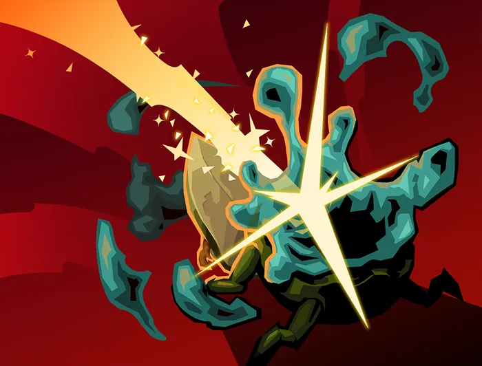 Frappe rayonnante (`SHINING_STRIKE`)
* **Type :** *Attack* | **Coût :** `1` ⚡ | **Rareté :** `Uncommon`
* **Effet Normal :** Infligez 8 dégâts.
Gagnez <s>2</s>.
Placez cette carte sur le dessus de votre **Pioche**.
* **Effet Amélioré :** Infligez 11 dégâts.
Gagnez <s>2</s>.
Placez cette carte sur le dessus de votre **Pioche**.
* **Amélioration :** `damage: +3`

###  Spectre visible (`SPECTRUM_SHIFT`)
* **Type :** *Power* | **Coût :** `2` ⚡ | **Rareté :** `Uncommon`
* **Effet Normal :** Au début de votre tour, ajoutez 1 carte Incolore aléatoire à votre **Main**.
* **Effet Amélioré :** Au début de votre tour, ajoutez 1 carte Incolore aléatoire à votre **Main**.
* **Amélioration :** `energy: -1`

###  Poussière d'étoiles (`STARDUST`)
* **Type :** *Attack* | **Coût :** `0` ⚡ | **Rareté :** `Uncommon`
* **Effet Normal :** Infligez 5 dégâts à un ennemi aléatoire X fois.
* **Effet Amélioré :** Infligez 7 dégâts à un ennemi aléatoire X fois.
* **Amélioration :** `damage: +2`

### 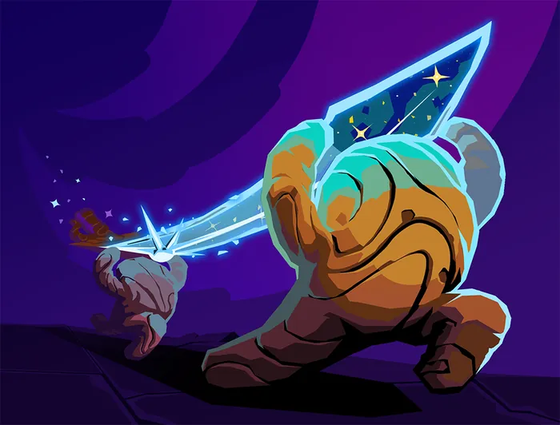 L'union fait la forge (`SUMMON_FORTH`)
* **Type :** *Skill* | **Coût :** `1` ⚡ | **Rareté :** `Uncommon`
* **Effet Normal :** Placez **Lame souveraine** dans votre **Main** depuis n'importe où.
**Forgez** pour 8.
* **Effet Amélioré :** Placez **Lame souveraine** dans votre **Main** depuis n'importe où.
**Forgez** pour 11.
* **Amélioration :** `forge: +3`

### 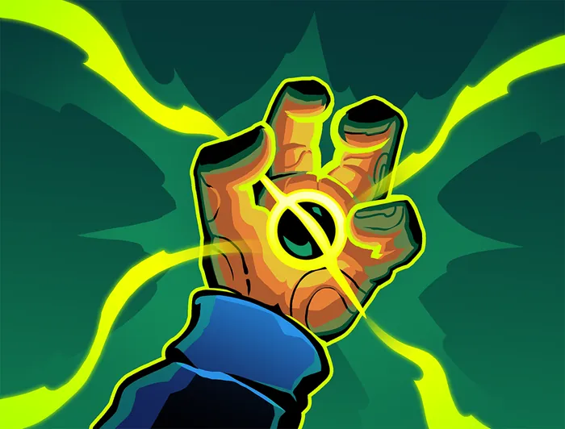 Supermassif (`SUPERMASSIVE`)
* **Type :** *Attack* | **Coût :** `1` ⚡ | **Rareté :** `Uncommon`
* **Effet Normal :** Infligez 5 dégâts.
Inflige 3 dégâts supplémentaires pour chaque carte que vous avez créée pendant ce combat.
* **Effet Amélioré :** Infligez 5 dégâts.
Inflige 4 dégâts supplémentaires pour chaque carte que vous avez créée pendant ce combat.
* **Amélioration :** `extradamage: +1`

### 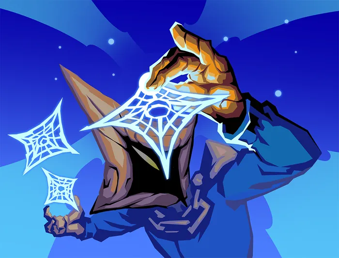 Terraformation (`TERRAFORMING`)
* **Type :** *Skill* | **Coût :** `1` ⚡ | **Rareté :** `Uncommon`
* **Effet Normal :** Gagnez 7 de **Vigueur**.
* **Effet Amélioré :** Gagnez 10 de **Vigueur**.
* **Amélioration :** `vigorpower: +3`

## ⭐ Rareté : Rare (27 cartes)

### 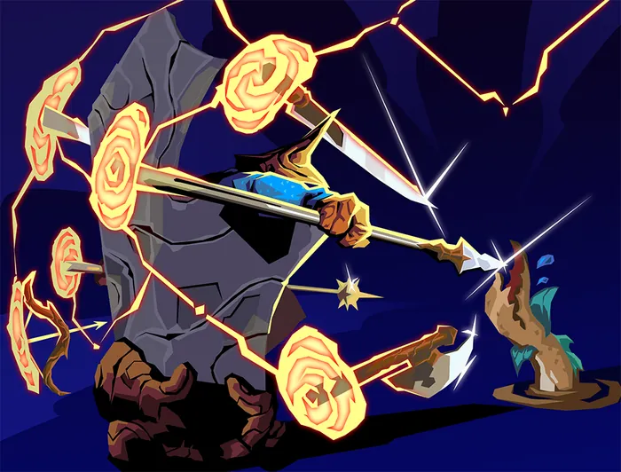 Arsenal (`ARSENAL`)
* **Type :** *Power* | **Coût :** `1` ⚡ | **Rareté :** `Rare`
* **Effet Normal :** Lorsque vous créez une carte, gagnez 1 de **Force**.
* **Effet Amélioré :** **Inné**.
Lorsque vous créez une carte, gagnez 1 de **Force**.
* **Amélioration :** `keywords: ['Innate']`

### 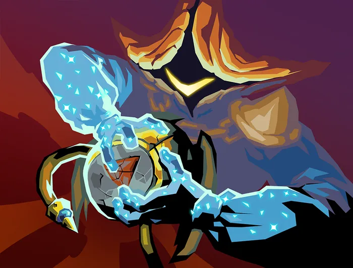 Châtiment (`BEAT_INTO_SHAPE`)
* **Type :** *Attack* | **Coût :** `1` ⚡ | **Rareté :** `Rare`
* **Effet Normal :** Infligez 5 dégâts.
**Forgez** pour 5.
**Forgez** pour 5 supplémentaires pour chaque fois que vous avez touché l'ennemi pendant ce tour.
* **Effet Amélioré :** Infligez 7 dégâts.
**Forgez** pour 7.
**Forgez** pour 7 supplémentaires pour chaque fois que vous avez touché l'ennemi pendant ce tour.
* **Amélioration :** `damage: +2, calculationbase: +2, calculationextra: +2`

### 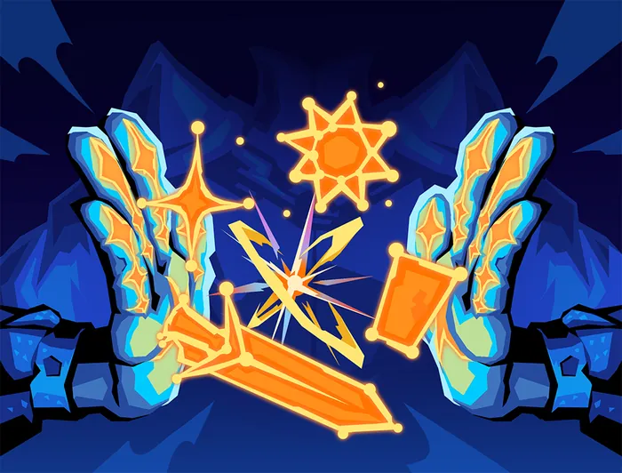 Big Bang (`BIG_BANG`)
* **Type :** *Skill* | **Coût :** `0` ⚡ | **Rareté :** `Rare`
* **Effet Normal :** Piochez 1 carte.
Gagnez ⚡1⚡.
Gagnez <s>1</s>.
**Forgez** pour 5.
**Épuisement**.
* **Effet Amélioré :** **Inné**.
Piochez 1 carte.
Gagnez ⚡1⚡.
Gagnez <s>1</s>.
**Forgez** pour 5.
**Épuisement**.
* **Amélioration :** `keywords: ['Innate']`

### 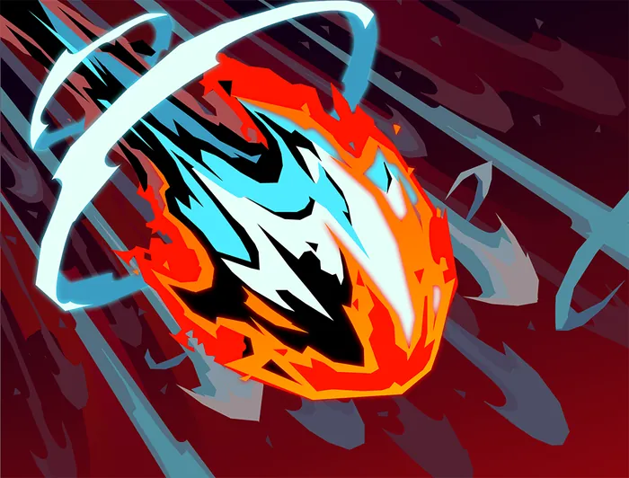 Bombardement (`BOMBARDMENT`)
* **Type :** *Attack* | **Coût :** `3` ⚡ | **Rareté :** `Rare`
* **Effet Normal :** Infligez 18 dégâts.
Au début de votre tour, si cette carte est dans votre pile de cartes **Épuisées**, jouez-la.
**Épuisement**.
* **Effet Amélioré :** Infligez 24 dégâts.
Au début de votre tour, si cette carte est dans votre pile de cartes **Épuisées**, jouez-la.
**Épuisement**.
* **Amélioration :** `damage: +6`

###  Cadeau joyeux (`BUNDLE_OF_JOY`)
* **Type :** *Skill* | **Coût :** `1` ⚡ | **Rareté :** `Rare`
* **Effet Normal :** Ajoutez 3 cartes Incolores aléatoires à votre **Main**.
**Épuisement**.
* **Effet Amélioré :** Ajoutez 4 cartes Incolores aléatoires à votre **Main**.
**Épuisement**.
* **Amélioration :** `cards: +1`

###  Comète (`COMET`)
* **Type :** *Attack* | **Coût :** `0` ⚡ | **Rareté :** `Rare`
* **Effet Normal :** Infligez 33 dégâts.
Appliquez **Affaibli** (3).
Appliquez **Vulnérable** (3).
* **Effet Amélioré :** Infligez 44 dégâts.
Appliquez **Affaibli** (3).
Appliquez **Vulnérable** (3).
* **Amélioration :** `damage: +11`

### 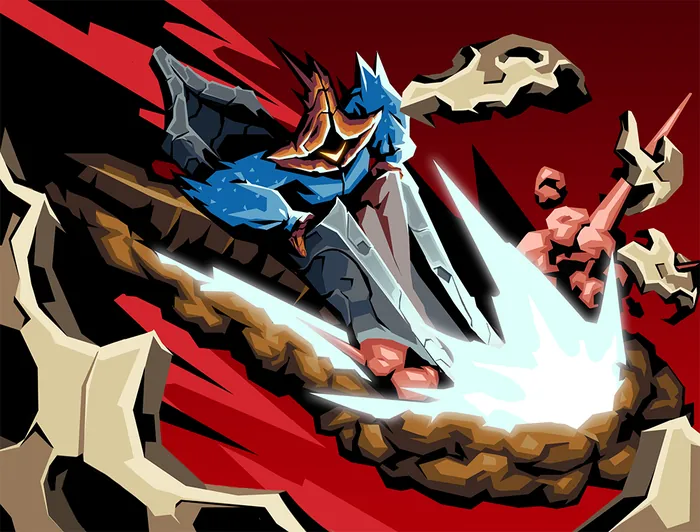 Atterrissage forcé (`CRASH_LANDING`)
* **Type :** *Attack* | **Coût :** `1` ⚡ | **Rareté :** `Rare`
* **Effet Normal :** Infligez 21 dégâts à TOUS les ennemis.
Remplissez votre **Main** de **Débris**.
* **Effet Amélioré :** Infligez 26 dégâts à TOUS les ennemis.
Remplissez votre **Main** de **Débris**.
* **Amélioration :** `damage: +5`

###  Grandes décisions (`DECISIONS_DECISIONS`)
* **Type :** *Skill* | **Coût :** `0` ⚡ | **Rareté :** `Rare`
* **Effet Normal :** Piochez 3 cartes.
Sélectionnez une Compétence dans votre **Main** et jouez-la 3 fois.
**Épuisement**.
* **Effet Amélioré :** Piochez 5 cartes.
Sélectionnez une Compétence dans votre **Main** et jouez-la 3 fois.
**Épuisement**.
* **Amélioration :** `cards: +2`

### 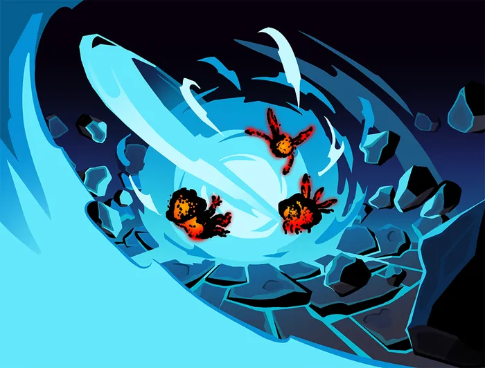 Étoile mourante (`DYING_STAR`)
* **Type :** *Attack* | **Coût :** `1` ⚡ | **Rareté :** `Rare`
* **Effet Normal :** **Éthéré**.
Infligez 9 dégâts à TOUS les ennemis. TOUS les ennemis perdent 9 de **Force** jusqu'à la fin du tour.
* **Effet Amélioré :** **Éthéré**.
Infligez 11 dégâts à TOUS les ennemis. TOUS les ennemis perdent 11 de **Force** jusqu'à la fin du tour.
* **Amélioration :** `damage: +2, strengthloss: +2`

###  Couru d'avance (`FOREGONE_CONCLUSION`)
* **Type :** *Skill* | **Coût :** `1` ⚡ | **Rareté :** `Rare`
* **Effet Normal :** Au prochain tour, placez 2 cartes de votre **Pioche** dans votre **Main**.
* **Effet Amélioré :** Au prochain tour, placez 3 cartes de votre **Pioche** dans votre **Main**.
* **Amélioration :** `cards: +1`

###  Genèse (`GENESIS`)
* **Type :** *Power* | **Coût :** `2` ⚡ | **Rareté :** `Rare`
* **Effet Normal :** Au début de votre tour, gagnez <s>2</s>.
* **Effet Amélioré :** Au début de votre tour, gagnez <s>3</s>.
* **Amélioration :** `starsperturn: +1`

###  GARDES !!! (`GUARDS`)
* **Type :** *Skill* | **Coût :** `2` ⚡ | **Rareté :** `Rare`
* **Effet Normal :** **Transformez** autant de cartes de votre **Main** que vous souhaitez en **Sbire sacrificiel**.
**Épuisement**.
* **Effet Amélioré :** **Transformez** autant de cartes de votre **Main** que vous souhaitez en **Sbire sacrificiel+**.
**Épuisement**.

###  L'heure du marteau (`HAMMER_TIME`)
* **Type :** *Power* | **Coût :** `2` ⚡ | **Rareté :** `Rare`
* **Effet Normal :** Lorsque vous **Forgez**, tous vos alliés **Forgent** également.
* **Effet Amélioré :** Lorsque vous **Forgez**, tous vos alliés **Forgent** également.
* **Amélioration :** `energy: -1`

### 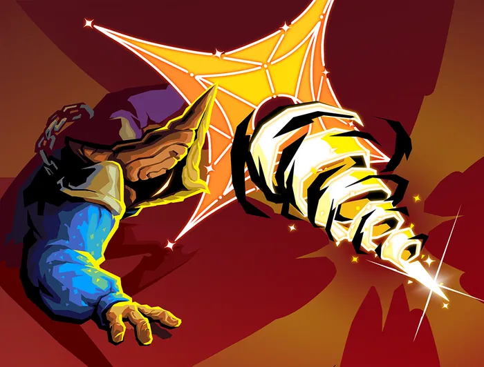 Foreuse céleste (`HEAVENLY_DRILL`)
* **Type :** *Attack* | **Coût :** `-1` ⚡ | **Rareté :** `Rare`
* **Effet Normal :** Infligez 8 dégâts X fois.
X est doublé si sa valeur est de 4 ou plus.
* **Effet Amélioré :** Infligez 10 dégâts X fois.
X est doublé si sa valeur est de 4 ou plus.
* **Amélioration :** `damage: +2`

### 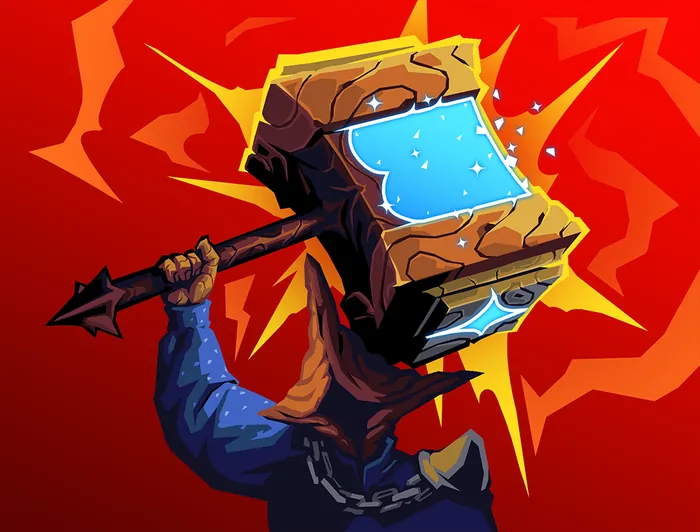 Marteau d'héritage (`HEIRLOOM_HAMMER`)
* **Type :** *Attack* | **Coût :** `2` ⚡ | **Rareté :** `Rare`
* **Effet Normal :** Infligez 20 dégâts.
Sélectionnez une carte Incolore dans votre **Main**. Ajoutez une copie de cette carte à votre **Main**.
* **Effet Amélioré :** Infligez 25 dégâts.
Sélectionnez une carte Incolore dans votre **Main**. Ajoutez une copie de cette carte à votre **Main**.
* **Amélioration :** `damage: +5`

### 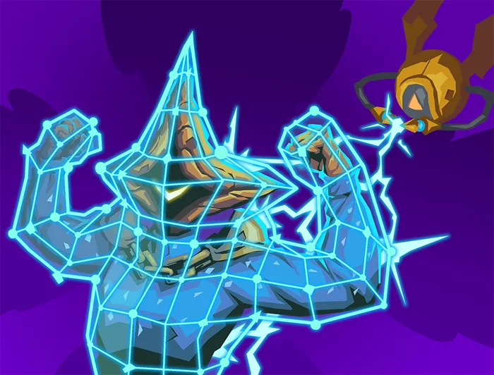 Je suis invincible (`I_AM_INVINCIBLE`)
* **Type :** *Skill* | **Coût :** `1` ⚡ | **Rareté :** `Rare`
* **Effet Normal :** Gagnez 10 d'**Armure**.
À la fin de votre tour, si cette carte est sur le dessus de votre **Pioche**, jouez-la.
* **Effet Amélioré :** Gagnez 13 d'**Armure**.
À la fin de votre tour, si cette carte est sur le dessus de votre **Pioche**, jouez-la.
* **Amélioration :** `block: +3`

### 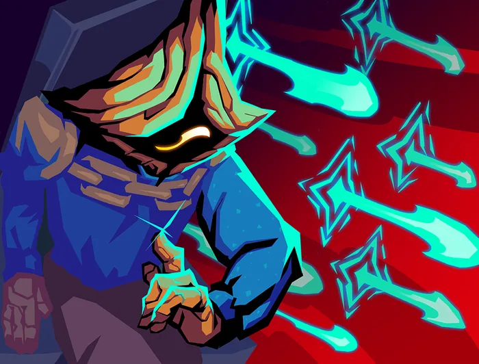 Ainsi soit-il (`MAKE_IT_SO`)
* **Type :** *Attack* | **Coût :** `0` ⚡ | **Rareté :** `Rare`
* **Effet Normal :** Infligez 6 dégâts.
Toutes les 3 Compétences jouées par tour, placez cette carte dans votre **Main**.
* **Effet Amélioré :** Infligez 9 dégâts.
Toutes les 3 Compétences jouées par tour, placez cette carte dans votre **Main**.
* **Amélioration :** `damage: +3`

### 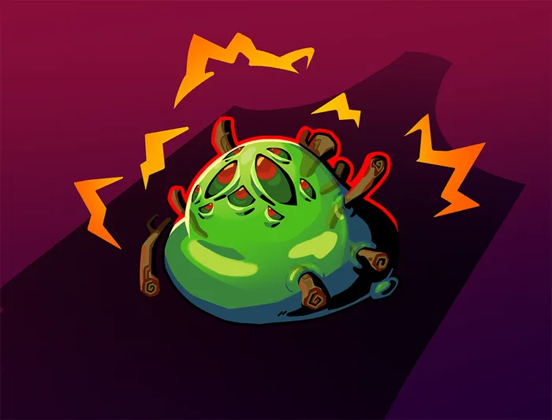 Regard monarchique (`MONARCHS_GAZE`)
* **Type :** *Power* | **Coût :** `2` ⚡ | **Rareté :** `Rare`
* **Effet Normal :** Lorsque vous attaquez un ennemi, celui-ci perd 1 de **Force** jusqu'à la fin du tour.
* **Effet Amélioré :** Lorsque vous attaquez un ennemi, celui-ci perd 1 de **Force** jusqu'à la fin du tour.
* **Amélioration :** `energy: -1`

### 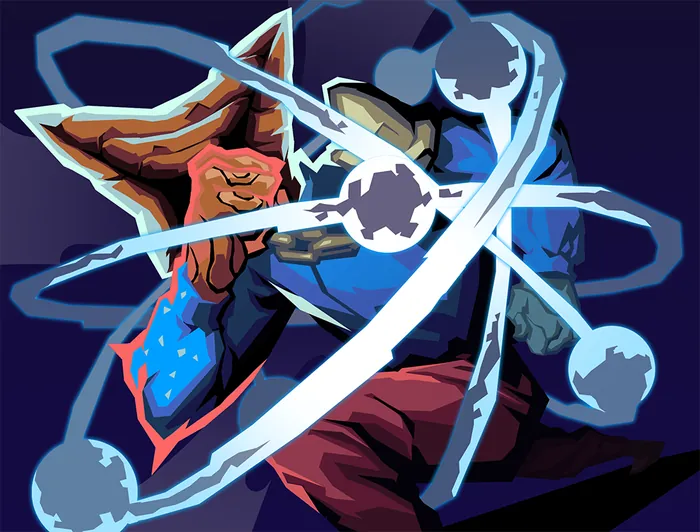 Égide à neutrons (`NEUTRON_AEGIS`)
* **Type :** *Power* | **Coût :** `1` ⚡ | **Rareté :** `Rare`
* **Effet Normal :** Gagnez 8 de **Blindage**.
* **Effet Amélioré :** Gagnez 11 de **Blindage**.
* **Amélioration :** `platingpower: +3`

###  Royalties (`ROYALTIES`)
* **Type :** *Power* | **Coût :** `1` ⚡ | **Rareté :** `Rare`
* **Effet Normal :** À la fin du combat, gagnez 30 **Pièces d'or**.
* **Effet Amélioré :** À la fin du combat, gagnez 40 **Pièces d'or**.
* **Amélioration :** `gold: +10`

### 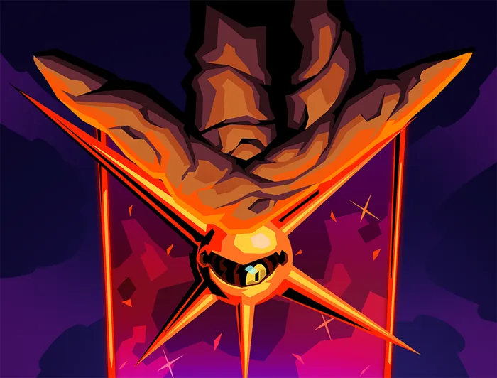 Lame chercheuse (`SEEKING_EDGE`)
* **Type :** *Power* | **Coût :** `1` ⚡ | **Rareté :** `Rare`
* **Effet Normal :** **Forgez** pour 7.
**Lame souveraine** inflige désormais ses dégâts à TOUS les ennemis.
* **Effet Amélioré :** **Forgez** pour 11.
**Lame souveraine** inflige désormais ses dégâts à TOUS les ennemis.
* **Amélioration :** `forge: +4`

### 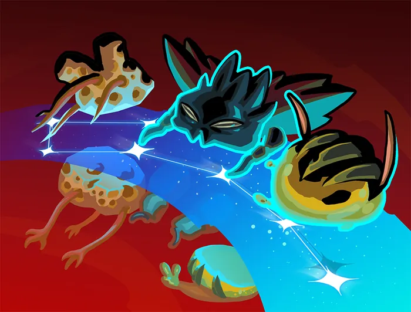 Pléiades (`SEVEN_STARS`)
* **Type :** *Attack* | **Coût :** `2` ⚡ | **Rareté :** `Rare`
* **Effet Normal :** Infligez 7 dégâts à TOUS les ennemis 7 fois.
* **Effet Amélioré :** Infligez 7 dégâts à TOUS les ennemis 7 fois.
* **Amélioration :** `energy: -1`

### 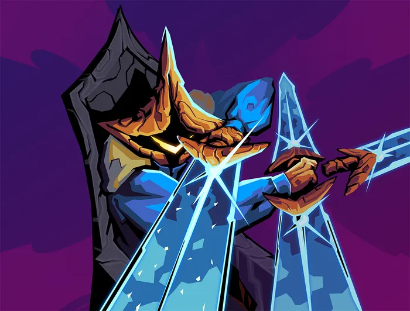 Sage à l'épée (`SWORD_SAGE`)
* **Type :** *Power* | **Coût :** `2` ⚡ | **Rareté :** `Rare`
* **Effet Normal :** **Lame souveraine** gagne **Écho** 1.
* **Effet Amélioré :** **Lame souveraine** gagne **Écho** 1.
* **Amélioration :** `energy: -1`

### 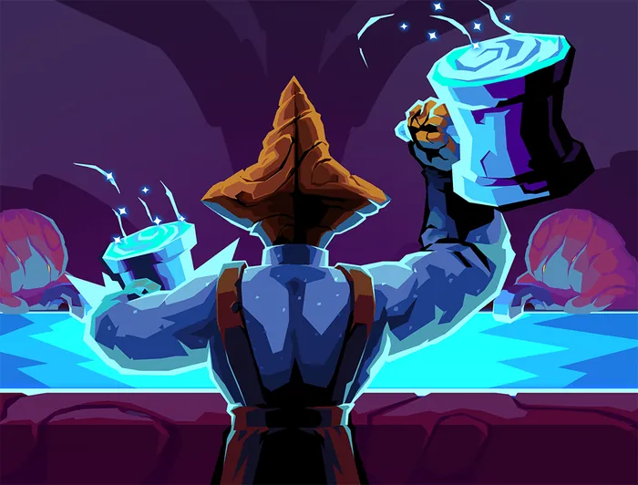 Le forgeron (`THE_SMITH`)
* **Type :** *Skill* | **Coût :** `1` ⚡ | **Rareté :** `Rare`
* **Effet Normal :** **Forgez** pour 30.
* **Effet Amélioré :** **Forgez** pour 40.
* **Amélioration :** `forge: +10`

###  Leçon (`TUTOR`)
* **Type :** *Skill* | **Coût :** `1` ⚡ | **Rareté :** `Rare`
* **Effet Normal :** Un autre joueurs choisit une carte dans sa **Pioche** à placer dans sa **Main**.
* **Effet Amélioré :** Un autre joueurs choisit une carte dans sa **Pioche** à placer dans sa **Main**.
* **Amélioration :** `energy: -1`

### 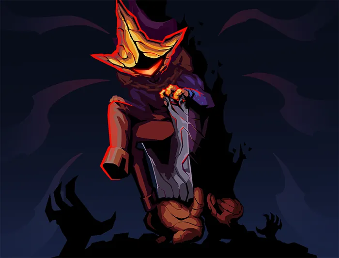 Tyran (`TYRANNY`)
* **Type :** *Power* | **Coût :** `1` ⚡ | **Rareté :** `Rare`
* **Effet Normal :** Au début de votre tour, piochez 1 carte et **Épuisez** 1 carte de votre **Main**.
* **Effet Amélioré :** **Inné**.
Au début de votre tour, piochez 1 carte et **Épuisez** 1 carte de votre **Main**.
* **Amélioration :** `keywords: ['Innate']`

###  Forme du néant (`VOID_FORM`)
* **Type :** *Power* | **Coût :** `3` ⚡ | **Rareté :** `Rare`
* **Effet Normal :** **Éthéré**.
Terminez votre tour.
Les 2 premières cartes que vous jouez chaque tour coûtent 0.
* **Effet Amélioré :** Terminez votre tour.
Les 2 premières cartes que vous jouez chaque tour coûtent 0.
* **Amélioration :** `keywordsRemoved: ['Ethereal']`
