# 🃏 Cartes — La Nécrolieuse (Necrobinder)

> **Total :** 91 cartes | **Patch :** `v0.111.0 Beta`  
> Nouveau personnage de STS2 : nécromancie, invocations et manipulation des âmes.

---

## ⭐ Rareté : Basic (4 cartes)

### 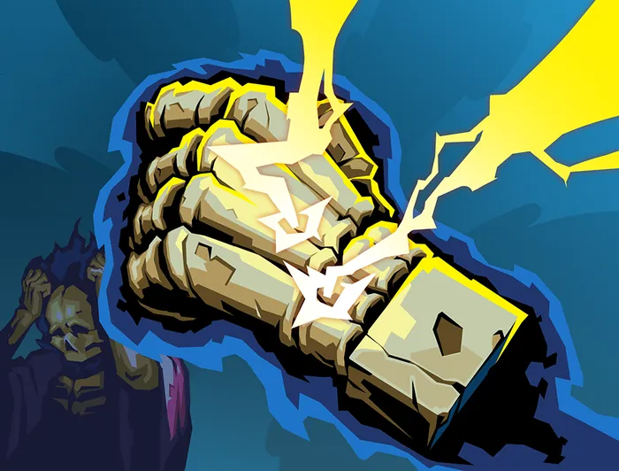 Garde du corps (`BODYGUARD`)
* **Type :** *Skill* | **Coût :** `1` ⚡ | **Rareté :** `Basic`
* **Effet Normal :** **Invoquez** pour 5.
* **Effet Amélioré :** **Invoquez** pour 7.
* **Amélioration :** `summon: +2`

### 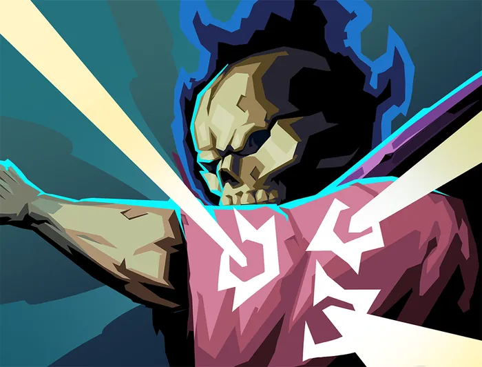 Défense (`DEFEND_NECROBINDER`)
* **Type :** *Skill* | **Coût :** `1` ⚡ | **Rareté :** `Basic`
* **Effet Normal :** Gagnez 5 d'**Armure**.
* **Effet Amélioré :** Gagnez 8 d'**Armure**.
* **Amélioration :** `block: +3`

###  Frappe (`STRIKE_NECROBINDER`)
* **Type :** *Attack* | **Coût :** `1` ⚡ | **Rareté :** `Basic`
* **Effet Normal :** Infligez 6 dégâts.
* **Effet Amélioré :** Infligez 9 dégâts.
* **Amélioration :** `damage: +3`

### 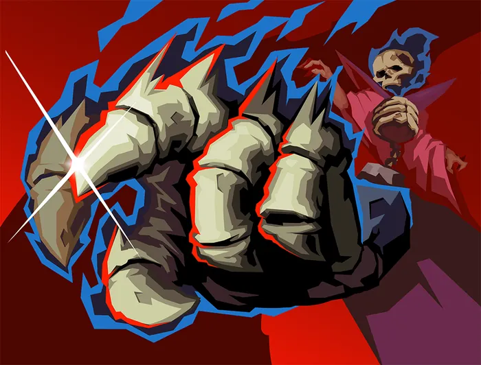 Déchaînement (`UNLEASH`)
* **Type :** *Attack* | **Coût :** `1` ⚡ | **Rareté :** `Basic`
* **Effet Normal :** **Titos** inflige 6 dégâts.
Inflige un montant de dégâts supplémentaires égal aux PV actuels de **Titos**.
* **Effet Amélioré :** **Titos** inflige 9 dégâts.
Inflige un montant de dégâts supplémentaires égal aux PV actuels de **Titos**.
* **Amélioration :** `calculationbase: +3`

## ⭐ Rareté : Common (20 cartes)

###  Vie après la mort (`AFTERLIFE`)
* **Type :** *Skill* | **Coût :** `1` ⚡ | **Rareté :** `Common`
* **Effet Normal :** **Invoquez** pour 6.
**Épuisement**.
* **Effet Amélioré :** **Invoquez** pour 9.
**Épuisement**.
* **Amélioration :** `summon: +3`

###  Frappe du fléau (`BLIGHT_STRIKE`)
* **Type :** *Attack* | **Coût :** `1` ⚡ | **Rareté :** `Common`
* **Effet Normal :** Infligez 8 dégâts.
Appliquez un montant de **Fatalité** égal aux dégâts infligés.
* **Effet Amélioré :** Infligez 10 dégâts.
Appliquez un montant de **Fatalité** égal aux dégâts infligés.
* **Amélioration :** `damage: +2`

###  Profanation (`DEFILE`)
* **Type :** *Attack* | **Coût :** `1` ⚡ | **Rareté :** `Common`
* **Effet Normal :** **Éthéré**.
Infligez 13 dégâts.
* **Effet Amélioré :** **Éthéré**.
Infligez 17 dégâts.
* **Amélioration :** `damage: +4`

###  Défi (`DEFY`)
* **Type :** *Skill* | **Coût :** `1` ⚡ | **Rareté :** `Common`
* **Effet Normal :** **Éthéré**.
Gagnez 6 d'**Armure**.
Appliquez **Affaibli** (1).
* **Effet Amélioré :** **Éthéré**.
Gagnez 9 d'**Armure**.
Appliquez **Affaibli** (1).
* **Amélioration :** `block: +3`

###  Drain de puissance (`DRAIN_POWER`)
* **Type :** *Attack* | **Coût :** `1` ⚡ | **Rareté :** `Common`
* **Effet Normal :** Infligez 10 dégâts.
**Améliorez** 2 cartes aléatoires de votre **Défausse**.
* **Effet Amélioré :** Infligez 12 dégâts.
**Améliorez** 3 cartes aléatoires de votre **Défausse**.
* **Amélioration :** `damage: +2, cards: +1`

###  Terreur (`FEAR`)
* **Type :** *Attack* | **Coût :** `1` ⚡ | **Rareté :** `Common`
* **Effet Normal :** **Éthéré**.
Infligez 7 dégâts.
Appliquez **Vulnérable** (1).
* **Effet Amélioré :** **Éthéré**.
Infligez 8 dégâts.
Appliquez **Vulnérable** (2).
* **Amélioration :** `damage: +1, vulnerable: +1`

###  Raser (`FLATTEN`)
* **Type :** *Attack* | **Coût :** `2` ⚡ | **Rareté :** `Common`
* **Effet Normal :** **Titos** inflige 12 dégâts.
Cette carte coûte 0 ⚡ si **Titos** a déjà attaqué pendant ce tour.
* **Effet Amélioré :** **Titos** inflige 16 dégâts.
Cette carte coûte 0 ⚡ si **Titos** a déjà attaqué pendant ce tour.
* **Amélioration :** `ostydamage: +4`

###  Fossoyeur (`GRAVE_WARDEN`)
* **Type :** *Skill* | **Coût :** `1` ⚡ | **Rareté :** `Common`
* **Effet Normal :** Gagnez 8 d'**Armure**.
Ajoutez une **Âme** à votre **Pioche**.
* **Effet Amélioré :** Gagnez 11 d'**Armure**.
Ajoutez une **Âme** à votre **Pioche**.
* **Amélioration :** `block: +3`

###  Déflagration tombale (`GRAVEBLAST`)
* **Type :** *Attack* | **Coût :** `1` ⚡ | **Rareté :** `Common`
* **Effet Normal :** Infligez 4 dégâts.
Placez une carte de votre **Défausse** dans votre **Main**.
**Épuisement**.
* **Effet Amélioré :** Infligez 6 dégâts.
Placez une carte de votre **Défausse** dans votre **Main**.
* **Amélioration :** `damage: +2, keywordsRemoved: ['Exhaust']`

###  Adjuration (`INVOKE`)
* **Type :** *Skill* | **Coût :** `1` ⚡ | **Rareté :** `Common`
* **Effet Normal :** Au prochain tour, **Invoquez** pour 2 et gagnez ⚡2⚡.
* **Effet Amélioré :** Au prochain tour, **Invoquez** pour 3 et gagnez ⚡3⚡.
* **Amélioration :** `summon: +1, energygain: +1`

###  Anti-pulsation (`NEGATIVE_PULSE`)
* **Type :** *Skill* | **Coût :** `1` ⚡ | **Rareté :** `Common`
* **Effet Normal :** Gagnez 5 d'**Armure**.
Appliquez 7 de **Fatalité** sur TOUS les ennemis.
* **Effet Amélioré :** Gagnez 6 d'**Armure**.
Appliquez 11 de **Fatalité** sur TOUS les ennemis.
* **Amélioration :** `block: +1, doom: +4`

###  Chiquenaude (`POKE`)
* **Type :** *Attack* | **Coût :** `0` ⚡ | **Rareté :** `Common`
* **Effet Normal :** **Titos** inflige 6 dégâts.
* **Effet Amélioré :** **Titos** inflige 9 dégâts.
* **Amélioration :** `ostydamage: +3`

###  Râblure (`PULL_AGGRO`)
* **Type :** *Skill* | **Coût :** `2` ⚡ | **Rareté :** `Common`
* **Effet Normal :** **Invoquez** pour 4.
Gagnez 7 d'**Armure**.
* **Effet Amélioré :** **Invoquez** pour 5.
Gagnez 9 d'**Armure**.
* **Amélioration :** `summon: +1, block: +2`

###  Moisson (`REAP`)
* **Type :** *Attack* | **Coût :** `3` ⚡ | **Rareté :** `Common`
* **Effet Normal :** **Retenue**.
Infligez 27 dégâts.
* **Effet Amélioré :** **Retenue**.
Infligez 33 dégâts.
* **Amélioration :** `damage: +6`

###  Exaction (`REAVE`)
* **Type :** *Attack* | **Coût :** `1` ⚡ | **Rareté :** `Common`
* **Effet Normal :** Infligez 10 dégâts.
Ajoutez une **Âme** à votre **Pioche**.
* **Effet Amélioré :** Infligez 13 dégâts.
Ajoutez une **Âme+** à votre **Pioche**.
* **Amélioration :** `damage: +3`

###  Pestilence (`SCOURGE`)
* **Type :** *Skill* | **Coût :** `1` ⚡ | **Rareté :** `Common`
* **Effet Normal :** Appliquez 13 de **Fatalité**.
Piochez 1 carte.
* **Effet Amélioré :** Appliquez 16 de **Fatalité**.
Piochez 2 cartes.
* **Amélioration :** `doom: +3, cards: +1`

###  Frappe du sculpteur (`SCULPTING_STRIKE`)
* **Type :** *Attack* | **Coût :** `1` ⚡ | **Rareté :** `Common`
* **Effet Normal :** Infligez 9 dégâts.
Ajoutez **Éthéré** à une carte dans votre **Main**.
* **Effet Amélioré :** Infligez 12 dégâts.
Ajoutez **Éthéré** à une carte dans votre **Main**.
* **Amélioration :** `damage: +3`

###  Claquement de doigts (`SNAP`)
* **Type :** *Attack* | **Coût :** `1` ⚡ | **Rareté :** `Common`
* **Effet Normal :** **Titos** inflige 7 dégâts.
Ajoutez **Retenue** à une carte dans votre **Main**.
* **Effet Amélioré :** **Titos** inflige 10 dégâts.
Ajoutez **Retenue** à une carte dans votre **Main**.
* **Amélioration :** `ostydamage: +3`

###  Semence (`SOW`)
* **Type :** *Attack* | **Coût :** `1` ⚡ | **Rareté :** `Common`
* **Effet Normal :** **Retenue**.
Infligez 8 dégâts à TOUS les ennemis.
* **Effet Amélioré :** **Retenue**.
Infligez 11 dégâts à TOUS les ennemis.
* **Amélioration :** `damage: +3`

###  Feu follet (`WISP`)
* **Type :** *Skill* | **Coût :** `0` ⚡ | **Rareté :** `Common`
* **Effet Normal :** Gagnez ⚡1⚡.
**Épuisement**.
* **Effet Amélioré :** **Retenue**.
Gagnez ⚡1⚡.
**Épuisement**.
* **Amélioration :** `keywords: ['Retain']`

## ⭐ Rareté : Uncommon (38 cartes)

### 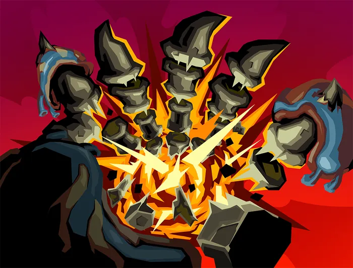 Détonation osseuse (`BONE_SHARDS`)
* **Type :** *Attack* | **Coût :** `1` ⚡ | **Rareté :** `Uncommon`
* **Effet Normal :** Si **Titos** est en vie, il inflige 9 dégâts à TOUS les ennemis, et vous gagnez 9 d'**Armure**.
**Titos** périt.
* **Effet Amélioré :** Si **Titos** est en vie, il inflige 12 dégâts à TOUS les ennemis, et vous gagnez 12 d'**Armure**.
**Titos** périt.
* **Amélioration :** `ostydamage: +3, block: +3`

### 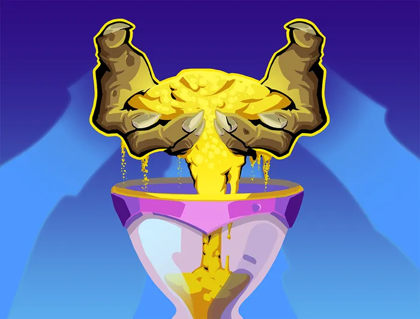 Sursis (`BORROWED_TIME`)
* **Type :** *Skill* | **Coût :** `1` ⚡ | **Rareté :** `Uncommon`
* **Effet Normal :** Gagnez ⚡4⚡.
Les cartes coûtent ⚡1⚡ de plus ce tour.
* **Effet Amélioré :** Gagnez ⚡6⚡.
Les cartes coûtent ⚡1⚡ de plus ce tour.
* **Amélioration :** `energygain: +2`

### 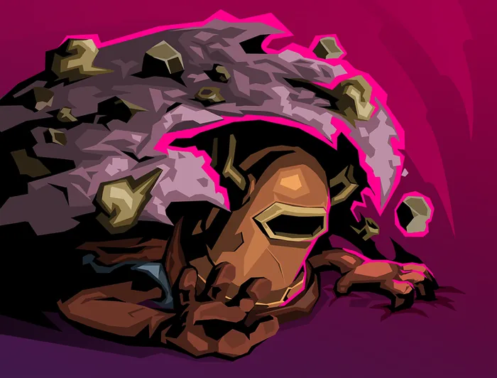 Enterrer (`BURY`)
* **Type :** *Attack* | **Coût :** `4` ⚡ | **Rareté :** `Uncommon`
* **Effet Normal :** Infligez 52 dégâts.
* **Effet Amélioré :** Infligez 63 dégâts.
* **Amélioration :** `damage: +11`

### 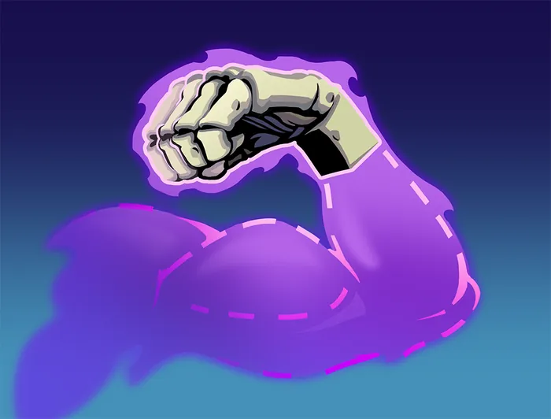 Calcification (`CALCIFY`)
* **Type :** *Power* | **Coût :** `1` ⚡ | **Rareté :** `Uncommon`
* **Effet Normal :** Les attaques de **Titos** infligent 4 dégâts supplémentaires.
* **Effet Amélioré :** Les attaques de **Titos** infligent 6 dégâts supplémentaires.
* **Amélioration :** `calcifypower: +2`

### 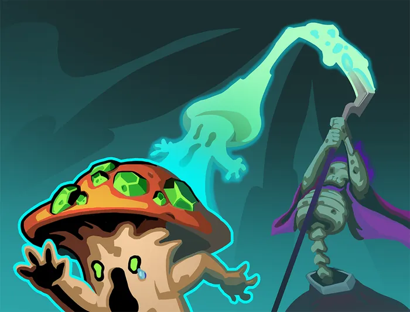 Capture spirituelle (`CAPTURE_SPIRIT`)
* **Type :** *Skill* | **Coût :** `1` ⚡ | **Rareté :** `Uncommon`
* **Effet Normal :** L'ennemi perd 3 PV.
Ajoutez 3 **Âmes** à votre **Pioche**.
* **Effet Amélioré :** L'ennemi perd 4 PV.
Ajoutez 4 **Âmes** à votre **Pioche**.
* **Amélioration :** `damage: +1, cards: +1`

###  Purge (`CLEANSE`)
* **Type :** *Skill* | **Coût :** `1` ⚡ | **Rareté :** `Uncommon`
* **Effet Normal :** **Invoquez** pour 3.
**Épuisez** 1 carte de votre **Pioche**.
* **Effet Amélioré :** **Invoquez** pour 5.
**Épuisez** 1 carte de votre **Pioche**.
* **Amélioration :** `summon: +2`

### 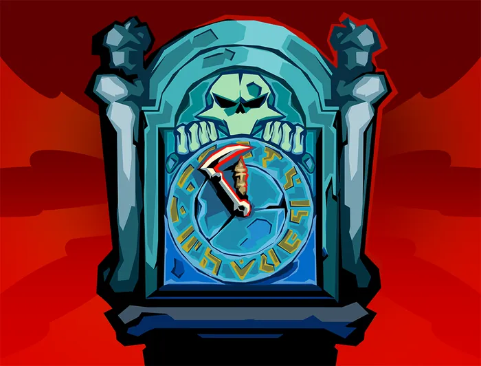 Décompte (`COUNTDOWN`)
* **Type :** *Power* | **Coût :** `1` ⚡ | **Rareté :** `Uncommon`
* **Effet Normal :** Au début de votre tour, appliquez 6 de **Fatalité** à un ennemi aléatoire.
* **Effet Amélioré :** Au début de votre tour, appliquez 9 de **Fatalité** à un ennemi aléatoire.
* **Amélioration :** `countdownpower: +3`

### 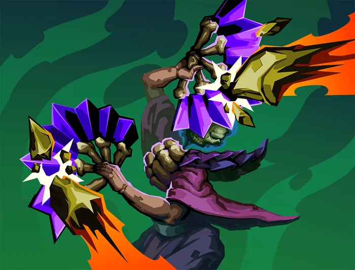 Danse Macabre (`DANSE_MACABRE`)
* **Type :** *Power* | **Coût :** `1` ⚡ | **Rareté :** `Uncommon`
* **Effet Normal :** Lorsque vous jouez une carte qui coûte ⚡2⚡ ou plus, gagnez 4 d'**Armure**.
* **Effet Amélioré :** Lorsque vous jouez une carte qui coûte ⚡2⚡ ou plus, gagnez 6 d'**Armure**.
* **Amélioration :** `dansemacabrepower: +2`

### 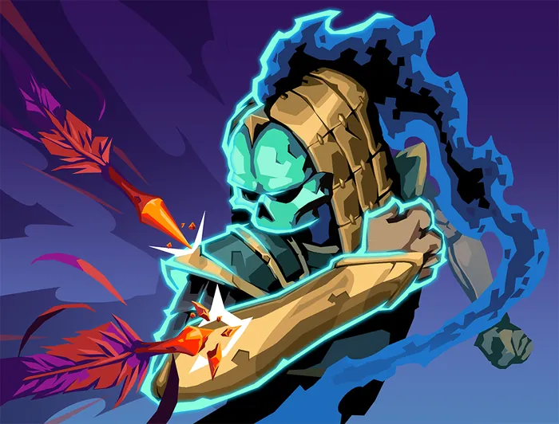 Marche funeste (`DEATH_MARCH`)
* **Type :** *Attack* | **Coût :** `1` ⚡ | **Rareté :** `Uncommon`
* **Effet Normal :** Infligez 8 dégâts.
Inflige 4 dégâts supplémentaires pour chaque carte piochée durant votre tour.
* **Effet Amélioré :** Infligez 9 dégâts.
Inflige 6 dégâts supplémentaires pour chaque carte piochée durant votre tour.
* **Amélioration :** `calculationbase: +1, extradamage: +2`

### 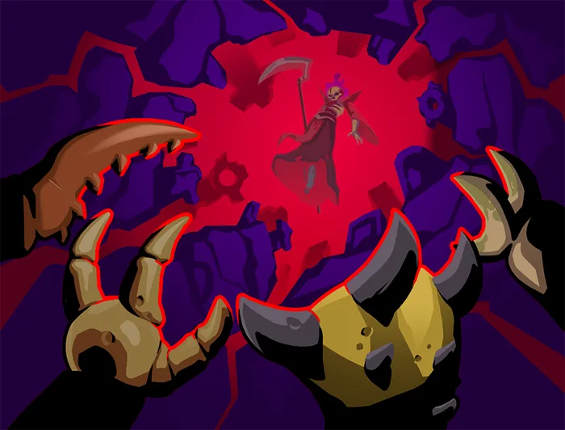 Porte-mort (`DEATHBRINGER`)
* **Type :** *Skill* | **Coût :** `2` ⚡ | **Rareté :** `Uncommon`
* **Effet Normal :** Appliquez 21 de **Fatalité** et **Affaibli** (1) à TOUS les ennemis.
* **Effet Amélioré :** Appliquez 26 de **Fatalité** et **Affaibli** (1) à TOUS les ennemis.
* **Amélioration :** `doom: +5`

### 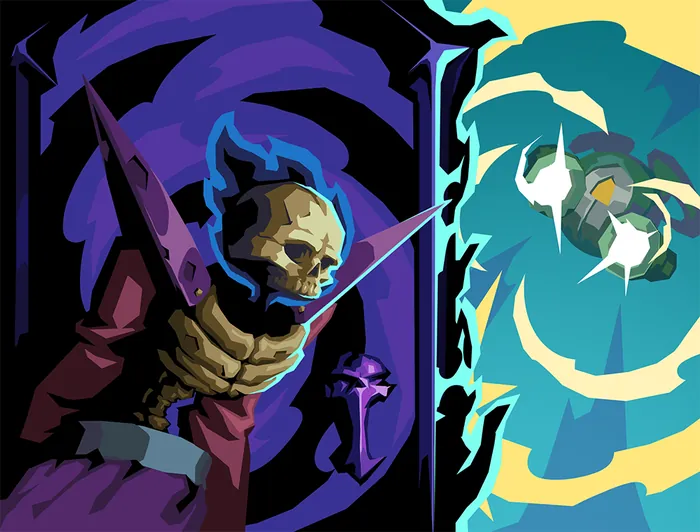 À l'agonie (`DEATHS_DOOR`)
* **Type :** *Skill* | **Coût :** `1` ⚡ | **Rareté :** `Uncommon`
* **Effet Normal :** Gagnez 6 d'**Armure**.
Si vous avez appliqué de la **Fatalité** pendant ce tour, gagnez l'**Armure** 2 fois supplémentaires.
* **Effet Amélioré :** Gagnez 7 d'**Armure**.
Si vous avez appliqué de la **Fatalité** pendant ce tour, gagnez l'**Armure** 2 fois supplémentaires.
* **Amélioration :** `block: +1`

### 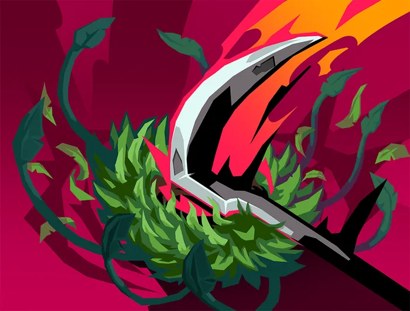 Amoindrissement (`DEBILITATE`)
* **Type :** *Attack* | **Coût :** `1` ⚡ | **Rareté :** `Uncommon`
* **Effet Normal :** Infligez 10 dégâts.
L'efficacité de **Vulnérable** et **Affaibli** sur l'ennemi est doublée pendant les 2 prochains tours.
* **Effet Amélioré :** Infligez 12 dégâts.
L'efficacité de **Vulnérable** et **Affaibli** sur l'ennemi est doublée pendant les 3 prochains tours.
* **Amélioration :** `damage: +2, debilitatepower: +1`

### 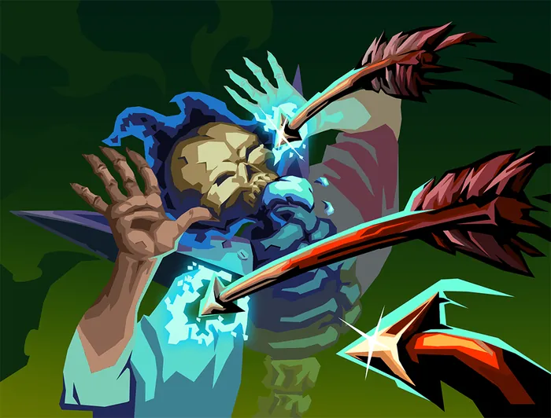 Délai (`DELAY`)
* **Type :** *Skill* | **Coût :** `2` ⚡ | **Rareté :** `Uncommon`
* **Effet Normal :** Gagnez 11 d'**Armure**.
Au prochain tour,
gagnez ⚡1⚡.
* **Effet Amélioré :** Gagnez 13 d'**Armure**.
Au prochain tour,
gagnez ⚡2⚡.
* **Amélioration :** `block: +2, energygain: +1`

### 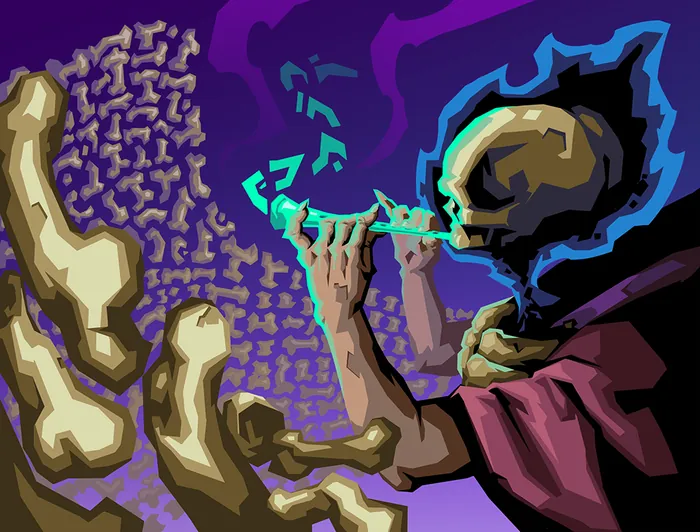 Oraison (`DIRGE`)
* **Type :** *Skill* | **Coût :** `-1` ⚡ | **Rareté :** `Uncommon`
* **Effet Normal :** **Invoquez** pour 3 X fois.
Ajoutez X **Âmes** à votre **Pioche**.
**Épuisement**.
* **Effet Amélioré :** **Invoquez** pour 4 X fois.
Ajoutez X **Âmes+** à votre **Pioche**.
**Épuisement**.
* **Amélioration :** `summon: +1`

### 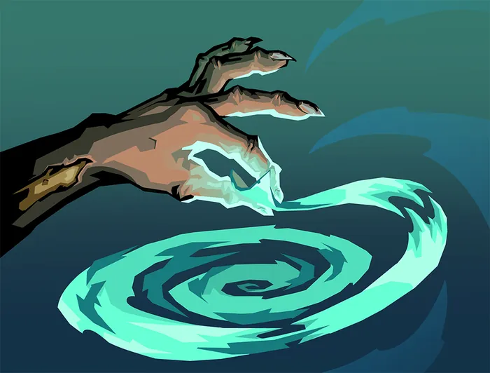 Déterrer (`DREDGE`)
* **Type :** *Skill* | **Coût :** `1` ⚡ | **Rareté :** `Uncommon`
* **Effet Normal :** Placez 3 cartes de votre **Défausse** dans votre **Main**.
**Épuisement**.
* **Effet Amélioré :** **Retenue**.
Placez 3 cartes de votre **Défausse** dans votre **Main**.
**Épuisement**.
* **Amélioration :** `keywords: ['Retain']`

### 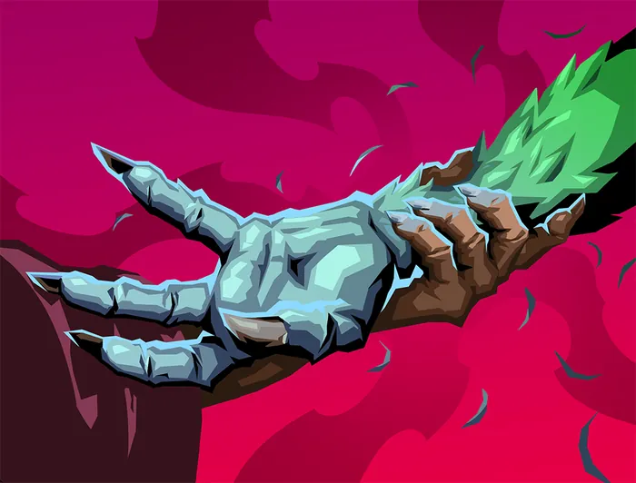 Toucher atrophiant (`ENFEEBLING_TOUCH`)
* **Type :** *Skill* | **Coût :** `1` ⚡ | **Rareté :** `Uncommon`
* **Effet Normal :** **Éthéré**.
L'ennemi perd 8 de **Force** jusqu'à la fin du tour.
* **Effet Amélioré :** **Éthéré**.
L'ennemi perd 11 de **Force** jusqu'à la fin du tour.
* **Amélioration :** `strengthloss: +3`

### 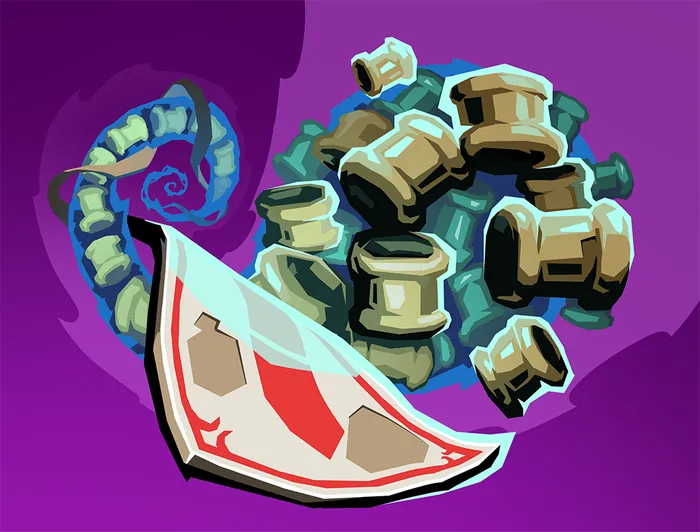 Va chercher (`FETCH`)
* **Type :** *Attack* | **Coût :** `0` ⚡ | **Rareté :** `Uncommon`
* **Effet Normal :** **Titos** inflige 3 dégâts.
Si c'est la première fois du tour que cette carte est jouée, piochez 1 carte.
* **Effet Amélioré :** **Titos** inflige 6 dégâts.
Si c'est la première fois du tour que cette carte est jouée, piochez 1 carte.
* **Amélioration :** `ostydamage: +3`

###  Amitié (`FRIENDSHIP`)
* **Type :** *Power* | **Coût :** `1` ⚡ | **Rareté :** `Uncommon`
* **Effet Normal :** Perdez 2 de **Force**.
Gagnez ⚡1⚡ au début de chaque tour.
* **Effet Amélioré :** Perdez 1 de **Force**.
Gagnez ⚡1⚡ au début de chaque tour.
* **Amélioration :** `strengthpower: -1`

### 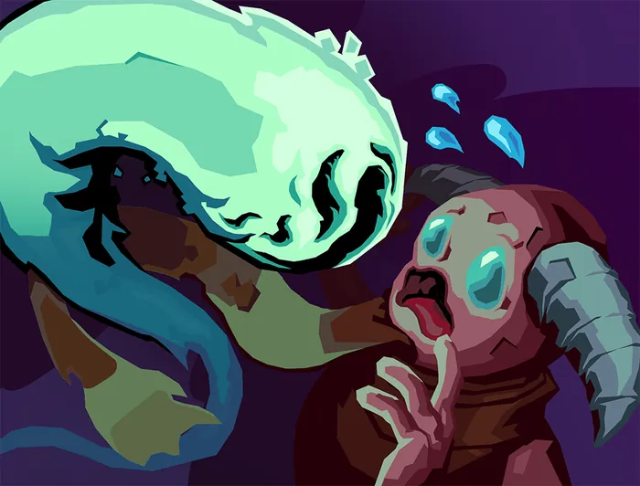 Hanter (`HAUNT`)
* **Type :** *Power* | **Coût :** `1` ⚡ | **Rareté :** `Uncommon`
* **Effet Normal :** Lorsque vous jouez une **Âme**, un ennemi aléatoire perd 7 PV.
* **Effet Amélioré :** Lorsque vous jouez une **Âme**, un ennemi aléatoire perd 9 PV.
* **Amélioration :** `hploss: +2`

### 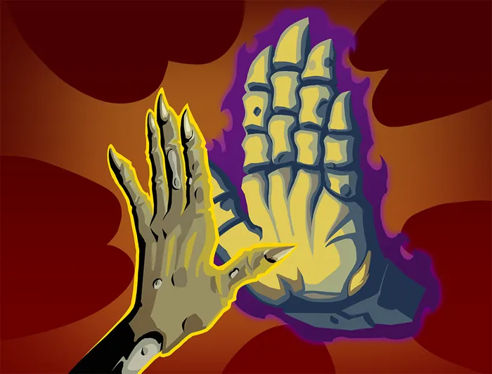 Tope là (`HIGH_FIVE`)
* **Type :** *Attack* | **Coût :** `2` ⚡ | **Rareté :** `Uncommon`
* **Effet Normal :** **Titos** inflige 11 dégâts
et applique **Vulnérable** (2) 
à TOUS les ennemis.
* **Effet Amélioré :** **Titos** inflige 13 dégâts
et applique **Vulnérable** (3) 
à TOUS les ennemis.
* **Amélioration :** `ostydamage: +2, vulnerable: +1`

### 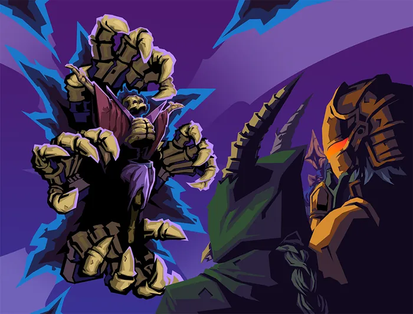 Légion d'ossements (`LEGION_OF_BONE`)
* **Type :** *Skill* | **Coût :** `2` ⚡ | **Rareté :** `Uncommon`
* **Effet Normal :** TOUS les joueurs **Invoquent** pour 6.
* **Effet Amélioré :** TOUS les joueurs **Invoquent** pour 8.
* **Amélioration :** `summon: +2`

### 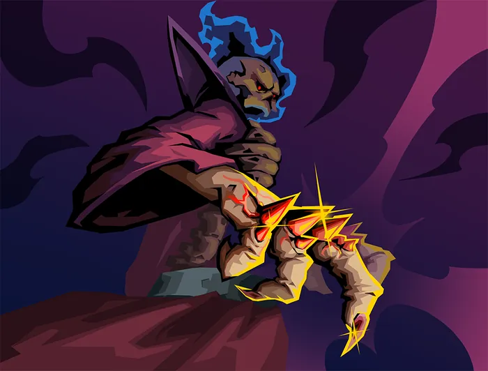 Létalité (`LETHALITY`)
* **Type :** *Power* | **Coût :** `1` ⚡ | **Rareté :** `Uncommon`
* **Effet Normal :** **Éthéré**.
La première Attaque jouée chaque tour inflige 50% de dégâts supplémentaires.
* **Effet Amélioré :** **Éthéré**.
La première Attaque jouée chaque tour inflige 75% de dégâts supplémentaires.
* **Amélioration :** `lethalitypower: +25`

### 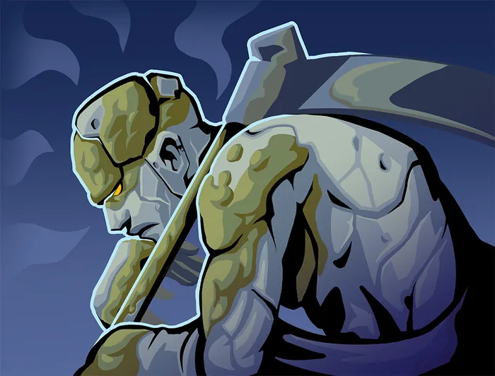 Mélancolie (`MELANCHOLY`)
* **Type :** *Skill* | **Coût :** `3` ⚡ | **Rareté :** `Uncommon`
* **Effet Normal :** Gagnez 13 d'**Armure**.
Réduisez le coût de cette carte de ⚡1⚡ lorsque N'IMPORTE QUEL PERSONNAGE périt.
* **Effet Amélioré :** Gagnez 17 d'**Armure**.
Réduisez le coût de cette carte de ⚡1⚡ lorsque N'IMPORTE QUEL PERSONNAGE périt.
* **Amélioration :** `block: +4`

### 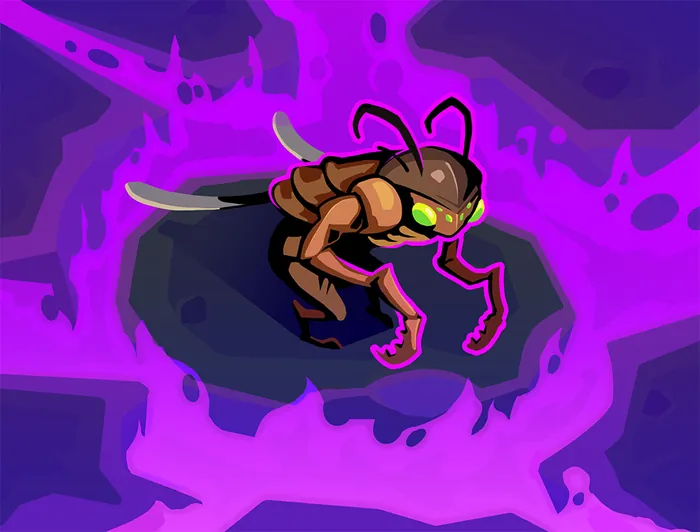 Inéluctable (`NO_ESCAPE`)
* **Type :** *Skill* | **Coût :** `1` ⚡ | **Rareté :** `Uncommon`
* **Effet Normal :** Appliquez 10 de **Fatalité**, plus 5 de **Fatalité** supplémentaire pour tous les 10 points de **Fatalité** déjà présents sur l'ennemi.
* **Effet Amélioré :** Appliquez 15 de **Fatalité**, plus 5 de **Fatalité** supplémentaire pour tous les 10 points de **Fatalité** déjà présents sur l'ennemi.
* **Amélioration :** `calculationbase: +5`

### 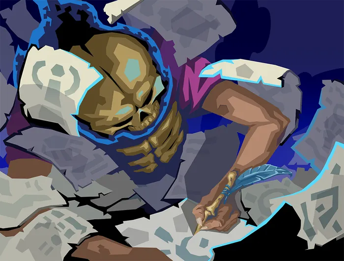 Pluie de papier (`PAGESTORM`)
* **Type :** *Power* | **Coût :** `1` ⚡ | **Rareté :** `Uncommon`
* **Effet Normal :** Lorsque vous piochez une carte **Éthérée**, piochez 1 carte.
* **Effet Amélioré :** Lorsque vous piochez une carte **Éthérée**, piochez 1 carte.
* **Amélioration :** `energy: -1`

###  Décomposition (`PARSE`)
* **Type :** *Skill* | **Coût :** `1` ⚡ | **Rareté :** `Uncommon`
* **Effet Normal :** **Éthéré**.
Piochez 3 cartes.
* **Effet Amélioré :** **Éthéré**.
Piochez 4 cartes.
* **Amélioration :** `cards: +1`

### 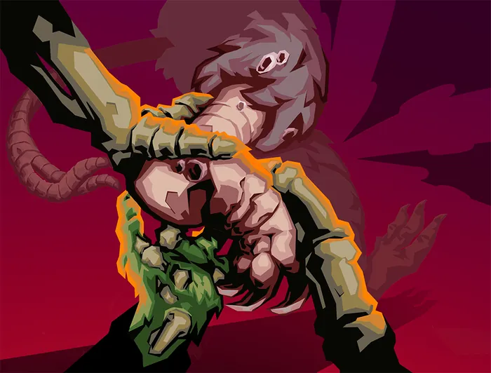 Six pieds sous terre (`PULL_FROM_BELOW`)
* **Type :** *Attack* | **Coût :** `1` ⚡ | **Rareté :** `Uncommon`
* **Effet Normal :** Infligez 5 dégâts pour chaque carte **Éthérée** jouée pendant ce combat.
* **Effet Amélioré :** Infligez 7 dégâts pour chaque carte **Éthérée** jouée pendant ce combat.
* **Amélioration :** `damage: +2`

### 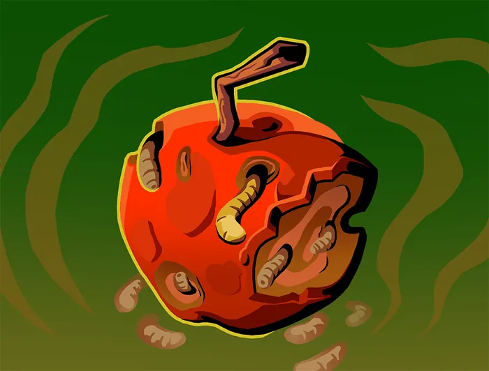 Putréfaction (`PUTREFY`)
* **Type :** *Skill* | **Coût :** `1` ⚡ | **Rareté :** `Uncommon`
* **Effet Normal :** Appliquez **Affaibli** (2).
Appliquez **Vulnérable** (2).
**Épuisement**.
* **Effet Amélioré :** Appliquez **Affaibli** (3).
Appliquez **Vulnérable** (3).
**Épuisement**.
* **Amélioration :** `power: +1`

### 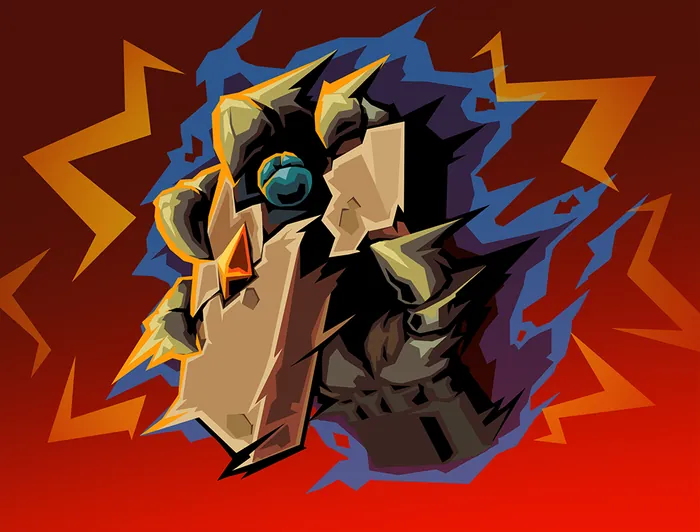 Cliquetis (`RATTLE`)
* **Type :** *Attack* | **Coût :** `1` ⚡ | **Rareté :** `Uncommon`
* **Effet Normal :** **Titos** inflige 7 dégâts.
Se déclenche un nombre de fois supplémentaires égal au nombre de fois qu'il a déjà attaqué ce tour.
* **Effet Amélioré :** **Titos** inflige 9 dégâts.
Se déclenche un nombre de fois supplémentaires égal au nombre de fois qu'il a déjà attaqué ce tour.
* **Amélioration :** `ostydamage: +2`

### 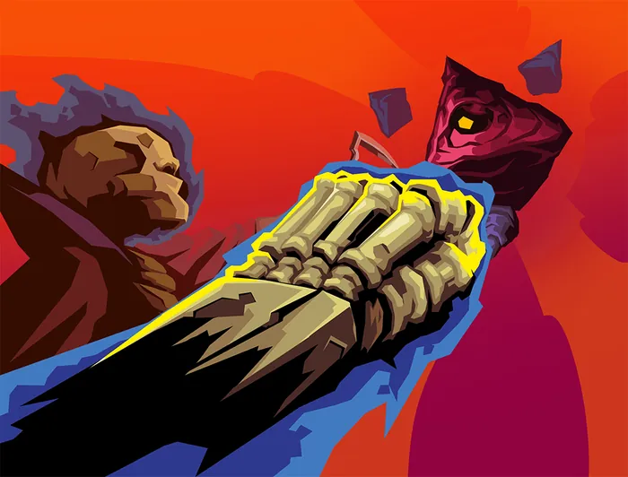 Droitier (`RIGHT_HAND_HAND`)
* **Type :** *Attack* | **Coût :** `0` ⚡ | **Rareté :** `Uncommon`
* **Effet Normal :** **Titos** inflige 4 dégâts.
Lorsque vous jouez une carte qui coûte ⚡2⚡ ou plus, cette carte retourne dans votre **Main** depuis la **Défausse**.
* **Effet Amélioré :** **Titos** inflige 6 dégâts.
Lorsque vous jouez une carte qui coûte ⚡2⚡ ou plus, cette carte retourne dans votre **Main** depuis la **Défausse**.
* **Amélioration :** `ostydamage: +2`

### 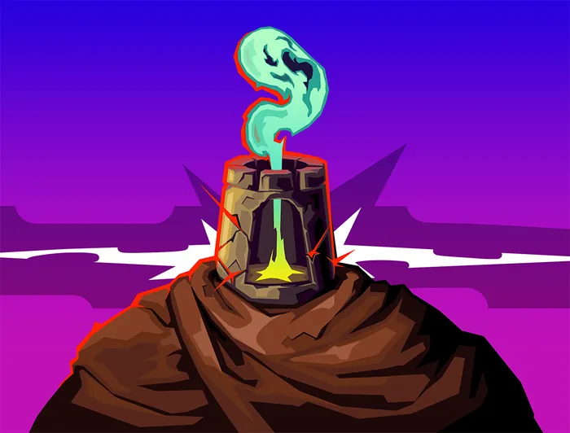 Césure (`SEVERANCE`)
* **Type :** *Attack* | **Coût :** `2` ⚡ | **Rareté :** `Uncommon`
* **Effet Normal :** Infligez 13 dégâts.
Ajoutez une **Âme** à votre **Pioche**, à votre **Main** et à votre **Défausse**.
* **Effet Amélioré :** Infligez 18 dégâts.
Ajoutez une **Âme** à votre **Pioche**, à votre **Main** et à votre **Défausse**.
* **Amélioration :** `damage: +5`

### 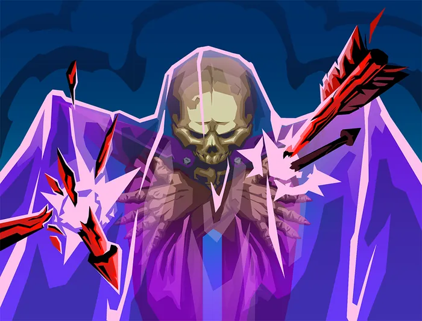 Voile (`SHROUD`)
* **Type :** *Power* | **Coût :** `1` ⚡ | **Rareté :** `Uncommon`
* **Effet Normal :** Lorsque vous appliquez de la **Fatalité**, gagnez 3 d'**Armure**.
* **Effet Amélioré :** Lorsque vous appliquez de la **Fatalité**, gagnez 4 d'**Armure**.
* **Amélioration :** `block: +1`

### 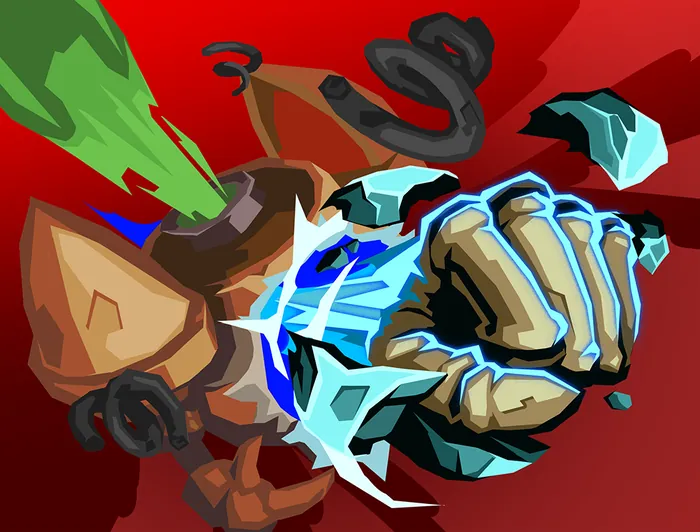 À l'attaque ! (`SIC_EM`)
* **Type :** *Attack* | **Coût :** `1` ⚡ | **Rareté :** `Uncommon`
* **Effet Normal :** **Titos** inflige 5 dégâts.
Lorsque **Titos** touche cet ennemi pendant ce tour, **Invoquez** pour 3.
* **Effet Amélioré :** **Titos** inflige 6 dégâts.
Lorsque **Titos** touche cet ennemi pendant ce tour, **Invoquez** pour 4.
* **Amélioration :** `ostydamage: +1, sicempower: +1`

### 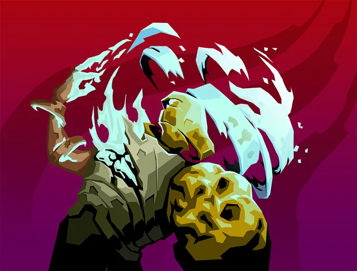 Tour de chair (`SLEIGHT_OF_FLESH`)
* **Type :** *Power* | **Coût :** `2` ⚡ | **Rareté :** `Uncommon`
* **Effet Normal :** Lorsque vous appliquez un effet néfaste sur un ennemi, celui-ci subit 9 dégâts.
* **Effet Amélioré :** Lorsque vous appliquez un effet néfaste sur un ennemi, celui-ci subit 13 dégâts.
* **Amélioration :** `sleightoffleshpower: +4`

### 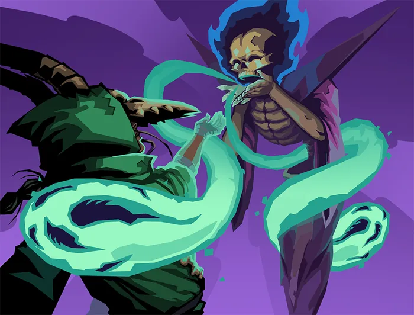 Âme sœur (`SOULBOUND`)
* **Type :** *Power* | **Coût :** `1` ⚡ | **Rareté :** `Uncommon`
* **Effet Normal :** Choisissez un allié.
Lorsque vous créez une **Âme**, ajoutez une **Âme** à sa **Pioche**.
* **Effet Amélioré :** **Inné**.
Choisissez un allié.
Lorsque vous créez une **Âme**, ajoutez une **Âme** à sa **Pioche**.
* **Amélioration :** `keywords: ['Innate']`

### 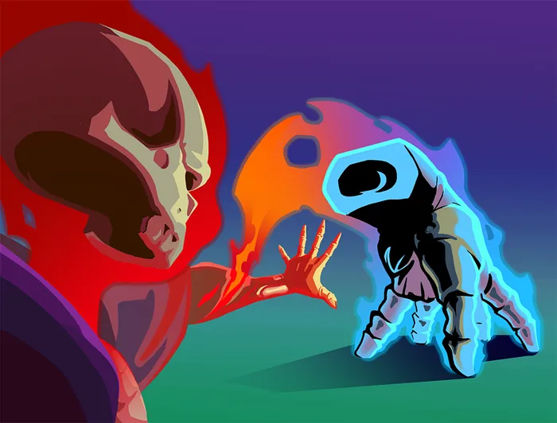 Stimulation (`SPUR`)
* **Type :** *Skill* | **Coût :** `1` ⚡ | **Rareté :** `Uncommon`
* **Effet Normal :** **Retenue**.
**Invoquez** pour 3.
**Titos** récupère 5 PV.
* **Effet Amélioré :** **Retenue**.
**Invoquez** pour 5.
**Titos** récupère 7 PV.
* **Amélioration :** `summon: +2, heal: +2`

### 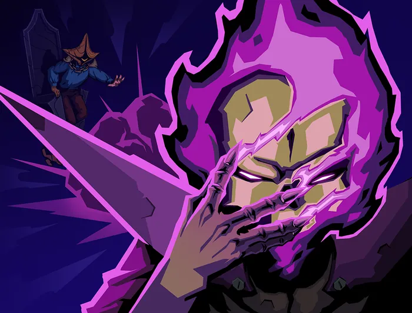 Enfers (`UNDERWORLD`)
* **Type :** *Skill* | **Coût :** `2` ⚡ | **Rareté :** `Uncommon`
* **Effet Normal :** Lorsque les autres joueurs infligent des dégâts pendant ce tour, appliquez le même montant de **Fatalité**.
**Épuisement**.
* **Effet Amélioré :** Lorsque les autres joueurs infligent des dégâts pendant ce tour, appliquez le même montant de **Fatalité**.
* **Amélioration :** `keywordsRemoved: ['Exhaust']`

### 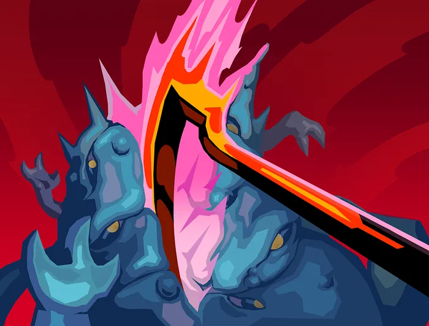 Perce-voile (`VEILPIERCER`)
* **Type :** *Attack* | **Coût :** `1` ⚡ | **Rareté :** `Uncommon`
* **Effet Normal :** Infligez 10 dégâts.
La prochaine carte **Éthérée** que vous jouez coûte 0 ⚡.
* **Effet Amélioré :** Infligez 13 dégâts.
La prochaine carte **Éthérée** que vous jouez coûte 0 ⚡.
* **Amélioration :** `damage: +3`

## ⭐ Rareté : Rare (27 cartes)

### 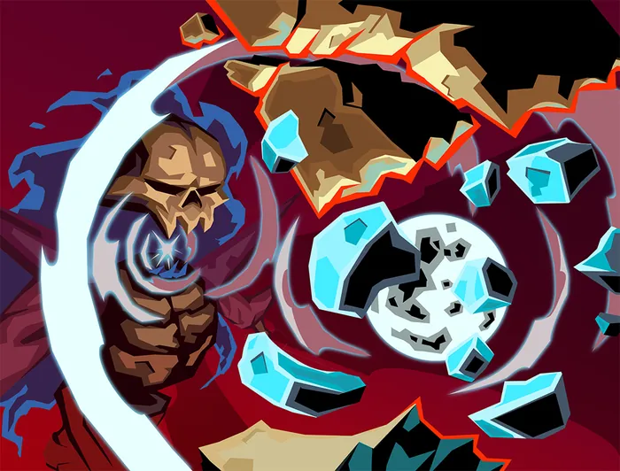 Cri de la banshee (`BANSHEES_CRY`)
* **Type :** *Attack* | **Coût :** `9` ⚡ | **Rareté :** `Rare`
* **Effet Normal :** Infligez 33 dégâts à TOUS les ennemis.
Coûte ⚡2⚡ de moins pour chaque carte **Éthérée** jouée pendant ce combat.
* **Effet Amélioré :** Infligez 33 dégâts à TOUS les ennemis.
Coûte ⚡2⚡ de moins pour chaque carte **Éthérée** jouée pendant ce combat.
* **Amélioration :** `energy: -2`

### 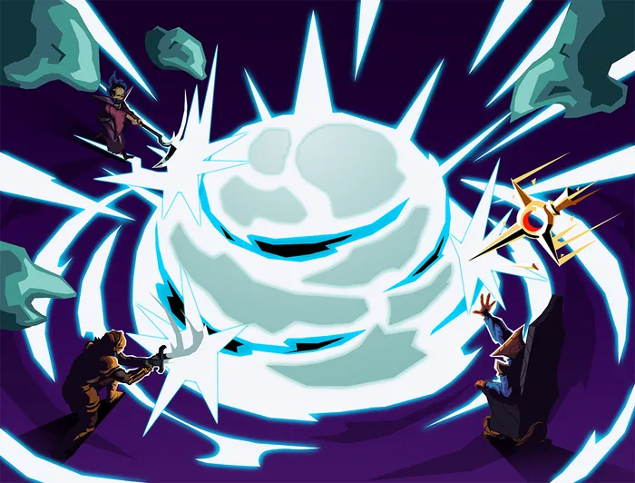 Cacophonie (`CACOPHONY`)
* **Type :** *Power* | **Coût :** `2` ⚡ | **Rareté :** `Rare`
* **Effet Normal :** Toutes les 33 cartes piochées par TOUS les joueurs, infligez 66 dégâts à un ennemi aléatoire.
* **Effet Amélioré :** Toutes les 33 cartes piochées par TOUS les joueurs, infligez 99 dégâts à un ennemi aléatoire.
* **Amélioration :** `damage: +33`

### 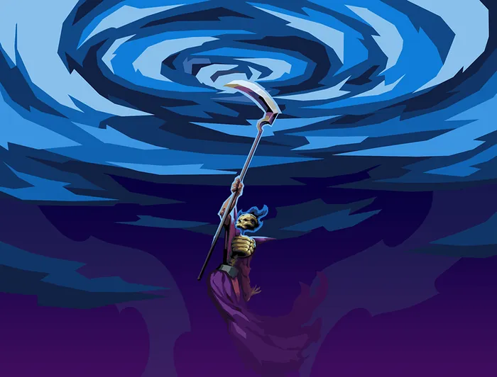 Appel du néant (`CALL_OF_THE_VOID`)
* **Type :** *Power* | **Coût :** `1` ⚡ | **Rareté :** `Rare`
* **Effet Normal :** Au début de votre tour, ajoutez 1 carte aléatoire à votre **Main**. Elle gagne **Éthéré**.
* **Effet Amélioré :** **Inné**.
Au début de votre tour, ajoutez 1 carte aléatoire à votre **Main**. Elle gagne **Éthéré**.
* **Amélioration :** `keywords: ['Innate']`

### 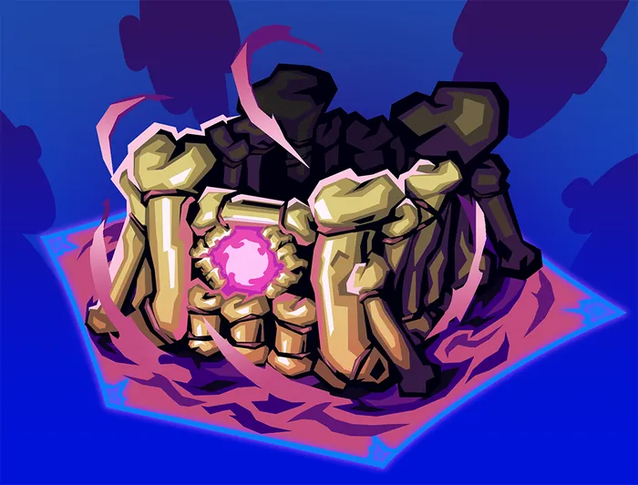 Domaine (`DEMESNE`)
* **Type :** *Power* | **Coût :** `3` ⚡ | **Rareté :** `Rare`
* **Effet Normal :** **Éthéré**.
Au début de votre tour, gagnez ⚡1⚡ et piochez 1 carte supplémentaire.
* **Effet Amélioré :** **Éthéré**.
Au début de votre tour, gagnez ⚡1⚡ et piochez 1 carte supplémentaire.
* **Amélioration :** `energy: -1`

### 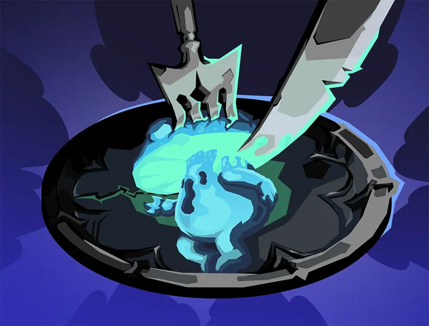 Dévoration de vie (`DEVOUR_LIFE`)
* **Type :** *Power* | **Coût :** `1` ⚡ | **Rareté :** `Rare`
* **Effet Normal :** Lorsque vous jouez une **Âme**, **Invoquez** pour 1.
* **Effet Amélioré :** Lorsque vous jouez une **Âme**, **Invoquez** pour 2.
* **Amélioration :** `devourlifepower: +1`

### 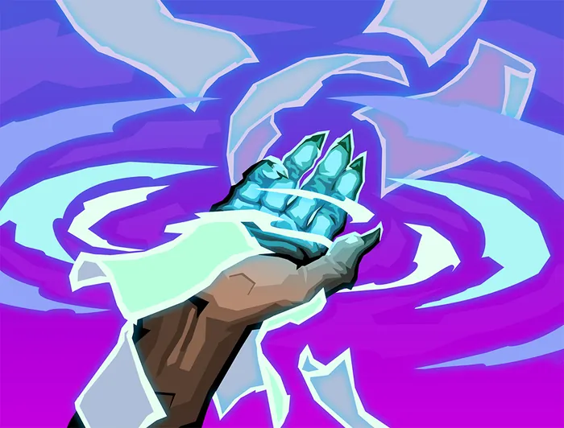 Eidolon (`EIDOLON`)
* **Type :** *Skill* | **Coût :** `2` ⚡ | **Rareté :** `Rare`
* **Effet Normal :** Jouez TOUTES les cartes **Éthérées** dans votre pile de cartes **Épuisées**.
**Épuisement**.
* **Effet Amélioré :** Jouez TOUTES les cartes **Éthérées** dans votre pile de cartes **Épuisées**.
**Épuisement**.
* **Amélioration :** `energy: -1`

### 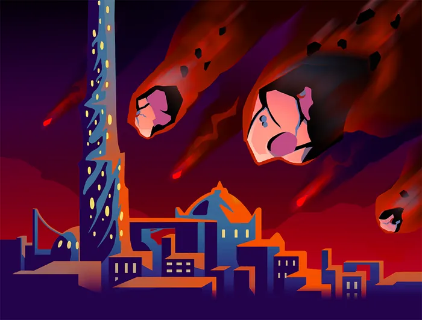 Fin des temps (`END_OF_DAYS`)
* **Type :** *Skill* | **Coût :** `3` ⚡ | **Rareté :** `Rare`
* **Effet Normal :** Appliquez 29 de **Fatalité** à TOUS les ennemis.
Les ennemis avec au moins autant de **Fatalité** que de PV périssent.
* **Effet Amélioré :** Appliquez 37 de **Fatalité** à TOUS les ennemis.
Les ennemis avec au moins autant de **Fatalité** que de PV périssent.
* **Amélioration :** `doom: +8`

### 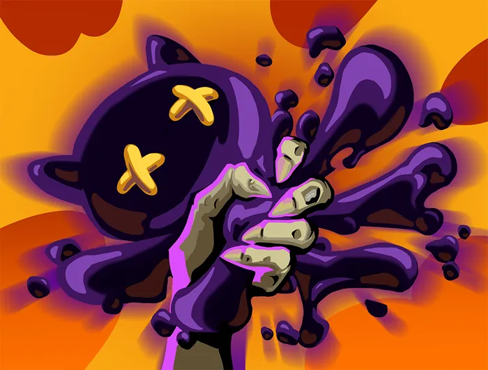 Éradication (`ERADICATE`)
* **Type :** *Attack* | **Coût :** `-1` ⚡ | **Rareté :** `Rare`
* **Effet Normal :** **Retenue**.
Infligez 11 dégâts X fois.
* **Effet Amélioré :** **Retenue**.
Infligez 14 dégâts X fois.
* **Amélioration :** `damage: +3`

### 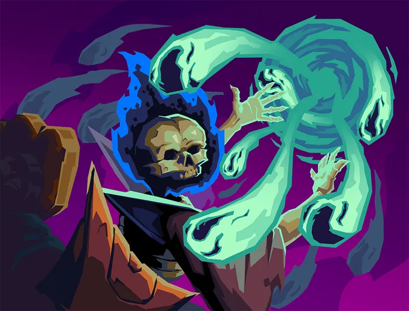 Vision de l'au-delà (`GLIMPSE_BEYOND`)
* **Type :** *Skill* | **Coût :** `1` ⚡ | **Rareté :** `Rare`
* **Effet Normal :** TOUS les joueurs ajoutent 3 **Âmes** à leur **Pioche**.
**Épuisement**.
* **Effet Amélioré :** TOUS les joueurs ajoutent 4 **Âmes** à leur **Pioche**.
**Épuisement**.
* **Amélioration :** `cards: +1`

### 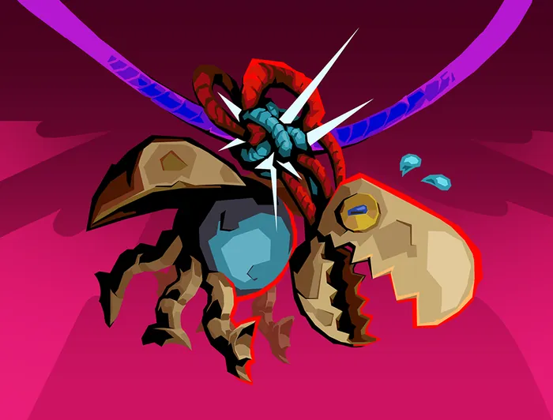 Pendaison (`HANG`)
* **Type :** *Attack* | **Coût :** `1` ⚡ | **Rareté :** `Rare`
* **Effet Normal :** Infligez 10 dégâts.
Double les dégâts de TOUTES les cartes Pendaison que vous jouez sur cet ennemi.
* **Effet Amélioré :** Infligez 13 dégâts.
Double les dégâts de TOUTES les cartes Pendaison que vous jouez sur cet ennemi.
* **Amélioration :** `damage: +3`

### 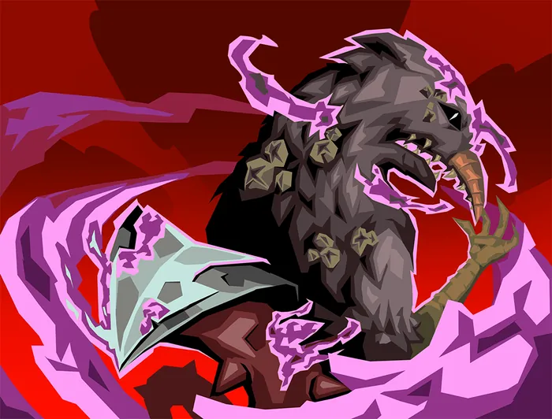 Misère (`MISERY`)
* **Type :** *Attack* | **Coût :** `0` ⚡ | **Rareté :** `Rare`
* **Effet Normal :** Infligez 7 dégâts.
Appliquez tous les effets néfastes présent sur l'ennemi à TOUS les autres ennemis.
* **Effet Amélioré :** **Retenue**.
Infligez 9 dégâts.
Appliquez tous les effets néfastes présent sur l'ennemi à TOUS les autres ennemis.
* **Amélioration :** `damage: +2, keywords: ['Retain']`

### 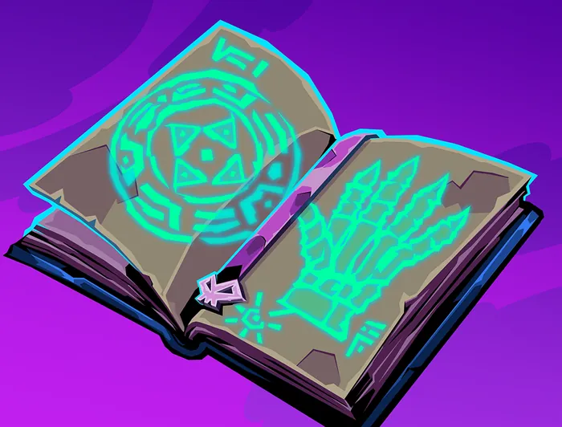 Maîtrise nécrologique (`NECRO_MASTERY`)
* **Type :** *Power* | **Coût :** `2` ⚡ | **Rareté :** `Rare`
* **Effet Normal :** **Invoquez** pour 5.
Lorsque **Titos** perd des PV,
TOUS les ennemis en perdent le même montant.
* **Effet Amélioré :** **Invoquez** pour 8.
Lorsque **Titos** perd des PV,
TOUS les ennemis en perdent le même montant.
* **Amélioration :** `summon: +3`

###  Influx neuronal (`NEUROSURGE`)
* **Type :** *Power* | **Coût :** `0` ⚡ | **Rareté :** `Rare`
* **Effet Normal :** Gagnez ⚡3⚡.
Piochez 2 cartes.
Au début de votre tour, appliquez 3 de **Fatalité** à vous-même.
* **Effet Amélioré :** Gagnez ⚡4⚡.
Piochez 2 cartes.
Au début de votre tour, appliquez 3 de **Fatalité** à vous-même.
* **Amélioration :** `energygain: +1`

###  Oblitération (`OBLIVION`)
* **Type :** *Skill* | **Coût :** `0` ⚡ | **Rareté :** `Rare`
* **Effet Normal :** Lorsque vous jouez une carte ce tour, appliquez 3 de **Fatalité** sur l'ennemi.
* **Effet Amélioré :** Lorsque vous jouez une carte ce tour, appliquez 4 de **Fatalité** sur l'ennemi.
* **Amélioration :** `doom: +1`

###  Réanimation (`REANIMATE`)
* **Type :** *Skill* | **Coût :** `3` ⚡ | **Rareté :** `Rare`
* **Effet Normal :** **Invoquez** pour 20.
**Épuisement**.
* **Effet Amélioré :** **Invoquez** pour 25.
**Épuisement**.
* **Amélioration :** `summon: +5`

###  Forme de la Faucheuse (`REAPER_FORM`)
* **Type :** *Power* | **Coût :** `3` ⚡ | **Rareté :** `Rare`
* **Effet Normal :** Lorsque vos Attaques infligent des dégâts, appliquez le même montant de **Fatalité**.
* **Effet Amélioré :** **Retenue**.
Lorsque vos Attaques infligent des dégâts, appliquez le même montant de **Fatalité**.
* **Amélioration :** `keywords: ['Retain']`

###  Sacrifice (`SACRIFICE`)
* **Type :** *Skill* | **Coût :** `1` ⚡ | **Rareté :** `Rare`
* **Effet Normal :** **Retenue**.
Si **Titos** est en vie, il périt, et vous gagnez un montant d'**Armure** égal au triple de ses PV Max.
* **Effet Amélioré :** **Retenue**.
Si **Titos** est en vie, il périt, et vous gagnez un montant d'**Armure** égal au triple de ses PV Max.
* **Amélioration :** `energy: -1`

###  Séance (`SEANCE`)
* **Type :** *Skill* | **Coût :** `1` ⚡ | **Rareté :** `Rare`
* **Effet Normal :** **Éthéré**.
Transformez une carte de votre **Pioche** en **Âme**.
* **Effet Amélioré :** **Éthéré**.
Transformez une carte de votre **Pioche** en **Âme**.
* **Amélioration :** `energy: -1`

###  Sentinelle (`SENTRY_MODE`)
* **Type :** *Power* | **Coût :** `2` ⚡ | **Rareté :** `Rare`
* **Effet Normal :** Au début de votre tour, ajoutez 1 **Balayage optique** à votre **Main**.
* **Effet Amélioré :** Au début de votre tour, ajoutez 1 **Balayage optique** à votre **Main**.
* **Amélioration :** `energy: -1`

###  Destin partagé (`SHARED_FATE`)
* **Type :** *Skill* | **Coût :** `0` ⚡ | **Rareté :** `Rare`
* **Effet Normal :** Perdez 2 de **Force**.
L'ennemi perd 2 de **Force**.
**Épuisement**.
* **Effet Amélioré :** Perdez 2 de **Force**.
L'ennemi perd 3 de **Force**.
**Épuisement**.
* **Amélioration :** `enemystrengthloss: +1`

###  Tempête d'âmes (`SOUL_STORM`)
* **Type :** *Attack* | **Coût :** `1` ⚡ | **Rareté :** `Rare`
* **Effet Normal :** Infligez 9 dégâts.
Inflige 4 dégâts supplémentaires pour chaque **Âme** dans votre pile de cartes **Épuisées**.
* **Effet Amélioré :** Infligez 9 dégâts.
Inflige 6 dégâts supplémentaires pour chaque **Âme** dans votre pile de cartes **Épuisées**.
* **Amélioration :** `extradamage: +2`

###  Esprit des cendres (`SPIRIT_OF_ASH`)
* **Type :** *Power* | **Coût :** `1` ⚡ | **Rareté :** `Rare`
* **Effet Normal :** Lorsque vous jouez une carte **Éthérée**, gagnez 4 d'**Armure**.
* **Effet Amélioré :** Lorsque vous jouez une carte **Éthérée**, gagnez 5 d'**Armure**.
* **Amélioration :** `blockonexhaust: +1`

###  Joug (`SQUEEZE`)
* **Type :** *Attack* | **Coût :** `3` ⚡ | **Rareté :** `Rare`
* **Effet Normal :** **Titos** inflige 25 dégâts.
Inflige 5 dégâts supplémentaires pour CHACUNE de vos autres Attaques de **Titos**.
* **Effet Amélioré :** **Titos** inflige 30 dégâts.
Inflige 6 dégâts supplémentaires pour CHACUNE de vos autres Attaques de **Titos**.
* **Amélioration :** `calculationbase: +5, extradamage: +1`

###  La faux (`THE_SCYTHE`)
* **Type :** *Attack* | **Coût :** `2` ⚡ | **Rareté :** `Rare`
* **Effet Normal :** Infligez 13 dégâts.
Augmentez les dégâts de cette carte de 5 de façon permanente.
**Épuisement**.
* **Effet Amélioré :** Infligez 13 dégâts.
Augmentez les dégâts de cette carte de 7 de façon permanente.
**Épuisement**.
* **Amélioration :** `increase: +2`

###  L'heure est venue (`TIMES_UP`)
* **Type :** *Attack* | **Coût :** `2` ⚡ | **Rareté :** `Rare`
* **Effet Normal :** Infligez un montant de dégâts égal à la quantité de **Fatalité** sur l'ennemi.
* **Effet Amélioré :** **Retenue**.
Infligez un montant de dégâts égal à la quantité de **Fatalité** sur l'ennemi.
* **Amélioration :** `keywords: ['Retain']`

###  Transfiguration (`TRANSFIGURE`)
* **Type :** *Skill* | **Coût :** `1` ⚡ | **Rareté :** `Rare`
* **Effet Normal :** Ajoutez **Écho** à une carte dans votre **Main**.
Elle coûte ⚡1⚡ supplémentaire.
**Épuisement**.
* **Effet Amélioré :** Ajoutez **Écho** à une carte dans votre **Main**.
Elle coûte ⚡1⚡ supplémentaire.
* **Amélioration :** `keywordsRemoved: ['Exhaust']`

###  Mort-vivant (`UNDEATH`)
* **Type :** *Skill* | **Coût :** `0` ⚡ | **Rareté :** `Rare`
* **Effet Normal :** Gagnez 7 d'**Armure**.
Ajoutez une copie de cette carte à votre **Défausse**.
* **Effet Amélioré :** Gagnez 9 d'**Armure**.
Ajoutez une copie de cette carte à votre **Défausse**.
* **Amélioration :** `block: +2`
