# 🃏 Cartes Incolores, Malédictions, Quêtes & Événements

> **Total :** 115 cartes | **Patch :** `v0.111.0 Beta`  
> Cartes neutres achetables chez le marchand, malédictions infligées par la Tour et cartes d'événements spéciaux.

---

## 🌀 Catégorie : Colorless (65 cartes)

### 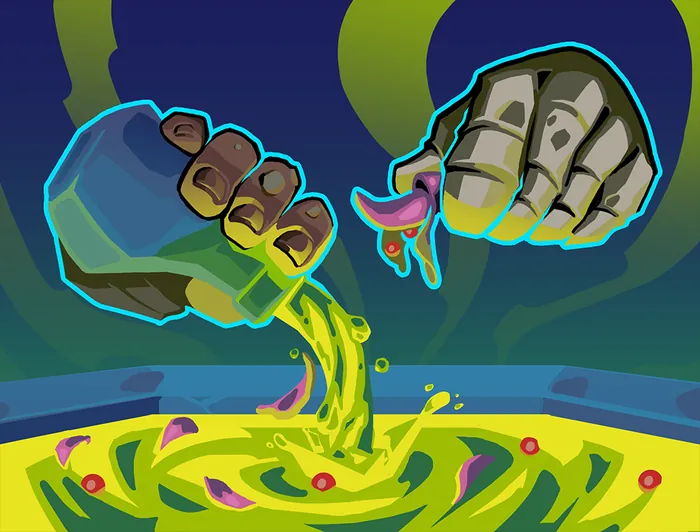 Alchimie (`ALCHEMIZE`)
* **Type :** *Skill* | **Coût :** `1` ⚡ | **Pool :** `Colorless`
* **Effet :** Obtenez une potion aléatoire.
**Épuisement**.
* **Effet Amélioré :** Obtenez une potion aléatoire.
**Épuisement**.

### 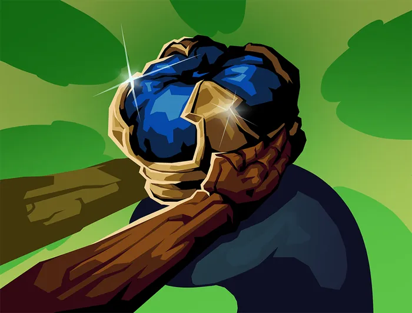 Sacrement (`ANOINTED`)
* **Type :** *Skill* | **Coût :** `1` ⚡ | **Pool :** `Colorless`
* **Effet :** Placez TOUTES les cartes **Rares** de votre **Pioche** dans votre **Main**.
**Épuisement**.
* **Effet Amélioré :** **Retenue**.
Placez TOUTES les cartes **Rares** de votre **Pioche** dans votre **Main**.
**Épuisement**.

### 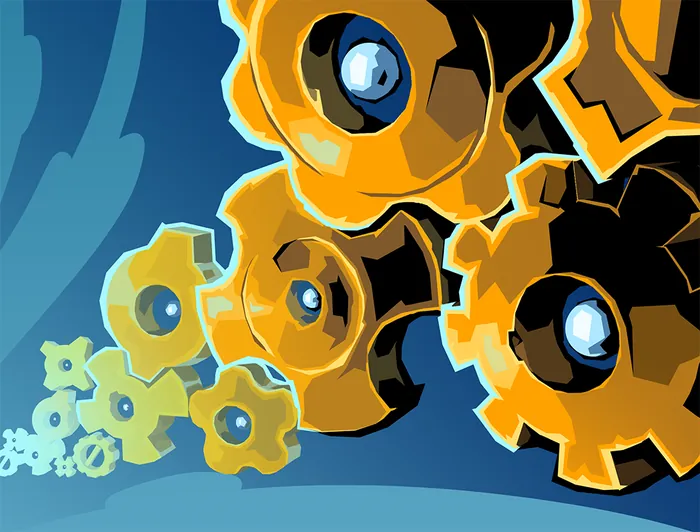 Automatisation (`AUTOMATION`)
* **Type :** *Power* | **Coût :** `1` ⚡ | **Pool :** `Colorless`
* **Effet :** Toutes les 10 cartes que vous piochez, gagnez ⚡1⚡.
* **Effet Amélioré :** Toutes les 10 cartes que vous piochez, gagnez ⚡1⚡.

### 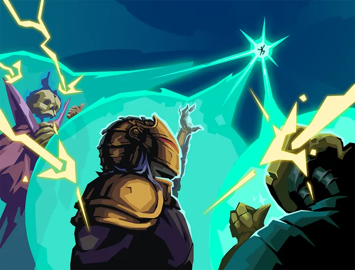 Balise d'espoir (`BEACON_OF_HOPE`)
* **Type :** *Power* | **Coût :** `2` ⚡ | **Pool :** `Colorless`
* **Effet :** Lorsque vous gagnez de l'**Armure** pendant votre tour, les autres joueurs en gagnent la moitié.
* **Effet Amélioré :** **Inné**.
Lorsque vous gagnez de l'**Armure** pendant votre tour, les autres joueurs en gagnent la moitié.

### 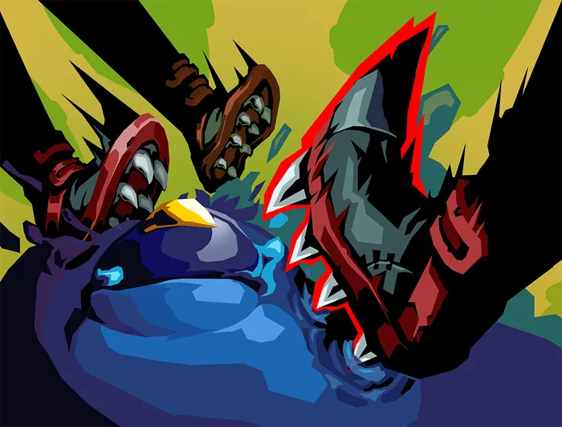 Passage à tabac (`BEAT_DOWN`)
* **Type :** *Skill* | **Coût :** `3` ⚡ | **Pool :** `Colorless`
* **Effet :** Jouez 3 Attaques aléatoires depuis votre **Défausse**.
* **Effet Amélioré :** Jouez 4 Attaques aléatoires depuis votre **Défausse**.

### 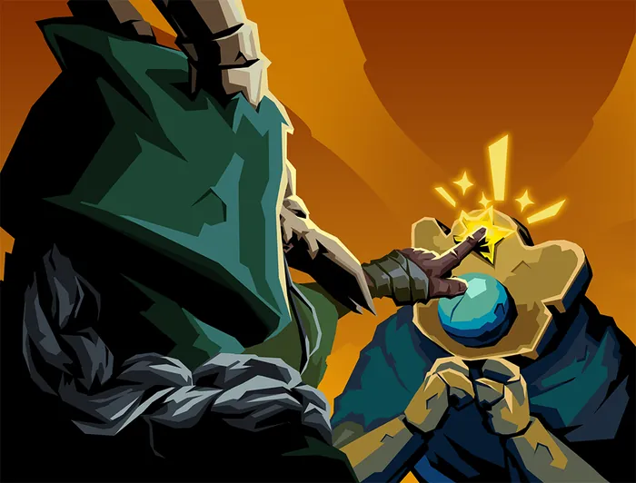 Confiance (`BELIEVE_IN_YOU`)
* **Type :** *Skill* | **Coût :** `0` ⚡ | **Pool :** `Colorless`
* **Effet :** Un autre joueur gagne ⚡2⚡.
* **Effet Amélioré :** Un autre joueur gagne ⚡3⚡.

### 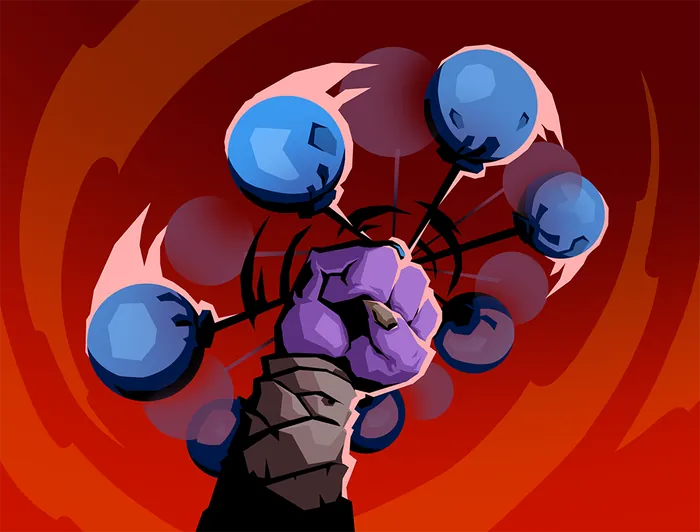 Bolas (`BOLAS`)
* **Type :** *Attack* | **Coût :** `0` ⚡ | **Pool :** `Colorless`
* **Effet :** Infligez 3 dégâts.
Au début de votre prochain tour, cette carte retourne dans votre **Main**.
* **Effet Amélioré :** Infligez 4 dégâts.
Au début de votre prochain tour, cette carte retourne dans votre **Main**.

### 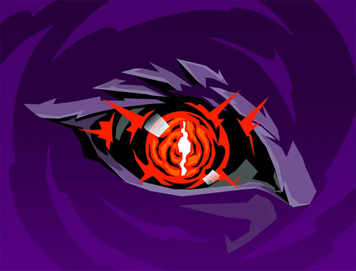 Calamité (`CALAMITY`)
* **Type :** *Power* | **Coût :** `3` ⚡ | **Pool :** `Colorless`
* **Effet :** Lorsque vous jouez une Attaque, ajoutez une Attaque aléatoire à votre **Main**.
* **Effet Amélioré :** Lorsque vous jouez une Attaque, ajoutez une Attaque aléatoire à votre **Main**.

### 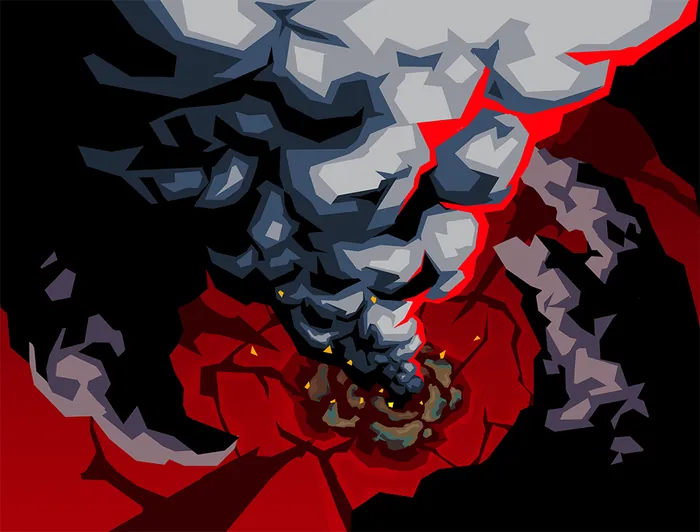 Catastrophe (`CATASTROPHE`)
* **Type :** *Skill* | **Coût :** `2` ⚡ | **Pool :** `Colorless`
* **Effet :** Jouez 2 cartes aléatoires depuis votre **Pioche**.
* **Effet Amélioré :** Jouez 3 cartes aléatoires depuis votre **Pioche**.

### 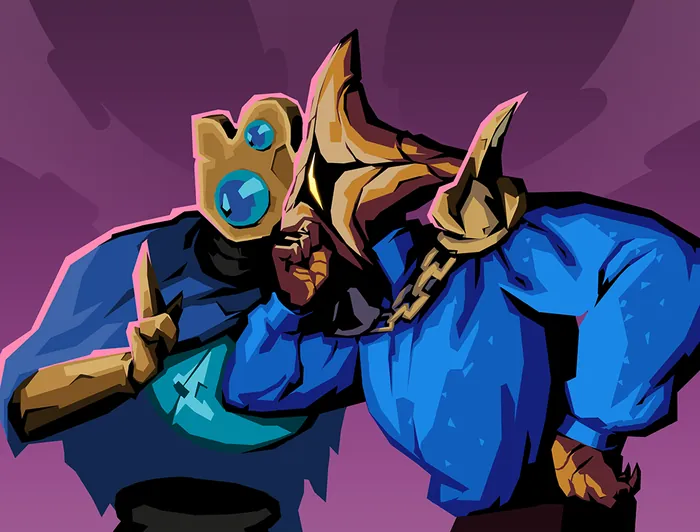 Coordination (`COORDINATE`)
* **Type :** *Skill* | **Coût :** `1` ⚡ | **Pool :** `Colorless`
* **Effet :** Donnez à un autre joueur 5 de **Force** jusqu'à la fin du tour.
* **Effet Amélioré :** Donnez à un autre joueur 8 de **Force** jusqu'à la fin du tour.

### 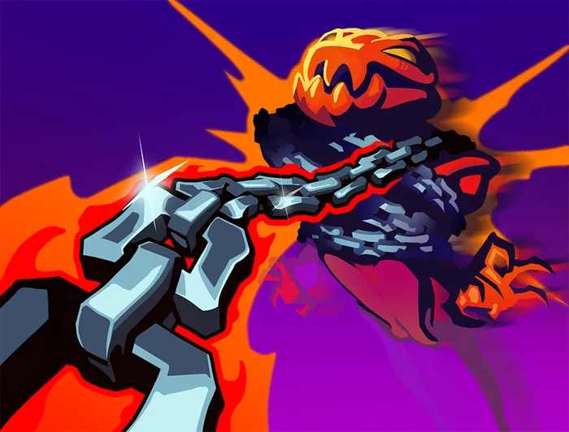 Entraves des ténèbres (`DARK_SHACKLES`)
* **Type :** *Skill* | **Coût :** `0` ⚡ | **Pool :** `Colorless`
* **Effet :** L'ennemi perd 9 de **Force** jusqu'à la fin du tour.
**Épuisement**.
* **Effet Amélioré :** L'ennemi perd 15 de **Force** jusqu'à la fin du tour.
**Épuisement**.

### 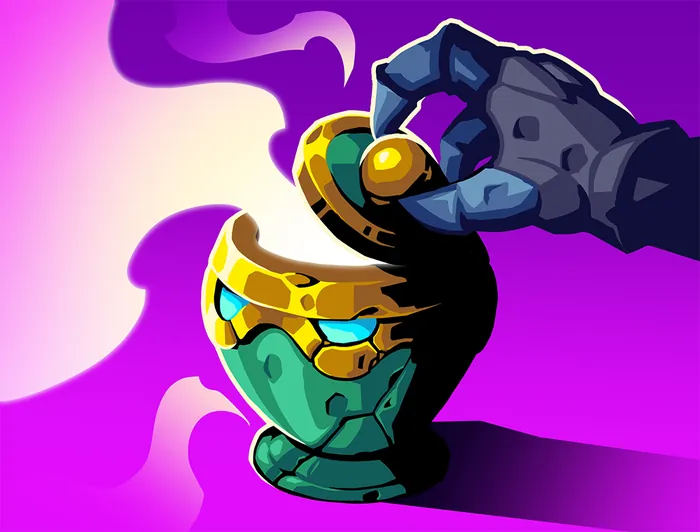 Découverte (`DISCOVERY`)
* **Type :** *Skill* | **Coût :** `1` ⚡ | **Pool :** `Colorless`
* **Effet :** Choisissez 1 carte parmi 3 aléatoires à ajouter à votre **Main**. Elle coûte 0 ce tour.
**Épuisement**.
* **Effet Amélioré :** Choisissez 1 carte parmi 3 aléatoires à ajouter à votre **Main**. Elle coûte 0 ce tour.

### 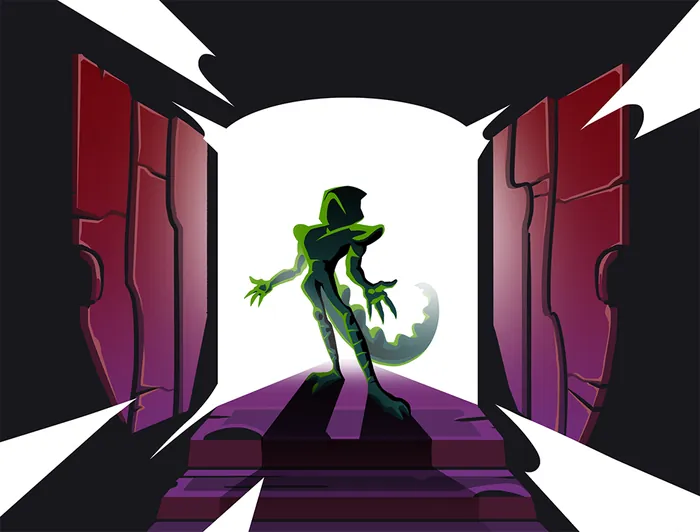 Entrée fracassante (`DRAMATIC_ENTRANCE`)
* **Type :** *Attack* | **Coût :** `0` ⚡ | **Pool :** `Colorless`
* **Effet :** **Inné**.
Infligez 11 dégâts à TOUS les ennemis.
**Épuisement**.
* **Effet Amélioré :** **Inné**.
Infligez 15 dégâts à TOUS les ennemis.
**Épuisement**.

### 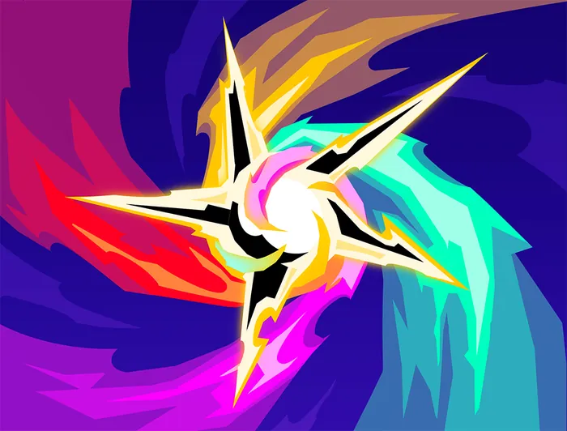 Entropie (`ENTROPY`)
* **Type :** *Power* | **Coût :** `1` ⚡ | **Pool :** `Colorless`
* **Effet :** Au début de votre tour, **Transformez** 1 carte dans votre **Main**.
* **Effet Amélioré :** **Inné**.
Au début de votre tour, **Transformez** 1 carte dans votre **Main**.

### 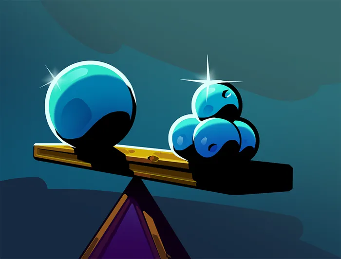 Équilibre (`EQUILIBRIUM`)
* **Type :** *Skill* | **Coût :** `2` ⚡ | **Pool :** `Colorless`
* **Effet :** Gagnez 13 d'**Armure**.
**Retenez** votre **Main** jusqu'au tour suivant.
* **Effet Amélioré :** Gagnez 16 d'**Armure**.
**Retenez** votre **Main** jusqu'au tour suivant.

### 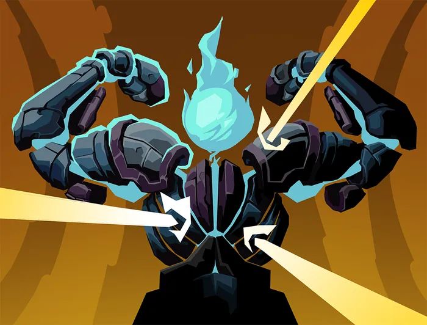 Armure éternelle (`ETERNAL_ARMOR`)
* **Type :** *Power* | **Coût :** `3` ⚡ | **Pool :** `Colorless`
* **Effet :** Gagnez 9 de **Blindage**.
* **Effet Amélioré :** Gagnez 12 de **Blindage**.

### 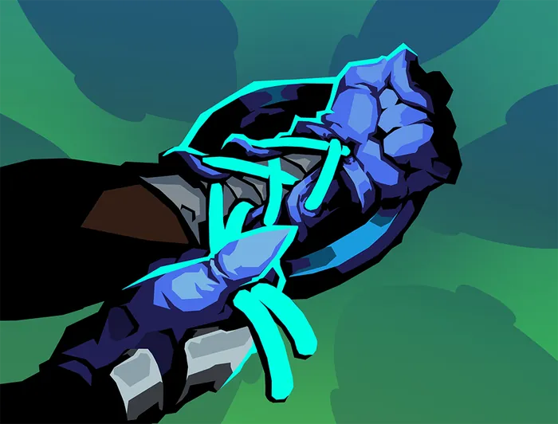 Bien attaché (`FASTEN`)
* **Type :** *Power* | **Coût :** `1` ⚡ | **Pool :** `Colorless`
* **Effet :** Vos cartes Défense confèrent 4 d'**Armure** supplémentaire.
* **Effet Amélioré :** Vos cartes Défense confèrent 6 d'**Armure** supplémentaire.

### 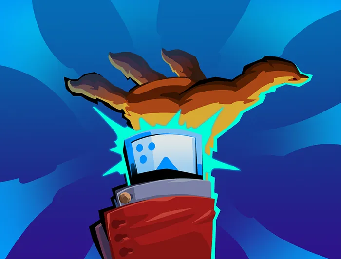 Finesse (`FINESSE`)
* **Type :** *Skill* | **Coût :** `0` ⚡ | **Pool :** `Colorless`
* **Effet :** Gagnez 4 d'**Armure**.
Piochez 1 carte.
* **Effet Amélioré :** Gagnez 7 d'**Armure**.
Piochez 1 carte.

### 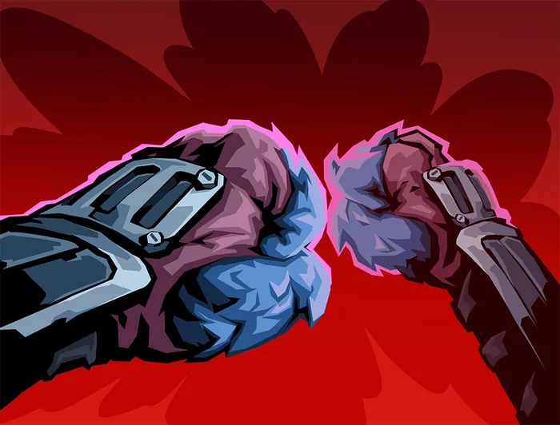 Bagarre (`FISTICUFFS`)
* **Type :** *Attack* | **Coût :** `1` ⚡ | **Pool :** `Colorless`
* **Effet :** Infligez 7 dégâts.
Gagnez un montant d'**Armure** égal aux dégâts infligés.
* **Effet Amélioré :** Infligez 9 dégâts.
Gagnez un montant d'**Armure** égal aux dégâts infligés.

### 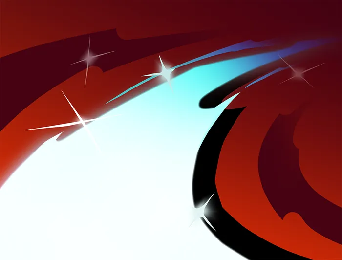 Éclair d'acier (`FLASH_OF_STEEL`)
* **Type :** *Attack* | **Coût :** `0` ⚡ | **Pool :** `Colorless`
* **Effet :** Infligez 5 dégâts.
Piochez 1 carte.
* **Effet Amélioré :** Infligez 8 dégâts.
Piochez 1 carte.

### 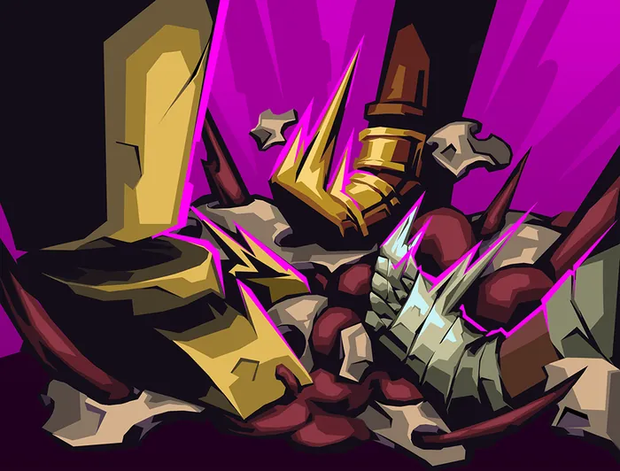 Meute (`GANG_UP`)
* **Type :** *Attack* | **Coût :** `1` ⚡ | **Pool :** `Colorless`
* **Effet :** Infligez 5 dégâts.
Inflige 5 dégâts supplémentaires pour chaque fois qu'un autre joueur a attaqué l'ennemi durant ce tour.
* **Effet Amélioré :** Infligez 5 dégâts.
Inflige 7 dégâts supplémentaires pour chaque fois qu'un autre joueur a attaqué l'ennemi durant ce tour.

### 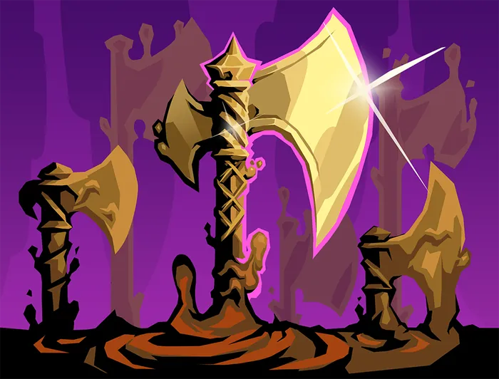 Hache dorée (`GOLD_AXE`)
* **Type :** *Attack* | **Coût :** `1` ⚡ | **Pool :** `Colorless`
* **Effet :** Infligez un montant de dégâts égal au nombre de cartes jouées pendant ce combat.
* **Effet Amélioré :** **Retenue**.
Infligez un montant de dégâts égal au nombre de cartes jouées pendant ce combat.

### 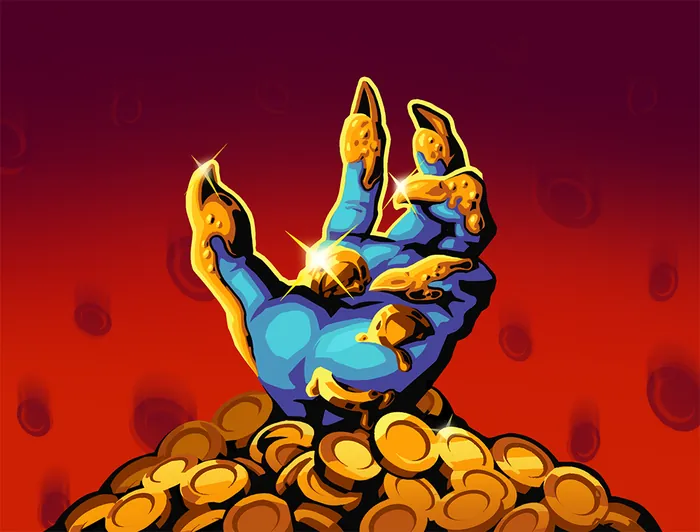 Main de la cupidité (`HAND_OF_GREED`)
* **Type :** *Attack* | **Coût :** `2` ⚡ | **Pool :** `Colorless`
* **Effet :** Infligez 20 dégâts.
**Coup de grâce** : gagnez 20 **Pièces d'or**.
* **Effet Amélioré :** Infligez 25 dégâts.
**Coup de grâce** : gagnez 25 **Pièces d'or**.

### 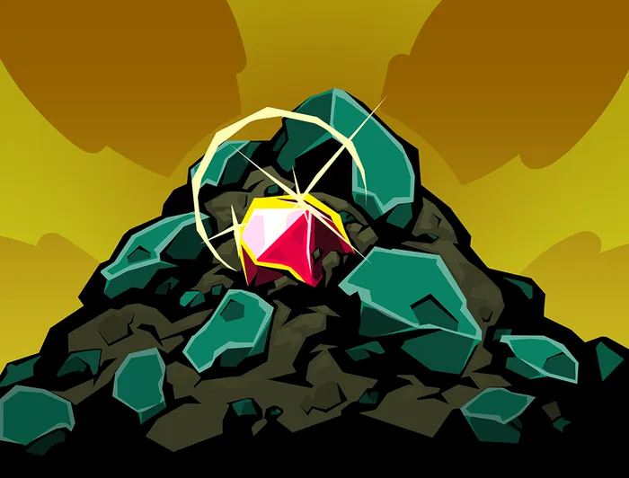 Joyau caché (`HIDDEN_GEM`)
* **Type :** *Skill* | **Coût :** `1` ⚡ | **Pool :** `Colorless`
* **Effet :** Une carte aléatoire sans **Écho** de votre **Pioche** gagne **Écho** 2.
* **Effet Amélioré :** Une carte aléatoire sans **Écho** de votre **Pioche** gagne **Écho** 3.

### 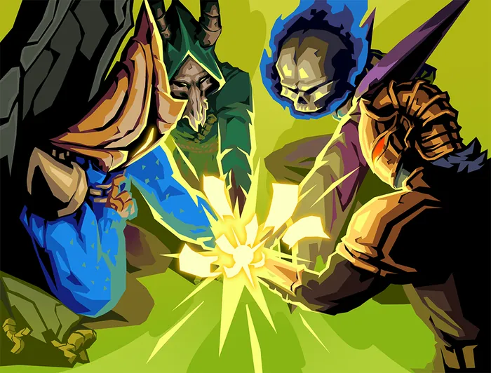 Grégarité (`HUDDLE_UP`)
* **Type :** *Skill* | **Coût :** `1` ⚡ | **Pool :** `Colorless`
* **Effet :** TOUS les joueurs piochent 2 cartes.
**Épuisement**.
* **Effet Amélioré :** TOUS les joueurs piochent 3 cartes.
**Épuisement**.

### 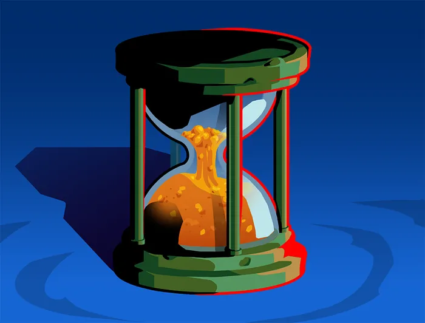 Impatience (`IMPATIENCE`)
* **Type :** *Skill* | **Coût :** `0` ⚡ | **Pool :** `Colorless`
* **Effet :** Si vous n'avez pas d'Attaques dans votre **Main**, piochez 2 cartes.
* **Effet Amélioré :** Si vous n'avez pas d'Attaques dans votre **Main**, piochez 3 cartes.

### 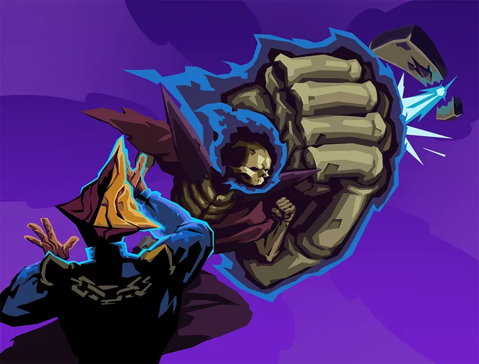 Interposition (`INTERCEPT`)
* **Type :** *Skill* | **Coût :** `1` ⚡ | **Pool :** `Colorless`
* **Effet :** Gagnez 9 d'**Armure**.
Interceptez toutes les attaques qui ciblent un autre joueur.
* **Effet Amélioré :** Gagnez 13 d'**Armure**.
Interceptez toutes les attaques qui ciblent un autre joueur.

### 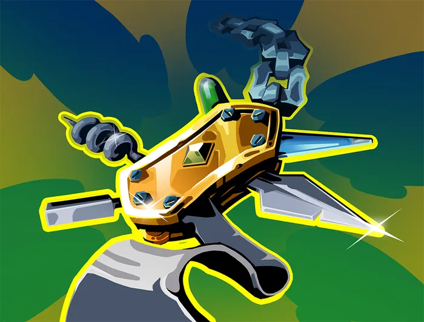 Polyvalence (`JACK_OF_ALL_TRADES`)
* **Type :** *Skill* | **Coût :** `0` ⚡ | **Pool :** `Colorless`
* **Effet :** Ajoutez 1 carte Incolore aléatoire à votre **Main**.
**Épuisement**.
* **Effet Amélioré :** Ajoutez 2 cartes Incolores aléatoires à votre **Main**.
**Épuisement**.

### 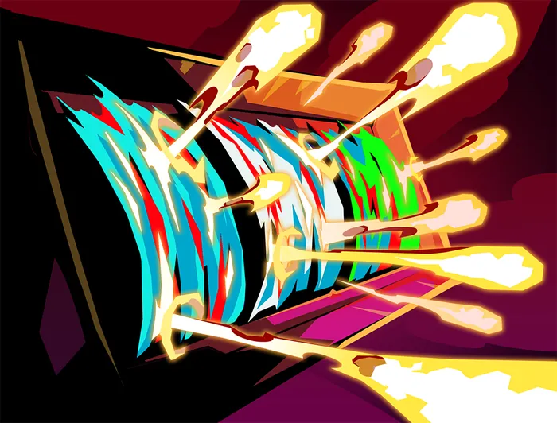 Jackpot (`JACKPOT`)
* **Type :** *Attack* | **Coût :** `3` ⚡ | **Pool :** `Colorless`
* **Effet :** Infligez 25 dégâts.
Ajoutez 3 cartes aléatoires coûtant 0 ⚡ à votre **Main**.
* **Effet Amélioré :** Infligez 30 dégâts.
Ajoutez 3 cartes aléatoires **Améliorées** coûtant 0 ⚡ à votre **Main**.

### 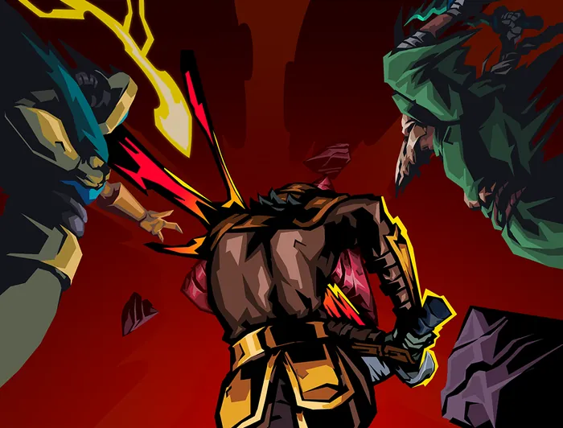 Renverser (`KNOCKDOWN`)
* **Type :** *Attack* | **Coût :** `3` ⚡ | **Pool :** `Colorless`
* **Effet :** Infligez 10 dégâts.
L'ennemi subit le double des dégâts infligés par les autres joueurs jusqu'à la fin du tour.
* **Effet Amélioré :** Infligez 14 dégâts.
L'ennemi subit le triple des dégâts infligés par les autres joueurs jusqu'à la fin du tour.

### 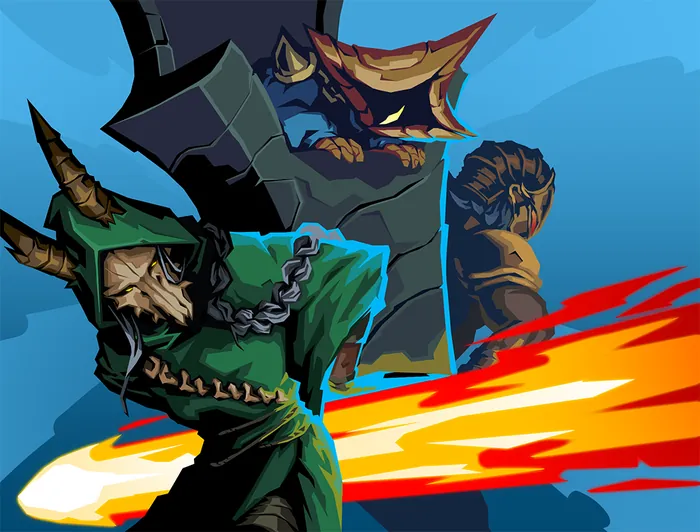 Assistance (`LIFT`)
* **Type :** *Skill* | **Coût :** `1` ⚡ | **Pool :** `Colorless`
* **Effet :** Octroyez 11 d'**Armure** à un autre joueur.
* **Effet Amélioré :** Octroyez 16 d'**Armure** à un autre joueur.

### 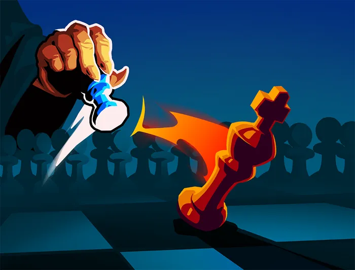 Maître stratège (`MASTER_OF_STRATEGY`)
* **Type :** *Skill* | **Coût :** `0` ⚡ | **Pool :** `Colorless`
* **Effet :** Piochez 3 cartes.
**Épuisement**.
* **Effet Amélioré :** Piochez 4 cartes.
**Épuisement**.

### 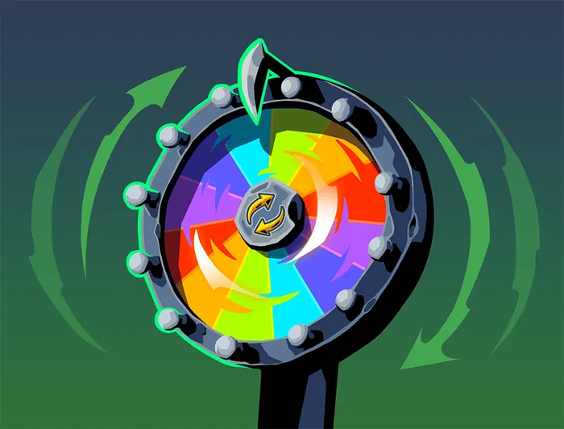 Grabuge (`MAYHEM`)
* **Type :** *Power* | **Coût :** `2` ⚡ | **Pool :** `Colorless`
* **Effet :** Au début de votre tour, jouez la carte du dessus de votre **Pioche**.
* **Effet Amélioré :** Au début de votre tour, jouez la carte du dessus de votre **Pioche**.

### 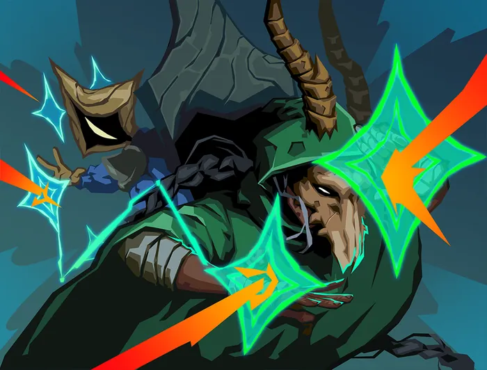 Imitation (`MIMIC`)
* **Type :** *Skill* | **Coût :** `1` ⚡ | **Pool :** `Colorless`
* **Effet :** Gagnez un montant d'**Armure** égal à l'**Armure** d'un autre joueur.
**Épuisement**.
* **Effet Amélioré :** Gagnez un montant d'**Armure** égal à l'**Armure** d'un autre joueur.

### 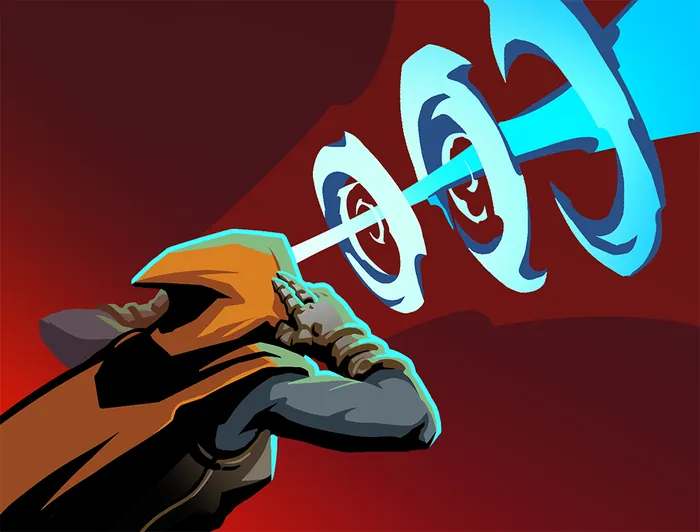 Déflagration mentale (`MIND_BLAST`)
* **Type :** *Attack* | **Coût :** `1` ⚡ | **Pool :** `Colorless`
* **Effet :** **Inné**.
Infligez un montant de dégâts égal au nombre de cartes dans votre **Pioche**.
* **Effet Amélioré :** **Inné**.
Infligez un montant de dégâts égal au nombre de cartes dans votre **Pioche**.

### 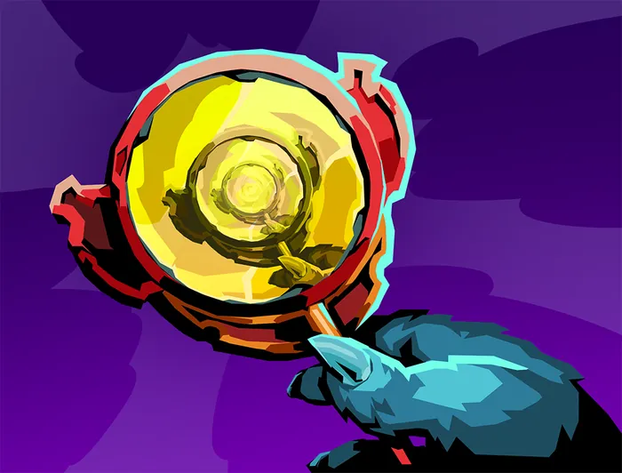 Nostalgie (`NOSTALGIA`)
* **Type :** *Power* | **Coût :** `1` ⚡ | **Pool :** `Colorless`
* **Effet :** La première Attaque ou Compétence que vous jouez chaque tour est placée sur le dessus de votre **Pioche**.
* **Effet Amélioré :** La première Attaque ou Compétence que vous jouez chaque tour est placée sur le dessus de votre **Pioche**.

### 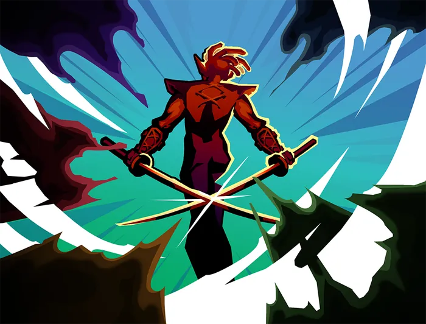 Omnilame (`OMNISLICE`)
* **Type :** *Attack* | **Coût :** `0` ⚡ | **Pool :** `Colorless`
* **Effet :** Infligez 8 dégâts.
Infligez le même montant de dégâts à TOUS les autres ennemis.
* **Effet Amélioré :** Infligez 11 dégâts.
Infligez le même montant de dégâts à TOUS les autres ennemis.

### 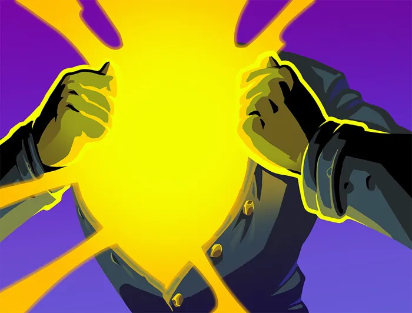 Panache (`PANACHE`)
* **Type :** *Power* | **Coût :** `0` ⚡ | **Pool :** `Colorless`
* **Effet :** Pour toutes les 5 cartes que vous jouez en un tour, infligez 10 dégâts à TOUS les ennemis.
* **Effet Amélioré :** Pour toutes les 5 cartes que vous jouez en un tour, infligez 14 dégâts à TOUS les ennemis.

### 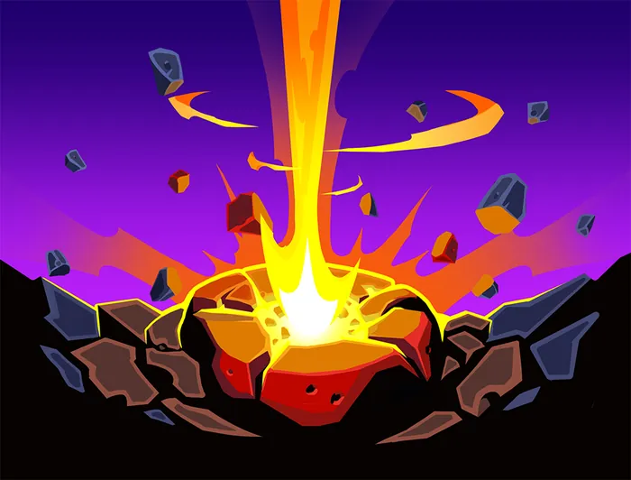 Bouton de secours (`PANIC_BUTTON`)
* **Type :** *Skill* | **Coût :** `0` ⚡ | **Pool :** `Colorless`
* **Effet :** Gagnez 30 d'**Armure**.
Les cartes ne vous confèrent plus d'**Armure** pendant 2 tours.
**Épuisement**.
* **Effet Amélioré :** Gagnez 40 d'**Armure**.
Les cartes ne vous confèrent plus d'**Armure** pendant 2 tours.
**Épuisement**.

### 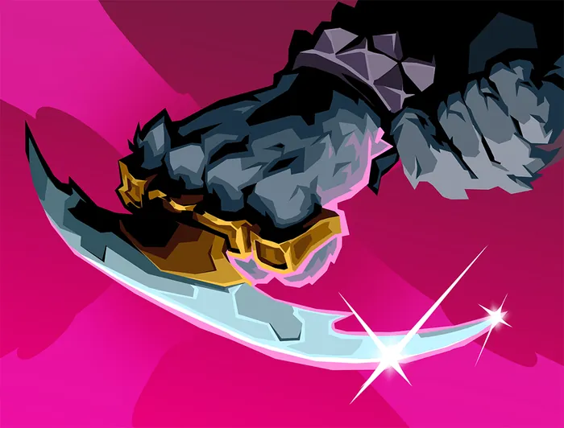 Échauffement (`PREP_TIME`)
* **Type :** *Power* | **Coût :** `1` ⚡ | **Pool :** `Colorless`
* **Effet :** Au début de votre tour, gagnez 4 de **Vigueur**.
* **Effet Amélioré :** Au début de votre tour, gagnez 6 de **Vigueur**.

### 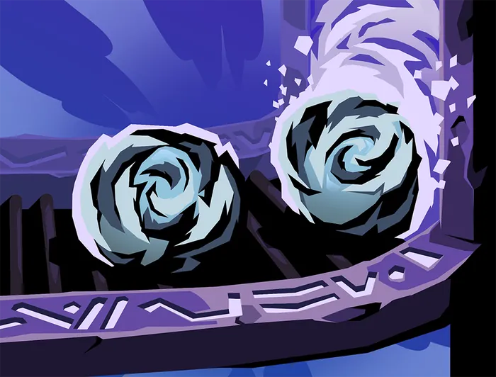 Production (`PRODUCTION`)
* **Type :** *Skill* | **Coût :** `0` ⚡ | **Pool :** `Colorless`
* **Effet :** Gagnez ⚡2⚡.
**Épuisement**.
* **Effet Amélioré :** Gagnez ⚡3⚡.
**Épuisement**.

### 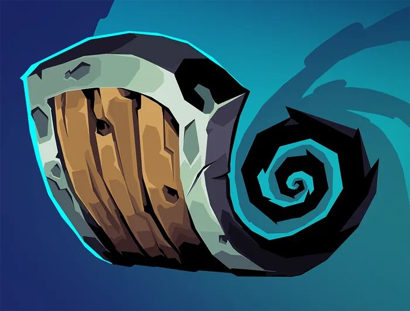 Prolongations (`PROLONG`)
* **Type :** *Skill* | **Coût :** `0` ⚡ | **Pool :** `Colorless`
* **Effet :** Au prochain tour, gagnez un montant d'**Armure** égal à votre quantité d'**Armure** actuelle.
**Épuisement**.
* **Effet Amélioré :** Au prochain tour, gagnez un montant d'**Armure** égal à votre quantité d'**Armure** actuelle.

### 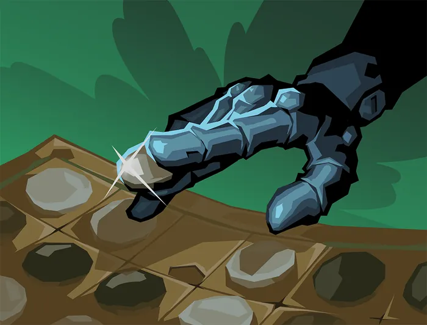 Prouesse (`PROWESS`)
* **Type :** *Power* | **Coût :** `1` ⚡ | **Pool :** `Colorless`
* **Effet :** Gagnez 1 de **Force**.
Gagnez 1 de **Dextérité**.
* **Effet Amélioré :** Gagnez 2 de **Force**.
Gagnez 2 de **Dextérité**.

###  Épuration (`PURITY`)
* **Type :** *Skill* | **Coût :** `0` ⚡ | **Pool :** `Colorless`
* **Effet :** **Retenue**.
**Épuisez** jusqu'à 3 cartes de votre **Main**.
**Épuisement**.
* **Effet Amélioré :** **Retenue**.
**Épuisez** jusqu'à 5 cartes de votre **Main**.
**Épuisement**.

### 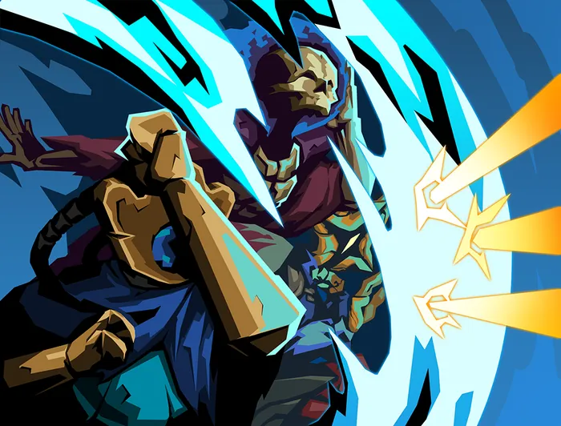 Ralliement (`RALLY`)
* **Type :** *Skill* | **Coût :** `2` ⚡ | **Pool :** `Colorless`
* **Effet :** TOUS les joueurs gagnent 12 d'**Armure**.
* **Effet Amélioré :** TOUS les joueurs gagnent 17 d'**Armure**.

### 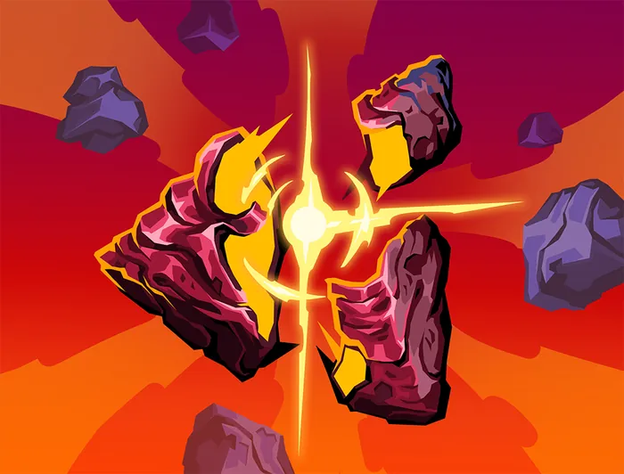 Pourfendre (`REND`)
* **Type :** *Attack* | **Coût :** `1` ⚡ | **Pool :** `Colorless`
* **Effet :** Infligez 10 dégâts.
Inflige 5 dégâts supplémentaires pour chaque effet néfaste unique présent sur l'ennemi.
* **Effet Amélioré :** Infligez 12 dégâts.
Inflige 8 dégâts supplémentaires pour chaque effet néfaste unique présent sur l'ennemi.

### 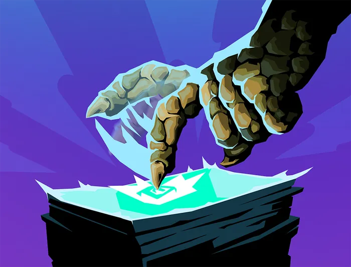 Sans repos (`RESTLESSNESS`)
* **Type :** *Skill* | **Coût :** `0` ⚡ | **Pool :** `Colorless`
* **Effet :** **Retenue**.
Si votre **Main** est vide, piochez 2 cartes et gagnez ⚡2⚡.
* **Effet Amélioré :** **Retenue**.
Si votre **Main** est vide, piochez 3 cartes et gagnez ⚡3⚡.

### 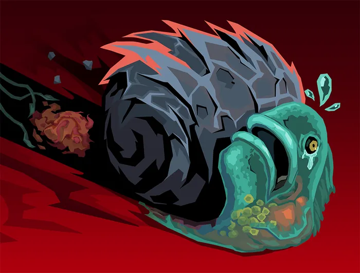 Pierre qui roule (`ROLLING_BOULDER`)
* **Type :** *Power* | **Coût :** `3` ⚡ | **Pool :** `Colorless`
* **Effet :** Au début de votre tour, infligez 5 dégâts à TOUS les ennemis et augmentez le montant de ces dégâts de 5.
* **Effet Amélioré :** Au début de votre tour, infligez 10 dégâts à TOUS les ennemis et augmentez le montant de ces dégâts de 5.

### 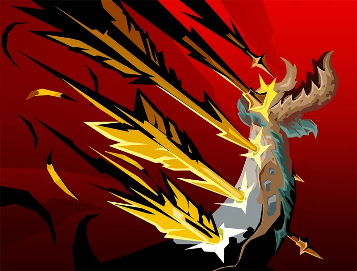 Salve (`SALVO`)
* **Type :** *Attack* | **Coût :** `1` ⚡ | **Pool :** `Colorless`
* **Effet :** Infligez 12 dégâts.
**Retenez** votre **Main** jusqu'au prochain tour.
* **Effet Amélioré :** Infligez 16 dégâts.
**Retenez** votre **Main** jusqu'au prochain tour.

### 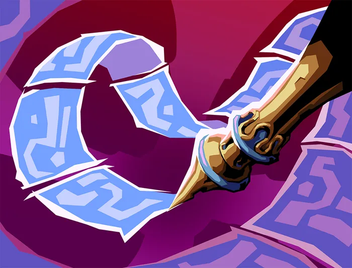 Griffonage (`SCRAWL`)
* **Type :** *Skill* | **Coût :** `1` ⚡ | **Pool :** `Colorless`
* **Effet :** Piochez des cartes jusqu'à remplir votre **Main**.
**Épuisement**.
* **Effet Amélioré :** **Retenue**.
Piochez des cartes jusqu'à remplir votre **Main**.
**Épuisement**.

### 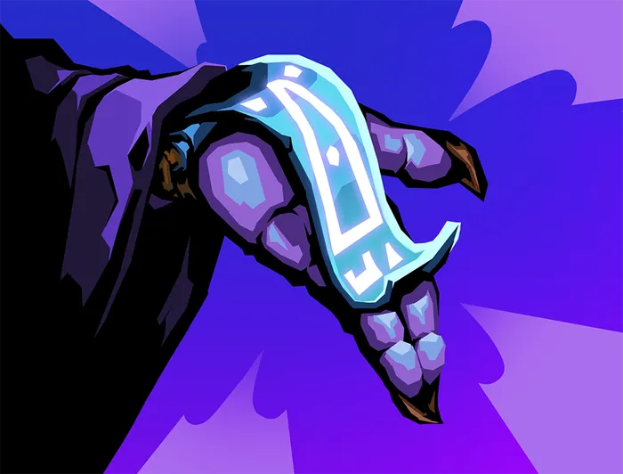 Technique secrète (`SECRET_TECHNIQUE`)
* **Type :** *Skill* | **Coût :** `0` ⚡ | **Pool :** `Colorless`
* **Effet :** Placez une Compétence de votre **Pioche** dans votre **Main**.
**Épuisement**.
* **Effet Amélioré :** Placez une Compétence de votre **Pioche** dans votre **Main**.

###  Arme secrète (`SECRET_WEAPON`)
* **Type :** *Skill* | **Coût :** `0` ⚡ | **Pool :** `Colorless`
* **Effet :** Placez une Attaque de votre **Pioche** dans votre **Main**.
**Épuisement**.
* **Effet Amélioré :** Placez une Attaque de votre **Pioche** dans votre **Main**.

###  Frappe chercheuse (`SEEKER_STRIKE`)
* **Type :** *Attack* | **Coût :** `1` ⚡ | **Pool :** `Colorless`
* **Effet :** Infligez 9 dégâts.
Choisissez 1 carte parmi 3 de votre **Pioche** à ajouter dans votre **Main**.
* **Effet Amélioré :** Infligez 12 dégâts.
Choisissez 1 carte parmi 3 de votre **Pioche** à ajouter dans votre **Main**.

###  Onde de choc (`SHOCKWAVE`)
* **Type :** *Skill* | **Coût :** `2` ⚡ | **Pool :** `Colorless`
* **Effet :** Appliquez **Affaibli** (3) et **Vulnérable** (3) à TOUS les ennemis.
**Épuisement**.
* **Effet Amélioré :** Appliquez **Affaibli** (5) et **Vulnérable** (5) à TOUS les ennemis.
**Épuisement**.

###  Clapotis (`SPLASH`)
* **Type :** *Skill* | **Coût :** `1` ⚡ | **Pool :** `Colorless`
* **Effet :** Choisissez 1 Attaque parmi 3 aléatoires d'un autre personnage à ajouter à votre **Main**. Elle coûte 0 ce tour.
* **Effet Amélioré :** Choisissez 1 Attaque **Améliorée** parmi 3 aléatoires d'un autre personnage à ajouter à votre **Main**. Elle coûte 0 ce tour.

###  Stratagème (`STRATAGEM`)
* **Type :** *Power* | **Coût :** `1` ⚡ | **Pool :** `Colorless`
* **Effet :** Lorsque vous mélangez votre **Pioche**, sélectionnez une carte à placer dans votre **Main**.
* **Effet Amélioré :** Lorsque vous mélangez votre **Pioche**, sélectionnez une carte à placer dans votre **Main**.

###  Relais (`TAG_TEAM`)
* **Type :** *Attack* | **Coût :** `2` ⚡ | **Pool :** `Colorless`
* **Effet :** Infligez 11 dégâts.
La prochaine Attaque jouée par un autre joueur sur l'ennemi est jouée une fois supplémentaire.
* **Effet Amélioré :** Infligez 15 dégâts.
La prochaine Attaque jouée par un autre joueur sur l'ennemi est jouée une fois supplémentaire.

###  La Boule (`THE_BALL`)
* **Type :** *Attack* | **Coût :** `1` ⚡ | **Pool :** `Colorless`
* **Effet :** Infligez 10 dégâts.
Augmentez les dégâts de cette carte de 10 pendant ce combat et donnez-la à un allié aléatoire.
* **Effet Amélioré :** Infligez 10 dégâts.
Augmentez les dégâts de cette carte de 15 pendant ce combat et donnez-la à un allié aléatoire.

###  La bombe (`THE_BOMB`)
* **Type :** *Skill* | **Coût :** `2` ⚡ | **Pool :** `Colorless`
* **Effet :** Au bout de 3 tours, infligez 40 dégâts à TOUS les ennemis.
* **Effet Amélioré :** Au bout de 3 tours, infligez 50 dégâts à TOUS les ennemis.

###  La grande manœuvre (`THE_GAMBIT`)
* **Type :** *Skill* | **Coût :** `0` ⚡ | **Pool :** `Colorless`
* **Effet :** Gagnez 50 d'**Armure**.
Si vous subissez des dégâts d'attaque non-bloqués par l'**Armure** ce combat, vous périssez.
* **Effet Amélioré :** Gagnez 75 d'**Armure**.
Si vous subissez des dégâts d'attaque non-bloqués par l'**Armure** ce combat, vous périssez.

###  Coup d'avance (`THINKING_AHEAD`)
* **Type :** *Skill* | **Coût :** `0` ⚡ | **Pool :** `Colorless`
* **Effet :** Piochez 2 cartes.
Placez 1 carte de votre **Main** sur le dessus de votre **Pioche**.
**Épuisement**.
* **Effet Amélioré :** Piochez 2 cartes.
Placez 1 carte de votre **Main** sur le dessus de votre **Pioche**.

###  Hache sifflante (`THRUMMING_HATCHET`)
* **Type :** *Attack* | **Coût :** `1` ⚡ | **Pool :** `Colorless`
* **Effet :** Infligez 11 dégâts.
Au début de votre prochain tour, cette carte retourne dans votre **Main**.
* **Effet Amélioré :** Infligez 14 dégâts.
Au début de votre prochain tour, cette carte retourne dans votre **Main**.

###  Défense ultime (`ULTIMATE_DEFEND`)
* **Type :** *Skill* | **Coût :** `1` ⚡ | **Pool :** `Colorless`
* **Effet :** Gagnez 11 d'**Armure**.
* **Effet Amélioré :** Gagnez 15 d'**Armure**.

###  Frappe ultime (`ULTIMATE_STRIKE`)
* **Type :** *Attack* | **Coût :** `1` ⚡ | **Pool :** `Colorless`
* **Effet :** Infligez 14 dégâts.
* **Effet Amélioré :** Infligez 20 dégâts.

###  Artillerie (`VOLLEY`)
* **Type :** *Attack* | **Coût :** `-1` ⚡ | **Pool :** `Colorless`
* **Effet :** Infligez 10 dégâts à un ennemi aléatoire X fois.
* **Effet Amélioré :** Infligez 14 dégâts à un ennemi aléatoire X fois.

## 🌀 Catégorie : Curse (18 cartes)

###  Fléau de l'ascendant (`ASCENDERS_BANE`)
* **Type :** *Curse* | **Coût :** `-` ⚡ | **Pool :** `Curse`
* **Effet :** **Injouable**.
**Éthéré**.
**Éternel**.
* **Effet Amélioré :** **Injouable**.
**Éthéré**.
**Éternel**.

###  Malchance (`BAD_LUCK`)
* **Type :** *Curse* | **Coût :** `-` ⚡ | **Pool :** `Curse`
* **Effet :** **Injouable**.
À la fin de votre tour, si cette carte est dans votre Main, perdez 13 PV.
**Éternel**.
* **Effet Amélioré :** **Injouable**.
À la fin de votre tour, si cette carte est dans votre Main, perdez 13 PV.
**Éternel**.

###  Maladresse (`CLUMSY`)
* **Type :** *Curse* | **Coût :** `-` ⚡ | **Pool :** `Curse`
* **Effet :** **Injouable**.
**Éthéré**.
* **Effet Amélioré :** **Injouable**.
**Éthéré**.

###  Malédiction de la cloche (`CURSE_OF_THE_BELL`)
* **Type :** *Curse* | **Coût :** `-` ⚡ | **Pool :** `Curse`
* **Effet :** **Injouable**.
**Éternel**.
* **Effet Amélioré :** **Injouable**.
**Éternel**.

###  Dette (`DEBT`)
* **Type :** *Curse* | **Coût :** `-` ⚡ | **Pool :** `Curse`
* **Effet :** **Injouable**.
À la fin de votre tour, si cette carte est dans votre **Main**, perdez 10 **Pièces d'or**.
* **Effet Amélioré :** **Injouable**.
À la fin de votre tour, si cette carte est dans votre **Main**, perdez 10 **Pièces d'or**.

###  Déclin (`DECAY`)
* **Type :** *Curse* | **Coût :** `-` ⚡ | **Pool :** `Curse`
* **Effet :** **Injouable**.
À la fin de votre tour, si cette carte est dans votre **Main**, subissez 2 dégâts.
* **Effet Amélioré :** **Injouable**.
À la fin de votre tour, si cette carte est dans votre **Main**, subissez 2 dégâts.

###  Doute (`DOUBT`)
* **Type :** *Curse* | **Coût :** `-` ⚡ | **Pool :** `Curse`
* **Effet :** **Injouable**.
À la fin de votre tour, si cette carte est dans votre **Main**, gagnez **Affaibli** (1).
* **Effet Amélioré :** **Injouable**.
À la fin de votre tour, si cette carte est dans votre **Main**, gagnez **Affaibli** (1).

###  Assuétude (`ENTHRALLED`)
* **Type :** *Curse* | **Coût :** `2` ⚡ | **Pool :** `Curse`
* **Effet :** Si cette carte est dans votre **Main**, elle doit être jouée avant les autres cartes.
**Éternel**.
* **Effet Amélioré :** Si cette carte est dans votre **Main**, elle doit être jouée avant les autres cartes.
**Éternel**.

###  Hubris (`FOLLY`)
* **Type :** *Curse* | **Coût :** `-` ⚡ | **Pool :** `Curse`
* **Effet :** **Injouable**.
**Inné**.
**Éthéré**.
**Éternel**.
* **Effet Amélioré :** **Injouable**.
**Inné**.
**Éthéré**.
**Éternel**.

###  Cupidité (`GREED`)
* **Type :** *Curse* | **Coût :** `-` ⚡ | **Pool :** `Curse`
* **Effet :** **Injouable**.
**Éternel**.
* **Effet Amélioré :** **Injouable**.
**Éternel**.

###  Culpabilité (`GUILTY`)
* **Type :** *Curse* | **Coût :** `-` ⚡ | **Pool :** `Curse`
* **Effet :** **Injouable**.
Retiré de votre **Deck** au bout de 5 combats.
* **Effet Amélioré :** **Injouable**.
Retiré de votre **Deck** au bout de 5 combats.

###  Blessure (`INJURY`)
* **Type :** *Curse* | **Coût :** `-` ⚡ | **Pool :** `Curse`
* **Effet :** **Injouable**.
* **Effet Amélioré :** **Injouable**.

###  Normalité (`NORMALITY`)
* **Type :** *Curse* | **Coût :** `-` ⚡ | **Pool :** `Curse`
* **Effet :** **Injouable**.
Vous ne pouvez pas jouer plus de 3 cartes ce tour.
* **Effet Amélioré :** **Injouable**.
Vous ne pouvez pas jouer plus de 3 cartes ce tour.

###  Insomnie (`POOR_SLEEP`)
* **Type :** *Curse* | **Coût :** `-` ⚡ | **Pool :** `Curse`
* **Effet :** **Injouable**.
**Retenue**.
* **Effet Amélioré :** **Injouable**.
**Retenue**.

###  Regrets (`REGRET`)
* **Type :** *Curse* | **Coût :** `-` ⚡ | **Pool :** `Curse`
* **Effet :** **Injouable**.
À la fin de votre tour, si cette carte est dans votre **Main**, perdez 1 PV pour chaque carte dans votre **Main**.
* **Effet Amélioré :** **Injouable**.
À la fin de votre tour, si cette carte est dans votre **Main**, perdez 1 PV pour chaque carte dans votre **Main**.

###  Honte (`SHAME`)
* **Type :** *Curse* | **Coût :** `-` ⚡ | **Pool :** `Curse`
* **Effet :** **Injouable**.
À la fin de votre tour, si cette carte est dans votre **Main**, gagnez **Fragilisé** (1).
* **Effet Amélioré :** **Injouable**.
À la fin de votre tour, si cette carte est dans votre **Main**, gagnez **Fragilisé** (1).

###  Conscience sporique (`SPORE_MIND`)
* **Type :** *Curse* | **Coût :** `1` ⚡ | **Pool :** `Curse`
* **Effet :** **Épuisement**.
* **Effet Amélioré :** **Épuisement**.

###  Souffrance (`WRITHE`)
* **Type :** *Curse* | **Coût :** `-` ⚡ | **Pool :** `Curse`
* **Effet :** **Injouable**.
**Inné**.
* **Effet Amélioré :** **Injouable**.
**Inné**.

## 🌀 Catégorie : Event (28 cartes)

###  Abondance (`ABUNDANCE`)
* **Type :** *Skill* | **Coût :** `1` ⚡ | **Pool :** `Event`
* **Effet :** Choisissez 1 **Pouvoir** **Amélioré** parmi 3 à ajouter à votre **Main**. Elle coûte 0 ce tour.
**Épuisement**.
* **Effet Amélioré :** Choisissez 1 **Pouvoir** **Amélioré** parmi 3 à ajouter à votre **Main**. Elle coûte 0 ce tour.
**Épuisement**.

###  Apothéose (`APOTHEOSIS`)
* **Type :** *Skill* | **Coût :** `2` ⚡ | **Pool :** `Event`
* **Effet :** **Inné**.
**Améliorez** TOUTES vos cartes.
**Épuisement**.
* **Effet Amélioré :** **Inné**.
**Améliorez** TOUTES vos cartes.
**Épuisement**.

###  Apparition (`APPARITION`)
* **Type :** *Skill* | **Coût :** `1` ⚡ | **Pool :** `Event`
* **Effet :** **Éthéré**.
Gagnez **Intangible** (1).
**Épuisement**.
* **Effet Amélioré :** Gagnez **Intangible** (1).
**Épuisement**.

###  Flamme éclatante (`BRIGHTEST_FLAME`)
* **Type :** *Skill* | **Coût :** `0` ⚡ | **Pool :** `Event`
* **Effet :** Gagnez ⚡2⚡.
Piochez 2 cartes.
Perdez 2 PV Max.
* **Effet Amélioré :** Gagnez ⚡3⚡.
Piochez 3 cartes.
Perdez 2 PV Max.

###  Piqué d'oizo (`BYRD_SWOOP`)
* **Type :** *Attack* | **Coût :** `0` ⚡ | **Pool :** `Event`
* **Effet :** Infligez 14 dégâts.
* **Effet Amélioré :** Infligez 18 dégâts.

###  Chausse-trapes (`CALTROPS`)
* **Type :** *Power* | **Coût :** `1` ⚡ | **Pool :** `Event`
* **Effet :** Infligez 3 dégâts à l'attaquant chaque fois que vous êtes la cible d'une attaque.
* **Effet Amélioré :** Infligez 5 dégâts à l'attaquant chaque fois que vous êtes la cible d'une attaque.

###  Conflit (`CLASH`)
* **Type :** *Attack* | **Coût :** `0` ⚡ | **Pool :** `Event`
* **Effet :** Ne peut être joué que si toutes les cartes dans votre **Main** sont des Attaques.
Infligez 14 dégâts.
* **Effet Amélioré :** Ne peut être joué que si toutes les cartes dans votre **Main** sont des Attaques.
Infligez 18 dégâts.

###  Distraction (`DISTRACTION`)
* **Type :** *Skill* | **Coût :** `1` ⚡ | **Pool :** `Event`
* **Effet :** Ajoutez une Compétence aléatoire à votre **Main**. Elle coûte 0 ce tour.
**Épuisement**.
* **Effet Amélioré :** Ajoutez une Compétence aléatoire à votre **Main**. Elle coûte 0 ce tour.
**Épuisement**.

###  Ambidextrie (`DUAL_WIELD`)
* **Type :** *Skill* | **Coût :** `1` ⚡ | **Pool :** `Event`
* **Effet :** Choisissez une carte Attaque ou Pouvoir. Ajoutez une copie de cette carte à votre **Main**.
* **Effet Amélioré :** Choisissez une carte Attaque ou Pouvoir. Ajoutez 2 copies de cette carte à votre **Main**.

###  Illumination (`ENLIGHTENMENT`)
* **Type :** *Skill* | **Coût :** `0` ⚡ | **Pool :** `Event`
* **Effet :** Réduisez le coût de TOUTES les cartes de votre **Main** à 1 jusqu'à la fin du tour.
**Épuisement**.
* **Effet Amélioré :** Réduisez le coût de TOUTES les cartes de votre **Main** à 1 jusqu'à la fin du combat.
**Épuisement**.

###  Fortification (`ENTRENCH`)
* **Type :** *Skill* | **Coût :** `2` ⚡ | **Pool :** `Event`
* **Effet :** Doublez votre **Armure**.
* **Effet Amélioré :** Doublez votre **Armure**.

###  Extermination (`EXTERMINATE`)
* **Type :** *Attack* | **Coût :** `1` ⚡ | **Pool :** `Event`
* **Effet :** Infligez 3 dégâts à TOUS les ennemis 4 fois.
* **Effet Amélioré :** Infligez 4 dégâts à TOUS les ennemis 4 fois.

###  Repas frénétique (`FEEDING_FRENZY`)
* **Type :** *Skill* | **Coût :** `0` ⚡ | **Pool :** `Event`
* **Effet :** Gagnez 5 de **Force** jusqu'à la fin du tour.
* **Effet Amélioré :** Gagnez 7 de **Force** jusqu'à la fin du tour.

###  Hello World (`HELLO_WORLD`)
* **Type :** *Power* | **Coût :** `1` ⚡ | **Pool :** `Event`
* **Effet :** Au début de votre tour, ajoutez une carte Commune aléatoire à votre **Main**.
* **Effet Amélioré :** **Inné**.
Au début de votre tour, ajoutez une carte Commune aléatoire à votre **Main**.

###  Science sans conscience (`MAD_SCIENCE`)
* **Type :** *Attack* | **Coût :** `1` ⚡ | **Pool :** `Event`
* **Effet :** Infligez 12 dégâts.
???
* **Effet Amélioré :** **Inné**.
Infligez 12 dégâts.
???

###  Mutilation (`MAUL`)
* **Type :** *Attack* | **Coût :** `1` ⚡ | **Pool :** `Event`
* **Effet :** Infligez 5 dégâts 2 fois.
Augmentez les dégâts de TOUTES les cartes Mutilation de 2 jusqu'à la fin du combat.
* **Effet Amélioré :** Infligez 6 dégâts 2 fois.
Augmentez les dégâts de TOUTES les cartes Mutilation de 3 jusqu'à la fin du combat.

###  Métamorphose (`METAMORPHOSIS`)
* **Type :** *Skill* | **Coût :** `2` ⚡ | **Pool :** `Event`
* **Effet :** Ajoutez 3 Attaques à votre **Pioche**. Elles coûtent 0 jusqu'à la fin du combat.
**Épuisement**.
* **Effet Amélioré :** Ajoutez 5 Attaques à votre **Pioche**. Elles coûtent 0 jusqu'à la fin du combat.
**Épuisement**.

###  Fureur de Neow (`NEOWS_FURY`)
* **Type :** *Attack* | **Coût :** `1` ⚡ | **Pool :** `Event`
* **Effet :** Infligez 10 dégâts.
Placez jusqu'à 2 cartes de votre **Défausse** dans votre **Main**.
**Épuisement**.
* **Effet Amélioré :** Infligez 14 dégâts.
Placez jusqu'à 3 cartes de votre **Défausse** dans votre **Main**.
**Épuisement**.

###  Astucieux (`OUTMANEUVER`)
* **Type :** *Skill* | **Coût :** `1` ⚡ | **Pool :** `Event`
* **Effet :** Au prochain tour, gagnez ⚡2⚡.
* **Effet Amélioré :** Au prochain tour, gagnez ⚡3⚡.

###  Picpic (`PECK`)
* **Type :** *Attack* | **Coût :** `1` ⚡ | **Pool :** `Event`
* **Effet :** Infligez 2 dégâts 3 fois.
* **Effet Amélioré :** Infligez 2 dégâts 4 fois.

###  Rebond (`REBOUND`)
* **Type :** *Attack* | **Coût :** `1` ⚡ | **Pool :** `Event`
* **Effet :** Infligez 9 dégâts.
La prochaine carte que vous jouez ce tour est placée sur le dessus de votre **Pioche**.
* **Effet Amélioré :** Infligez 12 dégâts.
La prochaine carte que vous jouez ce tour est placée sur le dessus de votre **Pioche**.

###  Relaxation (`RELAX`)
* **Type :** *Skill* | **Coût :** `3` ⚡ | **Pool :** `Event`
* **Effet :** Gagnez 16 d'**Armure**.
Au prochain tour, piochez 2 cartes et gagnez ⚡2⚡.
**Épuisement**.
* **Effet Amélioré :** Gagnez 18 d'**Armure**.
Au prochain tour, piochez 3 cartes et gagnez ⚡3⚡.
**Épuisement**.

###  Lacération (`RIP_AND_TEAR`)
* **Type :** *Attack* | **Coût :** `1` ⚡ | **Pool :** `Event`
* **Effet :** Infligez 7 dégâts à un ennemi aléatoire 2 fois.
* **Effet Amélioré :** Infligez 9 dégâts à un ennemi aléatoire 2 fois.

###  Aplatissement (`SQUASH`)
* **Type :** *Attack* | **Coût :** `1` ⚡ | **Pool :** `Event`
* **Effet :** Infligez 10 dégâts.
Appliquez **Vulnérable** (2).
* **Effet Amélioré :** Infligez 12 dégâts.
Appliquez **Vulnérable** (3).

###  Pile (`STACK`)
* **Type :** *Skill* | **Coût :** `1` ⚡ | **Pool :** `Event`
* **Effet :** Gagnez un montant d'**Armure** égal au nombre de cartes dans votre **Défausse**.
* **Effet Amélioré :** Gagnez un montant d'**Armure** égal au nombre de cartes dans votre **Défausse** +3.

###  Ténacité torique (`TORIC_TOUGHNESS`)
* **Type :** *Skill* | **Coût :** `2` ⚡ | **Pool :** `Event`
* **Effet :** Gagnez 5 d'**Armure**.
Gagnez 5 d'**Armure** au début des 2 prochains tours.
* **Effet Amélioré :** Gagnez 7 d'**Armure**.
Gagnez 7 d'**Armure** au début des 2 prochains tours.

###  Sifflet (`WHISTLE`)
* **Type :** *Attack* | **Coût :** `2` ⚡ | **Pool :** `Event`
* **Effet :** Infligez 33 dégâts.
**Étourdissez** l'ennemi.
**Épuisement**.
* **Effet Amélioré :** Infligez 44 dégâts.
**Étourdissez** l'ennemi.
**Épuisement**.

###  Vœu (`WISH`)
* **Type :** *Skill* | **Coût :** `0` ⚡ | **Pool :** `Event`
* **Effet :** Placez une carte de votre **Pioche** dans votre **Main**.
**Épuisement**.
* **Effet Amélioré :** **Retenue**.
Placez une carte de votre **Pioche** dans votre **Main**.
**Épuisement**.

## 🌀 Catégorie : Quest (4 cartes)

###  Œuf d'oizodon (`BYRDONIS_EGG`)
* **Type :** *Quest* | **Coût :** `-` ⚡ | **Pool :** `Quest`
* **Effet :** **Injouable**.
Peut éclore à un **Site de repos**.
* **Effet Amélioré :** **Injouable**.
Peut éclore à un **Site de repos**.

###  Rhabdomancie (`DOWSING`)
* **Type :** *Quest* | **Coût :** `-` ⚡ | **Pool :** `Quest`
* **Effet :** **Injouable**.
Après avoir visité encore 5 salles **?**, se transforme en **Abondance**.
* **Effet Amélioré :** **Injouable**.
Après avoir visité encore 5 salles **?**, se transforme en **Abondance**.

###  Clé de la lanterne (`LANTERN_KEY`)
* **Type :** *Quest* | **Coût :** `-` ⚡ | **Pool :** `Quest`
* **Effet :** **Injouable**.
Débloque un événement spécial à l'Acte suivant.
* **Effet Amélioré :** **Injouable**.
Débloque un événement spécial à l'Acte suivant.

###  Carte au trésor (`SPOILS_MAP`)
* **Type :** *Quest* | **Coût :** `-` ⚡ | **Pool :** `Quest`
* **Effet :** **Injouable**.
Indique un emplacement contenant 600 **Pièces d'or** supplémentaires à l'Acte suivant.
* **Effet Amélioré :** **Injouable**.
Indique un emplacement contenant 600 **Pièces d'or** supplémentaires à l'Acte suivant.
