# 🏺 Encyclopédie Complète des Reliques (Slay the Spire 2)

> **Total :** 298 reliques | **Patch :** `v0.111.0 Beta`  
> L'intégralité des reliques de départ, communes, peu communes, rares, de boss, de boutique et d'anciens.

---

## 🏆 Reliques : Starter (10 reliques)

###  Sang noir (`BLACK_BLOOD`)
* **Rareté :** `Starter` | **Pool :** `Event`
* **Effet :** At the end of combat, heal [green]{Heal}[/green] HP.

###  Phylactère enchaîné (`BOUND_PHYLACTERY`)
* **Rareté :** `Starter` | **Pool :** `Necrobinder`
* **Effet :** At the start of your turn, [gold]Summon[/gold] [blue]{Summon}[/blue].

###  Sang ardent (`BURNING_BLOOD`)
* **Rareté :** `Starter` | **Pool :** `Ironclad`
* **Effet :** At the end of combat, heal [green]{Heal}[/green] HP.

###  Noyau fissuré (`CRACKED_CORE`)
* **Rareté :** `Starter` | **Pool :** `Defect`
* **Effet :** At the start of each combat, [gold]Channel[/gold] [blue]{Lightning}[/blue] [gold]Lightning[/gold].

### 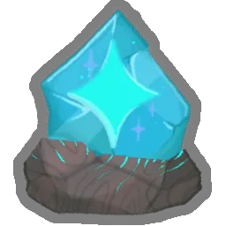 Destin divin (`DIVINE_DESTINY`)
* **Rareté :** `Starter` | **Pool :** `Event`
* **Effet :** At the start of each combat, gain {Stars:starIcons()}.

###  Droit divin (`DIVINE_RIGHT`)
* **Rareté :** `Starter` | **Pool :** `Regent`
* **Effet :** At the start of each combat, gain {Stars:starIcons()}.

###  Noyau infusé (`INFUSED_CORE`)
* **Rareté :** `Starter` | **Pool :** `Event`
* **Effet :** At the start of each combat, [gold]Channel[/gold] [blue]{Lightning}[/blue] [gold]Lightning[/gold]. [gold]Lightning[/gold] deals [blue]{ExtraDamage}[/blue] additional damage.

### 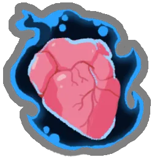 Phylactère déchaîné (`PHYLACTERY_UNBOUND`)
* **Rareté :** `Starter` | **Pool :** `Event`
* **Effet :** At the start of each combat, [gold]Summon[/gold] [blue]{StartOfCombat}[/blue]. At the start of your turn, [gold]Summon[/gold] [blue]{StartOfTurn}[/blue].

###  Anneau du dragon (`RING_OF_THE_DRAKE`)
* **Rareté :** `Starter` | **Pool :** `Event`
* **Effet :** At the start of your first {Turns:plural:turn|[blue]{}[/blue] turns}, draw [blue]{Cards}[/blue] additional {Cards:plural:card|cards}.

###  Anneau du serpent (`RING_OF_THE_SNAKE`)
* **Rareté :** `Starter` | **Pool :** `Silent`
* **Effet :** At the start of each combat, draw [blue]{Cards}[/blue] additional {Cards:plural:card|cards}.

## 🏆 Reliques : Common (30 reliques)

### 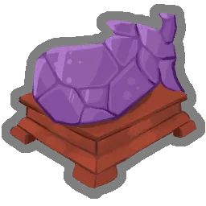 Aubergine d'améthyste (`AMETHYST_AUBERGINE`)
* **Rareté :** `Common` | **Pool :** `Shared`
* **Effet :** Enemies drop [blue]{Gold}[/blue] additional [gold]Gold[/gold].

###  Ancre (`ANCHOR`)
* **Rareté :** `Common` | **Pool :** `Shared`
* **Effet :** Start each combat with [blue]{Block}[/blue] [gold]Block[/gold].

### 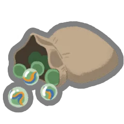 Sac de billes (`BAG_OF_MARBLES`)
* **Rareté :** `Common` | **Pool :** `Shared`
* **Effet :** At the start of each combat, apply [blue]{VulnerablePower}[/blue] [gold]Vulnerable[/gold] to ALL enemies.

### 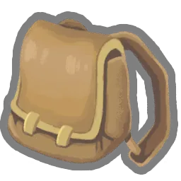 Sacoche de préparatifs (`BAG_OF_PREPARATION`)
* **Rareté :** `Common` | **Pool :** `Shared`
* **Effet :** At the start of each combat, draw [blue]{Cards}[/blue] additional {Cards:plural:card|cards}.

### 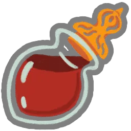 Fiole de sang (`BLOOD_VIAL`)
* **Rareté :** `Common` | **Pool :** `Shared`
* **Effet :** At the start of each combat, heal [green]{Heal}[/green] HP.

###  Flûte d'os (`BONE_FLUTE`)
* **Rareté :** `Common` | **Pool :** `Necrobinder`
* **Effet :** Whenever [gold]Osty[/gold] attacks, gain [blue]{Block}[/blue] [gold]Block[/gold].

###  Livre des cinq anneaux (`BOOK_OF_FIVE_RINGS`)
* **Rareté :** `Common` | **Pool :** `Shared`
* **Effet :** Every [blue]{Cards}[/blue] {Cards:plural:card|cards} you add to your [gold]Deck[/gold], heal [green]{Heal}[/green] HP.

###  Écailles de bronze (`BRONZE_SCALES`)
* **Rareté :** `Common` | **Pool :** `Shared`
* **Effet :** Start each combat with [blue]{ThornsPower}[/blue] [gold]Thorns[/gold].

###  Puzzle centenaire (`CENTENNIAL_PUZZLE`)
* **Rareté :** `Common` | **Pool :** `Shared`
* **Effet :** The first time you lose HP each combat, draw [blue]{Cards}[/blue] {Cards:plural:card|cards}.

### 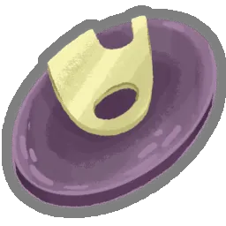 Disque dur (`DATA_DISK`)
* **Rareté :** `Common` | **Pool :** `Defect`
* **Effet :** Start each combat with [blue]{FocusPower}[/blue] [gold]Focus[/gold].

###  Manuel d'escrime (`FENCING_MANUAL`)
* **Rareté :** `Common` | **Pool :** `Regent`
* **Effet :** At the start of each combat, [gold]Forge[/gold] [blue]{Forge}[/blue].

###  Pétard de fête (`FESTIVE_POPPER`)
* **Rareté :** `Common` | **Pool :** `Shared`
* **Effet :** At the start of each combat, deal [blue]{Damage}[/blue] damage to ALL enemies.

### 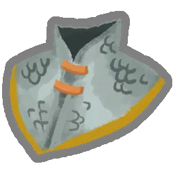 Gorgerette (`GORGET`)
* **Rareté :** `Common` | **Pool :** `Shared`
* **Effet :** At the start of each combat, gain [blue]{PlatingPower}[/blue] [gold]Plating[/gold].

###  Fleur joyeuse (`HAPPY_FLOWER`)
* **Rareté :** `Common` | **Pool :** `Shared`
* **Effet :** Every [blue]{Turns}[/blue] {Turns:plural:turn|turns}, gain {Energy:energyIcons()}.

### 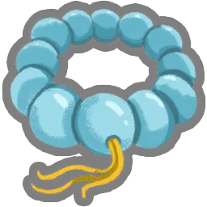 Bracelet Juzu (`JUZU_BRACELET`)
* **Rareté :** `Common` | **Pool :** `Shared`
* **Effet :** Regular enemy combats are no longer encountered in [gold]?[/gold] rooms.

###  Lanterne (`LANTERN`)
* **Rareté :** `Common` | **Pool :** `Shared`
* **Effet :** Start each combat with an additional {Energy:energyIcons()}.

###  Ticket restaurant (`MEAL_TICKET`)
* **Rareté :** `Common` | **Pool :** `Shared`
* **Effet :** Whenever you enter a shop room, heal [green]{Heal}[/green] HP.

### 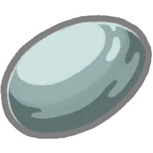 Pierre étrangement lisse (`ODDLY_SMOOTH_STONE`)
* **Rareté :** `Common` | **Pool :** `Shared`
* **Effet :** Start each combat with [blue]{DexterityPower}[/blue] [gold]Dexterity[/gold].

### 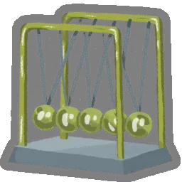 Pendule (`PENDULUM`)
* **Rareté :** `Common` | **Pool :** `Shared`
* **Effet :** Every [blue]{Turns}[/blue] {Turns:plural:turn|turns}, draw [blue]{Cards}[/blue] {Cards:plural:card|cards}.

### 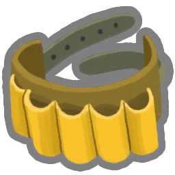 Ceinture à potions (`POTION_BELT`)
* **Rareté :** `Common` | **Pool :** `Shared`
* **Effet :** Upon pickup, gain [blue]{PotionSlots}[/blue] potion {PotionSlots:plural:slot|slots}.

###  Masque rouge (`RED_MASK`)
* **Rareté :** `Common` | **Pool :** `Shared`
* **Effet :** At the start of each combat, apply [blue]{WeakPower}[/blue] [gold]Weak[/gold] to ALL enemies.

###  Crâne rouge (`RED_SKULL`)
* **Rareté :** `Common` | **Pool :** `Ironclad`
* **Effet :** While your HP is at or below [blue]{HpThreshold}%[/blue], you have [blue]{StrengthPower}[/blue] additional [gold]Strength[/gold].

### 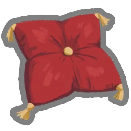 Oreiller royal (`REGAL_PILLOW`)
* **Rareté :** `Common` | **Pool :** `Shared`
* **Effet :** Whenever you [gold]Rest[/gold], heal an additional [blue]{Heal}[/blue] HP.

###  Crâne de geckobra (`SNECKO_SKULL`)
* **Rareté :** `Common` | **Pool :** `Silent`
* **Effet :** Whenever you apply [gold]Poison[/gold], apply an additional [blue]{PoisonPower}[/blue] [gold]Poison[/gold].

###  Fraise (`STRAWBERRY`)
* **Rareté :** `Common` | **Pool :** `Shared`
* **Effet :** Upon pickup, raise your Max HP by [blue]{MaxHp}[/blue].

### 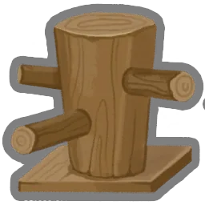 Mannequin d'entraînement (`STRIKE_DUMMY`)
* **Rareté :** `Common` | **Pool :** `Shared`
* **Effet :** Cards containing “Strike” deal [blue]{ExtraDamage}[/blue] additional damage.

###  Vajra (`VAJRA`)
* **Rareté :** `Common` | **Pool :** `Shared`
* **Effet :** Start each combat with [blue]{StrengthPower}[/blue] [gold]Strength[/gold].

###  Service à thé vénérable (`VENERABLE_TEA_SET`)
* **Rareté :** `Common` | **Pool :** `Shared`
* **Effet :** Whenever you enter a [gold]Rest Site[/gold], start the next combat with an additional {Energy:energyIcons()}.

### 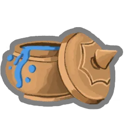 Peinture de guerre (`WAR_PAINT`)
* **Rareté :** `Common` | **Pool :** `Shared`
* **Effet :** Upon pickup, [gold]Upgrade[/gold] [blue]{Cards}[/blue] random {Cards:plural:Skill|Skills}.

###  Pierre à aiguiser (`WHETSTONE`)
* **Rareté :** `Common` | **Pool :** `Shared`
* **Effet :** Upon pickup, [gold]Upgrade[/gold] [blue]{Cards}[/blue] random {Cards:plural:Attack|Attacks}.

## 🏆 Reliques : Uncommon (40 reliques)

###  Akabeko (`AKABEKO`)
* **Rareté :** `Uncommon` | **Pool :** `Shared`
* **Effet :** At the start of each combat, gain [blue]{VigorPower}[/blue] [gold]Vigor[/gold].

### 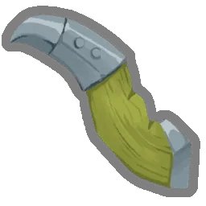 Couteau à reliure (`BOOK_REPAIR_KNIFE`)
* **Rareté :** `Uncommon` | **Pool :** `Necrobinder`
* **Effet :** Whenever a non-Minion enemy dies to [gold]Doom[/gold], heal [green]{Heal}[/green] HP.

###  Chapeau melon (`BOWLER_HAT`)
* **Rareté :** `Uncommon` | **Pool :** `Shared`
* **Effet :** Gain [blue]{GoldIncrease:percentMore()}%[/blue] additional [gold]Gold[/gold].

### 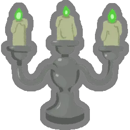 Candélabre (`CANDELABRA`)
* **Rareté :** `Uncommon` | **Pool :** `Shared`
* **Effet :** At the start of your [blue]2nd[/blue] turn, gain {Energy:energyIcons()}.

###  Plume éternelle (`ETERNAL_FEATHER`)
* **Rareté :** `Uncommon` | **Pool :** `Shared`
* **Effet :** For every {Cards:plural:card|[blue]{}[/blue] cards} in your [gold]Deck[/gold], heal [green]{Heal}[/green] HP whenever you enter a [gold]Rest Site[/gold].

###  Masque funéraire (`FUNERARY_MASK`)
* **Rareté :** `Uncommon` | **Pool :** `Necrobinder`
* **Effet :** At the start of each combat, add [blue]{Cards}[/blue] [gold]{Cards:plural:Soul|Souls}[/gold] into your [gold]Draw Pile[/gold].

###  Poussière galactique (`GALACTIC_DUST`)
* **Rareté :** `Uncommon` | **Pool :** `Regent`
* **Effet :** For every [blue]{Stars}[/blue] {singleStarIcon} spent, gain [blue]{Block}[/blue] [gold]Block[/gold].

### 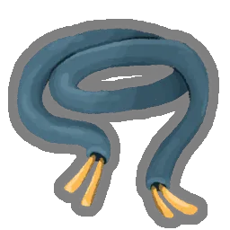 Câble plaqué or (`GOLD_PLATED_CABLES`)
* **Rareté :** `Uncommon` | **Pool :** `Defect`
* **Effet :** Your rightmost Orb triggers its passive an additional time.

###  Corne de diablotin (`GREMLIN_HORN`)
* **Rareté :** `Uncommon` | **Pool :** `Shared`
* **Effet :** Whenever an enemy dies, gain {Energy:energyIcons()} and draw [blue]{Cards}[/blue] {Cards:plural:card|cards}.

### 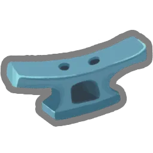 Taquet d'amarrage (`HORN_CLEAT`)
* **Rareté :** `Uncommon` | **Pool :** `Shared`
* **Effet :** At the start of your [blue]2nd[/blue] turn, gain [blue]{Block}[/blue] [gold]Block[/gold].

### 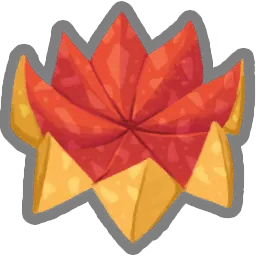 Billet funéraire (`JOSS_PAPER`)
* **Rareté :** `Uncommon` | **Pool :** `Shared`
* **Effet :** Every [blue]{ExhaustAmount}[/blue] times you [gold]Exhaust[/gold] a card, draw [blue]{Cards}[/blue] {Cards:plural:card|cards}.

### 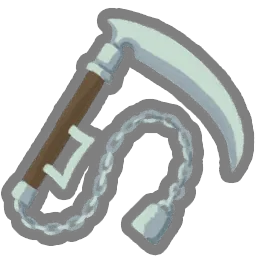 Kusarigama (`KUSARIGAMA`)
* **Rareté :** `Uncommon` | **Pool :** `Shared`
* **Effet :** Every time you play [blue]{Cards}[/blue] {Cards:plural:Attack|Attacks} in a single turn, deal [blue]{Damage}[/blue] damage to a random enemy.

###  Bonbon durable (`LASTING_CANDY`)
* **Rareté :** `Uncommon` | **Pool :** `Shared`
* **Effet :** Every other combat, your card rewards gain an additional Power.

### 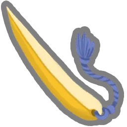 Coupe-papier (`LETTER_OPENER`)
* **Rareté :** `Uncommon` | **Pool :** `Shared`
* **Effet :** Every time you play [blue]{Cards}[/blue] {Cards:plural:Skill|Skills} in a single turn, deal [blue]{Damage}[/blue] damage to ALL enemies.

###  Poisson chanceux (`LUCKY_FYSH`)
* **Rareté :** `Uncommon` | **Pool :** `Shared`
* **Effet :** Whenever you add a card to your [gold]Deck[/gold], gain [blue]{Gold}[/blue] [gold]Gold[/gold].

### 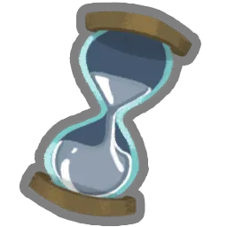 Sablier de mercure (`MERCURY_HOURGLASS`)
* **Rareté :** `Uncommon` | **Pool :** `Shared`
* **Effet :** At the start of your turn, deal [blue]{Damage}[/blue] damage to ALL enemies.

###  Canon miniature (`MINIATURE_CANNON`)
* **Rareté :** `Uncommon` | **Pool :** `Shared`
* **Effet :** [gold]Upgraded[/gold] Attacks deal [blue]{ExtraDamage}[/blue] additional damage.

###  Nunchaku (`NUNCHAKU`)
* **Rareté :** `Uncommon` | **Pool :** `Shared`
* **Effet :** Every time you play [blue]{Cards}[/blue] Attacks, gain {Energy:energyIcons()}.

### 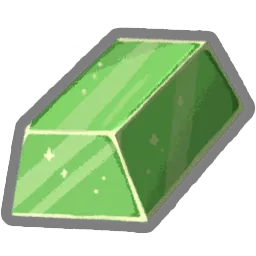 Orichalque (`ORICHALCUM`)
* **Rareté :** `Uncommon` | **Pool :** `Shared`
* **Effet :** If you end your turn without [gold]Block[/gold], gain [blue]{Block}[/blue] [gold]Block[/gold].

###  Éventail décoratif (`ORNAMENTAL_FAN`)
* **Rareté :** `Uncommon` | **Pool :** `Shared`
* **Effet :** Every time you play [blue]{Cards}[/blue] Attacks in a single turn, gain [blue]{Block}[/blue] [gold]Block[/gold].

###  Pantographe (`PANTOGRAPH`)
* **Rareté :** `Uncommon` | **Pool :** `Shared`
* **Effet :** At the start of each [gold]Boss[/gold] combat, heal [green]{Heal}[/green] HP.

###  Krapo en papier (`PAPER_PHROG`)
* **Rareté :** `Uncommon` | **Pool :** `Ironclad`
* **Effet :** Enemies with [gold]Vulnerable[/gold] take [blue]75%[/blue] more damage rather than [blue]50%[/blue].

###  Bouclier de parade (`PARRYING_SHIELD`)
* **Rareté :** `Uncommon` | **Pool :** `Shared`
* **Effet :** If you end a turn with at least [blue]{Block}[/blue] [gold]Block[/gold], deal [blue]{Damage}[/blue] damage to a random enemy.

###  Poire (`PEAR`)
* **Rareté :** `Uncommon` | **Pool :** `Shared`
* **Effet :** Upon pickup, raise your Max HP by [blue]{MaxHp}[/blue].

###  Pointe de stylo (`PEN_NIB`)
* **Rareté :** `Uncommon` | **Pool :** `Shared`
* **Effet :** Every [blue]10th[/blue] Attack you play deals double damage.

### 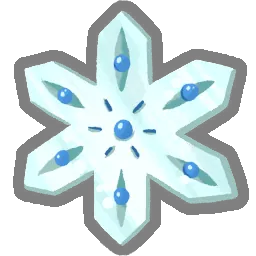 Pergélisol (`PERMAFROST`)
* **Rareté :** `Uncommon` | **Pool :** `Shared`
* **Effet :** The first time you play a Power each combat, gain [blue]{Block}[/blue] [gold]Block[/gold].

### 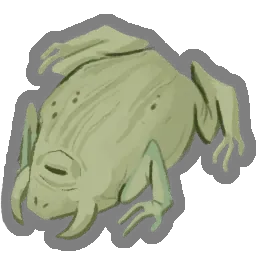 Crapaud pétrifié (`PETRIFIED_TOAD`)
* **Rareté :** `Uncommon` | **Pool :** `Shared`
* **Effet :** At the start of each combat, procure a [gold]Potion-Shaped Rock[/gold].

###  Planisphère (`PLANISPHERE`)
* **Rareté :** `Uncommon` | **Pool :** `Shared`
* **Effet :** Whenever you enter a [gold]?[/gold] room, heal [green]{Heal}[/green] HP.

### 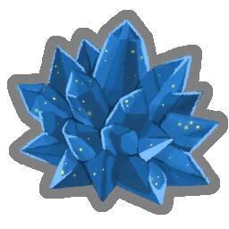 Royalithe (`REGALITE`)
* **Rareté :** `Uncommon` | **Pool :** `Regent`
* **Effet :** The first time you create a card each turn, gain [blue]{Block}[/blue] [gold]Block[/gold].

###  Breloque reptile (`REPTILE_TRINKET`)
* **Rareté :** `Uncommon` | **Pool :** `Shared`
* **Effet :** Whenever you use a potion, gain [blue]{StrengthPower}[/blue] [gold]Strength[/gold] this turn.

### 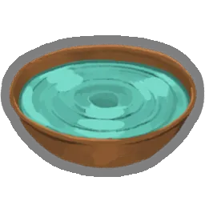 Bassinet à remous (`RIPPLE_BASIN`)
* **Rareté :** `Uncommon` | **Pool :** `Shared`
* **Effet :** If you did not play any Attacks during your turn, gain [blue]{Block}[/blue] [gold]Block[/gold].

### 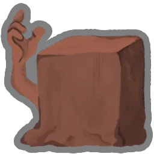 Argile autoformante (`SELF_FORMING_CLAY`)
* **Rareté :** `Uncommon` | **Pool :** `Ironclad`
* **Effet :** Whenever you lose HP in combat, gain [blue]{BlockNextTurn}[/blue] [gold]Block[/gold] next turn.

###  Fard pétillant (`SPARKLING_ROUGE`)
* **Rareté :** `Uncommon` | **Pool :** `Shared`
* **Effet :** At the start of your [blue]3rd[/blue] turn, gain [blue]{StrengthPower}[/blue] [gold]Strength[/gold] and [blue]{DexterityPower}[/blue] [gold]Dexterity[/gold].

### 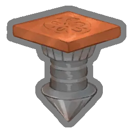 Marteau-piqueur (`STONE_CRACKER`)
* **Rareté :** `Uncommon` | **Pool :** `Shared`
* **Effet :** At the start of each combat, [gold]Upgrade[/gold] [blue]{Cards}[/blue] random {Cards:plural:card|cards} in your [gold]Draw Pile[/gold] for the rest of combat.

###  Virus symbiotique (`SYMBIOTIC_VIRUS`)
* **Rareté :** `Uncommon` | **Pool :** `Defect`
* **Effet :** At the start of each combat, [gold]Channel[/gold] [blue]{Dark}[/blue] [gold]Dark[/gold].

###  Tingsha (`TINGSHA`)
* **Rareté :** `Uncommon` | **Pool :** `Silent`
* **Effet :** Whenever you discard a card during your turn, deal [blue]{Damage}[/blue] damage to a random enemy for each card discarded.

###  Minuscule boîte aux lettres (`TINY_MAILBOX`)
* **Rareté :** `Uncommon` | **Pool :** `Shared`
* **Effet :** Whenever you [gold]Rest[/gold], procure [blue]2[/blue] random [gold]Potions[/gold].

### 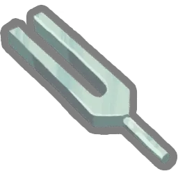 Diapason (`TUNING_FORK`)
* **Rareté :** `Uncommon` | **Pool :** `Shared`
* **Effet :** Every time you play [blue]{Cards}[/blue] Skills, gain [blue]{Block}[/blue] [gold]Block[/gold].

### 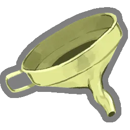 Entonnoir torsadé (`TWISTED_FUNNEL`)
* **Rareté :** `Uncommon` | **Pool :** `Silent`
* **Effet :** At the start of each combat, apply [blue]{PoisonPower}[/blue] [gold]Poison[/gold] to ALL enemies.

### 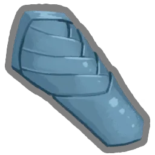 Brassard (`VAMBRACE`)
* **Rareté :** `Uncommon` | **Pool :** `Shared`
* **Effet :** The first time you gain [gold]Block[/gold] from a card each combat, double the amount gained.

## 🏆 Reliques : Rare (50 reliques)

### 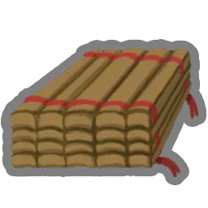 L'Art de la guerre (`ART_OF_WAR`)
* **Rareté :** `Rare` | **Pool :** `Shared`
* **Effet :** If you do not play any Attacks during your turn, gain an additional {Energy:energyIcons()} next turn.

### 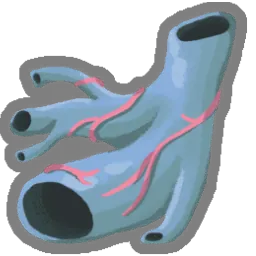 Vestige battant (`BEATING_REMNANT`)
* **Rareté :** `Rare` | **Pool :** `Shared`
* **Effet :** You cannot lose more than [blue]20[/blue] HP in a single turn.

### 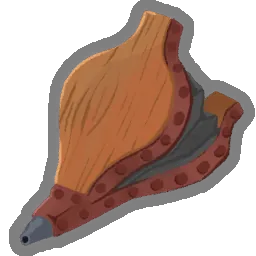 Soufflet (`BELLOWS`)
* **Rareté :** `Rare` | **Pool :** `Shared`
* **Effet :** The first [gold]Hand[/gold] you draw each combat is [gold]Upgraded[/gold].

### 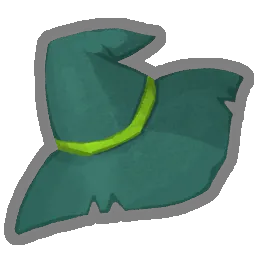 Grand chapeau (`BIG_HAT`)
* **Rareté :** `Rare` | **Pool :** `Necrobinder`
* **Effet :** At the start of each combat, add [blue]{Cards}[/blue] random [gold]Ethereal[/gold] {Cards:plural:card|cards} into your [gold]Hand[/gold].

###  Marque-page (`BOOKMARK`)
* **Rareté :** `Rare` | **Pool :** `Necrobinder`
* **Effet :** At the end of each turn, lower the cost of a random [gold]Retained[/gold] card by [blue]1[/blue] until played.

### 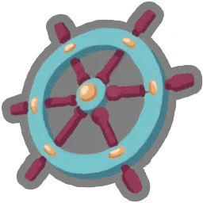 Barre de capitaine (`CAPTAINS_WHEEL`)
* **Rareté :** `Rare` | **Pool :** `Shared`
* **Effet :** At the start of your [blue]3rd[/blue] turn, gain [blue]{Block}[/blue] [gold]Block[/gold].

### 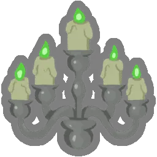 Chandelier (`CHANDELIER`)
* **Rareté :** `Rare` | **Pool :** `Shared`
* **Effet :** At the start of your [blue]3rd[/blue] turn, gain {Energy:energyIcons()}.

###  Cendres de Charon (`CHARONS_ASHES`)
* **Rareté :** `Rare` | **Pool :** `Ironclad`
* **Effet :** Whenever you [gold]Exhaust[/gold] a card, deal [blue]{Damage}[/blue] damage to ALL enemies.

### 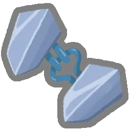 Boucle de cape (`CLOAK_CLASP`)
* **Rareté :** `Rare` | **Pool :** `Shared`
* **Effet :** At the end of your turn, gain [blue]{Block}[/blue] [gold]Block[/gold] for each card in your [gold]Hand[/gold].

###  Langue du Démon (`DEMON_TONGUE`)
* **Rareté :** `Rare` | **Pool :** `Ironclad`
* **Effet :** The first time you lose HP on your turn, heal HP equal to the amount lost.

### 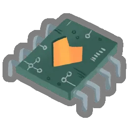 Puce émotionnelle (`EMOTION_CHIP`)
* **Rareté :** `Rare` | **Pool :** `Defect`
* **Effet :** If you lost HP during the previous turn, trigger the passive ability of all Orbs at the start of your turn.

### 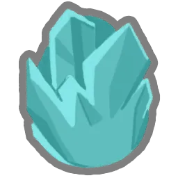 Œuf gelé (`FROZEN_EGG`)
* **Rareté :** `Rare` | **Pool :** `Shared`
* **Effet :** Whenever you add a Power into your [gold]Deck[/gold], [gold]Upgrade[/gold] it.

### 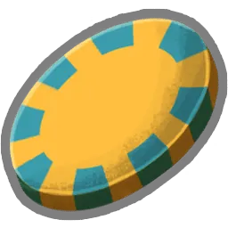 Jeton de casino (`GAMBLING_CHIP`)
* **Rareté :** `Rare` | **Pool :** `Shared`
* **Effet :** At the start of each combat, discard any number of cards then draw that many.

###  Pion (`GAME_PIECE`)
* **Rareté :** `Rare` | **Pool :** `Shared`
* **Effet :** Whenever you play a Power, draw [blue]{Cards}[/blue] {Cards:plural:card|cards}.

###  Girya (`GIRYA`)
* **Rareté :** `Rare` | **Pool :** `Shared`
* **Effet :** You can now gain [gold]Strength[/gold] at [gold]Rest Sites[/gold]. ([blue]3[/blue] times max)

### 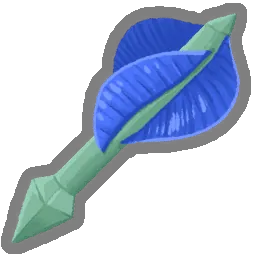 Fléchette hélicoïdale (`HELICAL_DART`)
* **Rareté :** `Rare` | **Pool :** `Silent`
* **Effet :** Whenever you play a [gold]Shiv[/gold], gain [blue]{DexterityPower}[/blue] [gold]Dexterity[/gold] this turn.

###  Crème glacée (`ICE_CREAM`)
* **Rareté :** `Rare` | **Pool :** `Shared`
* **Effet :** Energy is now conserved between turns.

###  Casque intimidant (`INTIMIDATING_HELMET`)
* **Rareté :** `Rare` | **Pool :** `Shared`
* **Effet :** Whenever you play a card that costs {Energy:energyIcons()} or more, gain [blue]{Block}[/blue] [gold]Block[/gold].

### 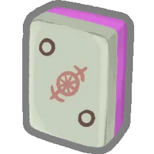 Tuile en ivoire (`IVORY_TILE`)
* **Rareté :** `Rare` | **Pool :** `Necrobinder`
* **Effet :** Whenever you play a card that costs {EnergyThreshold:energyIcons()} or more, gain {Energy:energyIcons()}.

### 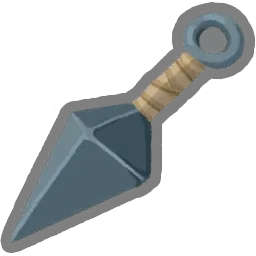 Kunai (`KUNAI`)
* **Rareté :** `Rare` | **Pool :** `Shared`
* **Effet :** Every time you play [blue]{Cards}[/blue] Attacks in a single turn, gain [blue]{DexterityPower}[/blue] [gold]Dexterity[/gold].

###  Queue de lézard (`LIZARD_TAIL`)
* **Rareté :** `Rare` | **Pool :** `Shared`
* **Effet :** When your HP would be reduced to [blue]0[/blue], heal to [green]{Heal}%[/green] of your Max HP instead (works once).

###  Pâtisserie lunaire (`LUNAR_PASTRY`)
* **Rareté :** `Rare` | **Pool :** `Regent`
* **Effet :** At the end of your turn, gain {Stars:starIcons()}.

###  Mangue (`MANGO`)
* **Rareté :** `Rare` | **Pool :** `Shared`
* **Effet :** Upon pickup, raise your Max HP by [blue]{MaxHp}[/blue].

### 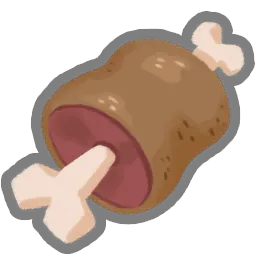 Os à viande (`MEAT_ON_THE_BONE`)
* **Rareté :** `Rare` | **Pool :** `Shared`
* **Effet :** If your HP is at or below [blue]{HpThreshold}%[/blue] at the end of combat, heal [green]{Heal}[/green] HP.

###  Métronome (`METRONOME`)
* **Rareté :** `Rare` | **Pool :** `Defect`
* **Effet :** The first time you [gold]Channel[/gold] [blue]{OrbCount}[/blue] [gold]Orbs[/gold] each combat, deal [blue]{Damage}[/blue] damage to ALL enemies.

###  Mini Régent (`MINI_REGENT`)
* **Rareté :** `Rare` | **Pool :** `Regent`
* **Effet :** The first time you spend {singleStarIcon} each turn, gain [blue]{StrengthPower}[/blue] [gold]Strength[/gold].

###  Œuf en fusion (`MOLTEN_EGG`)
* **Rareté :** `Rare` | **Pool :** `Shared`
* **Effet :** Whenever you add an Attack card to your [gold]Deck[/gold], [gold]Upgrade[/gold] it.

###  Main momifiée (`MUMMIFIED_HAND`)
* **Rareté :** `Rare` | **Pool :** `Shared`
* **Effet :** Whenever you play a Power, a random card in your [gold]Hand[/gold] is free to play that turn.

###  Pièce antique (`OLD_COIN`)
* **Rareté :** `Rare` | **Pool :** `Shared`
* **Effet :** Upon pickup, gain [blue]{Gold}[/blue] [gold]Gold[/gold].

### 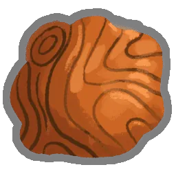 Pâte orange (`ORANGE_DOUGH`)
* **Rareté :** `Rare` | **Pool :** `Regent`
* **Effet :** At the start of each combat, add [blue]{Cards}[/blue] random Colorless {Cards:plural:card|cards} into your [gold]Hand[/gold].

### 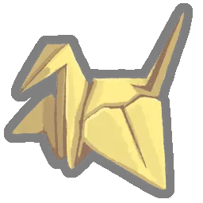 Grû en papier (`PAPER_KRANE`)
* **Rareté :** `Rare` | **Pool :** `Silent`
* **Effet :** Enemies with [gold]Weak[/gold] deal [blue]40%[/blue] less damage to you rather than [blue]25%[/blue].

###  Montre à gousset (`POCKETWATCH`)
* **Rareté :** `Rare` | **Pool :** `Shared`
* **Effet :** Whenever you play [blue]{CardThreshold}[/blue] or fewer {CardThreshold:plural:card|cards} during your turn, draw [blue]{Cards}[/blue] additional {Cards:plural:card|cards} at the start of your next turn.

### 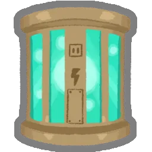 Pile d'énergie (`POWER_CELL`)
* **Rareté :** `Rare` | **Pool :** `Defect`
* **Effet :** At the start of each combat, add [blue]{Cards}[/blue] zero-cost cards from your [gold]Draw Pile[/gold] into your [gold]Hand[/gold].

###  Moulin à prières (`PRAYER_WHEEL`)
* **Rareté :** `Rare` | **Pool :** `Shared`
* **Effet :** Normal enemies drop an additional card reward.

###  Anneau arc-en-ciel (`RAINBOW_RING`)
* **Rareté :** `Rare` | **Pool :** `Shared`
* **Effet :** The first time you play an Attack, Skill, and Power each turn, gain [blue]{StrengthPower}[/blue] [gold]Strength[/gold] and [blue]{DexterityPower}[/blue] [gold]Dexterity[/gold].

###  Dent de rasoir (`RAZOR_TOOTH`)
* **Rareté :** `Rare` | **Pool :** `Shared`
* **Effet :** Every time you play an Attack or Skill, [gold]Upgrade[/gold] it for the remainder of combat.

###  Casque délabré (`RUINED_HELMET`)
* **Rareté :** `Rare` | **Pool :** `Ironclad`
* **Effet :** The first time you gain [gold]Strength[/gold] each combat, double the amount gained.

###  Pelle (`SHOVEL`)
* **Rareté :** `Rare` | **Pool :** `Shared`
* **Effet :** You can now dig at [gold]Rest Sites[/gold] to obtain a random [gold]Relic[/gold].

###  Shuriken (`SHURIKEN`)
* **Rareté :** `Rare` | **Pool :** `Shared`
* **Effet :** Every time you play [blue]{Cards}[/blue] Attacks in a single turn, gain [blue]{StrengthPower}[/blue] [gold]Strength[/gold].

###  Calendrier de pierre (`STONE_CALENDAR`)
* **Rareté :** `Rare` | **Pool :** `Shared`
* **Effet :** At the end of turn [blue]{DamageTurn}[/blue], deal [blue]{Damage}[/blue] damage to ALL enemies.

###  Pince robuste (`STURDY_CLAMP`)
* **Rareté :** `Rare` | **Pool :** `Shared`
* **Effet :** Up to [blue]{Block}[/blue] [gold]Block[/gold] persists across turns.

###  Le Coursier (`THE_COURIER`)
* **Rareté :** `Rare` | **Pool :** `Shared`
* **Effet :** The merchant no longer runs out of cards, relics, or potions and his prices are reduced by [blue]{Discount}%[/blue].

###  Bandages résistants (`TOUGH_BANDAGES`)
* **Rareté :** `Rare` | **Pool :** `Silent`
* **Effet :** Whenever you discard a card during your turn, gain [blue]{Block}[/blue] [gold]Block[/gold].

###  Œuf toxique (`TOXIC_EGG`)
* **Rareté :** `Rare` | **Pool :** `Shared`
* **Effet :** Whenever you add a Skill into your [gold]Deck[/gold], [gold]Upgrade[/gold] it.

###  Tige de tungstène (`TUNGSTEN_ROD`)
* **Rareté :** `Rare` | **Pool :** `Shared`
* **Effet :** Whenever you would lose HP, lose [blue]{HpLossReduction}[/blue] less.

###  Toupie perpétuelle (`UNCEASING_TOP`)
* **Rareté :** `Rare` | **Pool :** `Shared`
* **Effet :** Whenever you have no cards in [gold]Hand[/gold] during your turn, draw a card.

###  Lampe inquiétante (`UNSETTLING_LAMP`)
* **Rareté :** `Rare` | **Pool :** `Shared`
* **Effet :** Each combat, the first time you play a card that [gold]Debuffs[/gold] an enemy, double its effect.

###  Casse-tête vexant (`VEXING_PUZZLEBOX`)
* **Rareté :** `Rare` | **Pool :** `Shared`
* **Effet :** At the start of each combat, add a random card into your [gold]Hand[/gold]. It's free to play this turn.

###  Statue de bête blanche (`WHITE_BEAST_STATUE`)
* **Rareté :** `Rare` | **Pool :** `Shared`
* **Effet :** [gold]Potions[/gold] always appear in combat rewards.

###  Étoile blanche (`WHITE_STAR`)
* **Rareté :** `Rare` | **Pool :** `Shared`
* **Effet :** [gold]Elites[/gold] drop an additional [gold]Rare[/gold] card reward.

## 🏆 Reliques : Shop (30 reliques)

###  Boucle de ceinture (`BELT_BUCKLE`)
* **Rareté :** `Shop` | **Pool :** `Shared`
* **Effet :** While you have no [gold]Potions[/gold], you have [blue]{DexterityPower}[/blue] additional [gold]Dexterity[/gold].

###  Pain (`BREAD`)
* **Rareté :** `Shop` | **Pool :** `Shared`
* **Effet :** At the start of your first turn, lose {LoseEnergy:energyIcons()}. At the start of all other turns, gain {GainEnergy:energyIcons()}.

###  Soufre (`BRIMSTONE`)
* **Rareté :** `Shop` | **Pool :** `Ironclad`
* **Effet :** At the start of your turn, gain [blue]{SelfStrength}[/blue] [gold]Strength[/gold] and ALL enemies gain [blue]{EnemyStrength}[/blue] [gold]Strength[/gold].

###  Bâtonnets enflammés (`BURNING_STICKS`)
* **Rareté :** `Shop` | **Pool :** `Shared`
* **Effet :** The first time each combat you [gold]Exhaust[/gold] a Skill, add a copy of it into your [gold]Hand[/gold].

###  Chaudron (`CAULDRON`)
* **Rareté :** `Shop` | **Pool :** `Shared`
* **Effet :** Upon pickup, brews [blue]{Potions}[/blue] random [gold]{Potions:plural:Potion|Potions}[/gold].

###  Composé X (`CHEMICAL_X`)
* **Rareté :** `Shop` | **Pool :** `Shared`
* **Effet :** The effects of your cost [blue]X[/blue] cards are increased by [blue]{Increase}[/blue].

###  Tapis miteux (`DINGY_RUG`)
* **Rareté :** `Shop` | **Pool :** `Shared`
* **Effet :** Card rewards can now contain Colorless cards.

###  Miroir de Dolly (`DOLLYS_MIRROR`)
* **Rareté :** `Shop` | **Pool :** `Shared`
* **Effet :** Upon pickup, obtain an additional copy of a card in your [gold]Deck[/gold].

###  Fruit du dragon (`DRAGON_FRUIT`)
* **Rareté :** `Shop` | **Pool :** `Shared`
* **Effet :** Whenever you gain [gold]Gold[/gold], raise your Max HP by [blue]{MaxHp}[/blue].

###  Graine fantôme (`GHOST_SEED`)
* **Rareté :** `Shop` | **Pool :** `Shared`
* **Effet :** [gold]Strikes[/gold] and [gold]Defends[/gold] gain [gold]Ethereal[/gold].

###  Marteau tordu (`GNARLED_HAMMER`)
* **Rareté :** `Shop` | **Pool :** `Shared`
* **Effet :** Upon pickup, [gold]Enchant[/gold] up to [blue]{Cards}[/blue] {Cards:plural:Attack|Attacks} with [purple]Sharp[/purple] [blue]{SharpAmount:diff()}[/blue].

###  Kifuda (`KIFUDA`)
* **Rareté :** `Shop` | **Pool :** `Shared`
* **Effet :** Upon pickup, [gold]Enchant[/gold] up to [blue]{Cards}[/blue] {Cards:plural:card|cards} with [purple]Adroit[/purple].

###  Lampe à lave (`LAVA_LAMP`)
* **Rareté :** `Shop` | **Pool :** `Shared`
* **Effet :** At the end of combat, [gold]Upgrade[/gold] all card rewards if you took no damage.

###  Gaufre de Lee (`LEES_WAFFLE`)
* **Rareté :** `Shop` | **Pool :** `Shared`
* **Effet :** Upon pickup, raise your Max HP by [blue]{MaxHp}[/blue] and heal all of your HP.

###  Carte de fidélité (`MEMBERSHIP_CARD`)
* **Rareté :** `Shop` | **Pool :** `Shared`
* **Effet :** [blue]{Discount}%[/blue] discount on all products!

###  Tente miniature (`MINIATURE_TENT`)
* **Rareté :** `Shop` | **Pool :** `Shared`
* **Effet :** You may choose any number of options at [gold]Rest Sites[/gold].

###  Briquet mystique (`MYSTIC_LIGHTER`)
* **Rareté :** `Shop` | **Pool :** `Shared`
* **Effet :** [gold]Enchanted[/gold] Attacks deal [blue]{Damage}[/blue] additional damage.

###  Parchemin de ninja (`NINJA_SCROLL`)
* **Rareté :** `Shop` | **Pool :** `Silent`
* **Effet :** At the start of each combat, add [blue]{Shivs}[/blue] [gold]{Shivs:plural:Shiv|Shivs}[/gold] into your [gold]Hand[/gold].

###  Planétaire (`ORRERY`)
* **Rareté :** `Shop` | **Pool :** `Shared`
* **Effet :** Upon pickup, gain [blue]{Cards}[/blue] card {Cards:plural:reward|rewards}.

###  Poignard (`PUNCH_DAGGER`)
* **Rareté :** `Shop` | **Pool :** `Shared`
* **Effet :** Upon pickup, [gold]Enchant[/gold] an Attack with [purple]Momentum[/purple] [blue]{Momentum}[/blue].

###  Triangle résonnant (`RINGING_TRIANGLE`)
* **Rareté :** `Shop` | **Pool :** `Shared`
* **Effet :** [gold]Retain[/gold] your [gold]Hand[/gold] on the first turn of combat.

###  Sceau royal (`ROYAL_STAMP`)
* **Rareté :** `Shop` | **Pool :** `Shared`
* **Effet :** Upon pickup, choose an Attack or Skill in your [gold]Deck[/gold] to [gold]Enchant[/gold] with [purple]{Enchantment}[/purple].

###  Condensateur runique (`RUNIC_CAPACITOR`)
* **Rareté :** `Shop` | **Pool :** `Defect`
* **Effet :** Start each combat with [blue]{Repeat}[/blue] additional [gold]Orb Slots[/gold].

###  Pichet hurlant (`SCREAMING_FLAGON`)
* **Rareté :** `Shop` | **Pool :** `Shared`
* **Effet :** If you end your turn with no cards in your [gold]Hand[/gold], deal [blue]{Damage}[/blue] damage to ALL enemies.

###  Fronde du courage (`SLING_OF_COURAGE`)
* **Rareté :** `Shop` | **Pool :** `Shared`
* **Effet :** Start each [gold]Elite[/gold] combat with [blue]{StrengthPower}[/blue] [gold]Strength[/gold].

###  L'Abaque (`THE_ABACUS`)
* **Rareté :** `Shop` | **Pool :** `Shared`
* **Effet :** Whenever you shuffle your [gold]Draw Pile[/gold], gain [blue]{Block}[/blue] [gold]Block[/gold].

###  Boîte à outils (`TOOLBOX`)
* **Rareté :** `Shop` | **Pool :** `Shared`
* **Effet :** At the start of each combat, choose [blue]1[/blue] of [blue]{Cards}[/blue] random Colorless cards and add the chosen card into your [gold]Hand[/gold].

###  Sceau immortel (`UNDYING_SIGIL`)
* **Rareté :** `Shop` | **Pool :** `Necrobinder`
* **Effet :** Enemies with at least as much [gold]Doom[/gold] as HP deal [blue]50%[/blue] less damage.

###  Sbire de Vitruve (`VITRUVIAN_MINION`)
* **Rareté :** `Shop` | **Pool :** `Regent`
* **Effet :** Cards containing “Minion” deal double damage and gain double [gold]Block[/gold].

###  Aile fétiche (`WING_CHARM`)
* **Rareté :** `Shop` | **Pool :** `Shared`
* **Effet :** A random card in each card reward is [gold]Enchanted[/gold] with [purple]Swift[/purple] [blue]{SwiftAmount}[/blue].

## 🏆 Reliques : Event (35 reliques)

###  Gros champi (`BIG_MUSHROOM`)
* **Rareté :** `Event` | **Pool :** `Event`
* **Effet :** Upon pickup, raise your Max HP by [blue]{MaxHp}[/blue]. At the start of each combat, draw [blue]{Cards}[/blue] fewer {Cards:plural:card|cards}.

###  Bing bong (`BING_BONG`)
* **Rareté :** `Event` | **Pool :** `Event`
* **Effet :** Whenever you add a card to your [gold]Deck[/gold], add one additional copy.

###  Thé d'os (`BONE_TEA`)
* **Rareté :** `Event` | **Pool :** `Event`
* **Effet :** At the start of the next {Combats:plural:combat|[blue]{}[/blue] combats}, [gold]Upgrade[/gold] your starting hand.

###  Oizillon (`BYRDPIP`)
* **Rareté :** `Event` | **Pool :** `Event`
* **Effet :** Upon pickup, gain the card [gold]Byrd Swoop[/gold]. A [gold]Byrdpip[/gold] will accompany you in battles.

###  Fromage d'élection (`CHOSEN_CHEESE`)
* **Rareté :** `Event` | **Pool :** `Event`
* **Effet :** At the end of combat, gain [blue]{MaxHp}[/blue] Max HP.

###  Amulette sombrepierre (`DARKSTONE_PERIAPT`)
* **Rareté :** `Event` | **Pool :** `Event`
* **Effet :** Whenever you obtain a [red]Curse[/red], raise your Max HP by [blue]{MaxHp}[/blue].

###  Fille des vents (`DAUGHTER_OF_THE_WIND`)
* **Rareté :** `Event` | **Pool :** `Event`
* **Effet :** Whenever you play an Attack, gain [blue]{Block}[/blue] [gold]Block[/gold].

###  Attrape-rêves (`DREAM_CATCHER`)
* **Rareté :** `Event` | **Pool :** `Event`
* **Effet :** Whenever you [gold]Rest[/gold], you may add a card to your [gold]Deck[/gold].

###  Thé de braises (`EMBER_TEA`)
* **Rareté :** `Event` | **Pool :** `Event`
* **Effet :** At the start of the next {Combats:plural:combat|[blue]{}[/blue] combats}, gain [blue]{StrengthPower}[/blue] [gold]Strength[/gold].

###  Ancre ??? (`FAKE_ANCHOR`)
* **Rareté :** `Event` | **Pool :** `Event`
* **Effet :** Start each combat with [blue]{Block}[/blue] [gold]Block[/gold].

###  Fiole de sang ??? (`FAKE_BLOOD_VIAL`)
* **Rareté :** `Event` | **Pool :** `Event`
* **Effet :** At the start of each combat, heal [green]{Heal}[/green] HP.

###  Fleur joyeuse ??? (`FAKE_HAPPY_FLOWER`)
* **Rareté :** `Event` | **Pool :** `Event`
* **Effet :** Every [blue]{Turns}[/blue] {Turns:plural:turn|turns}, gain {Energy:energyIcons()}.

###  Gaufre de Lee ??? (`FAKE_LEES_WAFFLE`)
* **Rareté :** `Event` | **Pool :** `Event`
* **Effet :** Upon pickup, heal [green]{Heal}%[/green] of your HP.

###  Mangue ??? (`FAKE_MANGO`)
* **Rareté :** `Event` | **Pool :** `Event`
* **Effet :** Upon pickup, raise your Max HP by [blue]{MaxHp}[/blue].

###  Le tapis du Marchand ??? (`FAKE_MERCHANTS_RUG`)
* **Rareté :** `Event` | **Pool :** `Event`
* **Effet :** Poor imitation. Does nothing.

###  Orichalque ??? (`FAKE_ORICHALCUM`)
* **Rareté :** `Event` | **Pool :** `Event`
* **Effet :** If you end your turn without [gold]Block[/gold], gain [blue]{Block}[/blue] [gold]Block[/gold].

###  Œil de geckobra ??? (`FAKE_SNECKO_EYE`)
* **Rareté :** `Event` | **Pool :** `Event`
* **Effet :** Start each combat [red]Confused[/red].

###  Mannequin d'entraînement ??? (`FAKE_STRIKE_DUMMY`)
* **Rareté :** `Event` | **Pool :** `Event`
* **Effet :** Cards containing “Strike” deal [blue]{ExtraDamage}[/blue] additional damage.

###  Service à thé vénérable ??? (`FAKE_VENERABLE_TEA_SET`)
* **Rareté :** `Event` | **Pool :** `Event`
* **Effet :** Whenever you enter a [gold]Rest Site[/gold], start the next combat with an additional {Energy:energyIcons()}.

###  Âme oubliée (`FORGOTTEN_SOUL`)
* **Rareté :** `Event` | **Pool :** `Event`
* **Effet :** Whenever you [gold]Exhaust[/gold] a card, deal [blue]{Damage}[/blue] damage to a random enemy.

###  Champi aromatique (`FRAGRANT_MUSHROOM`)
* **Rareté :** `Event` | **Pool :** `Event`
* **Effet :** Upon pickup, lose [blue]{HpLoss}[/blue] HP and [gold]Upgrade[/gold] [blue]{Cards}[/blue] random {Cards:plural:card|cards}.

###  Lentille de Fresnel (`FRESNEL_LENS`)
* **Rareté :** `Event` | **Pool :** `Shared`
* **Effet :** Whenever you add a card that gains [gold]Block[/gold] to your [gold]Deck[/gold], [gold]Enchant[/gold] it with [purple]Nimble[/purple] [blue]{NimbleAmount}[/blue].

###  Perceuse (`HAND_DRILL`)
* **Rareté :** `Event` | **Pool :** `Event`
* **Effet :** Whenever you break an enemy's [gold]Block[/gold], apply [blue]{VulnerablePower}[/blue] [gold]Vulnerable[/gold].

###  Manuel d'Histoire (`HISTORY_COURSE`)
* **Rareté :** `Event` | **Pool :** `Event`
* **Effet :** At the start of your turn, play a copy of your last played Attack.

###  Feu follet perdu (`LOST_WISP`)
* **Rareté :** `Event` | **Pool :** `Event`
* **Effet :** Whenever you play a Power, deal [blue]{Damage}[/blue] damage to ALL enemies.

###  Tirelire-gueule (`MAW_BANK`)
* **Rareté :** `Event` | **Pool :** `Event`
* **Effet :** Whenever you climb a floor, gain [blue]{Gold}[/blue] [gold]Gold[/gold]. No longer works when you spend any [gold]Gold[/gold] at the shop.

###  Monsieur Carnage (`MR_STRUGGLES`)
* **Rareté :** `Event` | **Pool :** `Event`
* **Effet :** At the start of your turn, deal damage equal to the turn number to ALL enemies.

###  Noyau pollinique (`POLLINOUS_CORE`)
* **Rareté :** `Event` | **Pool :** `Event`
* **Effet :** Every [blue]{Turns}[/blue] {Turns:plural:turn|turns}, draw [blue]{Cards}[/blue] additional {Cards:plural:card|cards}.

###  Poison royal (`ROYAL_POISON`)
* **Rareté :** `Event` | **Pool :** `Event`
* **Effet :** At the start of each combat, lose [blue]{Damage}[/blue] HP.

###  Épée de jade (`SWORD_OF_JADE`)
* **Rareté :** `Event` | **Pool :** `Event`
* **Effet :** Start each combat with [blue]{StrengthPower}[/blue] [gold]Strength[/gold].

###  Épée de pierre (`SWORD_OF_STONE`)
* **Rareté :** `Event` | **Pool :** `Event`
* **Effet :** Transforms into a powerful [gold]Relic[/gold] after defeating [blue]{Elites}[/blue] [gold]{Elites:plural:Elite|Elites}[/gold].

###  Thé de l'incivilité (`TEA_OF_DISCOURTESY`)
* **Rareté :** `Event` | **Pool :** `Event`
* **Effet :** At the start of the next combat, shuffle [blue]{DazedCount}[/blue] [gold]Dazed[/gold] into your [gold]Draw Pile[/gold].

###  La botte (`THE_BOOT`)
* **Rareté :** `Event` | **Pool :** `Event`
* **Effet :** Whenever you would deal [blue]{DamageThreshold}[/blue] or less unblocked attack damage, increase it to [blue]{DamageMinimum}[/blue].

###  Pin’s Exclusif de Fidélité Wongo (`WONGO_CUSTOMER_APPRECIATION_BADGE`)
* **Rareté :** `Event` | **Pool :** `Event`
* **Effet :** Does nothing.

###  Ticket mystère de Chez Wongo's (`WONGOS_MYSTERY_TICKET`)
* **Rareté :** `Event` | **Pool :** `Event`
* **Effet :** Receive [blue]{Repeat}[/blue] random [gold]{Repeat:plural:Relic|Relics}[/gold] after [blue]{RemainingCombats}[/blue] {RemainingCombats:plural:combat|combats}.

## 🏆 Reliques : Ancient (102 reliques)

###  Caisse d'alchimie (`ALCHEMICAL_COFFER`)
* **Rareté :** `Ancient` | **Pool :** `Event`
* **Effet :** Upon pickup, gain [blue]{PotionSlots}[/blue] potion slots filled with random [gold]Potions[/gold].

###  Parchemin arcanique (`ARCANE_SCROLL`)
* **Rareté :** `Ancient` | **Pool :** `Event`
* **Effet :** Upon pickup, obtain a random [gold]Rare Card[/gold] to add to your [gold]Deck[/gold].

###  Dent archaïque (`ARCHAIC_TOOTH`)
* **Rareté :** `Ancient` | **Pool :** `Event`
* **Effet :** Upon pickup, [gold]Transform[/gold] {StarterCard.StringValue:cond:[gold]{StarterCard}[/gold] into [gold]{AncientCard}[/gold]|a starter card into an ancient version}.

###  Astrolabe (`ASTROLABE`)
* **Rareté :** `Ancient` | **Pool :** `Event`
* **Effet :** Upon pickup, [gold]Transform[/gold] [blue]{Cards}[/blue] {Cards:plural:card|cards}, then [gold]Upgrade[/gold] them.

###  Bracelet brillant (`BEAUTIFUL_BRACELET`)
* **Rareté :** `Ancient` | **Pool :** `Event`
* **Effet :** Upon pickup, [gold]Enchant[/gold] [blue]{Cards}[/blue] random {Cards:plural:card|cards} in your [gold]Deck[/gold] with [purple]Swift[/purple] [blue]2[/blue].

###  Grooos câlin (`BIIIG_HUG`)
* **Rareté :** `Ancient` | **Pool :** `Event`
* **Effet :** Upon pickup, remove [blue]{Cards}[/blue] cards from your [gold]Deck[/gold]. Whenever you shuffle your [gold]Draw Pile[/gold], add a [gold]Soot[/gold] into your [gold]Draw Pile[/gold].

###  Étoile noire (`BLACK_STAR`)
* **Rareté :** `Ancient` | **Pool :** `Event`
* **Effet :** [gold]Elites[/gold] drop an additional Relic when defeated.

###  Bois bénis (`BLESSED_ANTLER`)
* **Rareté :** `Ancient` | **Pool :** `Event`
* **Effet :** Gain {Energy:energyIcons()} at the start of each turn. At the start of each combat, shuffle [blue]{Cards}[/blue] [gold]Dazed[/gold] into your [gold]Draw Pile[/gold].

###  Rose sanguinolente (`BLOOD_SOAKED_ROSE`)
* **Rareté :** `Ancient` | **Pool :** `Event`
* **Effet :** Upon pickup, add [blue]1[/blue] [red]Enthralled[/red] to your [gold]Deck[/gold]. Gain {Energy:energyIcons()} at the start of each turn.

###  Conque retentissante (`BOOMING_CONCH`)
* **Rareté :** `Ancient` | **Pool :** `Event`
* **Effet :** At the start of [gold]Elite[/gold] combats, draw [blue]{Cards}[/blue] additional {Cards:plural:card|cards} and gain {Energy:energyIcons()}.

###  Écharpe étincelante (`BRILLIANT_SCARF`)
* **Rareté :** `Ancient` | **Pool :** `Event`
* **Effet :** The [blue]5th[/blue] card you play from your hand each turn is free.

###  Cloche d'appel (`CALLING_BELL`)
* **Rareté :** `Ancient` | **Pool :** `Event`
* **Effet :** Upon pickup, obtain a unique [red]Curse[/red] and [blue]{Relics}[/blue] [gold]Relics[/gold].

###  Embarras du choix (`CHOICES_PARADOX`)
* **Rareté :** `Ancient` | **Pool :** `Event`
* **Effet :** At the start of each combat, add [blue]1[/blue] of [blue]{Cards}[/blue] random cards into your [gold]Hand[/gold]. Add [gold]Retain[/gold] to the chosen card.

###  Griffes (`CLAWS`)
* **Rareté :** `Ancient` | **Pool :** `Event`
* **Effet :** Upon pickup, [gold]Transform[/gold] up to [blue]{Cards}[/blue] {Cards:plural:card|cards} into [gold]Maul[/gold].

###  Arbalète (`CROSSBOW`)
* **Rareté :** `Ancient` | **Pool :** `Event`
* **Effet :** At the start of your turn, add a random [gold]Attack[/gold] into your [gold]Hand[/gold]. It's free to play this turn.

###  Perle maudite (`CURSED_PEARL`)
* **Rareté :** `Ancient` | **Pool :** `Event`
* **Effet :** Upon pickup, receive [red]Greed[/red]. Gain [blue]{Gold}[/blue] [gold]Gold[/gold].

###  Fougère délicate (`DELICATE_FROND`)
* **Rareté :** `Ancient` | **Pool :** `Event`
* **Effet :** At the start of each combat, fill all empty potion slots with random [gold]Potions[/gold].

###  Diadème de diamant (`DIAMOND_DIADEM`)
* **Rareté :** `Ancient` | **Pool :** `Event`
* **Effet :** Start combat with [blue]{Block}[/blue] [gold]Block[/gold]. Your [gold]Block[/gold] is not removed at the start of your [blue]2nd[/blue] turn.

###  Cape distinguée (`DISTINGUISHED_CAPE`)
* **Rareté :** `Ancient` | **Pool :** `Event`
* **Effet :** Upon pickup, add [blue]{Curses}[/blue] random [red]Curses[/red] and [blue]{Cards}[/blue] [gold]{Cards:plural:Apparition|Apparitions}[/gold] to your [gold]Deck[/gold].

###  Baguette de rhabdomancie (`DOWSING_ROD`)
* **Rareté :** `Ancient` | **Pool :** `Event`
* **Effet :** Upon pickup, add [blue]1[/blue] [gold]Dowsing[/gold] to your [gold]Deck[/gold].

###  Bois flotté (`DRIFTWOOD`)
* **Rareté :** `Ancient` | **Pool :** `Event`
* **Effet :** You may reroll each card reward once.

###  Grimoire poussiéreux (`DUSTY_TOME`)
* **Rareté :** `Ancient` | **Pool :** `Event`
* **Effet :** Upon pickup, obtain {AncientCard.StringValue:cond:[gold]{}[/gold]|an [gold]Ancient Card[/gold]}.

###  Ectoplasme (`ECTOPLASM`)
* **Rareté :** `Ancient` | **Pool :** `Event`
* **Effet :** You can no longer gain [gold]Gold[/gold]. Gain {Energy:energyIcons()} at the start of each turn.

###  Crevaite électrique (`ELECTRIC_SHRYMP`)
* **Rareté :** `Ancient` | **Pool :** `Event`
* **Effet :** Upon pickup, [gold]Enchant[/gold] a Skill with [purple]Imbued[/purple].

###  Cage vide (`EMPTY_CAGE`)
* **Rareté :** `Ancient` | **Pool :** `Event`
* **Effet :** Upon pickup, remove [blue]{Cards}[/blue] {Cards:plural:card|cards} from your [gold]Deck[/gold].

###  Violon (`FIDDLE`)
* **Rareté :** `Ancient` | **Pool :** `Event`
* **Effet :** At the start of each turn, draw [blue]{Cards}[/blue] additional {Cards:plural:card|cards}. You may not draw cards during your turn.

###  Canne à pêche (`FISHING_ROD`)
* **Rareté :** `Ancient` | **Pool :** `Event`
* **Effet :** Every {Combats:plural:normal combat|[blue]{}[/blue] normal combats}, [gold]Upgrade[/gold] a random card in your [gold]Deck[/gold].

###  Manteau de fourrure (`FUR_COAT`)
* **Rareté :** `Ancient` | **Pool :** `Event`
* **Effet :** Upon pickup, mark [blue]{Combats}[/blue] random combats. Enemies in those rooms have [blue]1[/blue] HP.

###  Œil de verre (`GLASS_EYE`)
* **Rareté :** `Ancient` | **Pool :** `Event`
* **Effet :** Upon pickup, obtain [blue]2[/blue] [gold]Common[/gold] cards, [blue]2[/blue] [gold]Uncommon[/gold] cards, and [blue]1[/blue] [gold]Rare[/gold] card.

###  Paillettes (`GLITTER`)
* **Rareté :** `Ancient` | **Pool :** `Event`
* **Effet :** [gold]Enchant[/gold] all card rewards with [purple]Glam[/purple].

###  Boussole dorée (`GOLDEN_COMPASS`)
* **Rareté :** `Ancient` | **Pool :** `Event`
* **Effet :** Upon pickup, replace the [gold]Act[/gold] [blue]2[/blue] Map with a single special path.

###  Perle dorée (`GOLDEN_PEARL`)
* **Rareté :** `Ancient` | **Pool :** `Event`
* **Effet :** Upon pickup, gain [blue]{Gold}[/blue] [gold]Gold[/gold].

###  Tablette lourde (`HEFTY_TABLET`)
* **Rareté :** `Ancient` | **Pool :** `Event`
* **Effet :** Upon pickup, choose [blue]1[/blue] of [blue]{Cards}[/blue] Rare cards to add to your [gold]Deck[/gold], and add [blue]1[/blue] [red]Injury[/red] to your [gold]Deck[/gold].

###  Gourdin de fer (`IRON_CLUB`)
* **Rareté :** `Ancient` | **Pool :** `Event`
* **Effet :** Every [blue]{Cards}[/blue] {Cards:plural:card|cards} you play, draw [blue]1[/blue] card.

###  Masque serti (`JEWELED_MASK`)
* **Rareté :** `Ancient` | **Pool :** `Event`
* **Effet :** At the start of each combat, put a random Power from your [gold]Draw Pile[/gold] into your [gold]Hand[/gold]. It's free to play this combat.

###  Coffre à bijoux (`JEWELRY_BOX`)
* **Rareté :** `Ancient` | **Pool :** `Event`
* **Effet :** Upon pickup, add [blue]1[/blue] [gold]Apotheosis[/gold] to your [gold]Deck[/gold].

###  Kaléidoscope (`KALEIDOSCOPE`)
* **Rareté :** `Ancient` | **Pool :** `Event`
* **Effet :** Upon pickup, obtain [blue]{Cards}[/blue] {Cards:plural:card reward|card rewards} from other characters.

###  Grande capsule (`LARGE_CAPSULE`)
* **Rareté :** `Ancient` | **Pool :** `Event`
* **Effet :** Upon pickup, obtain [blue]{Relics}[/blue] random [gold]{Relics:plural:Relic|Relics}[/gold]. Add an additional [gold]Strike[/gold] and [gold]Defend[/gold] to your [gold]Deck[/gold].

###  Pierre volcanique (`LAVA_ROCK`)
* **Rareté :** `Ancient` | **Pool :** `Event`
* **Effet :** The Act 1 Boss drops [blue]{Relics}[/blue] [gold]Relics[/gold].

###  Presse-papier en plomb (`LEAD_PAPERWEIGHT`)
* **Rareté :** `Ancient` | **Pool :** `Event`
* **Effet :** Upon pickup, choose [blue]1[/blue] of [blue]2[/blue] Colorless cards to add to your [gold]Deck[/gold].

###  Cataplasme (`LEAFY_POULTICE`)
* **Rareté :** `Ancient` | **Pool :** `Event`
* **Effet :** Upon pickup, [gold]Transform[/gold] [blue]1[/blue] of your [gold]Strikes[/gold] and [blue]1[/blue] of your [gold]Defends[/gold] and lose [blue]{MaxHp}[/blue] Max HP.

###  Fruits exotiques (`LOOMING_FRUIT`)
* **Rareté :** `Ancient` | **Pool :** `Shared`
* **Effet :** Upon pickup, raise your Max HP by [blue]{MaxHp}[/blue].

###  Parasol seigneurial (`LORDS_PARASOL`)
* **Rareté :** `Ancient` | **Pool :** `Event`
* **Effet :** When you encounter the [gold]Merchant[/gold], immediately obtain EVERYTHING he sells.

###  Coffret perdu (`LOST_COFFER`)
* **Rareté :** `Ancient` | **Pool :** `Event`
* **Effet :** Upon pickup, gain [blue]1[/blue] card reward and procure [blue]1[/blue] random potion.

###  Parchemin énorme (`MASSIVE_SCROLL`)
* **Rareté :** `Ancient` | **Pool :** `Event`
* **Effet :** Upon pickup, choose [blue]1[/blue] of [blue]3[/blue] [gold]Multiplayer Cards[/gold] to add to your [gold]Deck[/gold].

###  Couperet à viande (`MEAT_CLEAVER`)
* **Rareté :** `Ancient` | **Pool :** `Event`
* **Effet :** You may [gold]Cook[/gold] at Rest Sites.

###  Boîte à musique (`MUSIC_BOX`)
* **Rareté :** `Ancient` | **Pool :** `Event`
* **Effet :** Create an [gold]Ethereal[/gold] copy of the first Attack you play each turn.

###  Osselets de Neow (`NEOWS_BONES`)
* **Rareté :** `Ancient` | **Pool :** `Event`
* **Effet :** Upon pickup, gain [blue]{Relics}[/blue] random [gold]Neow {Relics:plural:Relic|Relics}[/gold]. Add [blue]{Curses}[/blue] random [red]{Curses:plural:Curse|Curses}[/red] to your [gold]Deck[/gold].

###  Sacrifice de Neow (`NEOWS_SACRIFICE`)
* **Rareté :** `Ancient` | **Pool :** `Event`
* **Effet :** Upon pickup, procure [blue]1[/blue] [gold]Ambergris[/gold] and add [blue]1[/blue] [red]Guilty[/red] to your [gold]Deck[/gold].

###  Talisman de Neow (`NEOWS_TALISMAN`)
* **Rareté :** `Ancient` | **Pool :** `Event`
* **Effet :** Upon pickup, [gold]Upgrade[/gold] [blue]1[/blue] of your [gold]Strikes[/gold] and [blue]1[/blue] of your [gold]Defends[/gold].

###  Tourment de Neow (`NEOWS_TORMENT`)
* **Rareté :** `Ancient` | **Pool :** `Event`
* **Effet :** Upon pickup, add [blue]1[/blue] [gold]Neow's Fury[/gold] to your [gold]Deck[/gold].

###  Nouvelle page (`NEW_LEAF`)
* **Rareté :** `Ancient` | **Pool :** `Event`
* **Effet :** Upon pickup, [gold]Transform[/gold] [blue]{Cards}[/blue] {Cards:plural:card|cards}.

###  Huître nourrissante (`NUTRITIOUS_OYSTER`)
* **Rareté :** `Ancient` | **Pool :** `Event`
* **Effet :** Upon pickup, raise your Max HP by [blue]{MaxHp}[/blue].

###  Soupe nourrissante (`NUTRITIOUS_SOUP`)
* **Rareté :** `Ancient` | **Pool :** `Event`
* **Effet :** Upon pickup, [gold]Enchant[/gold] all [gold]Strikes[/gold] in your [gold]Deck[/gold] with [purple]Tezcatara's Ember[/purple].

###  Sang de Paël (`PAELS_BLOOD`)
* **Rareté :** `Ancient` | **Pool :** `Event`
* **Effet :** At the start of your turn, draw [blue]{Cards}[/blue] additional {Cards:plural:card|cards}.

###  Griffe de Paël (`PAELS_CLAW`)
* **Rareté :** `Ancient` | **Pool :** `Event`
* **Effet :** Upon pickup, [gold]Enchant[/gold] all [gold]Defends[/gold] with [purple]{EnchantmentName}[/purple].

###  Œil de Paël (`PAELS_EYE`)
* **Rareté :** `Ancient` | **Pool :** `Event`
* **Effet :** The first time each combat you end your turn without playing cards, [gold]Exhaust[/gold] your [gold]Hand[/gold], and take an extra turn.

###  Chair de Paël (`PAELS_FLESH`)
* **Rareté :** `Ancient` | **Pool :** `Event`
* **Effet :** Gain an additional {Energy:energyIcons()} at the start of your [blue]3rd[/blue] turn, and every turn after that.

###  Excroissance de Paël (`PAELS_GROWTH`)
* **Rareté :** `Ancient` | **Pool :** `Event`
* **Effet :** Upon pickup, [gold]Enchant[/gold] a card with [purple]{EnchantmentName}[/purple].

###  Corne de Paël (`PAELS_HORN`)
* **Rareté :** `Ancient` | **Pool :** `Event`
* **Effet :** Upon pickup, add [blue]2[/blue] [gold]Relax[/gold] to your [gold]Deck[/gold].

###  Légion de Paël (`PAELS_LEGION`)
* **Rareté :** `Ancient` | **Pool :** `Event`
* **Effet :** Doubles [gold]Block[/gold] gained from a card, then goes to sleep for [blue]{Turns}[/blue] {Turns:plural:turn|turns}.

###  Larmes de Paël (`PAELS_TEARS`)
* **Rareté :** `Ancient` | **Pool :** `Event`
* **Effet :** If you end your turn with unspent {energyPrefix:energyIcons(1)}, gain an additional {Energy:energyIcons()} next turn.

###  Dent de Paël (`PAELS_TOOTH`)
* **Rareté :** `Ancient` | **Pool :** `Event`
* **Effet :** Upon pickup, remove [blue]{Cards}[/blue] {Cards:plural:card|cards} from your [gold]Deck[/gold]. After each combat, randomly add [blue]1[/blue] back [gold]Upgraded[/gold].{CardTitles.StringValue:cond:

Cards devoured:
{}|}

###  Aile de Paël (`PAELS_WING`)
* **Rareté :** `Ancient` | **Pool :** `Event`
* **Effet :** You may sacrifice card rewards to Pael. Every {Sacrifices:plural:sacrifice|[blue]{}[/blue] sacrifices}, obtain a [gold]Relic[/gold].

###  Boîte de Pandore (`PANDORAS_BOX`)
* **Rareté :** `Ancient` | **Pool :** `Event`
* **Effet :** [gold]Transform[/gold] ALL [gold]Strikes[/gold] and [gold]Defends[/gold].

###  Étui à fioles (`PHIAL_HOLSTER`)
* **Rareté :** `Ancient` | **Pool :** `Event`
* **Effet :** Upon pickup, gain [blue]{PotionSlots}[/blue] potion {PotionSlots:plural:slot|slots} and procure [blue]{Potions}[/blue] random [gold]{Potions:plural:Potion|Potions}[/gold].

###  Pierre philosophale (`PHILOSOPHERS_STONE`)
* **Rareté :** `Ancient` | **Pool :** `Event`
* **Effet :** Gain {Energy:energyIcons()} at the start of each turn. ALL enemies start combat with [blue]{StrengthPower}[/blue] [gold]Strength[/gold].

###  Pommandre (`POMANDER`)
* **Rareté :** `Ancient` | **Pool :** `Event`
* **Effet :** Upon pickup, [gold]Upgrade[/gold] a card.

###  Forces précaires (`PRECARIOUS_SHEARS`)
* **Rareté :** `Ancient` | **Pool :** `Event`
* **Effet :** Upon pickup, remove [blue]{Cards}[/blue] {Cards:plural:card|cards} from your [gold]Deck[/gold] and lose [blue]{Damage}[/blue] HP.

###  Ciseaux précis (`PRECISE_SCISSORS`)
* **Rareté :** `Ancient` | **Pool :** `Event`
* **Effet :** Upon pickup, remove [blue]{Cards}[/blue] {Cards:plural:card|cards} from your [gold]Deck[/gold].

###  Brouillard en conserve (`PRESERVED_FOG`)
* **Rareté :** `Ancient` | **Pool :** `Event`
* **Effet :** Upon pickup, remove [blue]{Cards}[/blue] {Cards:plural:card|cards} from your [gold]Deck[/gold]. Add [red]Folly[/red] to your [gold]Deck[/gold].

###  Joyau prismatique (`PRISMATIC_GEM`)
* **Rareté :** `Ancient` | **Pool :** `Event`
* **Effet :** Gain {Energy:energyIcons()} at the start of each turn. Card rewards now contain cards from other colors.

###  Lanterne-citrouille (`PUMPKIN_CANDLE`)
* **Rareté :** `Ancient` | **Pool :** `Event`
* **Effet :** Gain {Energy:energyIcons()} at the start of each turn. Extinguishes after [blue]{CombatCount}[/blue] combats. Can be [gold]Kindled[/gold] at [gold]Rest Sites[/gold].

###  Perle radieuse (`RADIANT_PEARL`)
* **Rareté :** `Ancient` | **Pool :** `Event`
* **Effet :** At the start of each combat, add [blue]{Cards}[/blue] [gold]{Cards:plural:Luminesce|Luminesces}[/gold] into your [gold]Hand[/gold].

###  Pyramide runique (`RUNIC_PYRAMID`)
* **Rareté :** `Ancient` | **Pool :** `Event`
* **Effet :** At the end of your turn, you no longer discard your [gold]Hand[/gold].

###  Saï (`SAI`)
* **Rareté :** `Ancient` | **Pool :** `Event`
* **Effet :** At the start of your turn, gain [blue]{Block}[/blue] [gold]Block[/gold].

###  Château de sable (`SAND_CASTLE`)
* **Rareté :** `Ancient` | **Pool :** `Event`
* **Effet :** Upon pickup, [gold]Upgrade[/gold] [blue]{Cards}[/blue] random {Cards:plural:card|cards}.

###  Caisse de parchemins (`SCROLL_BOXES`)
* **Rareté :** `Ancient` | **Pool :** `Event`
* **Effet :** Upon pickup, choose [blue]1[/blue] of [blue]2[/blue] packs of cards to add to your [gold]Deck[/gold].

###  Verre marin (`SEA_GLASS`)
* **Rareté :** `Ancient` | **Pool :** `Event`
* **Effet :** See [blue]{Cards}[/blue] cards from {Character.StringValue:cond:[gold]{}[/gold]|another character}. Choose any number of them to add to your [gold]Deck[/gold].

###  Sceau doré (`SEAL_OF_GOLD`)
* **Rareté :** `Ancient` | **Pool :** `Event`
* **Effet :** At the start of your turn, spend [blue]{Gold}[/blue] [gold]Gold[/gold] to gain {Energy:energyIcons()}.

###  Serre desséchée (`SERE_TALON`)
* **Rareté :** `Ancient` | **Pool :** `Event`
* **Effet :** Upon pickup, lose [blue]9[/blue] Max HP. Add [blue]{Wishes}[/blue] [purple]Wishes[/purple] to your [gold]Deck[/gold].

###  Anneau à signet (`SIGNET_RING`)
* **Rareté :** `Ancient` | **Pool :** `Event`
* **Effet :** Upon pickup, gain [blue]{Gold}[/blue] [gold]Gold[/gold].

###  Tresse soyeuse (`SILKEN_TRESS`)
* **Rareté :** `Ancient` | **Pool :** `Event`
* **Effet :** Upon pickup, lose all [gold]Gold[/gold]. [gold]Enchant[/gold] all cards in your first card reward with [purple]Glam[/purple].

###  Creuset en argent (`SILVER_CRUCIBLE`)
* **Rareté :** `Ancient` | **Pool :** `Event`
* **Effet :** The first [blue]{Cards}[/blue] card rewards you see are [gold]Upgraded[/gold]. The first Treasure Chest you open is [red]empty[/red].

###  Petite capsule (`SMALL_CAPSULE`)
* **Rareté :** `Ancient` | **Pool :** `Event`
* **Effet :** Upon pickup, obtain a random [gold]Relic[/gold].

###  Œil de geckobra (`SNECKO_EYE`)
* **Rareté :** `Ancient` | **Pool :** `Event`
* **Effet :** At the start of your turn, draw [blue]{Cards}[/blue] additional {Cards:plural:card|cards}. Start each combat [red]Confused[/red].

###  Sozu (`SOZU`)
* **Rareté :** `Ancient` | **Pool :** `Event`
* **Effet :** Gain {Energy:energyIcons()} at the start of each turn. You can no longer obtain [gold]Potions[/gold].

###  Gantelets à pointes (`SPIKED_GAUNTLETS`)
* **Rareté :** `Ancient` | **Pool :** `Event`
* **Effet :** Gain {Energy:energyIcons()} at the start of each turn. Powers cost [blue]1[/blue] more {energyPrefix:energyIcons(1)}.

###  Humidificateur en pierre (`STONE_HUMIDIFIER`)
* **Rareté :** `Ancient` | **Pool :** `Event`
* **Effet :** Whenever you [gold]Rest[/gold] at a [gold]Rest Site[/gold], raise your Max HP by [blue]{MaxHp}[/blue].

###  Livre d'histoires (`STORYBOOK`)
* **Rareté :** `Ancient` | **Pool :** `Event`
* **Effet :** Upon pickup, add [blue]1[/blue] [gold]Brightest Flame[/gold] to your [gold]Deck[/gold].

###  Sifflet de Tanx (`TANXS_WHISTLE`)
* **Rareté :** `Ancient` | **Pool :** `Event`
* **Effet :** Upon pickup, add [blue]1[/blue] [gold]Whistle[/gold] to your [gold]Deck[/gold].

###  Hache de lancer (`THROWING_AXE`)
* **Rareté :** `Ancient` | **Pool :** `Event`
* **Effet :** The first card you play each combat is played an extra time.

###  Mitaines réchauffantes (`TOASTY_MITTENS`)
* **Rareté :** `Ancient` | **Pool :** `Event`
* **Effet :** At the start of your turn, [gold]Exhaust[/gold] [blue]1[/blue] card from your [gold]Hand[/gold] and gain [blue]{StrengthPower}[/blue] [gold]Strength[/gold].

###  Toucher d'Orobas (`TOUCH_OF_OROBAS`)
* **Rareté :** `Ancient` | **Pool :** `Event`
* **Effet :** Upon pickup, replace {StarterRelic.StringValue:cond:[gold]{StarterRelic}[/gold] with [gold]{UpgradedRelic}[/gold]|your starter [gold]Relic[/gold] with an [gold]Ancient[/gold] version}.

###  Caisse à jouets (`TOY_BOX`)
* **Rareté :** `Ancient` | **Pool :** `Event`
* **Effet :** Upon pickup, obtain [blue]{Relics}[/blue] [gold]Wax {Relics:plural:Relic|Relics}[/gold]. Every [blue]{Combats}[/blue] {Combats:plural:combat|combats}, your left-most [gold]Wax Relic[/gold] will melt away.

###  Tri-boomerang (`TRI_BOOMERANG`)
* **Rareté :** `Ancient` | **Pool :** `Event`
* **Effet :** Choose [blue]{Cards}[/blue] {Cards:plural:Attack|Attacks} in your [gold]Deck[/gold]. [gold]Enchant[/gold] them with [purple]Instinct[/purple].

###  Ras du cou en velours (`VELVET_CHOKER`)
* **Rareté :** `Ancient` | **Pool :** `Event`
* **Effet :** Gain {Energy:energyIcons()} at the start of each turn. You cannot play more than [blue]{Cards}[/blue] {Cards:plural:card|cards} per turn.

###  Chocolat très chaud (`VERY_HOT_COCOA`)
* **Rareté :** `Ancient` | **Pool :** `Shared`
* **Effet :** Start each combat with an additional [blue]{Energy:energyIcons()}[/blue].

###  Marteau de guerre (`WAR_HAMMER`)
* **Rareté :** `Ancient` | **Pool :** `Event`
* **Effet :** Whenever you kill an [gold]Elite[/gold], [gold]Upgrade[/gold] [blue]{Cards}[/blue] random {Cards:plural:card|cards}.

###  Boucle d'oreille susurrante (`WHISPERING_EARRING`)
* **Rareté :** `Ancient` | **Pool :** `Event`
* **Effet :** Gain {Energy:energyIcons()} at the start of each turn. [red]Vakuu plays your first turn for you.[/red]

###  Bottes ailées (`WINGED_BOOTS`)
* **Rareté :** `Ancient` | **Pool :** `Event`
* **Effet :** You may ignore paths when choosing the next rooms to travel to [blue]{Rooms}[/blue] times.

###  Délicieux biscuit (`YUMMY_COOKIE`)
* **Rareté :** `Ancient` | **Pool :** `Event`
* **Effet :** Upon pickup, [gold]Upgrade[/gold] [blue]{Cards}[/blue] {Cards:plural:card|cards}.
