# 🧪 Alchimie & Potions (Slay the Spire 2)

> **Total :** 63 potions répertoriées | **Patch :** `v0.111.0 Beta`  
> Toutes les fioles magiques, raretés, effets et descriptions.

---

###  Ambre gris (`AMBERGRIS`)
* **Rareté :** `Event` | **Cible :** `AnyPlayer`
* **Effet :** Récupérez 50% de vos PV Max. Si vous consommez la potion pendant un combat, jouez un tour supplémentaire.

###  Eau cendrée (`ASHWATER`)
* **Rareté :** `Uncommon` | **Cible :** `AnyPlayer`
* **Effet :** Épuisez autant de cartes de votre Main que vous souhaitez.

### 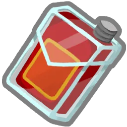 Potion d'attaque (`ATTACK_POTION`)
* **Rareté :** `Common` | **Cible :** `AnyPlayer`
* **Effet :** Choisissez 1 Attaque parmi 3 aléatoires à ajouter à votre Main. Elle coûte 0 ce tour.

###  Jus de coléoptère (`BEETLE_JUICE`)
* **Rareté :** `Rare` | **Cible :** `AnyEnemy`
* **Effet :** Les attaques de l'ennemi infligent 30% de dégâts en moins pendant les 4 prochains tours.

###  Bénédiction de la forge (`BLESSING_OF_THE_FORGE`)
* **Rareté :** `Uncommon` | **Cible :** `AnyPlayer`
* **Effet :** Améliorez toutes les cartes de votre Main pour le restant du combat.

###  Potion d'armure (`BLOCK_POTION`)
* **Rareté :** `Common` | **Cible :** `AnyPlayer`
* **Effet :** Gagnez 12 d'Armure.

###  Potion sanguine (`BLOOD_POTION`)
* **Rareté :** `Common` | **Cible :** `AnyPlayer`
* **Effet :** Récupérez 20% de vos PV Max.

###  Infusion osseuse (`BONE_BREW`)
* **Rareté :** `Uncommon` | **Cible :** `AnyPlayer`
* **Effet :** Invoquez pour 15.

###  Potentiel en bouteille (`BOTTLED_POTENTIAL`)
* **Rareté :** `Rare` | **Cible :** `AnyPlayer`
* **Effet :** Mélangez TOUTES vos cartes dans votre Pioche. Piochez 5 cartes.

###  Extrait de lucidité (`CLARITY`)
* **Rareté :** `Uncommon` | **Cible :** `AnyPlayer`
* **Effet :** Piochez 1 carte. Au début de vos 3 prochains tours, piochez 1 carte supplémentaire.

###  Potion incolore (`COLORLESS_POTION`)
* **Rareté :** `Common` | **Cible :** `AnyPlayer`
* **Effet :** Choisissez 1 carte Incolore parmi 3 aléatoires à ajouter à votre Main. Elle coûte 0 ce tour.

###  Concoction cosmique (`COSMIC_CONCOCTION`)
* **Rareté :** `Rare` | **Cible :** `AnyPlayer`
* **Effet :** Ajoutez 3 cartes Incolores Améliorées à votre Main.

###  Potion de ruse (`CUNNING_POTION`)
* **Rareté :** `Uncommon` | **Cible :** `AnyPlayer`
* **Effet :** Ajoutez 3 Surins Améliorés à votre Main.

###  Remède universel (`CURE_ALL`)
* **Rareté :** `Uncommon` | **Cible :** `AnyPlayer`
* **Effet :** Gagnez 1. Piochez 2 cartes.

###  Potion de dextérité (`DEXTERITY_POTION`)
* **Rareté :** `Common` | **Cible :** `AnyPlayer`
* **Effet :** Gagnez 2 de Dextérité.

### 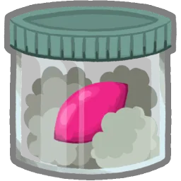 Chaos distillé (`DISTILLED_CHAOS`)
* **Rareté :** `Rare` | **Cible :** `AnyPlayer`
* **Effet :** Jouez les 3 cartes du dessus de votre Pioche.

###  Goutte de prescience (`DROPLET_OF_PRECOGNITION`)
* **Rareté :** `Rare` | **Cible :** `AnyPlayer`
* **Effet :** Choisissez une carte de votre Pioche et ajoutez-la à votre Main.

###  Duplicateur (`DUPLICATOR`)
* **Rareté :** `Uncommon` | **Cible :** `AnyPlayer`
* **Effet :** La prochaine carte que vous jouez ce tour est jouée une fois de plus.

###  Potion d'énergie (`ENERGY_POTION`)
* **Rareté :** `Common` | **Cible :** `AnyPlayer`
* **Effet :** Gagnez 2.

###  Décoction entropique (`ENTROPIC_BREW`)
* **Rareté :** `Rare` | **Cible :** `AnyPlayer`
* **Effet :** Remplissez vos emplacements de potion libres avec des potions aléatoires.

### 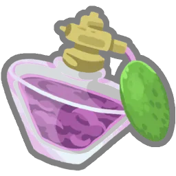 Essence ténébreuse (`ESSENCE_OF_DARKNESS`)
* **Rareté :** `Rare` | **Cible :** `AnyPlayer`
* **Effet :** Canalisez un Orbe obscur pour chacun de vos emplacements d'Orbe.

###  Ampoule explosive (`EXPLOSIVE_AMPOULE`)
* **Rareté :** `Common` | **Cible :** `AllEnemies`
* **Effet :** Infligez 10 dégâts à TOUS les ennemis.

###  Fée en bouteille (`FAIRY_IN_A_BOTTLE`)
* **Rareté :** `Rare` | **Cible :** `Self`
* **Effet :** Si vos PV atteignent 0, défaussez cette potion et récupérez 30 % de vos PV Max.

###  Potion incendiaire (`FIRE_POTION`)
* **Rareté :** `Common` | **Cible :** `AnyEnemy`
* **Effet :** Infligez 20 dégâts.

###  Potion de vantardise (`FLEX_POTION`)
* **Rareté :** `Common` | **Cible :** `AnyPlayer`
* **Effet :** Gagnez 5 de Force. À la fin de votre tour, perdez 5 de Force.

###  Potion de focalisation (`FOCUS_POTION`)
* **Rareté :** `Common` | **Cible :** `AnyPlayer`
* **Effet :** Gagnez 2 de Focalisation.

### 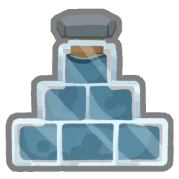 Fortifiant (`FORTIFIER`)
* **Rareté :** `Uncommon` | **Cible :** `AnyPlayer`
* **Effet :** Triplez votre Armure.

###  Potion infecte (`FOUL_POTION`)
* **Rareté :** `Event` | **Cible :** `Combat`
* **Effet :** Infligez 12 dégâts à TOUS les joueurs et les ennemis.
Peut être jetée sur le Marchand pour 100 Pièces d'or.

### 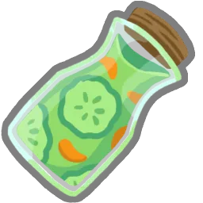 Jus de fruits (`FRUIT_JUICE`)
* **Rareté :** `Rare` | **Cible :** `AnyPlayer`
* **Effet :** Gagnez 5 PV Max.

###  Huile de poissâme (`FYSH_OIL`)
* **Rareté :** `Uncommon` | **Cible :** `AnyPlayer`
* **Effet :** Gagnez 1 de Force et 1 de Dextérité.

###  Décoction du parieur (`GAMBLERS_BREW`)
* **Rareté :** `Uncommon` | **Cible :** `AnyPlayer`
* **Effet :** Défaussez autant de cartes que vous le souhaitez, puis piochez-en le même nombre.

###  Fantôme dans un bocal (`GHOST_IN_A_JAR`)
* **Rareté :** `Rare` | **Cible :** `AnyPlayer`
* **Effet :** Gagnez Intangible (1).

###  Potion de géantification (`GIGANTIFICATION_POTION`)
* **Rareté :** `Rare` | **Cible :** `AnyPlayer`
* **Effet :** La prochaine Attaque que vous jouez inflige le triple de dégâts.

###  Potion luminescente (`GLOWWATER_POTION`)
* **Rareté :** `Event` | **Cible :** `AnyPlayer`
* **Effet :** Épuisez votre Main. Piochez 10 cartes.

###  Cœur de fer (`HEART_OF_IRON`)
* **Rareté :** `Uncommon` | **Cible :** `AnyPlayer`
* **Effet :** Gagnez 7 de Blindage.

### 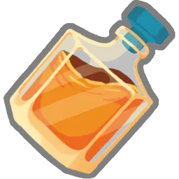 Courage du roi (`KINGS_COURAGE`)
* **Rareté :** `Uncommon` | **Cible :** `AnyPlayer`
* **Effet :** Forgez pour 15.

###  Bronze liquide (`LIQUID_BRONZE`)
* **Rareté :** `Uncommon` | **Cible :** `AnyPlayer`
* **Effet :** Gagnez 3 Épines.

### 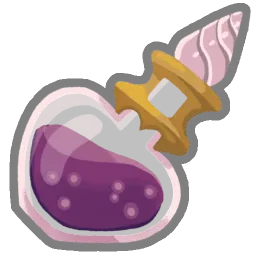 Souvenirs liquides (`LIQUID_MEMORIES`)
* **Rareté :** `Rare` | **Cible :** `AnyPlayer`
* **Effet :** Ajoutez une carte de votre Défausse à votre Main. Elle coûte 0 ce tour.

###  Philtre chanceux (`LUCKY_TONIC`)
* **Rareté :** `Rare` | **Cible :** `AnyPlayer`
* **Effet :** Gagnez 1 Tampon.

###  Don de Mazaleth (`MAZALETHS_GIFT`)
* **Rareté :** `Rare` | **Cible :** `AnyPlayer`
* **Effet :** Gagnez 1 Rituel.

### 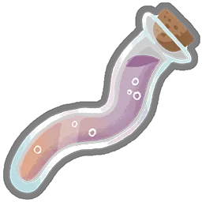 Acide orobique (`OROBIC_ACID`)
* **Rareté :** `Rare` | **Cible :** `AnyPlayer`
* **Effet :** Ajoutez une Attaque, une Compétence et un Pouvoir aléatoires à votre Main. Ils coûtent 0 ce tour.

###  Potion de poison (`POISON_POTION`)
* **Rareté :** `Common` | **Cible :** `AnyEnemy`
* **Effet :** Appliquez 6 de Poison.

### 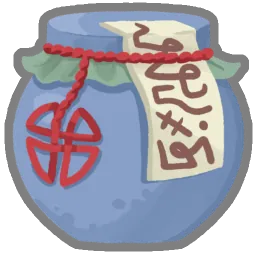 Goules en bouteille (`POT_OF_GHOULS`)
* **Rareté :** `Rare` | **Cible :** `AnyPlayer`
* **Effet :** Ajoutez 2 Âmes à votre Main.

### 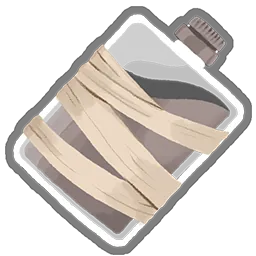 Potion paralysante (`POTION_OF_BINDING`)
* **Rareté :** `Uncommon` | **Cible :** `AllEnemies`
* **Effet :** Appliquez Affaibli (1) et Vulnérable (1) à TOUS les ennemis.

###  Potion de stockage (`POTION_OF_CAPACITY`)
* **Rareté :** `Uncommon` | **Cible :** `AnyPlayer`
* **Effet :** Gagnez 2 Emplacements d'Orbe.

### 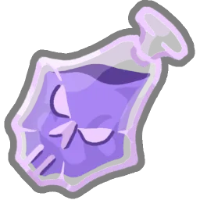 Potion macabre (`POTION_OF_DOOM`)
* **Rareté :** `Common` | **Cible :** `AnyEnemy`
* **Effet :** Appliquez 33 de Fatalité.

###  Poudre funeste (`POWDERED_DEMISE`)
* **Rareté :** `Uncommon` | **Cible :** `AnyEnemy`
* **Effet :** L'ennemi perd 9 PV à la fin de chacun de ses tours.

###  Potion de pouvoir (`POWER_POTION`)
* **Rareté :** `Common` | **Cible :** `AnyPlayer`
* **Effet :** Choisissez 1 Pouvoir parmi 3 aléatoires à ajouter à votre Main. Il coûte 0 ce tour.

###  Lampée de radiance (`RADIANT_TINCTURE`)
* **Rareté :** `Uncommon` | **Cible :** `AnyPlayer`
* **Effet :** Gagnez 1. Gagnez  au début de vos 3 prochains tours.

###  Potion de régénération (`REGEN_POTION`)
* **Rareté :** `Uncommon` | **Cible :** `AnyPlayer`
* **Effet :** Gagnez 5 de Régénération.

### 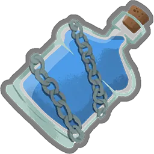 Potion d'entrave (`SHACKLING_POTION`)
* **Rareté :** `Rare` | **Cible :** `AllEnemies`
* **Effet :** TOUS les ennemis perdent 7 de Force ce tour.

###  Navire en bouteille (`SHIP_IN_A_BOTTLE`)
* **Rareté :** `Rare` | **Cible :** `AnyPlayer`
* **Effet :** Gagnez 10 d'Armure. Au prochain tour, gagnez 10 d'Armure.

###  Potion de compétence (`SKILL_POTION`)
* **Rareté :** `Common` | **Cible :** `AnyPlayer`
* **Effet :** Choisissez 1 Compétence parmi 3 aléatoires à ajouter à votre Main. Elle coûte 0 ce tour.

###  Huile de geckobra (`SNECKO_OIL`)
* **Rareté :** `Rare` | **Cible :** `AnyPlayer`
* **Effet :** Piochez 7 cartes. Les cartes dans votre Main ont un coût aléatoire pendant ce tour.

###  Ragoût militaire (`SOLDIERS_STEW`)
* **Rareté :** `Rare` | **Cible :** `AnyPlayer`
* **Effet :** Toutes les cartes dont le nom contient Frappe gagnent Écho (1) pendant ce combat.

###  Potion de vitesse (`SPEED_POTION`)
* **Rareté :** `Common` | **Cible :** `AnyPlayer`
* **Effet :** Gagnez 5 de Dextérité. À la fin de votre tour, perdez 5 de Dextérité.

###  Sérum de stabilité (`STABLE_SERUM`)
* **Rareté :** `Uncommon` | **Cible :** `AnyPlayer`
* **Effet :** Retenez votre Main pendant les 2 prochains tours.

###  Potion d'étoiles (`STAR_POTION`)
* **Rareté :** `Common` | **Cible :** `AnyPlayer`
* **Effet :** Gagnez 3.

###  Potion de force (`STRENGTH_POTION`)
* **Rareté :** `Common` | **Cible :** `AnyPlayer`
* **Effet :** Gagnez 2 de Force.

###  Potion de célérité (`SWIFT_POTION`)
* **Rareté :** `Common` | **Cible :** `AnyPlayer`
* **Effet :** Piochez 3 cartes.

### 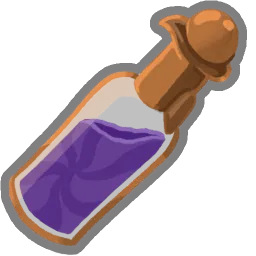 Goutte de folie (`TOUCH_OF_INSANITY`)
* **Rareté :** `Uncommon` | **Cible :** `AnyPlayer`
* **Effet :** Choisissez une carte de votre Main. Elle coûte 0 pour le restant du combat.

###  Potion de vulnérabilité (`VULNERABLE_POTION`)
* **Rareté :** `Common` | **Cible :** `AnyEnemy`
* **Effet :** Appliquez Vulnérable (3).

### 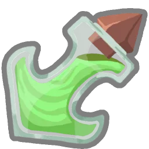 Potion d'affaiblissement (`WEAK_POTION`)
* **Rareté :** `Common` | **Cible :** `AnyEnemy`
* **Effet :** Appliquez Affaibli (3).
