# ❓ Événements & Points d'Interrogation (Slay the Spire 2)

> **Total :** 57 événements | **Patch :** `v0.111.0 Beta`  
> Rencontres aléatoires, choix moraux et récompenses/pénalités sur la carte.

---

### 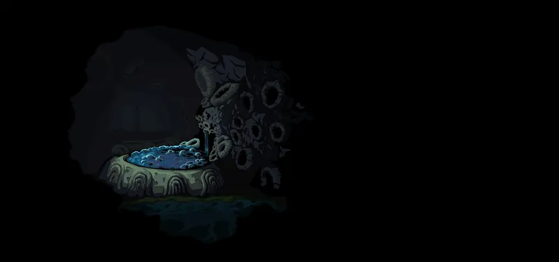 Bains abyssaux (`ABYSSAL_BATHS`)
* **Zone :** `Acte act1b` | **Nombre d'options :** `2`
* **Description :** Vous découvrez dans une pièce solitaire.

De la vapeur s'élève de bassins bouillonnants d'un liquide brûlant, dont les couleurs ondulent selon un rythme hypnotique. Des excroissances incrustées de coquillages pendent du plafond, laissant goutter une substance visqueuse qui grésille et frémit au contact du sol. L'air est lourd, saturé de sel, et d'une substance qui paraît sans aucun doute organique.

À mesure que vous vous approchez du plus grand bassin, le liquide se met à onduler. Les eaux bouillonnent avec de plus en plus d'intensité, comme si elles pressentaient votre arrivée.

<!-- choix:ABYSSAL_BATHS -->
**Choix dans le jeu** (généré depuis `src/engine/events`) :

* **Titre en jeu :** Bains Abyssaux | **Zones :** tous les actes

Page 0 (début) : « Des bassins fumants émettent des vapeurs minérales revigorantes. Au fond d'une vasque, des pièces d'or scintillent. »

* **Se prélasser dans le bain** - Récupérez 25 PV, coûte 35 Or.
  * Condition : au moins 35 Or (sinon l'option est grisée)
  * Effets : perd 35 Or ; soigne 25 PV
  * Résultat : « Les vapeurs chaudes dissolvent vos courbatures (+25 PV). »
* **Plonger dans les profondeurs** - Gagnez 80 Or, perdez 8 PV.
  * Effets : perd 8 PV ; gagne 80 Or
  * Résultat : « L'eau bouillante vous brûle mais vous repêchez 80 Pièces d'or ! »
* **Repartir** - Ignorer les bains.
  * Effets : aucun
  * Résultat : « Vous reprenez votre ascension sans vous attarder. »

<!-- /choix:ABYSSAL_BATHS -->

### 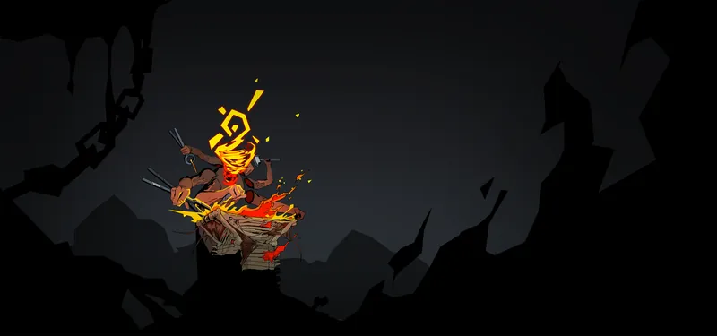 Amalgamateur (`AMALGAMATOR`)
* **Zone :** `Acte act2` | **Nombre d'options :** `2`
* **Description :** BANG ! BANG !!!

Vous entendez les échos du métal battant le métal de l’autre côté d’un mur...

Vous collez l’oreille contre la paroi, quand celle-ci s’ouvre soudain, révélant une énorme silhouette à six bras attelée à son ouvrage.
Son « visage » est un tourbillon de glyphes lumineux qui dansent en cercle.

« Un être doté d’un Esprit Ascendant a trouvé mon atelier ? Le moment est venu de réaliser quelque ALLIAGE ! »

<!-- choix:AMALGAMATOR -->
**Choix dans le jeu** (généré depuis `src/engine/events`) :

* **Titre en jeu :** Amalgamateur | **Zones :** Acte 2

Page 0 (début) : « BANG ! BANG !!! Un énorme être à six bras, au visage de glyphes lumineux, surgit d'un mur et s'écrie : « Un être doté d'un Esprit Ascendant a trouvé mon atelier ? Réalisons quelque ALLIAGE ! » »

* **Fusionner les Défenses** - -2 Défenses, +Défense ultime.
  * Condition : posséder 2 × Defend (sinon l'option est grisée)
  * Effets : retire 2 × Defend du deck ; ajoute au deck 1 × Ultimate Defend
  * Résultat : « Les six bras martèlent vos Défenses jusqu'à n'en faire qu'une. Vous obtenez Défense ultime ! »
* **Fusionner les Frappes** - -2 Frappes, +Frappe ultime.
  * Condition : posséder 2 × Strike (sinon l'option est grisée)
  * Effets : retire 2 × Strike du deck ; ajoute au deck 1 × Ultimate Strike
  * Résultat : « Les six bras forgent vos Frappes en un seul coup. Vous obtenez Frappe ultime ! »

<!-- /choix:AMALGAMATOR -->

### 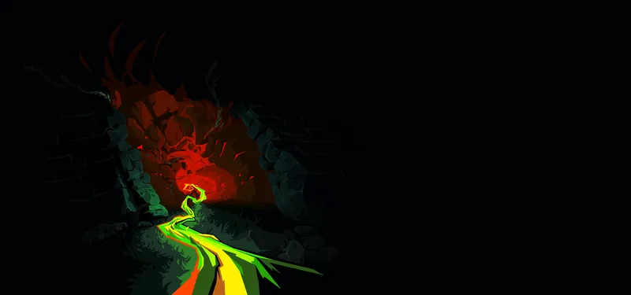 Arôme du chaos (`AROMA_OF_CHAOS`)
* **Zone :** `Acte act1a` | **Nombre d'options :** `2`
* **Description :** Après vous être frayé un chemin à travers un sous-bois dense, vous débouchez dans une clairière. Une nostalgie, impossible à situer, vous frappe de plein fouet.

Un mélange de parfums de fleurs, de pourriture fétide, et autre chose, quelque chose d’indéfinissable. L’odeur s’intensifie à chacun de vos pas, et vous avez l’impression que le monde autour de vous se tord et se déforme.

Submergé(e) par une sensation de chaos mouvant, vous commencez à en perdre toute notion de vous-même.

<!-- choix:AROMA_OF_CHAOS -->
**Choix dans le jeu** (généré depuis `src/engine/events`) :

* **Titre en jeu :** Arôme du chaos | **Zones :** Acte 1a

Page 0 (début) : « Dans une clairière, un mélange de fleurs, de pourriture et d'autre chose vous submerge. Le monde se tord autour de vous et vous perdez toute notion de vous-même. »

* **Lâcher prise** - Transformez une carte.
  * Effets : transforme 1 carte (au choix)
  * Résultat : « Le chaos vous emporte. Choisissez la carte qui se transformera. »
* **Garder le contrôle** - Améliorez une carte.
  * Effets : améliore 1 carte (au choix)
  * Résultat : « Vous résistez au tourbillon. Choisissez la carte à améliorer. »

<!-- /choix:AROMA_OF_CHAOS -->

### 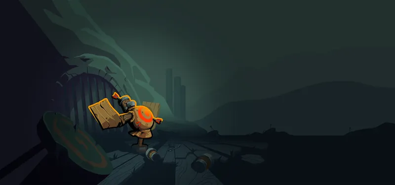 Mannequin de combat usé (`BATTLEWORN_DUMMY`)
* **Zone :** `Acte act3` | **Nombre d'options :** `3`
* **Description :** À mesure que vous vous approchez, il grésille et bourdonne, puis s’illumine brusquement !

« BZZZT ! SÉQUENCE D’ENTRAÎNEMENT INITIÉE !!! VOUS AVEZ 3 TOURS POUR ME VAINCRE !
RÉGLEZ LE PARAMÈTRE OU SUBISSEZ UNE HUMILIATION LÉTALE.
Options disponibles : »

Après ce message terrifiant, le mannequin énonce les instructions en détail.

Que choisissez-vous ?

<!-- choix:BATTLEWORN_DUMMY -->
**Choix dans le jeu** (généré depuis `src/engine/events`) :

* **Titre en jeu :** Mannequin d'Entraînement | **Zones :** tous les actes

Page 0 (début) : « « BZZZT ! SÉQUENCE D'ENTRAÎNEMENT INITIÉE ! Réglez vos coups ou subissez une humiliation létale ! » »

* **Attaque acharnée** - Subissez 6 dégâts, gagnez 60 Or.
  * Effets : perd 6 PV ; gagne 60 Or
  * Résultat : « Vous frappez sans retenue ! Le mannequin explose en pièces d'or. »
* **Réparer les rouages** - Améliorez une carte de votre deck.
  * Effets : améliore 1 carte (au choix)
  * Résultat : « Vous étudiez la mécanique interne. Une de vos cartes est améliorée (+) ! »
* **Prendre la fuite** - Passez votre chemin sans risque.
  * Effets : aucun
  * Résultat : « Vous quittez discrètement la salle. »

<!-- /choix:BATTLEWORN_DUMMY -->

### 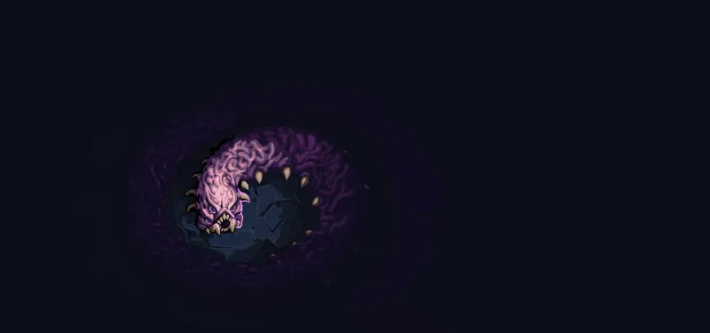 Sangsue cérébrale (`BRAIN_LEECH`)
* **Zone :** `Acte act1a, Acte act1b, Acte act2, Acte act3` | **Nombre d'options :** `2`
* **Description :** *poum*

Vous ressentez une douleur aiguë sur le dessus du crâne tandis qu’une pensée poignarde votre esprit.

« PARTAGER CONNAISSANCE ??? »

Vous hésitez sur la marche à suivre...

<!-- choix:BRAIN_LEECH -->
**Choix dans le jeu** (généré depuis `src/engine/events`) :

* **Titre en jeu :** Sangsue cérébrale | **Zones :** tous les actes

Page 0 (début) : « *poum* Vous ressentez une douleur aiguë sur le dessus du crâne tandis qu'une pensée poignarde votre esprit. « PARTAGER CONNAISSANCE ??? » Vous hésitez sur la marche à suivre... »

* **Partager la connaissance** - Choisissez 1 carte parmi 5.
  * Effets : propose 5 cartes du héros (rares comprises), le joueur en ajoute 1
  * Résultat : « La sangsue vous souffle cinq savoirs. Vous allez en choisir un pour votre deck. »
* **Arracher la sangsue** - Perdez 5 PV, carte incolore.
  * Effets : perd 5 PV ; récompense de carte ×1 (Incolores), à la sortie de l'évènement
  * Résultat : « Vous arrachez la sangsue d'un coup sec. Vous allez choisir une carte incolore. »

<!-- /choix:BRAIN_LEECH -->

### 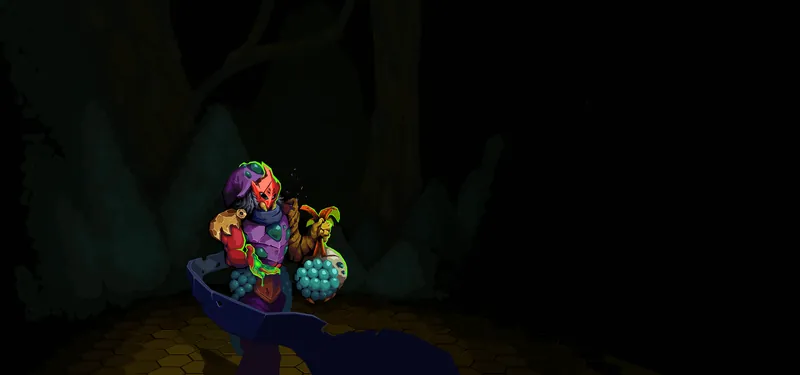 Tueur d’insectes (`BUGSLAYER`)
* **Zone :** `Acte act2` | **Nombre d'options :** `2`
* **Description :** Alors que vous affrontez un essaim d’insectes agressifs, vous remarquez soudain qu’un Puissant Guerrier à l’allure rude combattait à vos côtés depuis le début !

Sentant venir la défaite, les insectes s’éparpillent. Vous vous tournez vers votre nouveau compagnon.
« Veux-tu quelques conseils pour exterminer ces nuisibles ? »

Quelle courtoisie. Vous acceptez son offre d’un hochement de la tête.

<!-- choix:BUGSLAYER -->
**Choix dans le jeu** (généré depuis `src/engine/events`) :

* **Titre en jeu :** Tueur d'insectes | **Zones :** Acte 2

Page 0 (début) : « Un essaim d'insectes s'éparpille : un puissant guerrier combattait à vos côtés depuis le début ! « Veux-tu quelques conseils pour exterminer ces nuisibles ? » Vous acceptez d'un hochement de tête. »

* **Extermination** - Ajoutez Extermination au deck.
  * Effets : ajoute au deck 1 × Exterminate
  * Résultat : « Le guerrier vous montre comment balayer tout un essaim. Vous obtenez Extermination ! »
* **Aplatissement** - Ajoutez Aplatissement au deck.
  * Effets : ajoute au deck 1 × Squash
  * Résultat : « Le guerrier vous apprend à écraser un nuisible d'un seul coup. Vous obtenez Aplatissement ! »

<!-- /choix:BUGSLAYER -->

### 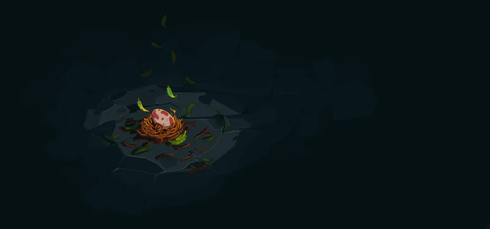 Nid d’oizodon (`BYRDONIS_NEST`)
* **Zone :** `Acte act1a` | **Nombre d'options :** `2`
* **Description :** Vous apercevez une Énorme Bête se traînant pour chasser un Oizo Vert blessé.

Dans l’alcôve d’où l’oizo a pris la fuite, un œuf solitaire gît, abandonné et sans surveillance. 

Votre estomac gargouille...

<!-- choix:BYRDONIS_NEST -->
**Choix dans le jeu** (généré depuis `src/engine/events`) :

* **Titre en jeu :** Nid d'oizodon | **Zones :** Acte 1a

Page 0 (début) : « Vous apercevez une Énorme Bête se traînant pour chasser un Oizo Vert blessé. Dans l'alcôve d'où l'oizo a pris la fuite, un oeuf solitaire gît, abandonné et sans surveillance. Votre estomac gargouille... »

* **Manger l'oeuf** - Gagnez 7 PV Max.
  * Effets : +7 PV max
  * Résultat : « Vous gobez l'oeuf d'un trait. Vous vous sentez plus robuste ! »
* **Prendre l'oeuf** - Ajoute un Oeuf d'oizodon.
  * Effets : ajoute au deck 1 × Byrdonis Egg
  * Résultat : « Vous glissez l'oeuf dans votre sac. Il éclora peut-être à un feu de camp. »

<!-- /choix:BYRDONIS_NEST -->

### 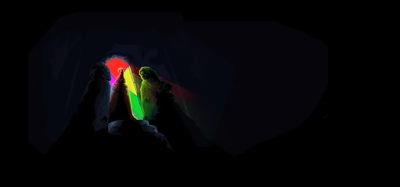 Philosophes multicolores (`COLORFUL_PHILOSOPHERS`)
* **Zone :** `Acte act2` | **Nombre d'options :** `6`
* **Description :** Devant vous se dresse un spectacle épique.
Perchées sur un dais, 3 statues de couleurs différentes sont engagées dans un débat enflammé portant sur les implications philosophiques du concept de la couleur.

À mesure que vous écoutez, vous comprenez que l’enjeu réel de la discussion consiste à déterminer laquelle des couleurs est LA MEILLEURE.

Vous intervenez pour donner votre avis.

<!-- choix:COLORFUL_PHILOSOPHERS -->
**Choix dans le jeu** (généré depuis `src/engine/events`) :

* **Titre en jeu :** Philosophes multicolores | **Zones :** Acte 2

Page 0 (début) : « Perchées sur un dais, trois statues de couleurs différentes débattent avec ardeur : quelle couleur est LA MEILLEURE ? Vous intervenez pour donner votre avis. »

* **Bleu** - 3 cartes Defect, une au choix.
  * Effets : récompense de carte ×1 (DEFECT), à la sortie de l'évènement
  * Résultat : « Les statues bleues exultent. Vous choisirez l'une de leurs cartes. »
* **Rouge** - 3 cartes Ironclad, une au choix.
  * Effets : récompense de carte ×1 (IRONCLAD), à la sortie de l'évènement
  * Résultat : « Les statues rouges rugissent de joie. Vous choisirez l'une de leurs cartes. »
* **Rose** - 3 cartes Necrobinder, une au choix.
  * Effets : récompense de carte ×1 (NECROBINDER), à la sortie de l'évènement
  * Résultat : « Les statues roses sourient. Vous choisirez l'une de leurs cartes. »
* **Autres couleurs** - Orange, vert ou Égalité.
  * Effets : mène à la page 1
  * Résultat : « Vous reprenez la parole. »

Page 1 : « Les statues attendent votre avis avec impatience. Orange, vert, ou bien aucune couleur ne l'emporte ? »

* **Orange** - 3 cartes Regent, une au choix.
  * Effets : récompense de carte ×1 (REGENT), à la sortie de l'évènement
  * Résultat : « Les statues orange se rengorgent. Vous choisirez l'une de leurs cartes. »
* **Vert** - 3 cartes Silent, une au choix.
  * Effets : récompense de carte ×1 (SILENT), à la sortie de l'évènement
  * Résultat : « Les statues vertes hochent la tête. Vous choisirez l'une de leurs cartes. »
* **Égalité** - Gagnez l'Éclat prismatique.
  * Effets : gagne la relique PRISMATIC_SHARD
  * Résultat : « Aucune couleur n'est meilleure qu'une autre ! Les statues vous remercient : vous obtenez l'Éclat prismatique. »
* **Retour** - Bleu, rouge ou rose.
  * Effets : mène à la page 0
  * Résultat : « Vous reprenez la parole. »

<!-- /choix:COLORFUL_PHILOSOPHERS -->

### 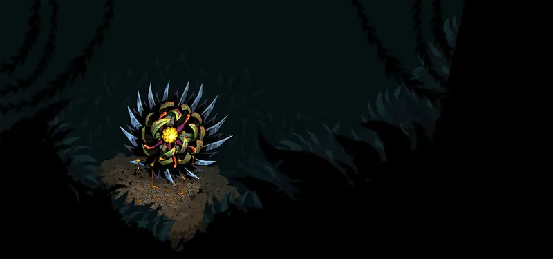 Fleur colossale (`COLOSSAL_FLOWER`)
* **Zone :** `Acte act2` | **Nombre d'options :** `2`
* **Description :** Une fleur colossale pousse au sommet d’un monticule d’ossements.

Au rythme des pulsations de ses pétales aux couleurs changeantes, vous gagnez la sensation qu’un Puissant amas de pollen niche en son centre ; mais les pétales ondoyantes sont aussi tranchants que des lames de rasoir, et leurs mouvements imprévisibles.

Vous pourriez vous contenter d’un peu de nectar doré, mais la tentation du trésor au centre est extrêmement forte...

<!-- choix:COLOSSAL_FLOWER -->
**Choix dans le jeu** (généré depuis `src/engine/events`) :

* **Titre en jeu :** Fleur Colossale | **Zones :** tous les actes

Page 0 (début) : « Une fleur cyclopéenne exsude un parfum suave. Du nectar doré perle sur ses pétales tranchants comme des rasoirs. »

* **Boire le nectar doré** - Récupérez 20 PV.
  * Effets : soigne 20 PV
  * Résultat : « Le nectar restaure vos forces (+20 PV) ! »
* **Arracher l'Épine Ancestrale** - Subissez 10 dégâts, obtenez la Relique Vajra (+1 Force).
  * Effets : perd 10 PV ; gagne la relique VAJRA
  * Résultat : « Vous coupez l'épine au prix d'une vive blessure. Vous obtenez Vajra ! »
* **Contourner la plante** - Ne prenez aucun risque.
  * Effets : aucun
  * Résultat : « Vous contournez la fleur avec précaution. »

<!-- /choix:COLOSSAL_FLOWER -->

### 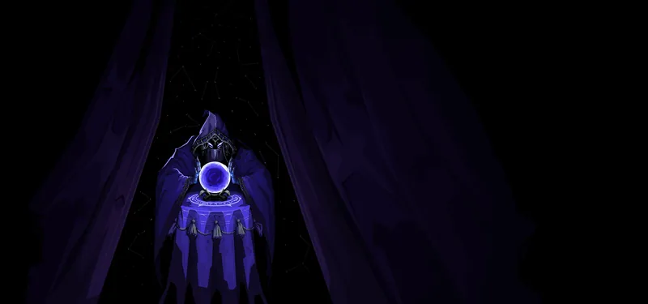 Sphère de cristal (`CRYSTAL_SPHERE`)
* **Zone :** `Acte act1a, Acte act1b, Acte act2, Acte act3` | **Nombre d'options :** `2`
* **Description :** « J’avais prédit votre venue...! »

Une voix rauque se fait entendre lorsque vous pénétrez dans une hutte mystique.

« Votre destin vous amène. Nous devons interroger vos fortunes et votre avenir afin que vous puissiez TOUS NOUS SAUVER !! »
« Bien, voici les prestations possibles pour les révélations de la Sphère de cristal. Et n’oubliez pas de signer cette décharge, » dit-elle en sortant une plume et un parchemin.

<!-- choix:CRYSTAL_SPHERE -->
**Choix dans le jeu** (généré depuis `src/engine/events`) :

* **Titre en jeu :** Sphère de cristal | **Zones :** tous les actes

Page 0 (début) : « « J'avais prédit votre venue ! » lance une voix rauque dans la hutte mystique. « Votre destin vous amène. Voici les prestations de la Sphère de cristal. N'oubliez pas de signer cette décharge. » »

* **Dévoiler l'avenir** - Payez 56 Or, 3 divinations.
  * Condition : au moins 56 Or (sinon l'option est grisée)
  * Effets : perd 56 Or ; gagne 1 potion aléatoire ; récompense de carte ×1 (du héros), à la sortie de l'évènement
  * Résultat : « Vous payez la voyante. La sphère s'illumine et dévoile vos fortunes ! »
* **Plan de paiement** - Ajoute Dette, 6 divinations.
  * Effets : ajoute au deck 1 × Debt ; gagne 2 potions aléatoire ; récompense de carte ×1 (du héros), à la sortie de l'évènement
  * Résultat : « Vous signez la décharge. La sphère révèle six fortunes, et une dette s'ajoute à votre deck. »

<!-- /choix:CRYSTAL_SPHERE -->

### 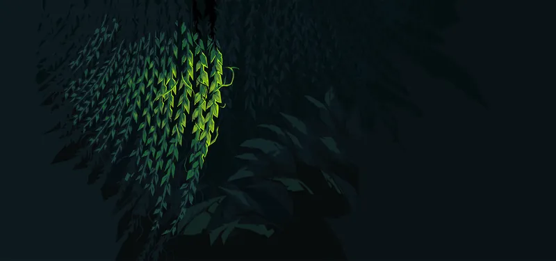 Jungle dense (`DENSE_VEGETATION`)
* **Zone :** `Acte act1a` | **Nombre d'options :** `2`
* **Description :** Après avoir emprunté le mauvais chemin depuis un bon moment, vous vous trouvez dans une épaisse jungle de fougères, de buissons et de lianes. Surtout de lianes. L’épuisement vous gagne, et une pensée sombre vous vient à l’esprit :

« Tu es perdu, pris au dépourvu, et la mort approche inexorablement. »

Que faites-vous ?

<!-- choix:DENSE_VEGETATION -->
**Choix dans le jeu** (généré depuis `src/engine/events`) :

* **Titre en jeu :** Jungle dense | **Zones :** Acte 1a

Page 0 (début) : « Après un long détour par le mauvais chemin, vous voilà dans une jungle de fougères, de buissons et de lianes. Surtout de lianes. Épuisé, vous pensez : « Tu es perdu, et la mort approche. » Que faites-vous ? »

* **S'accrocher** - Perdez 3 PV, relancez la carte.
  * Effets : perd 3 PV ; mène à la page 1
  * Résultat : « Vous vous accrochez aux lianes et reprenez votre souffle. »
* **Surmonter** - Une carte au hasard est retirée.
  * Effets : retire 1 carte du deck (au hasard)
  * Résultat : « Vous vous frayez un chemin dans la jungle. Une carte au hasard de votre deck est retirée. »

Page 1 : « Les lianes vous enserrent toujours. L'épuisement vous gagne. Que faites-vous ? »

* **S'accrocher** - Perdez 4 PV, relancez la carte.
  * Effets : perd 4 PV ; mène à la page 2
  * Résultat : « Vous vous accrochez encore, à bout de forces. »
* **Surmonter** - Une carte au hasard est retirée.
  * Effets : retire 1 carte du deck (au hasard)
  * Résultat : « Vous vous frayez un chemin dans la jungle. Une carte au hasard de votre deck est retirée. »

Page 2 : « Les lianes vous enserrent toujours. Vous tenez à peine debout. Que faites-vous ? »

* **S'accrocher** - Perdez 5 PV, relancez la carte.
  * Effets : perd 5 PV ; mène à la page 2
  * Résultat : « Vous vous accrochez encore, à bout de forces. »
* **Surmonter** - Une carte au hasard est retirée.
  * Effets : retire 1 carte du deck (au hasard)
  * Résultat : « Vous vous frayez un chemin dans la jungle. Une carte au hasard de votre deck est retirée. »

<!-- /choix:DENSE_VEGETATION -->

### 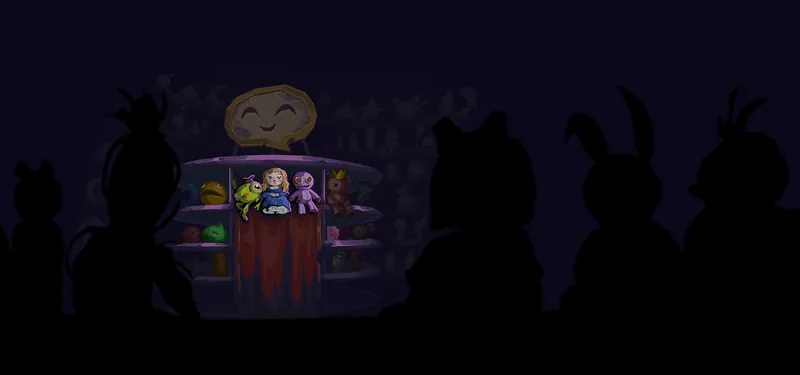 Salle aux poupées (`DOLL_ROOM`)
* **Zone :** `Acte act1a, Acte act1b, Acte act2, Acte act3` | **Nombre d'options :** `3`
* **Description :** Vous entrez dans une pièce dissimulée...

Elle est remplie de toutes sortes de poupées. Chacune d’entre elles est unique : leurs expressions vont de la joie à la tristesse, et leurs tenues traversent les siècles, voire même des mondes inconnus au vôtre.

Un chœur de murmures gagne progressivement en intensité, jusqu’à tel point que les poupées sont en train de hurler plus fort les unes que les autres, tentant de vous interpeller...

Vous devez en choisir une et partir le plus vite possible.

<!-- choix:DOLL_ROOM -->
**Choix dans le jeu** (généré depuis `src/engine/events`) :

* **Titre en jeu :** Salle aux poupées | **Zones :** tous les actes

Page 0 (début) : « Une pièce dissimulée, remplie de poupées toutes uniques. Leurs murmures enflent jusqu'aux hurlements: elles veulent que vous les choisissiez. Prenez-en une et partez vite. »

* **Choisir au hasard** - Une poupée au hasard.
  * Effets : gagne la relique DAUGHTER_OF_THE_WIND,MR_STRUGGLES,BING_BONG
  * Résultat : « Vous attrapez une poupée sans regarder et filez. Vous obtenez une relique ! »
* **Prendre son temps** - Perdez 5 PV, 1 poupée sur 2.
  * Effets : perd 5 PV ; mène à la page 1
  * Résultat : « Vous prenez votre temps, malgré les cris. Perdez 5 PV. »
* **Examiner chacune** - Perdez 15 PV, 1 poupée sur 3.
  * Effets : perd 15 PV ; mène à la page 2
  * Résultat : « Vous examinez chaque poupée, les oreilles en sang. Perdez 15 PV. »

Page 1 : « Deux poupées se détachent des autres. Laquelle emportez-vous ? »

* **Fille des vents** - Chaque Attaque donne 1 Armure.
  * Effets : gagne la relique DAUGHTER_OF_THE_WIND
  * Résultat : « Vous emportez la Fille des vents. »
* **Monsieur Carnage** - Dégâts = tour, à tous, chaque tour.
  * Effets : gagne la relique MR_STRUGGLES
  * Résultat : « Vous emportez Monsieur Carnage. »

Page 2 : « Après un examen minutieux, trois poupées se distinguent. Laquelle emportez-vous ? »

* **Fille des vents** - Chaque Attaque donne 1 Armure.
  * Effets : gagne la relique DAUGHTER_OF_THE_WIND
  * Résultat : « Vous emportez la Fille des vents. »
* **Monsieur Carnage** - Dégâts = tour, à tous, chaque tour.
  * Effets : gagne la relique MR_STRUGGLES
  * Résultat : « Vous emportez Monsieur Carnage. »
* **Bing bong** - Chaque carte ajoutée est copiée.
  * Effets : gagne la relique BING_BONG
  * Résultat : « Vous emportez Bing bong. »

<!-- /choix:DOLL_ROOM -->

### 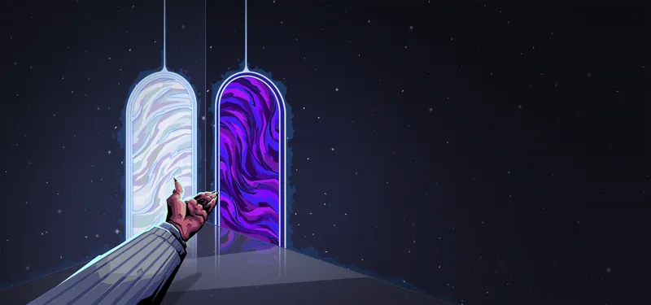 Portes de l’ombre et de la lumière (`DOORS_OF_LIGHT_AND_DARK`)
* **Zone :** `Acte act1b` | **Nombre d'options :** `2`
* **Description :** Une porte existe là où il n’y en avait pas quelques instants plus tôt...

Lorsque vous entrez, vous découvrez deux portes scintillantes ainsi qu’un portier élégamment vêtu.
« Un visiteur, enfin ! Venez, je vous en prie ! Choisissez une porte, n’importe laquelle ! »

Sommes-nous toujours dans la Tour ? Comment cet endroit peut-il être aussi propre ?

<!-- choix:DOORS_OF_LIGHT_AND_DARK -->
**Choix dans le jeu** (généré depuis `src/engine/events`) :

* **Titre en jeu :** Portes de l'ombre et de la lumière | **Zones :** Acte 1b

Page 0 (début) : « Une porte existe là où il n'y en avait pas. Dedans, deux portes scintillantes et un portier élégant : « Un visiteur, enfin ! Choisissez une porte, n'importe laquelle ! » »

* **Porte de lumière** - Améliorez 2 cartes au hasard.
  * Effets : améliore 2 cartes (au hasard)
  * Résultat : « La lumière vous enveloppe. Deux de vos cartes sont améliorées (+) ! »
* **Porte d'ombre** - Retirez une carte de votre deck.
  * Effets : retire 1 carte du deck (au choix)
  * Résultat : « L'ombre vous avale. Choisissez la carte qu'elle emportera. »

<!-- /choix:DOORS_OF_LIGHT_AND_DARK -->

### 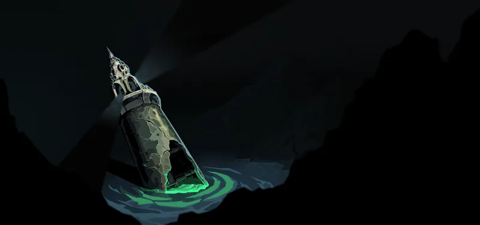 Phare englouti (`DROWNING_BEACON`)
* **Zone :** `Acte act1b` | **Nombre d'options :** `2`
* **Description :** Après avoir traversé un paysage onirique d’eaux calmes et de rochers, vous émergez face à un phare en train de s'enfoncer dans la boue et qui émet une lueur d'anti-lumière.

Vous pouvez mettre en bouteille un peu du liquide faiblement luminescent qui s’est accumulé ici, ou bien vous pouvez tenter d’atteindre le sommet du phare afin d’en récupérer la lentille.

<!-- choix:DROWNING_BEACON -->
**Choix dans le jeu** (généré depuis `src/engine/events`) :

* **Titre en jeu :** Phare englouti | **Zones :** Acte 1b

Page 0 (début) : « Après un paysage onirique d'eaux calmes et de rochers, vous émergez face à un phare qui s'enfonce dans la boue et émet une lueur d'anti-lumière. Mettre en bouteille le liquide luminescent, ou grimper récupérer la lentille ? »

* **Mettre en bouteille** - Obtenez Potion luminescente.
  * Effets : gagne la potion GLOWWATER_POTION
  * Résultat : « Vous recueillez le liquide faiblement luminescent dans une fiole. Vous obtenez Potion luminescente ! »
* **Grimper** - Lentille de Fresnel, -13 PV Max.
  * Effets : gagne la relique FRESNEL_LENS ; -13 PV max
  * Résultat : « L'ascension vous épuise, mais vous arrachez la lentille. Vous obtenez Lentille de Fresnel ! »

<!-- /choix:DROWNING_BEACON -->

### 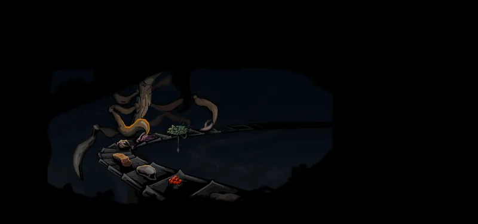 Convoyeur sans fin (`ENDLESS_CONVEYOR`)
* **Zone :** `Acte act1b` | **Nombre d'options :** `1`
* **Description :** Vous vous traînez jusque dans une baraque à l'enseigne lumineuse (mais de travers) :
« FESTIN À VOLONTÉ — PAYEZ SELON VOTRE FAIM ! »

À l'intérieur, un chef cuisinier svelte doté de nombreux bras prépare avec dextérité des bouchées alléchantes qu'il pose sur un convoyeur en chitine sinueux.

De l'un de ses bras, le chef indique un panneau :
40 Pièces d'or par assiette

<!-- choix:ENDLESS_CONVEYOR -->
**Choix dans le jeu** (généré depuis `src/engine/events`) :

* **Titre en jeu :** Convoyeur sans fin | **Zones :** Acte 1b

Page 0 (début) : « Vous entrez dans une baraque à l'enseigne de travers : « FESTIN À VOLONTÉ - PAYEZ SELON VOTRE FAIM ! » Un chef svelte à nombreux bras pose des bouchées sur un convoyeur de chitine. Un panneau : 40 Pièces d'or par assiette. »

* **Observer le chef** - Améliore une carte aléatoire.
  * Effets : améliore 1 carte (au hasard) ; mène à la page 1
  * Résultat : « Le chef ondule au-dessus de ses plats. Vous retenez ses gestes : une carte aléatoire sera améliorée. »

Page 1 : « Le convoyeur de chitine serpente devant vous, chargé de plats. 40 Pièces d'or par assiette. »

* **Caviar** - -40 Or, +4 PV Max.
  * Condition : au moins 40 Or (sinon l'option est grisée)
  * Effets : perd 40 Or ; +4 PV max ; mène à la page 1
  * Résultat : « Des perles salées éclatent sous la dent. Vous gagnez 4 PV Max. »
* **Roulé de palourde** - -40 Or, soigne 10 PV.
  * Condition : au moins 40 Or (sinon l'option est grisée)
  * Effets : perd 40 Or ; soigne 10 PV ; mène à la page 1
  * Résultat : « Un roulé tiède et réconfortant. Vous récupérez 10 PV. »
* **Anguille frite** - -40 Or, une carte incolore.
  * Condition : au moins 40 Or (sinon l'option est grisée)
  * Effets : perd 40 Or ; ajoute au deck 1 carte Incolore aléatoire ; mène à la page 1
  * Résultat : « Une anguille croustillante, étrangement nourrissante. Une carte incolore rejoint votre deck. »
* **Plats suivants** - Le tapis continue d'avancer.
  * Effets : mène à la page 2
  * Résultat : « Le tapis roule encore. »

Page 2 : « Le convoyeur de chitine serpente devant vous, chargé de plats. 40 Pièces d'or par assiette. »

* **Poisson d'or** - Gratuit : gagnez 75 Or.
  * Effets : gagne 75 Or ; mène à la page 5
  * Résultat : « GAGNANT CHANCEUX ! Le chef vous glisse 75 Pièces d'or avec le poisson. »
* **Foie en gelée** - -40 Or, transforme une carte.
  * Condition : au moins 40 Or (sinon l'option est grisée)
  * Effets : perd 40 Or ; transforme 1 carte (au choix) ; mène à la page 2
  * Résultat : « Le foie en gelée tremble, puis vous transforme de l'intérieur. Choisissez la carte à transformer. »
* **Salade seapunk** - -40 Or, ajoute Repas frénétique.
  * Condition : au moins 40 Or (sinon l'option est grisée)
  * Effets : perd 40 Or ; ajoute au deck 1 × Feeding Frenzy ; mène à la page 2
  * Résultat : « Une salade frénétique ! Repas frénétique rejoint votre deck. »
* **Plats suivants** - Le tapis continue d'avancer.
  * Effets : mène à la page 3
  * Résultat : « Le tapis roule encore. »

Page 3 : « Le convoyeur de chitine serpente devant vous, chargé de plats. 40 Pièces d'or par assiette. »

* **Vivaneau épicé** - -40 Or, améliore une carte.
  * Condition : au moins 40 Or (sinon l'option est grisée)
  * Effets : perd 40 Or ; améliore 1 carte (au hasard) ; mène à la page 3
  * Résultat : « Le vivaneau est si épicé qu'il vous aiguise l'esprit. Une carte aléatoire sera améliorée. »
* **Condiment suspect** - -40 Or, une potion aléatoire.
  * Condition : au moins 40 Or (sinon l'option est grisée)
  * Effets : perd 40 Or ; gagne 1 potion aléatoire ; mène à la page 3
  * Résultat : « Le condiment sent le soufre, mais le chef hoche la tête. Vous obtenez une potion. »
* **Plats précédents** - Revenir au début du tapis.
  * Effets : mène à la page 1
  * Résultat : « Le tapis ramène les premiers plats. »
* **Partir** - Quitter la baraque.
  * Effets : aucun
  * Résultat : « Vous quittez la baraque, le ventre plein, le chef agitant six bras d'adieu. »

Page 4 : « Le convoyeur de chitine serpente devant vous, chargé de plats. 40 Pièces d'or par assiette. »

* **Caviar** - -40 Or, +4 PV Max.
  * Condition : au moins 40 Or (sinon l'option est grisée)
  * Effets : perd 40 Or ; +4 PV max ; mène à la page 4
  * Résultat : « Des perles salées éclatent sous la dent. Vous gagnez 4 PV Max. »
* **Roulé de palourde** - -40 Or, soigne 10 PV.
  * Condition : au moins 40 Or (sinon l'option est grisée)
  * Effets : perd 40 Or ; soigne 10 PV ; mène à la page 4
  * Résultat : « Un roulé tiède et réconfortant. Vous récupérez 10 PV. »
* **Anguille frite** - -40 Or, une carte incolore.
  * Condition : au moins 40 Or (sinon l'option est grisée)
  * Effets : perd 40 Or ; ajoute au deck 1 carte Incolore aléatoire ; mène à la page 4
  * Résultat : « Une anguille croustillante, étrangement nourrissante. Une carte incolore rejoint votre deck. »
* **Plats suivants** - Le tapis continue d'avancer.
  * Effets : mène à la page 5
  * Résultat : « Le tapis roule encore. »

Page 5 : « Le convoyeur de chitine serpente devant vous, chargé de plats. 40 Pièces d'or par assiette. »

* **Foie en gelée** - -40 Or, transforme une carte.
  * Condition : au moins 40 Or (sinon l'option est grisée)
  * Effets : perd 40 Or ; transforme 1 carte (au choix) ; mène à la page 5
  * Résultat : « Le foie en gelée tremble, puis vous transforme de l'intérieur. Choisissez la carte à transformer. »
* **Salade seapunk** - -40 Or, ajoute Repas frénétique.
  * Condition : au moins 40 Or (sinon l'option est grisée)
  * Effets : perd 40 Or ; ajoute au deck 1 × Feeding Frenzy ; mène à la page 5
  * Résultat : « Une salade frénétique ! Repas frénétique rejoint votre deck. »
* **Plats suivants** - Le tapis continue d'avancer.
  * Effets : mène à la page 6
  * Résultat : « Le tapis roule encore. »

Page 6 : « Le convoyeur de chitine serpente devant vous, chargé de plats. 40 Pièces d'or par assiette. »

* **Vivaneau épicé** - -40 Or, améliore une carte.
  * Condition : au moins 40 Or (sinon l'option est grisée)
  * Effets : perd 40 Or ; améliore 1 carte (au hasard) ; mène à la page 6
  * Résultat : « Le vivaneau est si épicé qu'il vous aiguise l'esprit. Une carte aléatoire sera améliorée. »
* **Condiment suspect** - -40 Or, une potion aléatoire.
  * Condition : au moins 40 Or (sinon l'option est grisée)
  * Effets : perd 40 Or ; gagne 1 potion aléatoire ; mène à la page 6
  * Résultat : « Le condiment sent le soufre, mais le chef hoche la tête. Vous obtenez une potion. »
* **Plats précédents** - Revenir au début du tapis.
  * Effets : mène à la page 4
  * Résultat : « Le tapis ramène les premiers plats. »
* **Partir** - Quitter la baraque.
  * Effets : aucun
  * Résultat : « Vous quittez la baraque, le ventre plein, le chef agitant six bras d'adieu. »

<!-- /choix:ENDLESS_CONVEYOR -->

###  Le Marchand ??? (`FAKE_MERCHANT`)
* **Zone :** `Acte act1a, Acte act1b, Acte act2, Acte act3` | **Nombre d'options :** `0`
* **Description :** À faire

<!-- choix:FAKE_MERCHANT -->
**Choix dans le jeu** (généré depuis `src/engine/events`) :

* **Titre en jeu :** Le Marchand ??? | **Zones :** tous les actes

Page 0 (début) : « Un marchand au sourire un peu trop large vous interpelle : « Des reliques rares, rien que pour vous ! » Quelque chose cloche chez lui. »

* **Reliques contrefaites** - Achetez une relique pour 50 Or.
  * Effets : mène à la page 1
  * Résultat : « Le marchand étale sa marchandise, tout sourire. »
* **Lancer une Potion infecte** - Défiez le marchand au combat.
  * Condition : posséder la potion FOUL_POTION (sinon l'option est grisée)
  * Effets : perd la potion FOUL_POTION ; déclenche un combat normal, à la sortie de l'évènement
  * Résultat : « La fiole éclate sur le marchand. Son sourire disparaît : il se jette sur vous ! »
* **Partir** - Ne rien acheter.
  * Effets : aucun
  * Résultat : « Vous passez votre chemin. Le marchand vous regarde partir sans un mot. »

Page 1 : « « Ces reliques sont authentiques, je le jure ! » Chacune coûte 50 Or. »

* **Ancre ???** - 50 Or.
  * Condition : au moins 50 Or (sinon l'option est grisée)
  * Effets : perd 50 Or ; gagne la relique FAKE_ANCHOR
  * Résultat : « Vous payez 50 Or. Vous obtenez Ancre ???. »
* **Fiole de sang ???** - 50 Or.
  * Condition : au moins 50 Or (sinon l'option est grisée)
  * Effets : perd 50 Or ; gagne la relique FAKE_BLOOD_VIAL
  * Résultat : « Vous payez 50 Or. Vous obtenez Fiole de sang ???. »
* **Fleur joyeuse ???** - 50 Or.
  * Condition : au moins 50 Or (sinon l'option est grisée)
  * Effets : perd 50 Or ; gagne la relique FAKE_HAPPY_FLOWER
  * Résultat : « Vous payez 50 Or. Vous obtenez Fleur joyeuse ???. »
* **Voir la suite** - Autres reliques.
  * Effets : mène à la page 2
  * Résultat : « Le marchand sort d'autres reliques de sa besace. »

Page 2 : « « Encore quelques merveilles, ami ! » Chaque relique coûte 50 Or. »

* **Gaufre de Lee ???** - 50 Or.
  * Condition : au moins 50 Or (sinon l'option est grisée)
  * Effets : perd 50 Or ; gagne la relique FAKE_LEES_WAFFLE
  * Résultat : « Vous payez 50 Or. Vous obtenez Gaufre de Lee ???. »
* **Mangue ???** - 50 Or.
  * Condition : au moins 50 Or (sinon l'option est grisée)
  * Effets : perd 50 Or ; gagne la relique FAKE_MANGO
  * Résultat : « Vous payez 50 Or. Vous obtenez Mangue ???. »
* **Tapis du Marchand ???** - 50 Or.
  * Condition : au moins 50 Or (sinon l'option est grisée)
  * Effets : perd 50 Or ; gagne la relique FAKE_MERCHANTS_RUG
  * Résultat : « Vous payez 50 Or. Vous obtenez Le tapis du Marchand ???. »
* **Voir la suite** - Autres reliques.
  * Effets : mène à la page 3
  * Résultat : « Le marchand fouille encore sa besace. »

Page 3 : « « Les dernières, et pas les moins belles ! » Chaque relique coûte 50 Or. »

* **Orichalque ???** - 50 Or.
  * Condition : au moins 50 Or (sinon l'option est grisée)
  * Effets : perd 50 Or ; gagne la relique FAKE_ORICHALCUM
  * Résultat : « Vous payez 50 Or. Vous obtenez Orichalque ???. »
* **Œil de geckobra ???** - 50 Or.
  * Condition : au moins 50 Or (sinon l'option est grisée)
  * Effets : perd 50 Or ; gagne la relique FAKE_SNECKO_EYE
  * Résultat : « Vous payez 50 Or. Vous obtenez Œil de geckobra ???. »
* **Mannequin ???** - 50 Or.
  * Condition : au moins 50 Or (sinon l'option est grisée)
  * Effets : perd 50 Or ; gagne la relique FAKE_STRIKE_DUMMY
  * Résultat : « Vous payez 50 Or. Vous obtenez Mannequin d'entraînement ???. »
* **Voir la suite** - Autres reliques.
  * Effets : mène à la page 4
  * Résultat : « Le marchand sort enfin le fond de sa besace. »

Page 4 : « « Le tout dernier, mon préféré ! » Il coûte 50 Or. »

* **Service à thé ???** - 50 Or.
  * Condition : au moins 50 Or (sinon l'option est grisée)
  * Effets : perd 50 Or ; gagne la relique FAKE_VENERABLE_TEA_SET
  * Résultat : « Vous payez 50 Or. Vous obtenez Service à thé vénérable ???. »
* **Partir** - Ne rien acheter.
  * Effets : aucun
  * Résultat : « Vous quittez l'étal. Le marchand vous regarde partir sans un mot. »

<!-- /choix:FAKE_MERCHANT -->

### 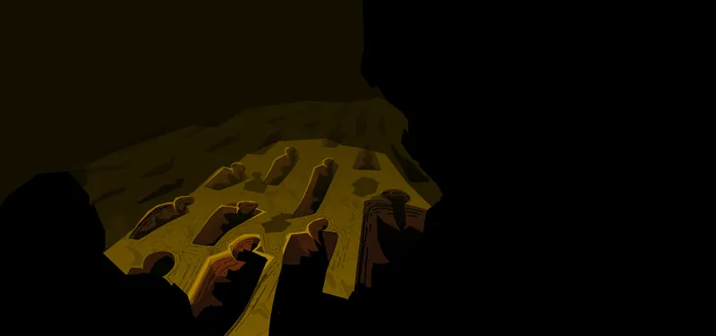 Champ de trous à taille corporelle (`FIELD_OF_MAN_SIZED_HOLES`)
* **Zone :** `Acte act2` | **Nombre d'options :** `2`
* **Description :** Vous vous arrêtez devant un énorme champ dans lequel sont taillées de larges silhouettes de corps.

L’une de ces silhouettes correspond à la vôtre.

La correspondance est parfaite...

<!-- choix:FIELD_OF_MAN_SIZED_HOLES -->
**Choix dans le jeu** (généré depuis `src/engine/events`) :

* **Titre en jeu :** Champ de trous à taille corporelle | **Zones :** Acte 2

Page 0 (début) : « Vous vous arrêtez devant un énorme champ dans lequel sont taillées de larges silhouettes de corps. L'une de ces silhouettes correspond à la vôtre. La correspondance est parfaite... »

* **Entrer dans votre trou** - Enchantez une carte au choix.
  * Effets : enchante 1 carte (au choix) : PERFECT_FIT
  * Résultat : « Vous vous glissez dans le trou, il vous va comme un gant. Vous allez choisir une carte à enchanter. »
* **Résister** - Retirez 2 cartes, ajoutez Normalité.
  * Effets : retire 2 cartes du deck (au choix) ; ajoute au deck 1 × Normality
  * Résultat : « Vous résistez à l'appel du trou. Vous allez retirer 2 cartes, et la Normalité s'installe. »

<!-- /choix:FIELD_OF_MAN_SIZED_HOLES -->

### 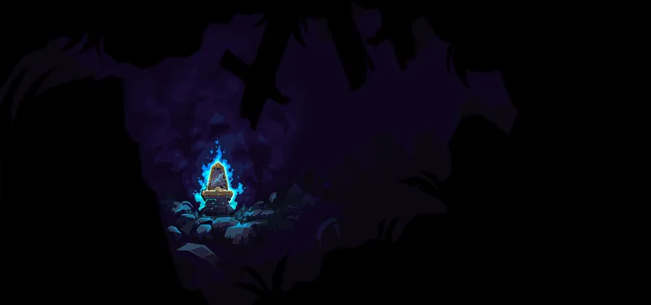 Tombe du guerrier oublié (`GRAVE_OF_THE_FORGOTTEN`)
* **Zone :** `Acte act3` | **Nombre d'options :** `3`
* **Description :** Vous découvrez une tombe solitaire surmontée d’une flamme bleue tourbillonnante...

Un guerrier orgueilleux est tombé au combat, mais son âme ne trouve pas le repos. Elle veut continuer à se battre, et vous pouvez ressentir qu’elle implore de voyager à vos côtés.

Mais peut-être vaudrait-il mieux pour elle qu’elle se confronte à la réalité ?

<!-- choix:GRAVE_OF_THE_FORGOTTEN -->
**Choix dans le jeu** (généré depuis `src/engine/events`) :

* **Titre en jeu :** Tombe du guerrier oublié | **Zones :** Acte 3

Page 0 (début) : « Une tombe solitaire, surmontée d'une flamme bleue. L'âme d'un guerrier orgueilleux y implore de voyager à vos côtés. Peut-être vaudrait-il mieux qu'elle affronte la réalité ? »

* **Accepter l'âme** - Gagnez Âme oubliée.
  * Effets : gagne la relique FORGOTTEN_SOUL
  * Résultat : « La flamme bleue se glisse en vous. Vous obtenez Âme oubliée ! »
* **Confronter** - Gagnez Déclin, enchantez une carte.
  * Condition : une carte du deck a Épuisement (sinon l'option est grisée)
  * Effets : ajoute au deck 1 × Decay ; enchante 1 carte (au choix) : SOULS_POWER
  * Résultat : « L'âme s'éteint, mais sa peine vous marque. Vous obtenez Déclin ! Choisissez une carte qui perdra Épuisement. »

<!-- /choix:GRAVE_OF_THE_FORGOTTEN -->

### 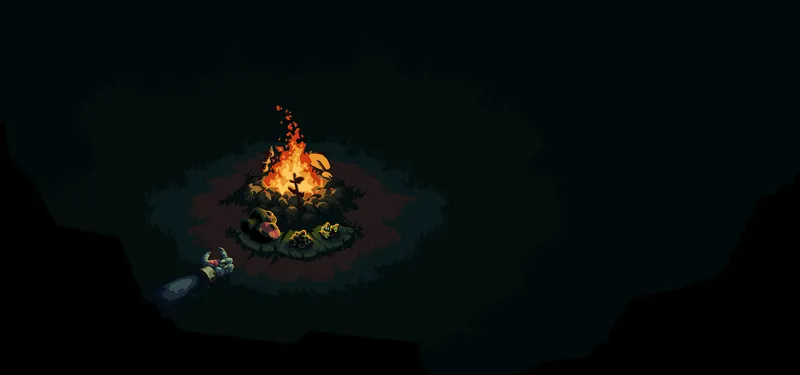 Affamé de champis (`HUNGRY_FOR_MUSHROOMS`)
* **Zone :** `Acte act3` | **Nombre d'options :** `2`
* **Description :** Depuis combien de temps n’avez-vous rien mangé ?
... attends, d’où vient cette odeur incroyable ?

Vous suivez l’odeur et arrivez dans un campement accueillant où cuisent toutes sortes de champignons appétissants ! Vous avez si faim que vous ne vous préoccupez pas de leur innocuité.
(Si faim que vous ne remarquez même pas l’aventurier mort qui gît à terre.)

<!-- choix:HUNGRY_FOR_MUSHROOMS -->
**Choix dans le jeu** (généré depuis `src/engine/events`) :

* **Titre en jeu :** Affamé de champis | **Zones :** Acte 3

Page 0 (début) : « Une odeur incroyable vous mène à un campement où cuisent des champignons appétissants. Vous avez si faim que vous ne remarquez même pas l'aventurier mort qui gît à terre. »

* **Gros champignon** - +20 PV Max, 2 cartes de moins au combat
  * Effets : gagne la relique BIG_MUSHROOM
  * Résultat : « Vous dévorez le gros champignon. Vous vous sentez... plus grand. Vous obtenez Gros champi ! »
* **Champignon parfumé** - Perdez 15 PV, améliorez 2 cartes
  * Effets : gagne la relique FRAGRANT_MUSHROOM
  * Résultat : « Un parfum enivrant vous monte à la tête. Vous obtenez Champi aromatique ! »

<!-- /choix:HUNGRY_FOR_MUSHROOMS -->

### 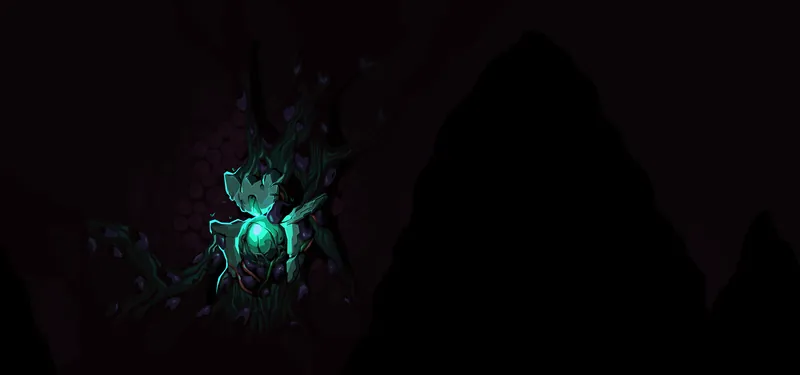 Automate infesté (`INFESTED_AUTOMATON`)
* **Zone :** `Acte act2` | **Nombre d'options :** `2`
* **Description :** Vous arrivez dans une salle remplie de robots morts.

Un seul automate paraît encore en service, mais son cœur faiblement lumineux est englouti par une excroissance organique grotesque, et il ne réagit plus.

<!-- choix:INFESTED_AUTOMATON -->
**Choix dans le jeu** (généré depuis `src/engine/events`) :

* **Titre en jeu :** Automate infesté | **Zones :** Acte 2

Page 0 (début) : « Vous arrivez dans une salle remplie de robots morts. Un seul automate paraît encore en service, mais son coeur faiblement lumineux est englouti par une excroissance organique grotesque, et il ne réagit plus. »

* **Étudier** - Ajoute un Pouvoir aléatoire.
  * Effets : ajoute au deck 1 carte Pouvoir aléatoire du héros
  * Résultat : « Vous étudiez les circuits de l'automate et en tirez un savoir-faire inattendu. »
* **Toucher le coeur** - Ajoute une carte aléatoire à 0.
  * Effets : ajoute au deck 1 carte coûtant 0 aléatoire du héros
  * Résultat : « Votre main effleure le coeur luisant. Une carte vous revient en mémoire. »

<!-- /choix:INFESTED_AUTOMATON -->

### 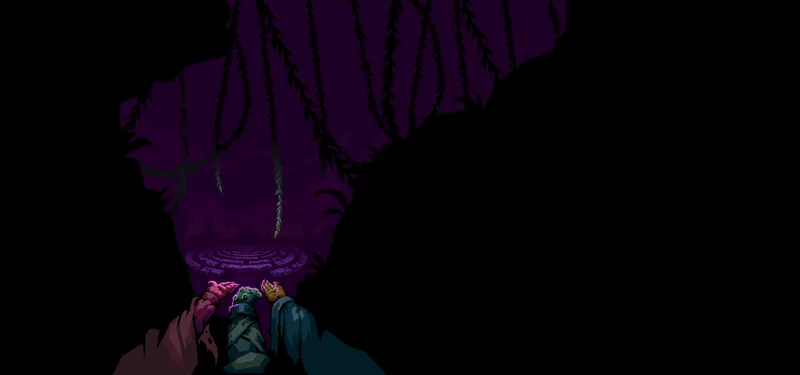 Aventure du labyrinthe de la jungle (`JUNGLE_MAZE_ADVENTURE`)
* **Zone :** `Acte act1a` | **Nombre d'options :** `2`
* **Description :** Dans une clairière, vous tombez sur une Bande d’aventuriers hétéroclite. L’air démoralisés, ils vous indiquent un labyrinthe géant.

Ils vous proposent d’unir vos forces aux leurs pour vous embarquer dans une Quête épique, dans le but de piller les trésors de ce labyrinthe. Étant vous-même un aventurier expérimenté, vous ne vous faites pas d’illusions sur les pièges mortels et les gardiens redoutables dont est sûrement rempli ce labyrinthe.

Ce serait plus simple si vous travailliez ensemble, mais il faudra alors partager le butin.

<!-- choix:JUNGLE_MAZE_ADVENTURE -->
**Choix dans le jeu** (généré depuis `src/engine/events`) :

* **Titre en jeu :** Aventure du labyrinthe de la jungle | **Zones :** Acte 1a

Page 0 (début) : « Dans une clairière, une bande d'aventuriers hétéroclite, l'air démoralisée, vous indique un labyrinthe géant. Ils vous proposent de piller ses trésors ensemble, mais il faudra alors partager le butin. »

* **Unir ses forces** - Gagnez 42 Or.
  * Effets : gagne 42 Or
  * Résultat : « Vous explorez le labyrinthe en équipe et partagez le butin. Vous obtenez 42 Or. »
* **Quête en solo** - Gagnez 140 Or, perdez 18 PV.
  * Condition : plus de 18 PV (sinon l'option est grisée)
  * Effets : gagne 140 Or ; perd 18 PV
  * Résultat : « Seul contre les pièges, vous gardez tout le trésor. Vous obtenez 140 Or, mais y laissez 18 PV. »

<!-- /choix:JUNGLE_MAZE_ADVENTURE -->

### 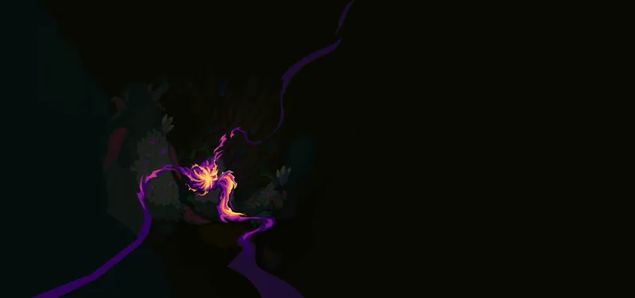 Feu follet égaré (`LOST_WISP`)
* **Zone :** `Acte act2` | **Nombre d'options :** `3`
* **Description :** Au loin se dresse une scène étrange. Des montagnes et des montagnes d’insectes morts, disposés tout autour d’un petit granule lumineux.
Ce dernier semble attirer toutes sortes de bestioles ; mais voilà que vous voyez en émaner des flammes !

Vous vous approchez pour l’examiner.

<!-- choix:LOST_WISP -->
**Choix dans le jeu** (généré depuis `src/engine/events`) :

*Pas encore dans le jeu* : choix de la référence (`bible/data/event_choices`).

Page `start` :

* **Capturer le feu follet** (Capture the Wisp)
  * Effets : gain relic 1 (LOST_WISP) ; add curse 1 (DECAY)
* **Fouiller les environs** (Search the Nearby Area)
  * Effets : gain gold - 45-75 or
* **(3e option)** ((third option))
  * Effets : other - 3e option du JSON (optionCount=3) non documentee; la page indique 'Your Max HP is too low' (seuil inconnu)

<!-- /choix:LOST_WISP -->

### 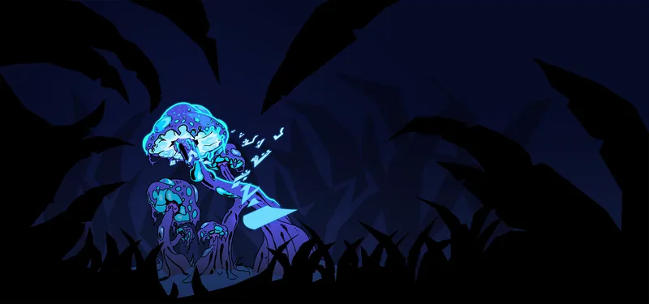 Chœur lumineux (`LUMINOUS_CHOIR`)
* **Zone :** `Acte act1a` | **Nombre d'options :** `3`
* **Description :** Vous arrivez dans une clairière baignée d’une étrange lueur bleue. Tout autour de vous, des champignons géants aux chapeaux gonflés répandent des ondes colorées par bioluminescence. Tandis que vous vous approchez, les champignons commencent à émettre des mélodies obsédantes et envoûtantes qui résonnent jusque dans votre poitrine.

Vous remarquez quelque chose de brillant, incrusté dans la chair du plus grand des champignons, et qui pulse au rythme de leur musique.

<!-- choix:LUMINOUS_CHOIR -->
**Choix dans le jeu** (généré depuis `src/engine/events`) :

* **Titre en jeu :** Chœur lumineux | **Zones :** Acte 1a

Page 0 (début) : « Dans une clairière baignée d'une lueur bleue, des champignons géants chantent des mélodies envoûtantes. Quelque chose de brillant pulse dans la chair du plus grand d'entre eux. »

* **Offrir un tribut** - Payez 149 Or, gagnez une relique.
  * Condition : au moins 149 Or (sinon l'option est grisée)
  * Effets : perd 149 Or ; gagne une relique aléatoire
  * Résultat : « Le chœur s'apaise et le champignon libère une relique. »
* **Plonger la main** - Retirez 2 cartes, +1 malédiction.
  * Effets : retire 2 cartes du deck (au choix) ; ajoute au deck 1 × Spore Mind
  * Résultat : « Vous plongez la main dans la chair du champignon. Choisissez 2 cartes à retirer ; Conscience sporique rejoint votre deck. »
* **Partir** - Ne rien faire.
  * Effets : aucun
  * Résultat : « Vous quittez la clairière, la mélodie résonnant encore dans votre poitrine. »

<!-- /choix:LUMINOUS_CHOIR -->

### 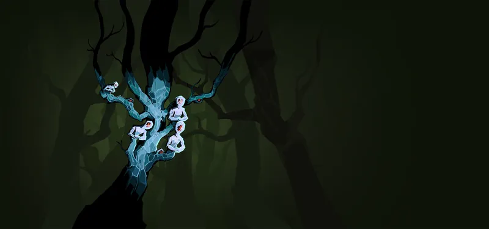 Bosquet des Morphiques (`MORPHIC_GROVE`)
* **Zone :** `Acte act1a` | **Nombre d'options :** `2`
* **Description :** Vous pénétrez dans un bosquet d’arbres cristallins, et ceux-ci se mettent à vaciller avec entrain !
Un chœur chaleureux vous assaille en guise de salutations : c'est un groupe de Morphiques gazouillants, émergeant depuis les arbres.

L'un des Morphiques se tient dans un coin à l’écart des autres. Celui-ci n’est clairement pas de nature sociable.

Vous approchez-vous du groupe ou de l’individu solitaire ?

<!-- choix:MORPHIC_GROVE -->
**Choix dans le jeu** (généré depuis `src/engine/events`) :

* **Titre en jeu :** Bosquet des Morphiques | **Zones :** Acte 1a

Page 0 (début) : « Un bosquet d'arbres cristallins vacille avec entrain. Des Morphiques gazouillants vous saluent en choeur, sauf un, seul dans son coin. Vous approchez-vous du groupe ou du solitaire ? »

* **Le groupe** - Perdez tout l'Or, transformez 2 cartes.
  * Effets : perd 32767 Or ; transforme 2 cartes (au choix)
  * Résultat : « Les Morphiques réclament tout votre Or et remodèlent votre deck. Choisissez 2 cartes à transformer. »
* **Le solitaire** - Gagnez 5 PV Max.
  * Effets : +5 PV max
  * Résultat : « Le Morphique solitaire vous gratifie d'un regard timide. Vous gagnez 5 PV Max. »

<!-- /choix:MORPHIC_GROVE -->

### 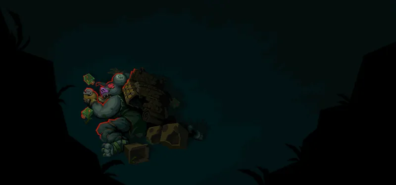 Coursier de potions (`POTION_COURIER`)
* **Zone :** `Acte act1a, Acte act1b, Acte act2, Acte act3` | **Nombre d'options :** `2`
* **Description :** Une odeur acerbe commence à planer dans l’air, et vous tombez bientôt sur un Coursier de potions effondré par terre.
Pas un mouvement. Pas un signe de vie. Mort !?
Ses affaires semblent avoir été fouillées, mais vous apercevez un lot de Potions à l’odeur âcre avec un mot : "Destinataire : Le Marchand".

<!-- choix:POTION_COURIER -->
**Choix dans le jeu** (généré depuis `src/engine/events`) :

* **Titre en jeu :** Coursier de potions | **Zones :** tous les actes

Page 0 (début) : « Une odeur âcre flotte dans l'air. Un Coursier de potions gît à terre, sans un souffle. Ses affaires ont été fouillées, mais un lot de potions nauséabondes reste, marqué : « Destinataire : Le Marchand ». »

* **Prendre les potions** - Gagnez 3 Potions infectes.
  * Effets : gagne la potion FOUL_POTION ; gagne la potion FOUL_POTION ; gagne la potion FOUL_POTION
  * Résultat : « Vous emportez le lot, le nez pincé. Vous obtenez 3 Potions infectes ! »
* **Fouiller** - Gagnez 1 potion au hasard.
  * Effets : gagne 1 potion aléatoire
  * Résultat : « Vous fouillez ses affaires et dénichez une potion intacte. »

<!-- /choix:POTION_COURIER -->

### 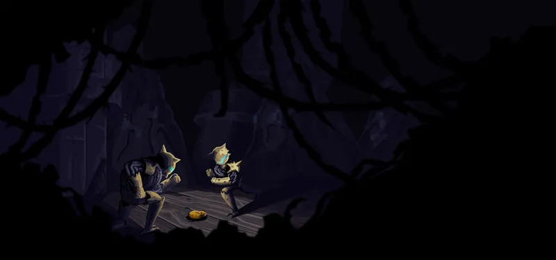 À coups de poing (`PUNCH_OFF`)
* **Zone :** `Acte act1b` | **Nombre d'options :** `2`
* **Description :** Deux Assemblages de pugilat sont en pleine bagarre, et vous apercevez entre eux un trésor...

Devriez-vous essayer de l’attraper ?

<!-- choix:PUNCH_OFF -->
**Choix dans le jeu** (généré depuis `src/engine/events`) :

* **Titre en jeu :** À coups de poing | **Zones :** Acte 1b

Page 0 (début) : « Deux Assemblages de pugilat sont en pleine bagarre, et vous apercevez entre eux un trésor... Devriez-vous essayer de l'attraper ? »

* **Chiper** - Relique aléatoire, +Blessure.
  * Effets : ajoute au deck 1 × Injury ; gagne une relique aléatoire
  * Résultat : « Vous filez le trésor sous le nez des combattants. Un coup au passage vous laisse une Blessure. »
* **Je peux les prendre** - Combat : relique et récompenses.
  * Effets : déclenche 2 Constructions à poing, puis une relique, à la sortie de l'évènement
  * Résultat : « Vous vous jetez dans la mêlée ! Les deux Assemblages se tournent vers vous. »

<!-- /choix:PUNCH_OFF -->

### 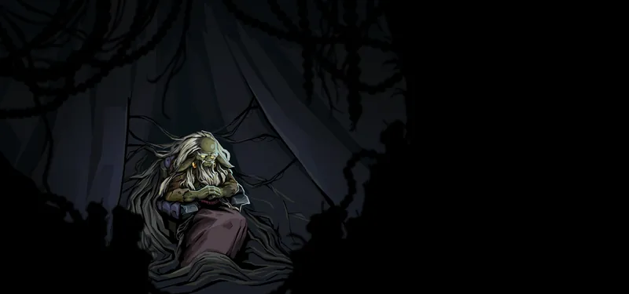 Ranwid l’Aîné (`RANWID_THE_ELDER`)
* **Zone :** `Acte act1a, Acte act1b, Acte act2, Acte act3` | **Nombre d'options :** `5`
* **Description :** Vous êtes approché par la personne la plus âgée que vous ayez jamais vue.
 « Nous nous rencontrons à nouveau... c’est moi, Ranwid ! »

Vous ne connaissez pas cet homme.

<!-- choix:RANWID_THE_ELDER -->
**Choix dans le jeu** (généré depuis `src/engine/events`) :

* **Titre en jeu :** Ranwid l'Aîné | **Zones :** tous les actes

Page 0 (début) : « Vous êtes approché par la personne la plus âgée que vous ayez jamais vue. « Nous nous rencontrons à nouveau... c'est moi, Ranwid ! » Vous ne connaissez pas cet homme. »

* **Donner 100 Or** - -100 Or, gagnez une relique.
  * Condition : au moins 100 Or (sinon l'option est grisée)
  * Effets : perd 100 Or ; gagne une relique aléatoire
  * Résultat : « Ranwid empoche vos pièces avec un sourire édenté et vous tend une relique. »
* **Donner une potion** - -1 potion, gagnez une relique.
  * Condition : au moins une potion (sinon l'option est grisée)
  * Effets : perd 1 potion au hasard ; gagne une relique aléatoire
  * Résultat : « Ranwid boit la potion d'un trait, puis vous tend une relique. »
* **Donner une relique** - -1 relique, gagnez-en 2.
  * Condition : au moins 2 reliques (sinon l'option est grisée)
  * Effets : perd la dernière relique obtenue ; gagne une relique aléatoire ; gagne une relique aléatoire
  * Résultat : « Ranwid examine longuement votre relique, puis vous en rend deux autres. »

<!-- /choix:RANWID_THE_ELDER -->

### 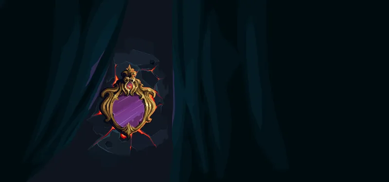 Reflets stelfeR (`REFLECTIONS`)
* **Zone :** `Acte act3` | **Nombre d'options :** `2`
* **Description :** Que se passe-t-il ? Quelque chose ici ne tourne pas rond...
...dnor sap enruot en ici esohc euqleuQ ? il-t-essap es euQ

<!-- choix:REFLECTIONS -->
**Choix dans le jeu** (généré depuis `src/engine/events`) :

* **Titre en jeu :** Reflets stelfeR | **Zones :** Acte 3

Page 0 (début) : « Que se passe-t-il ? Quelque chose ici ne tourne pas rond...
...dnor sap enruot ici esohc euqleuQ »

* **Toucher un miroir** - Améliore 4 cartes, rétrograde 2.
  * Effets : améliore 4 cartes (au hasard) ; 2 cartes améliorées redevient normale (au hasard)
  * Résultat : « Le miroir ondule. Quatre cartes brillent plus fort, deux autres se ternissent. »
* **Briser** - Dupliquez le deck, Malchance.
  * Effets : chaque carte du deck est copiée une fois ; ajoute au deck 1 × Bad Luck
  * Résultat : « Le miroir éclate : chaque carte se retrouve en double. Vous obtenez Malchance. »

<!-- /choix:REFLECTIONS -->

### 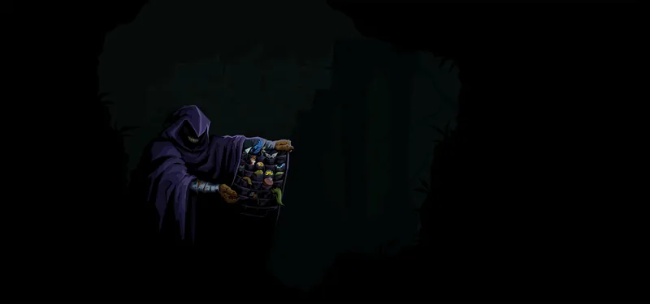 Trafiquant de reliques (`RELIC_TRADER`)
* **Zone :** `Acte act1a, Acte act1b, Acte act2, Acte act3` | **Nombre d'options :** `3`
* **Description :** Vous tournez un coin sur votre route lorsque vous vous retrouvez nez-à-nez avec une figure voilée.

« Bienvenue ! T’as quelque chose à troquer ? »
vous demande-t-elle en ouvrant grand son manteau, révélant par-dessous un éventail de marchandises plus suspectes les unes que les autres..

<!-- choix:RELIC_TRADER -->
**Choix dans le jeu** (généré depuis `src/engine/events`) :

* **Titre en jeu :** Trafiquant de reliques | **Zones :** tous les actes

Page 0 (début) : « Vous tournez un coin lorsque vous vous retrouvez nez-à-nez avec une figure voilée. « Bienvenue ! T'as quelque chose à troquer ? » Elle ouvre grand son manteau, révélant des marchandises plus suspectes les unes que les autres... »

* **Prendre celui du haut** - Échangez une relique au hasard.
  * Effets : échange une relique au hasard contre une relique qu'on n'avait pas
  * Résultat : « Le trafiquant empoche l'une de vos reliques et vous glisse celle du haut. »
* **Prendre celui du milieu** - Échangez une relique au hasard.
  * Effets : échange une relique au hasard contre une relique qu'on n'avait pas
  * Résultat : « Le trafiquant empoche l'une de vos reliques et vous glisse celle du milieu. »
* **Prendre celui du bas** - Échangez une relique au hasard.
  * Effets : échange une relique au hasard contre une relique qu'on n'avait pas
  * Résultat : « Le trafiquant empoche l'une de vos reliques et vous glisse celle du bas. »

<!-- /choix:RELIC_TRADER -->

### 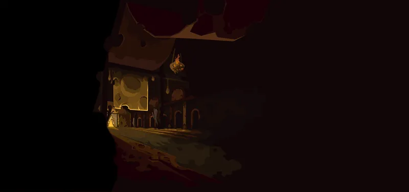 Salle du Fromage (`ROOM_FULL_OF_CHEESE`)
* **Zone :** `Acte act1a, Acte act1b, Acte act2, Acte act3` | **Nombre d'options :** `2`
* **Description :** Cette salle est remplie de fromage !!!

Vous jetez un œil tout autour de vous pour vous assurer qu’il n’y a pas de pièges, et remarquez qu’au-dessus de vous se trouve... encore du fromage. Les bougies dans la pièce semblent être faites de fromage. Le mobilier est aussi en fromage.
Soudain, la porte se referme derrière vous.

Elle est aussi faite de fromage.

<!-- choix:ROOM_FULL_OF_CHEESE -->
**Choix dans le jeu** (généré depuis `src/engine/events`) :

* **Titre en jeu :** Salle du Fromage | **Zones :** tous les actes

Page 0 (début) : « Cette salle est remplie de fromage ! Les bougies, le mobilier, et même la porte qui vient de se refermer derrière vous sont en fromage. »

* **Se gaver** - +2 cartes communes aléatoires.
  * Effets : ajoute au deck 2 carte Communes du héros
  * Résultat : « Vous vous empiffrez jusqu'à l'écoeurement. Deux cartes rejoignent votre deck. »
* **Fouiller** - Perdez 14 PV, relique Fromage.
  * Condition : plus de 14 PV (sinon l'option est grisée)
  * Effets : perd 14 PV ; gagne la relique CHOSEN_CHEESE
  * Résultat : « Vous fouillez dans le fromage et vous en prenez plein la figure. Vous obtenez Fromage d'élection ! »

<!-- /choix:ROOM_FULL_OF_CHEESE -->

### 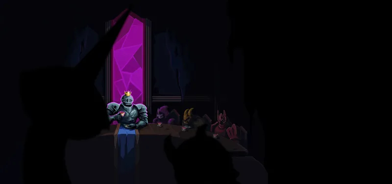 Le thé de la table ronde (`ROUND_TEA_PARTY`)
* **Zone :** `Acte act3` | **Nombre d'options :** `2`
* **Description :** Vous trouvez par hasard une invitation à une collation postméridienne destinée à un certain « Monseigneur Galalot » ; vous décidez de vous y rendre à sa place.

Après être entré à l’intérieur d’une rotonde sans prétention, vous vous retrouvez parmi un groupe de commandants, de généraux, de seigneurs de guerre et de mercenaires en train de prendre... le thé ?
Un gigantesque chevalier portant sur la tête une couronne dorée prend la parole.

« C’est à cette heure tardive que vous vous manifestez pour prendre le Thé ?! »

<!-- choix:ROUND_TEA_PARTY -->
**Choix dans le jeu** (généré depuis `src/engine/events`) :

* **Titre en jeu :** Le thé de la table ronde | **Zones :** Acte 3

Page 0 (début) : « Vous trouvez une invitation à un goûter destiné à un certain « Monseigneur Galalot » et vous vous y rendez à sa place. Dans une rotonde, des commandants et des mercenaires prennent le thé. Un géant couronné d'or s'écrie : « C'est à cette heure que vous vous manifestez ?! » »

* **Savourer le thé** - Soin complet. Poison royal.
  * Effets : soigne 999 PV ; gagne la relique ROYAL_POISON
  * Résultat : « Le thé est délicieux et vous revigore, mais son arrière-goût est étrangement amer. Vous obtenez Poison royal ! »
* **Chercher la bagarre** - Perdez 11 PV, gagnez une relique.
  * Condition : plus de 11 PV (sinon l'option est grisée)
  * Effets : perd 11 PV ; gagne une relique aléatoire ; mène à la page 1
  * Résultat : « Vous renversez la table. Les coups pleuvent, mais vous repartez avec un butin ! »

Page 1 : « Le géant couronné vous toise : « Vous allez au moins payer le droit d'entrée ! » »

* **Continuer** - Rien de plus à payer.
  * Effets : aucun
  * Résultat : « Le chevalier à la couronne vous congédie d'un geste. Au moins, vous avez payé l'entrée. »

<!-- /choix:ROUND_TEA_PARTY -->

### 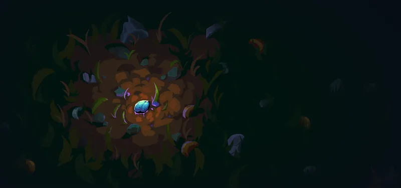 Graine de saphir (`SAPPHIRE_SEED`)
* **Zone :** `Acte act1a` | **Nombre d'options :** `2`
* **Description :** Vous manquez de peu de marcher sur un éclat de... graine ? Sa couleur ne laisse aucun doute : il s’agit d’une Graine de saphir ! Ces graines extraordinaires étaient pourtant portées disparues !?

La légende voudrait que leur consommation pourrait fortement amplifier votre endurance. Mais si vous plantiez plutôt la graine pour la faire croître ?

<!-- choix:SAPPHIRE_SEED -->
**Choix dans le jeu** (généré depuis `src/engine/events`) :

*Pas encore dans le jeu* : choix de la référence (`bible/data/event_choices`).

Page `start` :

* **Consommer : soigne 9 PV, améliore une carte.** (Consume: Heal 9 HP. Upgrade a card in your Deck.)
  * Effets : heal 9 ; upgrade card 1
* **Planter et nourrir : enchante une carte avec Semé.** (Plant and Nourish: Enchant a card with Sown.)
  * Effets : other 1 (ENCHANT_SOWN)

<!-- /choix:SAPPHIRE_SEED -->

### 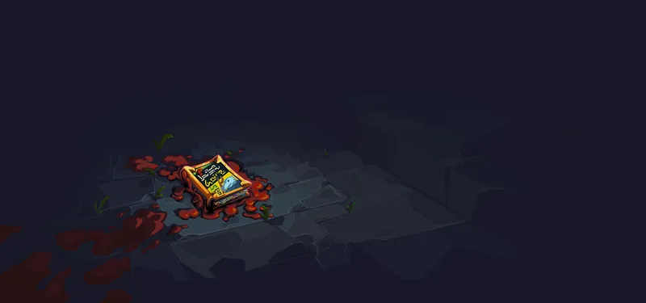 Développement personnel (`SELF_HELP_BOOK`)
* **Zone :** `Acte act1a, Acte act1b, Acte act2, Acte act3` | **Nombre d'options :** `7`
* **Description :** À terre gît un tome intitulé :
« Les 3 méthodes secrètes pour terrasser la Tour ».

Le livre est incrusté de sang ; vous le jugez donc hautement douteux à première vue.

Le lisez-vous ?

<!-- choix:SELF_HELP_BOOK -->
**Choix dans le jeu** (généré depuis `src/engine/events`) :

* **Titre en jeu :** Développement personnel | **Zones :** tous les actes

Page 0 (début) : « À terre gît un tome intitulé « Les 3 méthodes secrètes pour terrasser la Tour ». Il est incrusté de sang : vous le jugez hautement douteux. Le lisez-vous ? »

* **Lire le livre en entier** - Pouvoir : Célérité 2.
  * Condition : une carte de type 2 peut être enchantée (sinon l'option est grisée)
  * Effets : enchante 1 carte (au choix) : SWIFT 2, type 2
  * Résultat : « Vous lisez tout le livre. Choisirez un Pouvoir à envoûter avec Célérité 2. »
* **Lire un passage au hasard** - Compétence : Agilité 2.
  * Condition : une carte de type 1 peut être enchantée (sinon l'option est grisée)
  * Effets : enchante 1 carte (au choix) : NIMBLE 2, type 1
  * Résultat : « Vous lisez un passage au hasard. Choisirez une Compétence à envoûter avec Agilité 2. »
* **Lire la 4e de couverture** - Attaque : Tranchant 2.
  * Condition : une carte de type 0 peut être enchantée (sinon l'option est grisée)
  * Effets : enchante 1 carte (au choix) : SHARP 2, type 0
  * Résultat : « Vous lisez la quatrième de couverture. Choisirez une Attaque à envoûter avec Tranchant 2. »
* **Passer son chemin** - Ne rien lire.
  * Effets : aucun
  * Résultat : « Ce livre ensanglanté est bien trop douteux. Vous passez votre chemin. »

<!-- /choix:SELF_HELP_BOOK -->

### 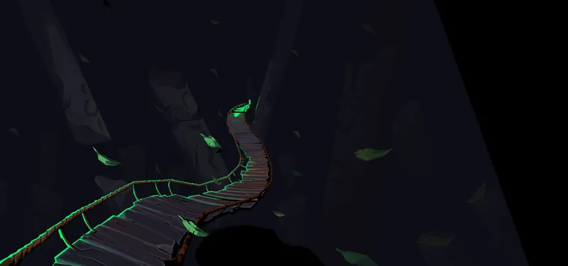 Pont glissant (`SLIPPERY_BRIDGE`)
* **Zone :** `Acte act1a, Acte act1b, Acte act2, Acte act3` | **Nombre d'options :** `2`
* **Description :** Alors que vous êtes en train de traverser un pont en bois chancelant, un torrent de pluie se lève soudainement. De puissantes rafales de vent vous assaillent, menaçant de mettre fin à votre périple.

<!-- choix:SLIPPERY_BRIDGE -->
**Choix dans le jeu** (généré depuis `src/engine/events`) :

* **Titre en jeu :** Pont glissant | **Zones :** tous les actes

Page 0 (début) : « Alors que vous traversez un pont de bois chancelant, un torrent de pluie se lève. De puissantes rafales de vent menacent de mettre fin à votre périple. »

* **Persévérer** - Perdez 8 PV, retirez une carte.
  * Condition : plus de 8 PV (sinon l'option est grisée)
  * Effets : perd 8 PV ; retire 1 carte du deck (au choix)
  * Résultat : « Vous avancez contre le vent, à pas lents. Choisissez une carte à retirer de votre deck. »
* **Se reposer** - Soignez 25 PV, puis combattez.
  * Effets : soigne 25 PV ; mène à la page 1
  * Résultat : « Vous vous abritez et reprenez des forces. Mais quelque chose remue sous le pont... »

Page 1 : « Des créatures grouillantes montent à l'assaut du pont. »

* **Combattre !** - Un combat commence.
  * Effets : déclenche un combat normal, à la sortie de l'évènement
  * Résultat : « Des larves surgissent de sous le pont ! »

<!-- /choix:SLIPPERY_BRIDGE -->

### 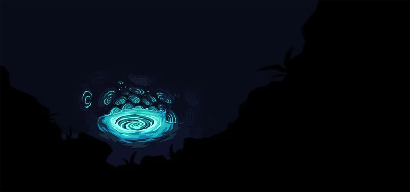 Tourbillon aquatique (`SPIRALING_WHIRLPOOL`)
* **Zone :** `Acte act1b` | **Nombre d'options :** `3`
* **Description :** Vous tombez sur un Énorme tourbillon aquatique. L’eau, qui dessine des remous avec une précision ravissante, s’écrase sur les murs, somptueusement ornés de motifs dessinant des spirales. 

Tourne et tourne et tourne et tourne...
....et tourne encore... quel spectacle......

Que faites-vous ?

<!-- choix:SPIRALING_WHIRLPOOL -->
**Choix dans le jeu** (généré depuis `src/engine/events`) :

*Pas encore dans le jeu* : choix de la référence (`bible/data/event_choices`).

Page `start` :

* **Boire : soigne des PV.** (Drink: Heal HP.)
  * Effets : heal - montant introuvable (op.gg affiche 0)
* **Observer : enchante une Frappe ou Défense de base avec Spirale.** (Observe: Enchant a Basic Strike or Defend with Spiral.)
  * Effets : other 1 (ENCHANT_SPIRAL)
* **Plonger la main : relique aléatoire et ajoute Contorsion.** (Reach In: Gain a random Relic and add Writhe to your Deck.)
  * Effets : gain relic 1 (RANDOM_RELIC) ; add curse 1 (WRITHE)

<!-- /choix:SPIRALING_WHIRLPOOL -->

### 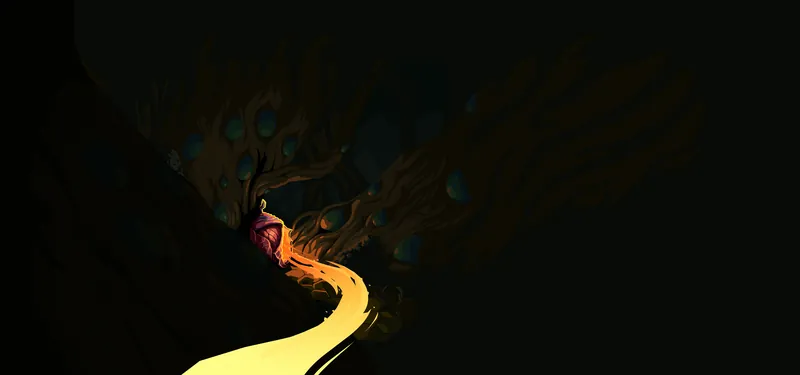 Esprit greffeur (`SPIRIT_GRAFTER`)
* **Zone :** `Acte act2` | **Nombre d'options :** `2`
* **Description :** Un cocon pend au-dessus de votre tête, gigotant et se tortillant dans tous les sens ; il est sur le point d’éclore !

...le gigotement cesse. Le cocon prend feu ! Que se passe-t-il ? 
Dans une déflagration de flammes et de lumière, un Esprit greffeur vous fonce dessus, menaçant de fusionner avec votre être. »

<!-- choix:SPIRIT_GRAFTER -->
**Choix dans le jeu** (généré depuis `src/engine/events`) :

* **Titre en jeu :** Esprit greffeur | **Zones :** Acte 2

Page 0 (début) : « Un cocon pend au-dessus de vous, gigotant. Soudain il prend feu et, dans une déflagration de flammes et de lumière, un Esprit greffeur vous fonce dessus, menaçant de fusionner avec votre être. »

* **Le laisser entrer** - Soignez 25 PV, gagnez Métamorphose.
  * Effets : soigne 25 PV ; ajoute au deck 1 × Metamorphosis
  * Résultat : « L'esprit fusionne avec vous. Vous vous sentez mieux. Vous obtenez Métamorphose ! »
* **Rejet** - Perdez 10 PV, améliorez une carte.
  * Effets : perd 10 PV ; améliore 1 carte (au choix)
  * Résultat : « Vous repoussez l'esprit, non sans mal. Choisissez la carte à améliorer. »

<!-- /choix:SPIRIT_GRAFTER -->

### 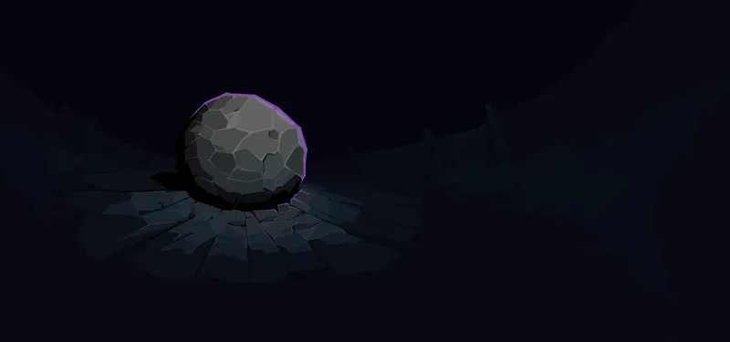 Pierre de tous les temps (`STONE_OF_ALL_TIME`)
* **Zone :** `Acte act1a, Acte act1b, Acte act2, Acte act3` | **Nombre d'options :** `4`
* **Description :** Un énorme rocher sied au centre d’une cour abandonnée.

Vous trouvez une plaque avec l’inscription suivante :
Pierre de tous les temps.

Sa présence, sa forme et les parures qui la recouvrent indiquent que cette cour fut construite autour de cette Pierre, et que celle-ci n’a jamais quitté son emplacement.

<!-- choix:STONE_OF_ALL_TIME -->
**Choix dans le jeu** (généré depuis `src/engine/events`) :

* **Titre en jeu :** Pierre de tous les temps | **Zones :** tous les actes

Page 0 (début) : « Un énorme rocher trône au centre d'une cour abandonnée. Une plaque indique : « Pierre de tous les temps ». La cour fut construite autour de cette Pierre, qui n'a jamais quitté son emplacement. »

* **Boire et soulever** - Perdez 1 potion, +10 PV Max.
  * Condition : au moins une potion (sinon l'option est grisée)
  * Effets : perd 1 potion au hasard ; +10 PV max
  * Résultat : « Vous videz une potion et soulevez la Pierre à bout de bras. Vous gagnez 10 PV Max. »
* **Pousser** - Perdez 6 PV, Attaque Vigoureuse 8.
  * Condition : une Attaque du deck peut être enchantée (sinon l'option est grisée)
  * Effets : perd 6 PV ; enchante 1 carte (au choix) : VIGOROUS 8
  * Résultat : « Vous poussez la Pierre de toutes vos forces. Choisissez une Attaque à envoûter de Vigoureux 8. »
* **Partir** - Ne touchez pas à la Pierre.
  * Effets : aucun
  * Résultat : « La Pierre est là depuis toujours. Elle y restera. »

<!-- /choix:STONE_OF_ALL_TIME -->

### 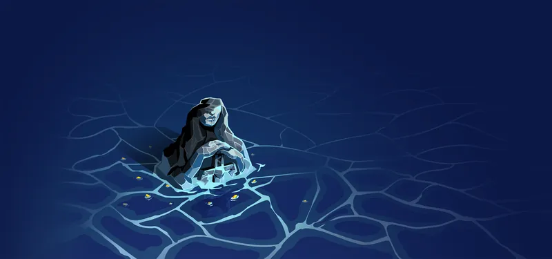 La statue engloutie (`SUNKEN_STATUE`)
* **Zone :** `Acte act1a, Acte act1b` | **Nombre d'options :** `2`
* **Description :** Vous apercevez une statue érodée par le temps, à moitié immergée dans un bassin ; ses mains agrippent une épée en pierre.

Par ailleurs, vous remarquez que quelque chose scintille au fond du lac.
Des offrandes votives ?

Vous ne diriez pas non à un peu d’argent...

<!-- choix:SUNKEN_STATUE -->
**Choix dans le jeu** (généré depuis `src/engine/events`) :

* **Titre en jeu :** La statue engloutie | **Zones :** Acte 1a, Acte 1b

Page 0 (début) : « Une statue érodée, à moitié immergée dans un bassin, agrippe une épée de pierre. Quelque chose scintille au fond du lac : des offrandes votives ? Un peu d'argent ne serait pas de refus... »

* **Plonger dans l'eau** - Gagnez 111 Or, perdez 7 PV.
  * Condition : plus de 7 PV (sinon l'option est grisée)
  * Effets : gagne 111 Or ; perd 7 PV
  * Résultat : « Vous plongez et remontez des poignées de pièces : +111 Or, -7 PV. »
* **Prendre l'épée** - Obtenez l'Épée de pierre.
  * Effets : gagne la relique SWORD_OF_STONE
  * Résultat : « Vous arrachez l'épée aux mains de la statue. Vous obtenez l'Épée de pierre ! »

<!-- /choix:SUNKEN_STATUE -->

### 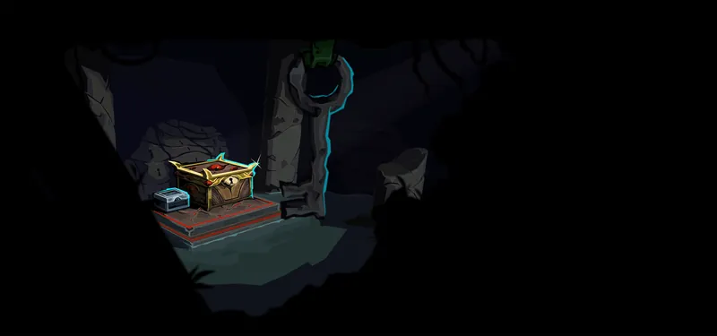 Trésor englouti (`SUNKEN_TREASURY`)
* **Zone :** `Acte act1b` | **Nombre d'options :** `2`
* **Description :** Un sentier vous mène jusqu’à une chambre forte partiellement engloutie.
Vous apercevez 2 coffres, mais seulement 1 clé d’aspect fragile.

Le premier coffre : Lorsque vous le secouez, vous entendez des cliquetis et des tintements. Quelques pièces d’or.
Le deuxième coffre : Énorme, orné de décorations, et assurément maudit. Beaucoup de pièces d’or !

<!-- choix:SUNKEN_TREASURY -->
**Choix dans le jeu** (généré depuis `src/engine/events`) :

* **Titre en jeu :** Trésor englouti | **Zones :** Acte 1b

Page 0 (début) : « Une chambre forte à moitié engloutie renferme 2 coffres, mais une seule clé fragile. Le premier cliquette de quelques pièces. Le second, énorme et orné, est sans doute maudit. »

* **Premier coffre** - Gagnez 52 Or.
  * Effets : gagne 52 Or
  * Résultat : « La clé tourne. Quelques pièces d'or tintent au fond du coffre : +52 Or. »
* **Deuxième coffre** - Gagnez 303 Or, Cupidité.
  * Effets : gagne 303 Or ; ajoute au deck 1 × Greed
  * Résultat : « Une fortune déborde du coffre maudit : +303 Or. Vous obtenez la malédiction Cupidité. »

<!-- /choix:SUNKEN_TREASURY -->

### 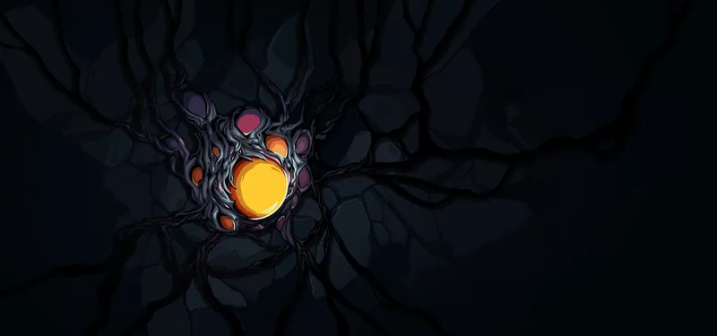 Symbiote (`SYMBIOTE`)
* **Zone :** `Acte act1a, Acte act1b, Acte act2, Acte act3` | **Nombre d'options :** `3`
* **Description :** Au cours de votre périple, vous tombez sur un polype sombre et amorphe. Vous avez le pressentiment qu’il est très ancien, et très maléfique. 

Approchez...

<!-- choix:SYMBIOTE -->
**Choix dans le jeu** (généré depuis `src/engine/events`) :

* **Titre en jeu :** Symbiote | **Zones :** tous les actes

Page 0 (début) : « Au cours de votre périple, vous tombez sur un polype sombre et amorphe. Vous avez le pressentiment qu'il est très ancien, et très maléfique. Approchez... »

* **Approcher** - Corrompez une Attaque au choix.
  * Effets : enchante 1 carte (au choix) : CORRUPTED
  * Résultat : « Le polype vous enveloppe. Vous allez choisir l'Attaque qu'il corrompra. »
* **Tuer par le feu** - Transformez une carte au choix.
  * Effets : transforme 1 carte (au choix)
  * Résultat : « Les flammes dévorent le polype. Vous allez choisir une carte à transformer. »

<!-- /choix:SYMBIOTE -->

### 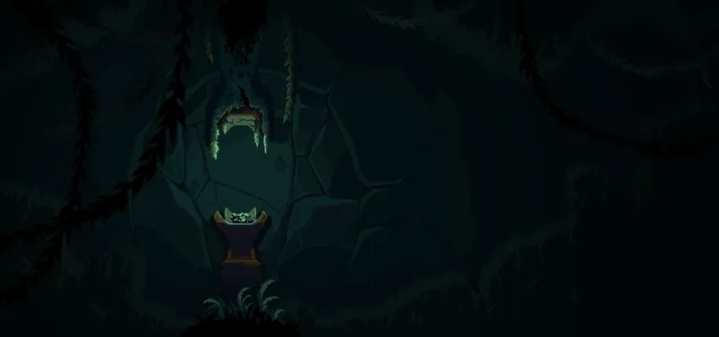 Stèle de la Vérité (`TABLET_OF_TRUTH`)
* **Zone :** `Acte act1a` | **Nombre d'options :** `2`
* **Description :** Vous venez à bout de deux Gardiens de la Tribu et entrez dans un caveau sécurisé.

À l’intérieur, vous trouvez une stèle recouverte d’inscriptions qui vous semblent familières. Votre intuition vous dit que vous êtes capable de déchiffrer cette langue sans trop de difficulté... Cependant, une fois que vous commencerez à traduire, vous aurez besoin de toute votre concentration.

Une énergie apaisante émane de la stèle, et vous pourriez la détruire afin de libérer son pouvoir guérisseur au lieu de la lire.

<!-- choix:TABLET_OF_TRUTH -->
**Choix dans le jeu** (généré depuis `src/engine/events`) :

* **Titre en jeu :** Stèle de la Vérité | **Zones :** Acte 1a

Page 0 (début) : « Dans un caveau, une stèle couverte d'inscriptions familières. Vous pouvez la déchiffrer, mais cela exigera toute votre concentration, ou la détruire pour libérer son pouvoir guérisseur. »

* **Déchiffrer** - -3 PV Max, améliore 1 carte au hasard.
  * Effets : -3 PV max ; améliore 1 carte (au hasard) ; mène à la page 1
  * Résultat : « Les symboles s'éclairent peu à peu. Une de vos cartes est améliorée (+) ! »
* **Briser** - Soignez 20 PV.
  * Effets : soigne 20 PV
  * Résultat : « Vous fracassez la stèle. Son énergie apaisante vous envahit. »

Page 1 : « Vous continuez la traduction. Votre esprit se fatigue, mais la stèle en révèle davantage. »

* **Continuer** - -3 PV Max, améliore 1 carte au hasard.
  * Effets : -3 PV max ; améliore 1 carte (au hasard) ; mène à la page 2
  * Résultat : « Le sens vous apparaît, mais votre tête vous fait mal. Une de vos cartes est améliorée (+) ! »
* **Abandonner** - Quittez la stèle.
  * Effets : aucun
  * Résultat : « Vous détournez les yeux de la stèle. »

Page 2 : « La stèle livre un nouveau passage. Votre concentration vacille. »

* **Continuer encore** - -3 PV Max, améliore 1 carte au hasard.
  * Effets : -3 PV max ; améliore 1 carte (au hasard) ; mène à la page 3
  * Résultat : « Vous poursuivez, le front en sueur. Une de vos cartes est améliorée (+) ! »
* **Abandonner** - Quittez la stèle.
  * Effets : aucun
  * Résultat : « Vous détournez les yeux de la stèle. »

Page 3 : « Chaque mot pèse davantage. Il reste peu à lire, mais le prix s'alourdit. »

* **CONTINUER** - -3 PV Max, améliore 1 carte au hasard.
  * Effets : -3 PV max ; améliore 1 carte (au hasard) ; mène à la page 4
  * Résultat : « Les mots résonnent dans votre crâne. Une de vos cartes est améliorée (+) ! »
* **Abandonner** - Quittez la stèle.
  * Effets : aucun
  * Résultat : « Vous détournez les yeux de la stèle. »

Page 4 : « Le dernier passage est là. Le lire vous coûtera cher, mais votre deck n'aura plus de secrets. »

* **Tout perdre** - -3 PV Max, améliore TOUTES les cartes.
  * Effets : -3 PV max ; améliore 99 cartes (au hasard)
  * Résultat : « La vérité vous submerge. Toutes vos cartes sont améliorées (+) ! »
* **Abandonner** - Quittez la stèle.
  * Effets : aucun
  * Résultat : « Vous détournez les yeux de la stèle. »

<!-- /choix:TABLET_OF_TRUTH -->

### 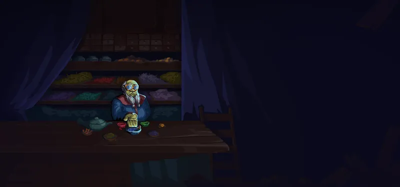 Maître de thé (`TEA_MASTER`)
* **Zone :** `Acte act1a, Acte act1b, Acte act2, Acte act3` | **Nombre d'options :** `5`
* **Description :** Vous arrivez par hasard dans une petite cahute mal éclairée ; l’atmosphère à l’intérieur est calme et contemplative, et, partout, des variétés de thé dont l’exhaustivité frôle l’obsession sont exposées.

L’homme à l’intérieur vous indique une sélection de thés, chacun étiqueté d’un prix élevé.

<!-- choix:TEA_MASTER -->
**Choix dans le jeu** (généré depuis `src/engine/events`) :

* **Titre en jeu :** Maître de thé | **Zones :** tous les actes

Page 0 (début) : « Vous arrivez par hasard dans une petite cahute mal éclairée ; l'atmosphère y est calme et contemplative, et des variétés de thé dont l'exhaustivité frôle l'obsession sont exposées. L'homme à l'intérieur vous indique une sélection de thés, chacun étiqueté d'un prix élevé. »

* **Thé d'os** - 50 Or. Main de départ améliorée.
  * Condition : au moins 50 Or (sinon l'option est grisée)
  * Effets : perd 50 Or ; gagne la relique BONE_TEA
  * Résultat : « Le thé d'os vous réchauffe les os. Vous obtenez Thé d'os ! »
* **Thé de braise** - 150 Or. +2 Force, 5 combats.
  * Condition : au moins 150 Or (sinon l'option est grisée)
  * Effets : perd 150 Or ; gagne la relique EMBER_TEA
  * Résultat : « Le thé de braise vous brûle la gorge. Vous obtenez Thé de braise ! »
* **Thé de l'impolitesse** - Gratuit. +2 Hébété au combat.
  * Effets : gagne la relique TEA_OF_DISCOURTESY
  * Résultat : « Le maître de thé vous toise. Vous obtenez Thé de l'impolitesse ! »

<!-- /choix:TEA_MASTER -->

###  L’avenir des potions ? (`THE_FUTURE_OF_POTIONS`)
* **Zone :** `Acte act1a, Acte act1b, Acte act2, Acte act3` | **Nombre d'options :** `1`
* **Description :** Vous vous apprêtez à tourner au coin lorsque vous ressentez un léger bourdonnement, et découvrez un énorme appareil qui pivote sur son axe !
Vous remarquez qu’il dispose d’emplacements où des liquides semblent pouvoir être transformés en petits comprimés faciles à digérer.

L’idée de convertir vos potions tonifiantes en toutes petites bouchées vous gêne un peu, mais c’est peut-être l’occasion d’essayer de nouvelles choses ?

<!-- choix:THE_FUTURE_OF_POTIONS -->
**Choix dans le jeu** (généré depuis `src/engine/events`) :

* **Titre en jeu :** L'avenir des potions ? | **Zones :** tous les actes

Page 0 (début) : « Un énorme appareil pivote sur son axe en bourdonnant. Ses emplacements semblent transformer les liquides en petits comprimés faciles à digérer. Et si vous essayiez quelque chose de nouveau ? »

* **Insérer une potion** - Potion contre carte améliorée.
  * Condition : au moins une potion (sinon l'option est grisée)
  * Effets : échange la première potion contre une carte améliorée de même rareté
  * Résultat : « La machine avale votre potion et recrache un comprimé : une carte améliorée de même rareté rejoint votre deck. »
* **Partir** - Ne rien insérer.
  * Effets : aucun
  * Résultat : « Vous laissez l'appareil à ses expériences et poursuivez votre chemin. »

<!-- /choix:THE_FUTURE_OF_POTIONS -->

###  La clé de la lanterne (`THE_LANTERN_KEY`)
* **Zone :** `Acte act2` | **Nombre d'options :** `2`
* **Description :** Vous apercevez une clé faiblement luminescente et êtes sur le point de la ramasser lorsque...

« La voilà, je la cherchais partout ! Si tu permets... »

Cette personne ne vous inspire pas confiance, mais il vaut peut-être mieux ne pas juger les gens trop vite.

<!-- choix:THE_LANTERN_KEY -->
**Choix dans le jeu** (généré depuis `src/engine/events`) :

* **Titre en jeu :** La clé de la lanterne | **Zones :** aucune (ouvert par une quête uniquement)

Page 0 (début) : « La clé luminescente vibre dans votre sac. Un inconnu surgit : « La voilà, je la cherchais partout ! » »

* **Rendre la clé** - Gagnez 100 Or.
  * Effets : gagne 100 Or
  * Résultat : « L'inconnu vous remercie avec une bourse bien garnie. »
* **Garder la clé** - Gagnez une potion.
  * Effets : gagne la potion FIRE_POTION
  * Résultat : « Vous refusez. L'inconnu vous lance une fiole avant de disparaître. »

<!-- /choix:THE_LANTERN_KEY -->

### 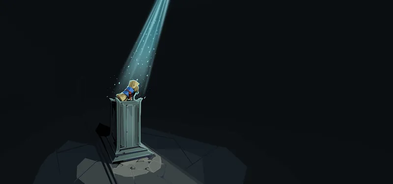 La légende disait vrai (`THE_LEGENDS_WERE_TRUE`)
* **Zone :** `Acte act1a, Acte act1b, Acte act2, Acte act3` | **Nombre d'options :** `2`
* **Description :** Vous pénétrez dans une pièce où règne le noir total, lorsque, soudain, une lueur venue d’au-dessus transperce l’obscurité — au même moment, la porte claque derrière vous.

Devant vous, illuminé, se tient un podium sur lequel est posé une carte dessinée. Vous ressentez l’envie pressante de vous en emparer.

Tout ceci est très suspect.

<!-- choix:THE_LEGENDS_WERE_TRUE -->
**Choix dans le jeu** (généré depuis `src/engine/events`) :

* **Titre en jeu :** La légende disait vrai | **Zones :** tous les actes

Page 0 (début) : « Dans une pièce plongée dans le noir, une lueur éclaire soudain un podium où repose une carte dessinée, et la porte claque derrière vous. Vous ressentez l'envie pressante de vous en emparer. Tout ceci est très suspect. »

* **Attraper la carte** - Ajoute Carte au trésor.
  * Effets : ajoute au deck 1 × Spoils Map
  * Résultat : « Vous vous emparez de la carte. La porte se rouvre : vous voilà avec un plan au trésor ! »
* **Chercher une sortie** - Perdez 8 PV, gagnez 1 potion.
  * Condition : plus de 8 PV (sinon l'option est grisée)
  * Effets : perd 8 PV ; gagne 1 potion aléatoire
  * Résultat : « Vous tâtonnez dans le noir, vous cognant partout, et finissez par trouver une potion et la sortie. »

<!-- /choix:THE_LEGENDS_WERE_TRUE -->

### 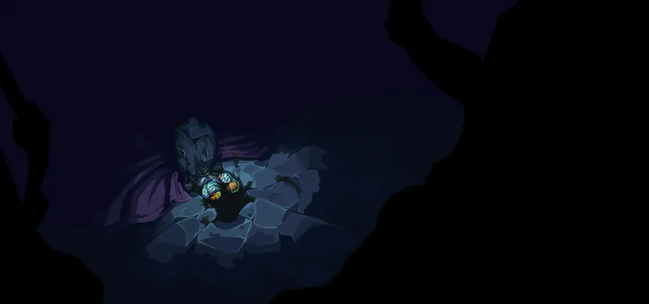 Ceci ou Cela ? (`THIS_OR_THAT`)
* **Zone :** `Acte act1a, Acte act1b, Acte act2, Acte act3` | **Nombre d'options :** `2`
* **Description :** Des bras jaillissent soudainement d’un trou dans le sol, tenant d’une part un un sac suspect rempli de richesses et d’autre part une relique clairement maudite.

« Ceci... ou Cela ? »
chuchote une voix rauque d’en-dessous.

<!-- choix:THIS_OR_THAT -->
**Choix dans le jeu** (généré depuis `src/engine/events`) :

* **Titre en jeu :** Ceci ou Cela ? | **Zones :** tous les actes

Page 0 (début) : « Des bras jaillissent d'un trou dans le sol, tenant un sac suspect rempli de richesses et une relique clairement maudite. « Ceci... ou Cela ? » chuchote une voix rauque d'en-dessous. »

* **Ceci** - Perdez 6 PV, gagnez 55 Or.
  * Condition : plus de 6 PV (sinon l'option est grisée)
  * Effets : perd 6 PV ; gagne 55 Or
  * Résultat : « Le sac vous mord la main, mais il est bien rempli. Vous gagnez 55 Or ! »
* **Cela** - Gagnez une relique, +Maladresse.
  * Effets : ajoute au deck 1 × Clumsy ; gagne une relique aléatoire
  * Résultat : « Vous saisissez la relique maudite. Maladresse rejoint votre deck. »

<!-- /choix:THIS_OR_THAT -->

### 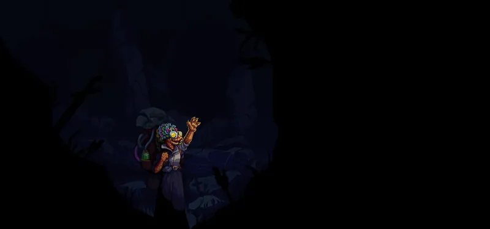 Bricolage (`TINKER_TIME`)
* **Zone :** `Acte act3` | **Nombre d'options :** `1`
* **Description :** Après avoir traversé un véritable océan de cadavres, vous tombez sur une ingénieure aux airs de savante folle en train de farfouiller à la recherche de quelque chose d’utile.

« Oui. Salut, bonjour ! Tu as l’air d’être un guerrier compétent... J’ai besoin de quelqu’un pour tester mon prochain atrociteur ! Ça t’intéresse ? »

<!-- choix:TINKER_TIME -->
**Choix dans le jeu** (généré depuis `src/engine/events`) :

*Pas encore dans le jeu* : choix de la référence (`bible/data/event_choices`).

Page `start` :

* **Accepter : crée une carte sur mesure ajoutée au deck.** (Accept: Create a custom card to add to your Deck.)
  * Effets : add card 1 (CUSTOM_CARD)

Page `type` :

* **Arme : crée une Attaque.** (Weapon: Make an Attack.)
  * Effets : other 1 (TYPE_ATTACK)
* **Gadget : crée un Pouvoir.** (Gadget: Make a Power.)
  * Effets : other 1 (TYPE_POWER)
* **Protecteur : crée une Compétence.** (Protector: Make a Skill.)
  * Effets : other 1 (TYPE_SKILL)

Page `effect` :

* **Chaos : ajoute une carte aléatoire en main, gratuite ce tour.** (Chaos: Add a random card into your Hand. It's free to play this turn.)
  * Effets : other 1 (RIDER_CHAOS)
* **Étranglement : chaque carte jouée ce tour fait perdre X PV à l'ennemi.** (Choking: Whenever you play a card this turn, the enemy loses X HP.)
  * Effets : other (RIDER_CHOKING) - X inconnu
* **Curieux : les Pouvoirs coûtent 1 énergie de moins.** (Curious: Powers cost 1 energy less.)
  * Effets : other 1 (RIDER_CURIOUS)
* **Énergisé : gagne de l'énergie.** (Energized: Gain energy.)
  * Effets : other (RIDER_ENERGIZED) - quantité inconnue
* **Expertise : gagne X Force et Y Dextérité.** (Expertise: Gain X Strength, Y Dexterity.)
  * Effets : other (RIDER_EXPERTISE) - X, Y inconnus
* **Amélioration : en fin de combat, améliore une carte aléatoire.** (Improvement: At the end of combat, upgrade a random card.)
  * Effets : other 1 (RIDER_IMPROVEMENT)
* **Sape : applique X Faiblesse et Y Vulnérable.** (Sapping: Apply X Weak, Y Vulnerable.)
  * Effets : other (RIDER_SAPPING) - X, Y inconnus
* **Violence : frappe 2 fois de plus.** (Violence: Hits 2 additional times.)
  * Effets : other 2 (RIDER_VIOLENCE)
* **Sagesse : pioche 3 cartes.** (Wisdom: Draw 3 cards.)
  * Effets : other 3 (RIDER_WISDOM)

<!-- /choix:TINKER_TIME -->

### 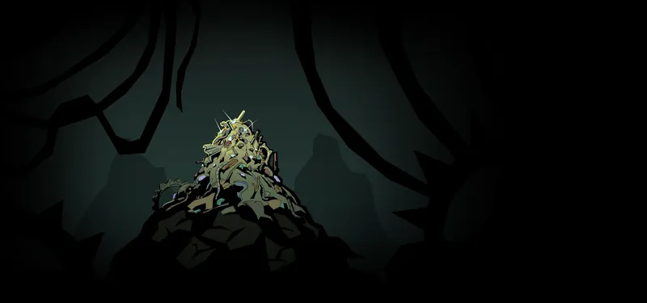 Tas de déchets (`TRASH_HEAP`)
* **Zone :** `Acte act1b` | **Nombre d'options :** `2`
* **Description :** Vous découvrez un gigantesque tas d’armes et de breloques abandonnées, ainsi que toutes sortes de babioles insolites. Le tas paraît vibrer et se mouvoir, comme s’il grandissait de l’intérieur...

Si vous cherchez en surface, vous trouverez sans doute des objets de valeur. Mais si vous fouillez plus en profondeur, vous pourriez trouver des trésors exotiques.

<!-- choix:TRASH_HEAP -->
**Choix dans le jeu** (généré depuis `src/engine/events`) :

* **Titre en jeu :** Tas de déchets | **Zones :** Acte 1b

Page 0 (début) : « Un gigantesque tas d'armes et de breloques abandonnées vibre, comme s'il grandissait de l'intérieur. En surface, vous trouverez sans doute des objets de valeur ; en fouillant plus profond, des trésors exotiques. »

* **Plonger dedans** - Perdez 8 PV, gagnez une relique.
  * Effets : perd 8 PV ; gagne 1 relique parmi : DARKSTONE_PERIAPT, DREAM_CATCHER, HAND_DRILL, MAW_BANK, THE_BOOT
  * Résultat : « Vous fouillez en profondeur, au prix de quelques coupures. Vous trouvez une relique ! »
* **Bric-à-brac au hasard** - Gagnez 100 Or et une carte.
  * Effets : gagne 100 Or ; ajoute au deck 1 carte parmi : Caltrops, Clash, Distraction, Dual Wield, Entrench, Hello World, Outmaneuver, Rebound, Rip and Tear, Stack
  * Résultat : « Vous ramassez ce qui traîne en surface : de l'or, et une carte oubliée. »

<!-- /choix:TRASH_HEAP -->

###  Le procès (`TRIAL`)
* **Zone :** `Acte act3` | **Nombre d'options :** `2`
* **Description :** Vous vous joignez à une file de personnes en train d’entrer dans un énorme bâtiment.

Tandis que vous passez sous une arche dorée, un beuglement de cors se fait entendre, des confettis jaillissent, et des banderoles se déploient du plafond !

« Citoyen -1, vous êtes LE DÉCIDEUR pour le Procès d’aujourd’hui. »

<!-- choix:TRIAL -->
**Choix dans le jeu** (généré depuis `src/engine/events`) :

* **Titre en jeu :** Le procès | **Zones :** Acte 3

Page 0 (début) : « Vous rejoignez une file entrant dans un énorme bâtiment. Sous une arche dorée, des cors beuglent, des confettis jaillissent : « Citoyen -1, vous êtes LE DÉCIDEUR pour le Procès d'aujourd'hui. » »

* **Accepter** - Devenez le Décideur.
  * Effets : mène à la page 1
  * Résultat : « Vous prenez place sur l'estrade, sous les acclamations. »
* **Refuser** - Vous n'en avez pas le droit.
  * Effets : mène à la page 1
  * Résultat : « « Le Décideur n'a pas le droit de refuser. » Des gardes vous poussent vers l'estrade. »

Page 1 : « Le juge vous fixe : « Le Décideur ne peut se dérober. Rendez votre verdict... ou insistez, et assumez les conséquences. » »

* **Accepter** - Un procès est tiré au sort.
  * Effets : mène à l'une des pages 2 à 4 (tirée au hasard)
  * Résultat : « On amène l'accusé devant vous. »
* **Insister** - Conséquences mortelles.
  * Effets : perd 999 PV
  * Résultat : « Vous défiez la cour. Elle ne le prend pas bien. »

Page 2 : « Un marchand est à la barre, accusé d'avoir vendu des reliques truquées. Coupable ou innocent ? »

* **Coupable** - 2 reliques, ajoute Regrets.
  * Effets : ajoute au deck 1 × Regret ; gagne une relique aléatoire ; gagne une relique aléatoire
  * Résultat : « Le marchand est condamné ; ses biens vous reviennent. Vous obtenez 2 reliques, et des Regrets. »
* **Innocent** - Améliore 2 cartes, ajoute Honte.
  * Effets : ajoute au deck 1 × Shame ; améliore 2 cartes (au choix)
  * Résultat : « Le marchand vous remercie. Choisissez 2 cartes à améliorer ; vous obtenez la Honte. »

Page 3 : « Un noble drapé de soie est à la barre, accusé de crimes que personne ne détaille. Coupable ou innocent ? »

* **Coupable** - Récupérez 10 PV.
  * Effets : soigne 10 PV
  * Résultat : « Le noble est condamné sous les vivats. Vous vous sentez mieux (+10 PV). »
* **Innocent** - Gagnez 300 Or, ajoute Regrets.
  * Effets : ajoute au deck 1 × Regret ; gagne 300 Or
  * Résultat : « Le noble vous glisse une bourse bien remplie (+300 Or). Vous obtenez des Regrets. »

Page 4 : « Un individu quelconque, que personne ne semble reconnaître, est à la barre. Coupable ou innocent ? »

* **Coupable** - 2 choix de carte, ajoute Doute.
  * Effets : ajoute au deck 1 × Doubt ; récompense de carte ×2 (du héros), à la sortie de l'évènement
  * Résultat : « La cour vous récompense. Vous obtenez le Doute ; choisissez une carte, puis une autre. »
* **Innocent** - Transforme 2 cartes, ajoute Doute.
  * Effets : ajoute au deck 1 × Doubt ; transforme 2 cartes (au choix)
  * Résultat : « L'accusé s'éclipse. Vous obtenez le Doute ; choisissez 2 cartes à transformer. »

<!-- /choix:TRIAL -->

### 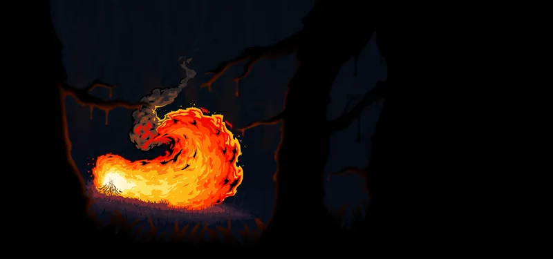 Site sans repos (`UNREST_SITE`)
* **Zone :** `Acte act1a` | **Nombre d'options :** `2`
* **Description :** Vous découvrez un Site de repos isolé et allumez un feu de camp pour vous reposer.
Ou du moins, c’est ce que vous pensiez.

Une fois le feu allumé, il se met à croître de tous côtés et semble s’étendre vers un bosquet d’arbres dégoulinant de sève.

Essayez-vous de trouver le sommeil malgré tout ?

<!-- choix:UNREST_SITE -->
**Choix dans le jeu** (généré depuis `src/engine/events`) :

* **Titre en jeu :** Site sans repos | **Zones :** Acte 1a

Page 0 (début) : « Vous découvrez un Site de repos isolé et allumez un feu pour vous reposer. Ou du moins, c'est ce que vous pensiez. Le feu croît de tous côtés et s'étend vers un bosquet d'arbres dégoulinant de sève. Essayez-vous de trouver le sommeil malgré tout ? »

* **Dormir quand même** - Soignez tous vos PV, Mauvais sommeil.
  * Effets : soigne 9999 PV ; ajoute au deck 1 × Poor Sleep
  * Résultat : « Vous dormez d'un sommeil agité. Vos PV sont restaurés, mais Mauvais sommeil rejoint votre deck. »
* **Abattre les arbres** - Perdez 8 PV Max, gagnez une relique.
  * Effets : -8 PV max ; gagne une relique aléatoire
  * Résultat : « Vous abattez les arbres dégoulinants de sève. Une relique roule à vos pieds, mais vous perdez 8 PV Max. »

<!-- /choix:UNREST_SITE -->

### 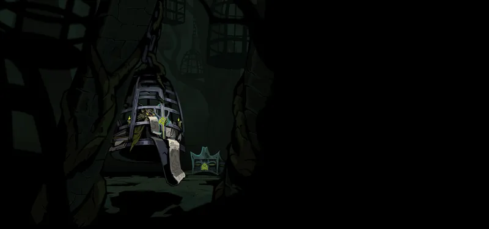 Répi, historien de la guerre (`WAR_HISTORIAN_REPY`)
* **Zone :** `Acte act1a, Acte act1b, Acte act2, Acte act3` | **Nombre d'options :** `2`
* **Description :** Un érudit est piégé dans une cage qui pend du plafond, juste à côté d’un coffre trésor..

L’érudit marmonne quelque chose à propos de soi-disantes « Clés à usage unique » tout en griffonnant furieusement sur son parchemin.

Il semblerait que vous puissiez déverrouiller soit la cage, soit le coffre.

<!-- choix:WAR_HISTORIAN_REPY -->
**Choix dans le jeu** (généré depuis `src/engine/events`) :

* **Titre en jeu :** Répi, historien de la guerre | **Zones :** tous les actes
* **Apparaît seulement si :** posséder 1 × Lantern Key

Page 0 (début) : « Un érudit est prisonnier d'une cage suspendue, près d'un coffre. Il marmonne sur des « clés à usage unique » en griffonnant sur son parchemin. Vous pouvez ouvrir la cage ou le coffre. »

* **Ouvrir la cage** - Clé perdue, Manuel d'Histoire.
  * Condition : posséder 1 × Lantern Key (sinon l'option est grisée)
  * Effets : perd 1 × Lantern Key ; gagne la relique HISTORY_COURSE
  * Résultat : « La cage s'ouvre. Répi vous offre son Manuel d'Histoire et file à ses archives. »
* **Ouvrir le coffre** - Clé perdue, 2 potions, 2 reliques.
  * Condition : posséder 1 × Lantern Key (sinon l'option est grisée)
  * Effets : perd 1 × Lantern Key ; gagne 2 potions aléatoire ; gagne une relique aléatoire ; gagne une relique aléatoire
  * Résultat : « Le coffre s'ouvre sur 2 potions et 2 reliques. Répi proteste dans sa cage. »

<!-- /choix:WAR_HISTORIAN_REPY -->

### 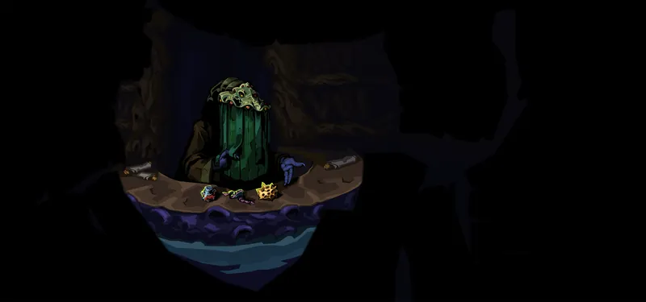 Scriptorium englouti (`WATERLOGGED_SCRIPTORIUM`)
* **Zone :** `Acte act1b` | **Nombre d'options :** `5`
* **Description :** Tandis que vous faites votre chemin à travers les passages embourbés, vous tombez sur une silhouette émaciée qui tient une petite boutique. Sur les nombreuses étagères sont tassées des liasses de vélins et parchemins humides.

Remarquant qu’un client est entré, le scribe-commerçant accourt pour vous servir puis vous indique le matériel exposé sur le bureau.

<!-- choix:WATERLOGGED_SCRIPTORIUM -->
**Choix dans le jeu** (généré depuis `src/engine/events`) :

* **Titre en jeu :** Scriptorium englouti | **Zones :** Acte 1b

Page 0 (début) : « Dans les passages embourbés, vous tombez sur une silhouette émaciée qui tient une petite boutique, où s'entassent des liasses de vélins et de parchemins humides. Le scribe-commerçant accourt et vous indique le matériel exposé sur le bureau. »

* **Encre sanglante** - Gagnez 6 PV Max.
  * Effets : +6 PV max
  * Résultat : « Vous trempez la plume dans l'encre sanglante. Vous vous sentez plus robuste : +6 PV Max ! »
* **Éponge piquante** - Payez 99 Or, 2 cartes Stables.
  * Condition : au moins 99 Or (sinon l'option est grisée)
  * Effets : perd 99 Or ; enchante 2 cartes (au choix) : STEADY
  * Résultat : « Le scribe vous tend l'éponge contre 99 Or. Vous allez choisir 2 cartes à rendre Stables. »
* **Plume tentaculaire** - Payez 55 Or, 1 carte Stable.
  * Condition : au moins 55 Or (sinon l'option est grisée)
  * Effets : perd 55 Or ; enchante 1 carte (au choix) : STEADY
  * Résultat : « Le scribe vous cède la plume contre 55 Or. Vous allez choisir 1 carte à rendre Stable. »

<!-- /choix:WATERLOGGED_SCRIPTORIUM -->

### 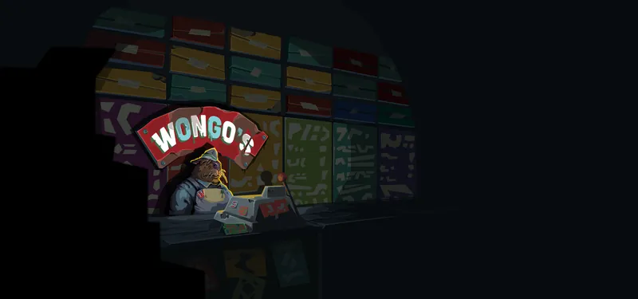 Bienvenue chez Wongo’s (`WELCOME_TO_WONGOS`)
* **Zone :** `Acte act1a, Acte act1b, Acte act2, Acte act3` | **Nombre d'options :** `7`
* **Description :** « Bienvenue chez Wongo’s. Nous avons tout ce que vous désirez à prix Wongtastique, » annonce le vendeur le moins enthousiaste que vous ayez jamais rencontré.

« Jetez un œil à nos articles et passez un bon moment chez Wongo’s, » poursuit-elle, sans même lever la tête. »

<!-- choix:WELCOME_TO_WONGOS -->
**Choix dans le jeu** (généré depuis `src/engine/events`) :

* **Titre en jeu :** Bienvenue chez Wongo's | **Zones :** tous les actes

Page 0 (début) : « « Bienvenue chez Wongo's. Nous avons tout ce que vous désirez à prix Wongtastique, » annonce le vendeur le moins enthousiaste que vous ayez jamais rencontré, sans même lever la tête. »

* **Bac à soldes** - Payez 100 Or, 1 relique commune.
  * Condition : au moins 100 Or (sinon l'option est grisée)
  * Effets : perd 100 Or ; gagne une relique Commune aléatoire
  * Résultat : « Vous fouillez le bac et en sortez une relique. La vendeuse encaisse sans lever la tête. »
* **Article vedette** - Payez 200 Or, gagnez Oeuf gelé.
  * Condition : au moins 200 Or (sinon l'option est grisée)
  * Effets : perd 200 Or ; gagne la relique FROZEN_EGG
  * Résultat : « « Wongtastique, » soupire la vendeuse. Vous obtenez Oeuf gelé ! »
* **Boîte mystère** - Payez 300 Or, 3 reliques aléatoires.
  * Condition : au moins 300 Or (sinon l'option est grisée)
  * Effets : perd 300 Or ; gagne une relique aléatoire ; gagne une relique aléatoire ; gagne une relique aléatoire
  * Résultat : « La boîte s'ouvre sur trois reliques. « Merci d'avoir choisi Wongo's. » »
* **Partir** - Une carte améliorée est rétrogradée.
  * Effets : 1 carte améliorée redevient normale (au hasard)
  * Résultat : « Vous partez les mains vides. Une de vos cartes perd son amélioration. »

<!-- /choix:WELCOME_TO_WONGOS -->

### 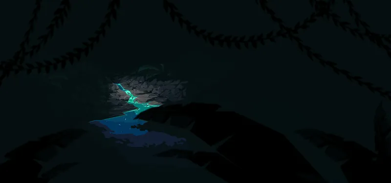 Source mystique (`WELLSPRING`)
* **Zone :** `Acte act1a` | **Nombre d'options :** `2`
* **Description :** Vous suivez un bruit de clapotis jusqu’à sa source et vous trouvez captivé par un bassin paisible. À la surface de l’eau vert émeraude flottent des granules lumineux.

Vous avez envie de vous baigner. Quel est le pire qui puisse arriver ?

<!-- choix:WELLSPRING -->
**Choix dans le jeu** (généré depuis `src/engine/events`) :

* **Titre en jeu :** Source mystique | **Zones :** Acte 1a

Page 0 (début) : « Vous suivez un bruit de clapotis jusqu'à sa source et vous trouvez captivé par un bassin paisible. À la surface de l'eau vert émeraude flottent des granules lumineux. Vous avez envie de vous baigner. Quel est le pire qui puisse arriver ? »

* **Se baigner** - Retirez une carte, +Culpabilité.
  * Effets : retire 1 carte du deck (au choix) ; ajoute au deck 1 × Guilty
  * Résultat : « L'eau vous lave de vos fardeaux, mais vous en sortez coupable. Choisissez une carte à retirer. »
* **Mettre en bouteille** - Gagnez une potion aléatoire.
  * Effets : gagne 1 potion aléatoire
  * Résultat : « Vous remplissez une fiole d'eau scintillante. Vous obtenez une potion ! »

<!-- /choix:WELLSPRING -->

###  Vallon des Murmures (`WHISPERING_HOLLOW`)
* **Zone :** `Acte act1a` | **Nombre d'options :** `2`
* **Description :** Vous vous frayez un chemin à travers un vallon d’arbres morts et découvrez un arbre blanc comme de l’os, solitaire parmi les autres. Des boules d’argile pendent des branches, qui s’incurvent vers l’intérieur à la manière d’une cage thoracique.

Comme cet arbre est sinistre. Il murmure

...faire échange.....

<!-- choix:WHISPERING_HOLLOW -->
**Choix dans le jeu** (généré depuis `src/engine/events`) :

* **Titre en jeu :** Vallon des Murmures | **Zones :** Acte 1a

Page 0 (début) : « Au milieu d'un vallon d'arbres morts se dresse un arbre blanc comme l'os. Des boules d'argile pendent de ses branches, courbées comme une cage thoracique. Il murmure : « ...faire échange... » »

* **Échanger de l'or** - Payez 50 Or, gagnez 2 potions.
  * Condition : au moins 50 Or (sinon l'option est grisée)
  * Effets : perd 50 Or ; gagne 2 potions aléatoire
  * Résultat : « Vous glissez vos pièces dans la cage de branches. Elle vous rend 2 potions. »
* **Étreindre l'arbre** - Perdez 9 PV, transformez 1 carte.
  * Condition : plus de 9 PV (sinon l'option est grisée)
  * Effets : perd 9 PV ; transforme 1 carte (au choix)
  * Résultat : « Les branches vous serrent à vous briser les côtes. Vous perdez 9 PV et une carte va se transformer. »

<!-- /choix:WHISPERING_HOLLOW -->

###  Gravures sur bois (`WOOD_CARVINGS`)
* **Zone :** `Acte act1a` | **Nombre d'options :** `4`
* **Description :** Vous ouvrez une petite boîte poussiéreuse et y trouvez 3 minutieuses figurines en bois gravées :

Un oiseau, un serpent, et... un tore ?

Un piédestal à proximité est muni d’emplacements qui correspondent au bas des figurines. Laquelle des figurines placez-vous sur le piédestal ?

<!-- choix:WOOD_CARVINGS -->
**Choix dans le jeu** (généré depuis `src/engine/events`) :

*Pas encore dans le jeu* : choix de la référence (`bible/data/event_choices`).

Page `start` :

* **Oiseau : transforme une carte de départ en Picorer.** (Bird: Choose 1 starter card to Transform into Peck.)
  * Effets : transform card 1 (PECK) - 2 dégâts x3
* **Serpent : enchante une carte avec Glissement.** (Snake: Enchant 1 card with Slither.)
  * Effets : other 1 (ENCHANT_SLITHER) - verrouillé si aucune carte enchantable; coût de la carte aléatoire
* **Tore : transforme une carte de départ en Robustesse torique.** (Torus: Choose 1 starter card to Transform into Toric Toughness.)
  * Effets : transform card 1 (TORIC_TOUGHNESS) - 5 Armure, +5 Armure au début des 2 tours suivants
* **(quatrième option, probablement Partir)** ((fourth option, probably Leave))
  * Effets : leave - optionCount=4 mais seulement 3 options trouvées

<!-- /choix:WOOD_CARVINGS -->

###  Tisseur zen (`ZEN_WEAVER`)
* **Zone :** `Acte act2` | **Nombre d'options :** `4`
* **Description :** Vous traversez par inadvertance une toile d’araignée —PANIQUE !
Mais rapidement, une vague de calme vous gagne...

« Du calme. Il faut que tu arrêtes de défaire ma toile. »

Comment avez-vous réussi à vous calmer si vite ?
Une toute petite araignée descend à votre rencontre. Elle semble bien vouloir vous apprendre quelques techniques en échange de pièces d’or.

<!-- choix:ZEN_WEAVER -->
**Choix dans le jeu** (généré depuis `src/engine/events`) :

* **Titre en jeu :** Tisseur zen | **Zones :** Acte 2

Page 0 (début) : « Vous traversez par inadvertance une toile d'araignée. PANIQUE ! Mais une vague de calme vous gagne. Une minuscule araignée descend : contre quelques pièces d'or, elle vous apprendra des techniques. »

* **Techniques de respiration** - 50 Or : ajoutez 2 Illumination.
  * Condition : au moins 50 Or (sinon l'option est grisée)
  * Effets : perd 50 Or ; ajoute au deck 2 × Enlightenment
  * Résultat : « Vous respirez lentement, au rythme de l'araignée. Deux Illumination rejoignent votre deck. »
* **Conscience émotionnelle** - Payez 125 Or, retirez une carte.
  * Condition : au moins 125 Or (sinon l'option est grisée)
  * Effets : perd 125 Or ; retire 1 carte du deck (au choix)
  * Résultat : « L'araignée vous aide à lâcher prise. Choisissez une carte à retirer de votre deck. »
* **Acupuncture arachnéenne** - Payez 250 Or, retirez 2 cartes.
  * Condition : au moins 250 Or (sinon l'option est grisée)
  * Effets : perd 250 Or ; retire 2 cartes du deck (au choix)
  * Résultat : « Les pattes de l'araignée piquent avec précision. Choisissez 2 cartes à retirer de votre deck. »
* **Partir** - Ne rien payer.
  * Effets : aucun
  * Résultat : « Vous remerciez la petite araignée et poursuivez votre route. »

<!-- /choix:ZEN_WEAVER -->
