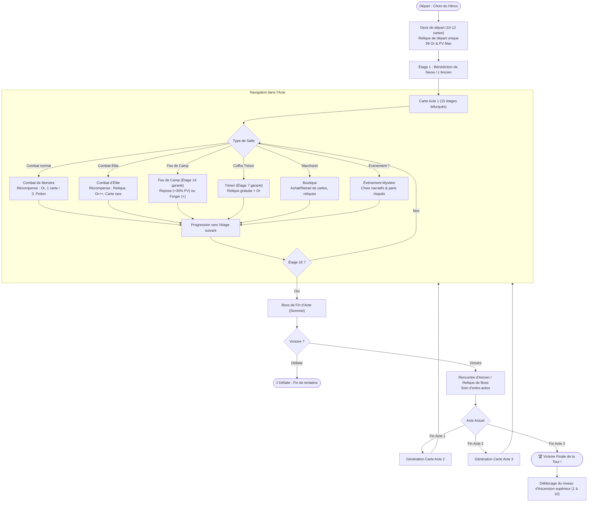

# 🗺️ Tome 19 — Boucle de Gameplay Roguelike, Carte & Système d'Ascension (1 à 10)

> **Référence de conception et d'implémentation pour le moteur `slay_the_gba`**  
> **Source :** Règles fondamentales de *Slay the Spire* & *Slay the Spire 2* (`v0.111.0 Beta`)  
> **Composants C++ associés :** [`include/engine/map.h`](../include/engine/map.h), [`src/engine/map.cpp`](../src/engine/map.cpp), [`include/engine/run.h`](../include/engine/run.h), [`src/engine/run.cpp`](../src/engine/run.cpp)

---

## 1. 🔄 Vue d'Ensemble de la Boucle de Gameplay (The Roguelike Run Loop)

Dans *Slay the Spire 2*, chaque tentative (*Run*) est une ascension impitoyable à travers 3 Actes consécutifs, régie par la gestion d'un **Master Deck**, de **Reliques**, de **Potions**, de **Points de Vie (PV)** et d'**Or**.



---

## 2. 🏛️ Configuration Initiale par Personnage (Étage 1)

Chaque héros débute son ascension avec des statistiques et un deck asymétriques :

| Héros | PV Max | Or | Relique de Départ | Composition du Deck de Départ (10 à 12 cartes) |
|---|:---:|:---:|---|---|
| **Soldat de Fer** (*Ironclad*) | **80** | 99 | **Sang ardent** (*Burning Blood*) : Récupère 6 PV à la fin de chaque combat. | 5 Frappe, 4 Défense, 1 Fracassement (*Bash*) |
| **La Silencieuse** (*Silent*) | **70** | 99 | **Anneau du serpent** (*Ring of the Snake*) : Pioche 2 cartes supplémentaires au tour 1. | 5 Frappe, 5 Défense, 1 Neutralisation (*Neutralize*), 1 Survivant (*Survivor*) |
| **Le Défectueux** (*Defect*) | **75** | 99 | **Noyau fissuré** (*Cracked Core*) : Canalise 1 Orbe d'Éclair au début du combat. | 4 Frappe, 4 Défense, 1 Éclair (*Zap*), 1 Double distribution (*Dualcast*) |
| **Le Régent** (*Regent*) | **75** | 99 | **Droit divin** (*Divine Right*) : Octroie 1 Énergie supplémentaire tous les 3 tours. | 4 Frappe, 4 Défense, 1 Étoile filante (*Falling Star*), 1 Vénération (*Venerate*) |
| **La Nécrolieuse** (*Necrobinder*) | **65** | 99 | **Phylactère lié** (*Bound Phylactery*) : Conserve les cadavres pour invoquer des sbires. | 4 Frappe, 4 Défense, 1 Déchaînement (*Unleash*), 1 Garde du corps (*Bodyguard*) |

---

## 3. 🗺️ Structure de la Carte & Types de Salles

Chaque Acte est composé de **15 étages progressifs + 1 sommet de Boss** (16 étages au total), répartis sur **3 couloirs verticaux (Lanes : Gauche, Centre, Droite)** reliés par des chemins directionnels ascendants.

### Typologie des Salles et Règles de Génération

| Icône | Type de Salle | Étage Garanti / Règle d'apparition | Effet & Choix disponibles |
|:---:|---|---|---|
| ⚔️ | **Combat Normal** (`MONSTER`) | **Étage 1 toujours combat**. Fréquence ~45%. | Affronte des monstres de base. Victoire = 15-30 Or, sélection de 1 carte parmi 3 (ou passer), chance de potion (40%). |
| 😈 | **Combat d'Élite** (`ELITE`) | Ne peut apparaître avant l'étage 6. Fréquence ~20% au-delà. | Ennemis redoutables avec patterns complexes. Victoire = **Relique garantie**, 35-50 Or, carte avec taux de Rares augmenté. |
| 🔥 | **Feu de Camp** (`REST_SITE`) | **Étage 14 garanti (avant-boss)**. Fréquence ~15%. | **Se Reposer** (rend 30% des PV max) **OU** **Forger** (améliore définitivement une carte du deck en version `+`). |
| 🎁 | **Salle au Trésor** (`TREASURE`) | **Étage 7 garanti (mi-parcours)**. | Ouvre un grand coffre contenant une **Relique majeure** et une bourse d'or. Aucun combat. |
| 💰 | **Marchand de la Tour** (`SHOP`) | Fréquence ~10%. Pas d'étages consécutifs. | Dépensez votre Or : 5 cartes en vente, 3 reliques, 3 potions, et service de retrait (*Card Removal* : 75 Or + 25 par retrait). |
| ❓ | **Événement Mystère** (`EVENT`) | Fréquence ~20%. | Rencontres scénarisées, sanctuaires anciens, jeux de hasard, offres démoniaques (sacrifier des PV ou accepter une malédiction contre des récompenses). |
| 👑 | **Boss de l'Acte** (`BOSS`) | **Étage 16 (Sommet)**. Accessible depuis les 3 couloirs. | Boss titanesque de l'Acte. Victoire = transition d'Acte, sélection d'Ancien / Relique de Boss, soin d'Acte. |

---

## 4. 📈 Le Système d'Ascension (Niveaux 1 à 10)

L'**Ascension** est le système de difficulté évolutif de *Slay the Spire*. Chaque victoire complète (Acte 3 battu) débloque le niveau d'Ascension suivant pour le personnage victorieux. **Les modificateurs sont cumulatifs** : l'Ascension 5 inclut les handicaps des Ascensions 1, 2, 3, 4 et 5 !

```mermaid
flowchart LR
    A0["A0 : Standard"] --> A1["A1 : Élites + fréquents"]
    A1 --> A2["A2 : Monstres +20% Dégâts"]
    A2 --> A3["A3 : Élites + Dégâts"]
    A3 --> A4["A4 : Boss + Dégâts"]
    A4 --> A5["A5 : Soin Boss 75%"]
    A5 --> A6["A6 : Départ 90% PV"]
    A6 --> A7["A7 : Monstres +15% PV"]
    A7 --> A8["A8 : Élites + PV"]
    A8 --> A9["A9 : Boss + PV"]
    A9 --> A10["A10 : Fléau permanent"]
```



### Tableau Exhaustif des 10 Paliers d'Ascension

| Niveau | Nom Officiel | Description du Handicap | Impact Mécanique sur GBA |
|:---:|---|---|---|
| **Ascension 0** | *Mode Standard* | Difficulté par défaut du jeu. | Multiplicateurs à 100%, 0 malédiction de départ. |
| **Ascension 1** | *Élites Renforcés* | Les salles d'Élites apparaissent plus fréquemment sur la carte. | Augmentation du ratio d'Élites sur la carte (`MapGraph::generate`). |
| **Ascension 2** | *Monstres Meurtris* | Les attaques de tous les monstres normaux infligent plus de dégâts (+20%). | Multiplicateur de dégâts : `x1.20` (`get_enemy_damage_multiplier()`). |
| **Ascension 3** | *Élites Féroces* | Les attaques des monstres Élites infligent plus de dégâts. | Les patterns offensifs des Élites infligent +25% de dégâts bruts. |
| **Ascension 4** | *Boss Impitoyables* | Les attaques des Boss d'actes infligent plus de dégâts. | Les attaques signature des Boss sont augmentées de 2 à 4 points de dégâts. |
| **Ascension 5** | *Soin Réduit* | La régénération de fin d'acte ne rend que 75% des PV manquants (au lieu de 100%). | Lors du passage d'acte : `hp += (max_hp - hp) * 75 / 100`. |
| **Ascension 6** | *Départ Éprouvé* | Le héros commence son ascension avec 10% de PV en moins. | `hp = (max_hp * 9) / 10` (ex: Ironclad débute à 72/80 PV, Necrobinder à 58/65 PV). |
| **Ascension 7** | *Monstres Robustes* | Les monstres normaux ont plus de Points de Vie (+15%). | Multiplicateur de PV ennemis : `x1.15` (`get_enemy_hp_multiplier()`). |
| **Ascension 8** | *Élites Robustes* | Les monstres Élites possèdent une réserve de PV accrue (+20%). | Les PV max de tous les monstres Élites sont multipliés par `x1.20`. |
| **Ascension 9** | *Boss Colossaux* | Les Boss d'Actes possèdent une réserve de PV accrue (+25%). | Les Boss ont des seuils de PV nettement plus élevés (ex: 300+ PV). |
| **Ascension 10** | *Fléau de l'Ascension* | Vous débutez la tentative avec la carte malédiction **Fléau** (*Ascender's Bane*) dans votre deck. | La carte insupportable (Injouable, Éthérée) est insérée d'office au deck de départ. |

---

## 5. 🛠️ Architecture Moteur GBA C++20 (`slay_the_gba`)

Pour respecter les contraintes strictes de la Game Boy Advance (32 Ko de Fast WRAM, 256 Ko de WRAM, processeur ARM7TDMI 16.78 MHz), toute la boucle est implémentée **sans aucune allocation dynamique sur le tas** (`malloc`/`new`).

### 1. Le Graphe de Carte (`MapGraph`)
* Déclaré dans [`include/engine/map.h`](../include/engine/map.h).
* Stocké dans un `FixedVector<MapNode, 50>` (45 nœuds de couloir + 1 nœud de Boss = 46 nœuds au total).
* Chaque nœud connaît son numéro d'étage (`0` à `15`), son couloir (`0` à `2`), son type de salle (`RoomType`), et jusqu'à 3 liens enfants (`children`).

```cpp
enum class RoomType : uint8_t {
    MONSTER = 0,
    EVENT,
    SHOP,
    REST_SITE,
    TREASURE,
    ELITE,
    BOSS
};

struct MapNode {
    uint8_t floor;      // 0 à 15 (15 = Boss)
    uint8_t lane;       // 0: Gauche, 1: Centre, 2: Droite
    RoomType type;
    uint8_t children[3];
    uint8_t children_count;
};
```

### 2. Le Gestionnaire de Tentative (`RunManager`)
* Déclaré dans [`include/engine/run.h`](../include/engine/run.h).
* Coordonne les transitions d'écrans via l'énumération `RunPhase` :
  - `MAP_NAVIGATION` : Sélection de la prochaine salle au D-Pad.
  - `IN_COMBAT` : Moteur de combat Butano 60 FPS.
  - `REWARD_SCREEN` : Choix d'une carte parmi 3 et collecte de l'Or.
  - `CAMPFIRE` : Écran de repos ou forge.
  - `SHOP` : Écran de transaction avec le Marchand.
  - `ANCIENT_BLESSING` : Écran de dialogue et de choix d'Ancien (Neow, Darv, etc.).
  - `VICTORY_ACT` : Écran de triomphe final et déblocage de l'Ascension.

```cpp
class RunManager {
public:
    CharacterId character = CharacterId::IRONCLAD;
    uint8_t ascension_level = 0; // 0 à 10
    uint8_t current_act = 1;     // 1, 2, 3
    uint8_t current_floor = 1;   // 1 à 16
    int16_t hp = 80;
    int16_t max_hp = 80;
    int16_t gold = 99;

    FixedVector<CardId, 50> master_deck;
    FixedVector<std::string_view, 25> relics;
    FixedVector<std::string_view, 3> potions;

    MapGraph map;
    int current_node_index = -1;
    RunPhase phase = RunPhase::MAP_NAVIGATION;

    CombatEngine combat;
    FixedVector<CardId, 3> current_card_rewards;
    int16_t gold_reward = 0;
    // ...
};
```

---

## 6. 🎮 Validation & Tests Unitaires Automatisés

L'ensemble de la boucle de jeu et les règles d'Ascension sont validés par la suite de tests unitaires C++20 (`make test`) :

```bash
=== Slay The GBA Engine Test ===
[PASS] Procedural Map Graph: 16 floors generated (3 start branches, 1 Boss summit)
[PASS] Run Loop: Deck, Combat, Burning Blood (+6 HP), Card Reward & Gold picked
[PASS] Campfire: Rest healed HP back to max
[PASS] Ascension 0-10: Levels, handicap HP (A6/A10), dmg mult (A2), and HP mult (A7) verified
[PASS] Act Progression: Act 3 Boss victory triggers Run Completed
=== All Engine Tests Passed Successfully! ===
```

---
*Tome 19 rédigé pour le projet Slay The GBA — Version patch v0.111.0 Beta.*
