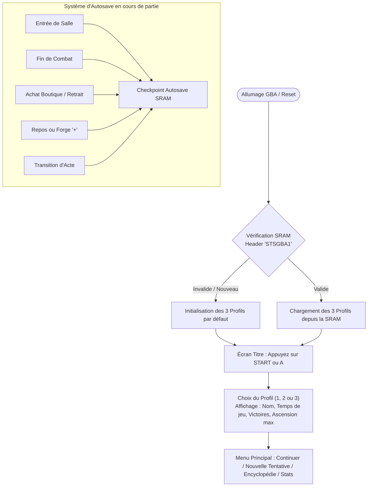
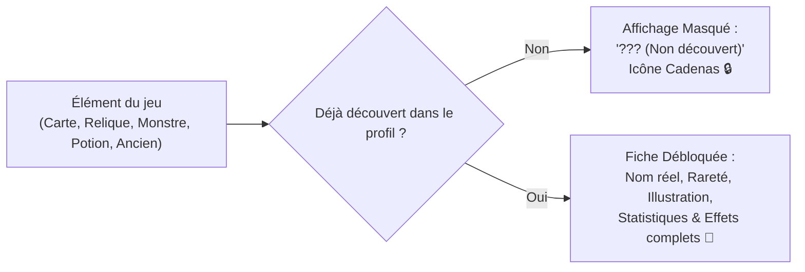
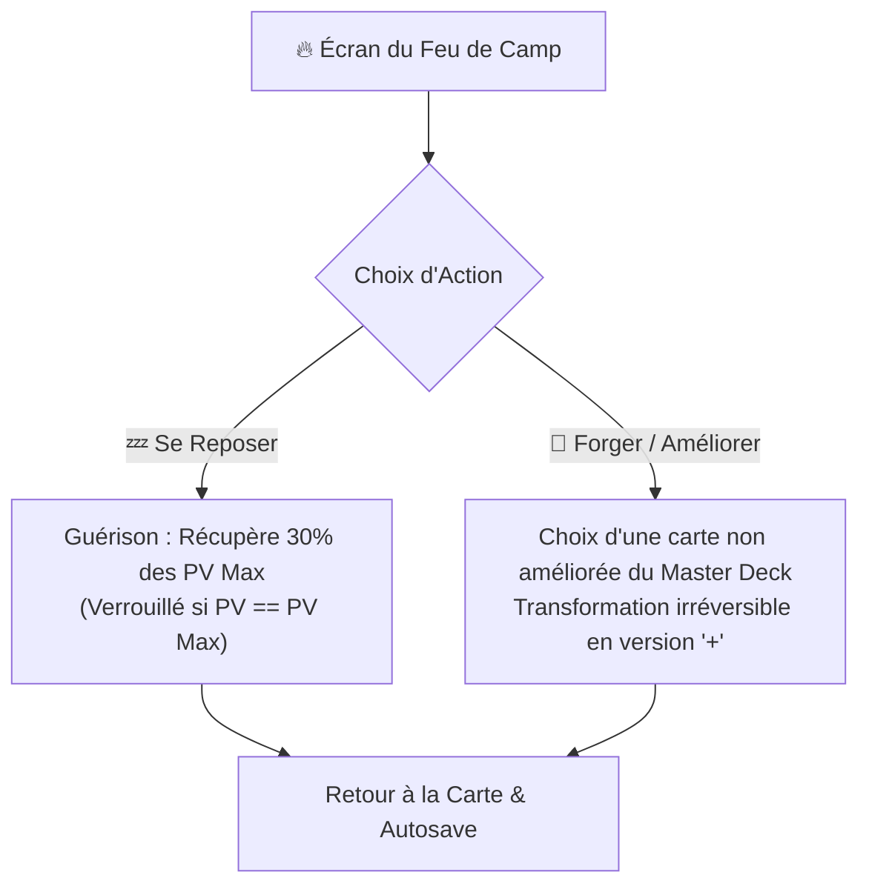
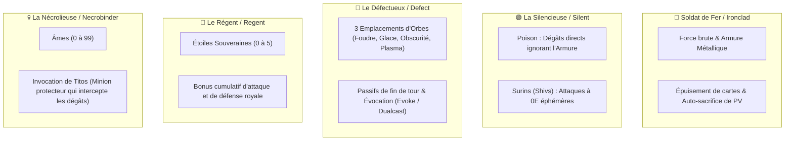
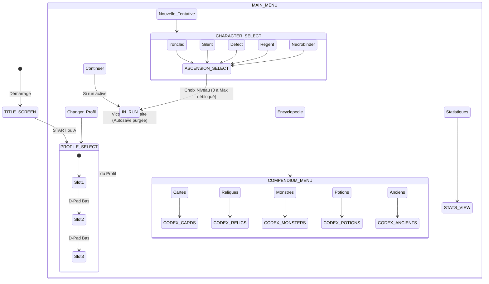

# 💾 Tome 20 — Profils de Sauvegarde, Autosave, Encyclopédies & Ressources des Personnages

> **Référence de conception et d'implémentation pour le moteur `slay_the_gba`**  
> **Composants C++ associés :** [`include/engine/save_system.h`](../include/engine/save_system.h), [`src/engine/save_system.cpp`](../src/engine/save_system.cpp), [`include/engine/shop.h`](../include/engine/shop.h), [`src/engine/shop.cpp`](../src/engine/shop.cpp), [`include/engine/title_menu.h`](../include/engine/title_menu.h), [`src/engine/title_menu.cpp`](../src/engine/title_menu.cpp)

---

## 1. 💾 Les 3 Profils de Sauvegarde & Sauvegarde Automatique (*Autosave*)

Sur Game Boy Advance, la mémoire SRAM (statique) de 32 Ko est allouée pour gérer **3 profils de joueurs indépendants** avec sauvegarde automatique transparente.

### Données Sauvegardées par Profil (`SaveProfile`)
* **Nom & Métadonnées** : Nom du profil (16 caractères), temps de jeu en secondes, total de tentatives et total de victoires.
* **Ascension Maximale Débloquée** : Paliers 0 à 10 enregistrés séparément pour les 5 personnages (*Ironclad, Silent, Defect, Regent, Necrobinder*).
* **Brouillard de l'Encyclopédie (Bitsets compacts)** :
  - `discovered_cards` : 569 cartes (72 octets)
  - `discovered_relics` : 298 reliques (38 octets)
  - `discovered_monsters` : 112 monstres (14 octets)
  - `discovered_potions` : 63 potions (8 octets)
  - `discovered_ancients` : 8 anciens (1 octet)
* **Tentative Active (*InRunSaveData*)** :
  - Enregistre l'état exact : PV actuels, PV max, Or, Niveau d'Ascension, Acte (1-3), Étage (1-16), Nœud de carte actuel, Graine procédurale (Seed), Phase de jeu (`RunPhase`).
  - Composition exhaustive du Master Deck (avec flag d'amélioration `+` pour chaque carte).
  - Liste des reliques possédées, potions en poche et nombre de retraits de cartes effectués au marchand.

---

## 2. 📖 L'Encyclopédie Évolutive (Compendium & Codex)

L'Encyclopédie de la Tour se dévoile au fur et à mesure des découvertes du joueur dans ses tentatives :

### Statistiques de Découverte Suivies
1. **Codex des Cartes** : Suivi des 569 cartes du jeu (Communes, Peu communes, Rares, Incolores, Malédictions).
2. **Codex des Reliques** : Suivi des 298 reliques (Départ, Boss, Boutique, Événement, Anciens).
3. **Bestiaire des Monstres** : Suivi des 112 monstres et boss de la Tour.
4. **Alchimie des Potions** : Suivi des 63 potions.
5. **Tome des Anciens** : Suivi des 8 Anciens rencontrés (Neow, Darv, Orobas, Paël, Tezcatara, Nonupeipée, Tanx, Vakuu).

---

## 3. 💰 Le Marchand de la Tour & L'Économie des Pièces d'Or (`ShopInventory`)

Dans les salles de type `SHOP`, le joueur peut dépenser l'or accumulé lors des combats et des coffres :

| Rayon de la Boutique | Contenu & Rareté | Prix Indicatif | Action Possible |
|---|---|:---:|---|
| **Cartes en Vente** | 3 cartes exclusives au personnage (dont des versions déjà améliorées `+`). | **50 à 150 Or** | Ajout direct au Master Deck du joueur. |
| **Reliques Précieuses** | 2 reliques (Communes à Rares, ex: Vajra, Ancre). | **150 à 250 Or** | Attribution instantanée au profil de reliques actives. |
| **Fioles d'Alchimie** | 2 potions consommables (ex: Fiole de feu, Potion de blocage). | **50 Or** | Remplissage d'un emplacement de potion libre. |
| **Service de Retrait** (*Card Removal*) | Suppression définitive d'une carte choisie dans le Master Deck. | **75 Or de base** (+25 Or par utilisation ultérieure) | Épure le deck en éliminant les cartes de base (*Frappe*, *Défense* ou Malédictions). |

---

## 4. 🔥 Les Feux de Camp & L'Amélioration de Cartes (`+`)

Dans les salles `REST_SITE` (dont l'Étage 14 avant le Boss), le joueur dispose d'un dilemme tactique fondamental :

### Exemples d'Améliorations de Cartes (`+`)

| Carte de Base | Effet Standard (1E) | Version Améliorée (`+`) | Gain Tactique |
|---|---|---|---|
| **Frappe** (*Strike*) | Inflige 6 dégâts. | **Frappe+** : Inflige **9 dégâts**. | +50% de puissance offensive brute. |
| **Défense** (*Defend*) | Confère 5 d'armure. | **Défense+** : Confère **8 d'armure**. | +60% de capacité d'absorption. |
| **Fracassement** (*Bash*) (2E) | 8 dégâts, 2 Vulnérable. | **Fracassement+** : **10 dégâts, 3 Vulnérable**. | Prolonge le debuff d'un tour critique. |
| **Vague de fer** (*Iron Wave*) | 5 dégâts, 5 armure. | **Vague de fer+** : **7 dégâts, 7 armure**. | Ratio coût/efficacité excellent. |
| **Éclair** (*Zap*) | Coût 1E. Canalise 1 Foudre. | **Éclair+** : **Coût 0E**. Canalise 1 Foudre. | Canalisation gratuite chaque cycle. |
| **Double distribution** (*Dualcast*) | Coût 1E. Évoque l'orbe 2 fois. | **Double distribution+** : **Coût 0E**. | Évocation dévastatrice sans coût d'énergie. |
| **Neutralisation** (*Neutralize*) | 3 dégâts, 1 Affaibli (0E). | **Neutralisation+** : **4 dégâts, 2 Affaibli (0E)**. | Neutralise les attaques ennemies 2 tours durant. |
| **Armure métallique** (*Metallicize*) | Pouvoir (1E) : +3 armure/tour. | **Armure métallique+** : **+4 armure/tour**. | Rempart défensif passif cumulable. |

---

## 5. ⚡ Ressources Spécifiques des 5 Personnages & Modificateurs de Combat

Chaque personnage possède des mécaniques exclusives fidèlement reproduites dans le moteur :

### 1. 🔴 Soldat de Fer (*Ironclad*)
* **Force** (*Strength*) : Ajoute `+X` dégâts fixes à chaque frappe d'attaque.
* **Armure Métallique** (*Metallicize*) : Déclenche automatiquement `+X` d'armure au début ou à la fin de chaque tour.
* **Sang ardent** (*Burning Blood*) : Récupère **+6 PV** à la conclusion victorieuse de chaque combat.

### 2. 🟢 La Silencieuse (*Silent*)
* **Poison** : Statut infligeant des dégâts directs aux Points de Vie (ignore le block). À chaque fin de tour ennemi, l'ennemi subit `X` dégâts et le compteur de poison diminue de 1.
* **Affaibli** (*Weak*) : Réduit les attaques ennemies de 25%.
* **Surins** (*Shivs*) : Cartes d'attaque à 0 Énergie infligeant 4 dégâts puis s'épuisant.

### 3. 🔵 Le Défectueux (*Defect*)
* **3 Emplacements d'Orbes** :
  - ⚡ **Foudre** (*Lightning*) : Passif = 3 dégâts aléatoires / Évocation = 8 dégâts ciblés.
  - ❄️ **Glace** (*Frost*) : Passif = 2 armure / Évocation = 5 armure instantanée.
  - 🌑 **Obscurité** (*Dark*) : Passif = accumule +6 dégâts par tour / Évocation = décharge la totalité des dégâts accumulés.
  - 🔮 **Plasma** : Passif = +1 Énergie par tour / Évocation = +2 Énergie immédiate.
* **Canalisation & Évocation automatique** : Lorsque les 3 slots sont pleins, canaliser un nouvel orbe évoque immédiatement l'orbe le plus ancien (*First In, First Out*).

### 4. 👑 Le Régent (*Regent*)
* **Étoiles Souveraines** (*Sovereign Stars*, 0 à 5 étoiles) :
  - Générées par des compétences royales (*Étoile filante*, *Vénération*).
  - Chaque étoile active ajoute `+1` dégât à toutes les attaques et `+1` armure aux compétences.

### 5. 💀 La Nécrolieuse (*Necrobinder*)
* **Âmes** (*Souls*, 0 à 99) : Jauge récoltée lors des blessures infligées aux ennemis.
* **Familier Minion (Titos, *Osty* en VO)** :
  - Possède ses propres PV et son propre blocage (`minion_hp`, `minion_block`).
  - **Interception des dégâts** : Lorsque l'héroïne subit une attaque, son Armure absorbe d'abord les dégâts ; Titos encaisse ensuite ce qui passe, à la place des PV de la Nécrolieuse. S'il meurt, le reste du coup touche l'héroïne.
  - Titos n'attaque pas de lui-même : il frappe quand une carte le lui demande (Déchaînement, par exemple).

---

## 6. 🎮 Arborescence de l'Écran Titre & Menus GBA (`TitleMenuManager`)

---
*Tome 20 rédigé pour le projet Slay The GBA — Version patch v0.111.0 Beta.*
