# 🗡️ La Bible des Anciens — Slay the Spire 2 sur Game Boy Advance

> **Référence officielle de conception et d'implémentation pour le projet `slay_the_gba`**  
> **Source :** [Slay the Spire 2 Guide & Wiki — Les Anciens](https://slaythespire2.net/fr/ancient)  
> **Version du jeu :** `v0.111.0 Beta` (Dernier patch officiel — Août 2026)  
> **Dossier d'assets :** [`bible/images/`](images/) (137 illustrations, icônes et cartes locales)

---

## 📖 Sommaire

0. [Guide des 5 Personnages Jouables (00_personnages.md)](00_personnages.md)
1. [Introduction & Vision de l'Adaptation GBA](#1--introduction--vision-de-ladaptation-gba)
2. [Matrice Comparative des 8 Anciens](#2--matrice-comparative-des-8-anciens)
3. [Index des Tomes Individuels](#3--index-des-tomes-individuels)
4. [Tier List Globale des Reliques d'Anciens](#4--tier-list-globale-des-reliques-danciens)
5. [Règles de Tirage, Slots & Exclusions](#5--règles-de-tirage-slots--exclusions)
6. [Spécifications & Ergonomie GBA (240x160)](#6--spécifications--ergonomie-gba-240x160)
7. [Fiche Technique & Code C++20](#7--fiche-technique--code-c20)
8. [Encyclopédie Complète de Slay the Spire 2](#8--encyclopédie-complète-de-slay-the-spire-2-patch-v01110-beta)
9. [Boucle de Gameplay Roguelike & Ascension 1 à 10 (19_boucle_de_gameplay_et_ascension.md)](19_boucle_de_gameplay_et_ascension.md)
10. [Profils de Sauvegarde, Autosave, Encyclopédies & Ressources (20_sauvegardes_encyclopedie_et_ressources.md)](20_sauvegardes_encyclopedie_et_ressources.md)
11. [Interface Style Pokémon, Navigation de Carte & Inspecteur de Deck (21_interface_pokemon_et_navigation_carte.md)](21_interface_pokemon_et_navigation_carte.md)
12. [Collection des 5 Livrets de Jeu GBA Officiels (livrets_gba/README.md)](livrets_gba/README.md)

---

## 1. 🌟 Introduction & Vision de l'Adaptation GBA

Dans **Slay the Spire 2**, le système des **Anciens** (*The Ancients*) constitue l'évolution majeure des événements d'ascension. Remplaçant et étendant la simple bénédiction initiale de Neow du premier opus, les Anciens interviennent désormais :

* **Au début de la tentative (Acte 1)** : **Neow** vous ressuscite et vous propose un système sophistiqué de bénédictions et malédictions.
* **Entre les Actes (Transition d'Actes 2 & 3)** : Vous rencontrez des divinités ou monstres cosmiques (Orobas, Paël, Tezcatara, Nonupeipée, Tanx, Vakuu) qui façonnent la construction de votre deck via des reliques exclusives surpuissantes et des cartes uniques.
* **En tout lieu (Wildcard)** : **Darv l'Amasseur**, capable de remplacer un slot d'Ancien pour troquer des reliques de Boss légendaires du premier jeu (Pyramide runique, Œil de Geckobra, Boîte de Pandore).

### 🎯 Objectif pour `slay_the_gba`
Transposer cette mécanique riche et tactique sur la **Nintendo Game Boy Advance** grâce au moteur **Butano** (C++20), en respectant scrupuleusement :
* La résolution native de **240 × 160 pixels**.
* Le format palette 16 couleurs (4 bpp) pour les portraits et les reliques.
* Une ergonomie au D-Pad / Boutons A et B fluide et lisible sans surcharger l'écran.
* Une architecture logicielle zéro allocation dynamique pendant la scène de draft.

---

## 2. 📊 Matrice Comparative des 8 Anciens

| Ancien | Titre / Rôle | Acte | Thème | Reliques | Structure de Choix |
|---|---|:---:|:---:|:---:|---|
|  **Neow** | Mère de la Résurrection (exilée) | `Acte 1` | `#28454F` | **30** | 2 parmi 20 + 1 parmi 10 |
|  **Darv** | L'Amasseur | `Tous actes` | `#512E66` | **12** | 3 parmi 12 |
|  **Orobas** | Arc-en-ciel Vivant | `Acte 2` | `#5C5F7A` | **10** | 1 parmi 4 + 1 parmi 4 + 1 parmi 2 |
|  **Paël** | Dragon de Cire | `Acte 2` | `#332C29` | **10** | 1 parmi 3 + 1 parmi 4 + 1 parmi 3 |
|  **Tezcatara** | Nourricière de la Flamme | `Acte 2` | `#33251E` | **10** | 1 parmi 3 + 1 parmi 3 + 1 parmi 4 |
|  **Nonupeipée** | Incarnation de la Fortune | `Acte 3` | `#0A494D` | **10** | 3 parmi 10 |
|  **Tanx** | Roi Chimère | `Acte 3` | `#731717` | **10** | 3 parmi 10 |
|  **Vakuu** | Le Premier Démon | `Acte 3` | `#3C1931` | **10** | 1 parmi 3 + 1 parmi 3 + 1 parmi 4 |

---

## 3. 📚 Index des Tomes Individuels

Chaque Ancien dispose de son tome dédié comprenant son artwork complet, son lore, l'intégralité de ses dialogues par personnage (Ironclad, Silent, Defect, Regent, Necrobinder), et l'analyse détaillée de chacune de ses reliques avec ses notes d'implémentation C++ pour la GBA :

### [1. Neow — Mère de la Résurrection (exilée)](01_neow.md)
  
Mère de la Résurrection exilée. Offre 2 bénédictions majeures et propose un système de malédictions volontaires pour obtenir d'immenses avantages au départ de l'Acte 1.  
👉 **[Consulter le Tome de Neow](01_neow.md)**

### [2. Darv — L'Amasseur](02_darv.md)
  
L'Amasseur mystérieux. Peut apparaître dans n'importe quel acte en remplacement. Propose les célèbres reliques de Boss classiques (Pyramide runique, Astrolabe, Snecko Eye, Boîte de Pandore).  
👉 **[Consulter le Tome de Darv](02_darv.md)**

### [3. Orobas — Arc-en-ciel Vivant](03_orobas.md)
  
L'Arc-en-ciel Vivant. Ancien de l'Acte 2 spécialisé dans la manipulation des gemmes, de l'alchimie et de la dent archaïque offrant des cartes d'attaque/défense élémentaires.  
👉 **[Consulter le Tome de Orobas](03_orobas.md)**

### [4. Paël — Dragon de Cire](04_pael.md)
  
Le Dragon de Cire. Ancien de l'Acte 2 dont les reliques sont forgées à partir de son propre corps (Larmes, Œil, Sang, Chair, Griffe, Aile, Corne).  
👉 **[Consulter le Tome de Paël](04_pael.md)**

### [5. Tezcatara — Nourricière de la Flamme](05_tezcatara.md)
  
La Nourricière de la Flamme. Mère protectrice et chaleureuse de l'Acte 2 offrant du réconfort, des soupes, des cookies et la Flamme Éclatante.  
👉 **[Consulter le Tome de Tezcatara](05_tezcatara.md)**

### [6. Nonupeipée — Incarnation de la Fortune](06_nonupeipe.md)
  
L'Incarnation de la Fortune. Reine de l'opulence et de la chance de l'Acte 3, proposant des parures, le Diadème de diamant et la prestigieuse carte Apothéose.  
👉 **[Consulter le Tome de Nonupeipée](06_nonupeipe.md)**

### [7. Tanx — Roi Chimère](07_tanx.md)
  
Le Roi Chimère. Guerrier brutal de l'Acte 3 axé sur les armes de guerre dévastatrices (Couperet, Saï, Gourdin, Sifflet de Tanx, Griffes).  
👉 **[Consulter le Tome de Tanx](07_tanx.md)**

### [8. Vakuu — Le Premier Démon](08_vakuu.md)
  
Le Premier Démon. Entité ténébreuse de l'Acte 3 proposant des pactes faustiens contre des cartes légendaires comme Apparition et Vœu.  
👉 **[Consulter le Tome de Vakuu](08_vakuu.md)**

---

## 4. 🏆 Tier List Globale des Reliques d'Anciens

Basée sur les classements officiels de la communauté et du patch `v0.111.0 Beta` :

### ⭐ Tier S (17 Reliques)

| Relique | Ancien | Effet Synthétique |
|---|:---:|---|
|  **Coffret perdu** | Neow | Gagnez 1 récompense de carte et obtenez 1 <g>Potion</g> aléatoire. |
|  **Étui à fioles** | Neow | Gagnez 1 nouvel emplacement de potion et obtenez 2 <g>Potions</g> aléatoires. |
|  **Perle maudite** | Neow | Recevez Cupidité. Obtenez 333 <g>Pièces d'or</g>. |
|  **Cataplasme** | Neow | <g>Transformez</g> 1 <g>Frappe</g> et 1 <g>Défense</g> et perdez 12 PV Max. |
|  **Boîte de Pandore** | Darv | <g>Transformez</g> TOUTES vos <g>Frappes</g> et vos <g>Défenses</g>. |
|  **Pyramide runique** | Darv | À la fin de votre tour, vous ne défaussez pas votre <g>Main</g>. |
|  **Caisse d'alchimie** | Orobas | Gagnez 4 emplacements de potion avec des <g>Potions</g> aléatoires. |
|  **Perle radieuse** | Orobas | Au début de chaque combat, ajoutez 1 <g>Luminescence</g> à votre <g>Main</g>. |
|  **Larmes de Paël** | Paël | Si vous terminez votre tour sans avoir dépensé toute votre <e/>, gagnez <e>2</e> supplé... |
|  **Œil de Paël** | Paël | Lorsque vous terminez votre tour sans avoir joué de cartes pour la première fois dans u... |
|  **Sang de Paël** | Paël | Au début de votre tour, piochez 1 carte supplémentaire. |
|  **Livre d'histoires** | Tezcatara | Ajoutez 1 <g>Flamme éclatante</g> à votre <g>Deck</g>. |
|  **Diadème de diamant** | Nonupeipée | Démarrez chaque combat avec 20 d'<g>Armure</g>. Vous ne perdez pas votre <g>Armure</g> ... |
|  **Couperet à viande** | Tanx | Vous pouvez <g>Cuisiner</g> aux Sites de Repos. |
| 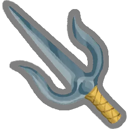 **Saï** | Tanx | Au début de votre tour, gagnez 7 d'<g>Armure</g>. |
|  **Cape distinguée** | Vakuu | Ajoutez 2 Malédictions aléatoires et 3 <g>Apparitions</g> à votre <g>Deck</g>. |
|  **Masque serti** | Vakuu | Au début de chaque combat, placez un Pouvoir aléatoire de votre <g>Pioche</g> dans votr... |

### ⭐ Tier A (25 Reliques)

| Relique | Ancien | Effet Synthétique |
|---|:---:|---|
|  **Perle dorée** | Neow | Lorsque vous obtenez cette relique, gagnez 150 <g>Pièces d'or</g>. |
| 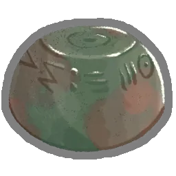 **Presse-papier en plomb** | Neow | Choisissez 1 carte Incolore parmi 2 à ajoutez à votre <g>Deck</g>. |
| 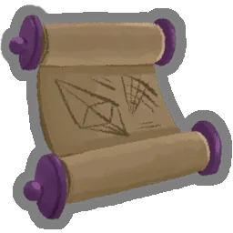 **Parchemin énorme** | Neow | Choisissez 1 <g>Carte Multijoueur</g> parmi 3 à ajouter à votre <g>Deck</g>. |
|  **Nouvelle page** | Neow | <g>Transformez</g> 1 carte. |
| 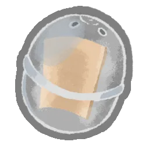 **Petite capsule** | Neow | Obtenez une <g>Relique</g> aléatoire. |
| 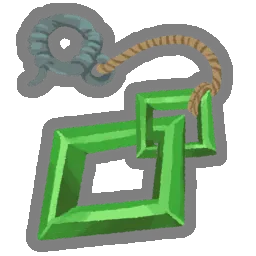 **Talisman de Neow** | Neow | <g>Améliorez</g> 1 de vos <g>Frappes</g> et 1 de vos <g>Défenses</g>. |
|  **Astrolabe** | Darv | <g>Transformez</g> 3 cartes, puis <g>Améliorez</g>-les. |
|  **Cage vide** | Darv | Retirez 2 cartes de votre <g>Deck</g>. |
| 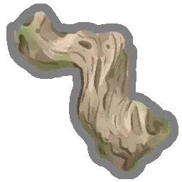 **Bois flotté** | Orobas | Vous disposez d'une relance gratuite pour chaque récompense de carte. |
|  **Dent archaïque** | Orobas | <g>Transformez</g> une carte de base en sa version d'Ancien. |
|  **Chair de Paël** | Paël | Gagnez <e>1</e> supplémentaire au début de votre 3ème tour et au début de chaque tour s... |
|  **Griffe de Paël** | Paël | <g>Envoûtez</g> toutes vos <g>Défenses</g> avec Viscosité. |
|  **Délicieux biscuit** | Tezcatara | <g>Améliorez</g> 4 cartes. |
|  **Grooos câlin** | Tezcatara | Retirez 4 cartes de votre <g>Deck</g>. Lorsque vous mélangez votre <g>Pioche</g>, ajout... |
|  **Boussole dorée** | Tezcatara | Remplacez la carte de l'<g>Acte</g> 2 par un chemin unique. |
|  **Fougère délicate** | Nonupeipée | Au début de chaque combat, remplissez vos emplacements de potion vides avec des <g>Poti... |
|  **Coffre à bijoux** | Nonupeipée | Ajoutez 1 <g>Apothéose</g> à votre <g>Deck</g>. |
|  **Anneau à signet** | Nonupeipée | Lorsque vous obtenez cette relique, obtenez 888 <g>Pièces d'or</g>. |
|  **Gourdin de fer** | Tanx | Toutes les 4 cartes jouées, vous piochez 1 carte. |
|  **Sifflet de Tanx** | Tanx | Ajoutez 1 <g>Sifflet</g> à votre <g>Deck</g>. |
| 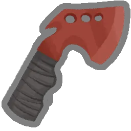 **Hache de lancer** | Tanx | La première carte que vous jouez chaque combat est jouée une fois de plus. |
| 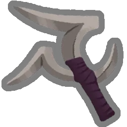 **Tri-boomerang** | Tanx | Choisissez 3 Attaques de votre <g>Deck</g>. <g>Envoûtez</g>-les avec Instinct. |
| 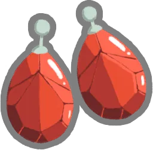 **Boucle d'oreille susurrante** | Vakuu | Gagnez <e>1</e> au début de chaque tour. Vakuu joue votre premier tour à votre place. |
|  **Brouillard en conserve** | Vakuu | Retirez 3 cartes de votre <g>Deck</g>. Ajoutez Hubris à votre Deck. |
| 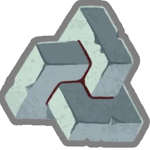 **Embarras du choix** | Vakuu | Au début de chaque combat, ajoutez 1 carte parmi 5 cartes aléatoires à votre <g>Main</g... |

### ⭐ Tier B (22 Reliques)

| Relique | Ancien | Effet Synthétique |
|---|:---:|---|
| 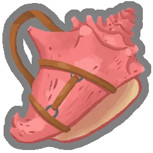 **Conque retentissante** | Neow | Au début des combats d'<g>Élite</g>, piochez 2 cartes supplémentaires et gagnez <e>1</e>. |
|  **Tourment de Neow** | Neow | Ajoutez 1 <g>Fureur de Neow</g> à votre <g>Deck</g>. |
|  **Ciseaux précis** | Neow | Retirez 1 carte de votre <g>Deck</g>. |
| 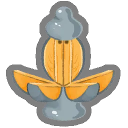 **Pommandre** | Neow | <g>Améliorez</g> une carte. |
| 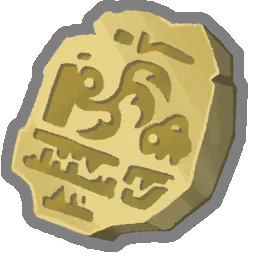 **Tablette lourde** | Neow | Choisissez 1 carte Rare parmi 3 à ajouter à votre <g>Deck</g>. Ajoutez 1 Blessure à vot... |
|  **Grande capsule** | Neow | Obtenez 2 <g>Reliques aléatoires</g>. Ajoutez une <g>Frappe</g> et une <g>Défense</g> à... |
|  **Étoile noire** | Darv | Les <g>Élites</g> donnent une Relique supplémentaire lorsqu'ils sont vaincus. |
|  **Œil de geckobra** | Darv | Au début de votre tour, piochez 2 cartes supplémentaires. Démarrez chaque combat Désori... |
|  **Ras du cou en velours** | Darv | Gagnez <e>1</e> au début de chaque tour. Vous ne pouvez pas jouer plus de 6 cartes par ... |
|  **Grimoire poussiéreux** | Darv | Obtenez une <g>Carte d'Ancien</g>. |
|  **Crevaite électrique** | Orobas | <g>Envoûtez</g> une Compétence avec Imprégné. |
|  **Joyau prismatique** | Orobas | Gagnez <e>1</e> au début de chaque tour. Les récompenses de carte contiennent désormais... |
|  **Aile de Paël** | Paël | Vous pouvez offrir des récompenses de carte en sacrifice à Paël. Tous les 2 sacrifices,... |
|  **Excroissance de Paël** | Paël | <g>Envoûtez</g> une carte avec Clonage. |
|  **Chocolat très chaud** | Tezcatara | Démarrez chaque combat avec <e>4</e> supplémentaires. |
|  **Soupe nourrissante** | Tezcatara | <g>Envoûtez</g> toutes les <g>Frappes</g> dans votre <g>Deck</g> avec Braise de Tezcatara. |
|  **Bois bénis** | Nonupeipée | Gagnez <e>1</e> au début de chaque tour. Au début de chaque combat, ajoutez 3 <g>Hébété... |
|  **Écharpe étincelante** | Nonupeipée | La 5ème carte jouée depuis votre main chaque tour peut être jouée sans coût. |
|  **Bracelet brillant** | Nonupeipée | Choisissez 4 cartes dans votre <g>Deck</g>. <g>Envoûtez</g>-les avec Célérité 2. |
|  **Griffes** | Tanx | <g>Transformez</g> jusqu'à 6 cartes en <g>Mutilation</g>. |
| 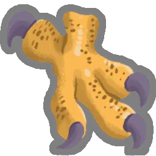 **Serre desséchée** | Vakuu | Perdez 9 PV Max. Ajoutez 3 Vœux à votre <g>Deck</g>. |
| 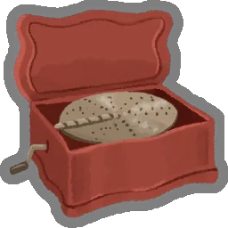 **Boîte à musique** | Vakuu | Vous créez une copie <g>Éthérée</g> de la première Attaque que vous jouez chaque tour. |

### ⭐ Tier C (15 Reliques)

| Relique | Ancien | Effet Synthétique |
|---|:---:|---|
|  **Parchemin arcanique** | Neow | Obtenez une <g>Carte Rare</g> aléatoire. |
| 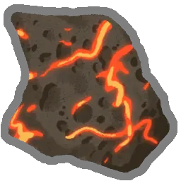 **Pierre volcanique** | Neow | Le Boss de l'Acte 1 octroie 2 <g>Reliques</g> lorsqu'il est vaincu. |
|  **Osselets de Neow** | Neow | Gagnez 2 <g>Reliques</g> de Neow aléatoires. Ajoutez 1 Malédiction aléatoire à votre <g... |
|  **Forces précaires** | Neow | Retirez 2 cartes de votre <g>Deck</g>. Perdez 16 PV. |
| 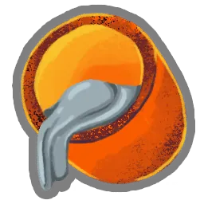 **Creuset en argent** | Neow | Vos 3 premières récompenses de carte sont <g>Améliorées</g>. Le premier Coffre trésor q... |
|  **Cloche d'appel** | Darv | Obtenez une Malédiction spéciale et 3 <g>Reliques</g>. |
|  **Œil de verre** | Orobas | Lorsque vous obtenez cette relique, obtenez 2 cartes <g>Communes</g>, 2 cartes <g>Inhab... |
|  **Toucher d'Orobas** | Orobas | Remplacez votre <g>Relique</g> de départ par une version <g>Améliorée</g>. |
|  **Légion de Paël** | Paël | Double l'<g>Armure</g> reçue d'une carte, puis s'endort pendant 2 tours. |
|  **Lanterne-citrouille** | Tezcatara | Gagnez <e>1</e> au début de chaque tour. S'éteint après 5 combats. Peut être <g>Ravivée... |
|  **Sceau doré** | Tezcatara | Au début de votre tour, dépensez 3 <g>Pièces d'or</g> pour gagner <e>1</e>. |
|  **Paillettes** | Nonupeipée | <g>Envoûtez</g> toutes les récompenses de carte avec Glamour. |
|  **Fruits exotiques** | Nonupeipée | Augmentez vos PV Max de 31. |
| 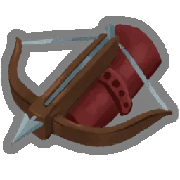 **Arbalète** | Tanx | Au début de votre tour, ajoutez une <g>Attaque</g> aléatoire à votre <g>Main</g>. Elle ... |
|  **Rose sanguinolente** | Vakuu | Ajoutez 1 Assuétude à votre <g>Deck</g>. Gagnez <e>1</e> au début de chaque tour. |

### ⭐ Tier D (18 Reliques)

| Relique | Ancien | Effet Synthétique |
|---|:---:|---|
|  **Caisse de parchemins** | Neow | Choisissez 1 pack de cartes parmi 2 à ajouter à votre <g>Deck</g>. |
|  **Bottes ailées** | Neow | Vous pouvez ignorer les trajets indiqués sur la carte lorsque vous choisissez la procha... |
| 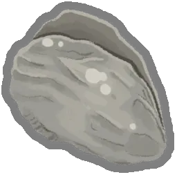 **Huître nourrissante** | Neow | Augmentez vos PV Max de 11. |
|  **Humidificateur en pierre** | Neow | Lorsque vous vous <g>Reposez</g> à un <g>Site de repos</g>, augmentez vos PV Max de 5. |
|  **Ectoplasme** | Darv | Vous ne pouvez plus obtenir de <g>Pièces d'or</g>. Gagnez <e>1</e> au début de chaque t... |
|  **Sozu** | Darv | Gagnez <e>1</e> au début de chaque tour. Vous ne pouvez plus obtenir de <g>Potions</g>. |
|  **Pierre philosophale** | Darv | Gagnez <e>1</e> au début de chaque tour. TOUS les ennemis démarrent le combat avec 1 de... |
|  **Verre marin** | Orobas | Consultez une sélection de 15 cartes d'un autre personnage. Ajoutez-en autant que vous ... |
| 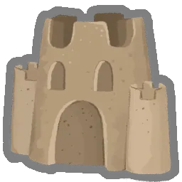 **Château de sable** | Orobas | Lorsque vous obtenez cette relique, <g>Améliorez</g> 6 cartes aléatoires. |
|  **Corne de Paël** | Paël | Ajoutez 2 <g>Relaxations</g> à votre <g>Deck</g>. |
|  **Dent de Paël** | Paël | Retirez 5 cartes de votre <g>Deck</g>. Après chaque combat, récupérez-en 1 aléatoiremen... |
| 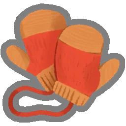 **Mitaines réchauffantes** | Tezcatara | Au début de votre tour, <g>Épuisez</g> 1 carte de votre <g>Main</g> et gagnez 1 de <g>F... |
|  **Caisse à jouets** | Tezcatara | Obtenez 5 <g>Reliques de cire</g>. Tous les 3 combats, la <g>Relique de cire</g> le plu... |
|  **Manteau de fourrure** | Nonupeipée | Marquez 8 combats aléatoires sur la Carte. Les ennemis dans ces salles ont 1 PV. |
| 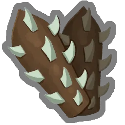 **Gantelets à pointes** | Tanx | Gagnez <e>1</e> au début de chaque tour. Les Pouvoirs coûtent 1 <e/> supplémentaire. |
|  **Marteau de guerre** | Tanx | Lorsque vous tuez un <g>Élite</g>, <g>Améliorez</g> 4 cartes aléatoires. |
|  **Violon** | Vakuu | Au début de chaque tour, piochez 2 cartes supplémentaires. Vous ne pouvez plus piocher ... |
|  **Parasol seigneurial** | Vakuu | Lorsque vous passez chez le <g>Marchand</g>, vous obtenez immédiatement TOUT ce qu'il p... |

---

## 5. 🎲 Règles de Tirage, Slots & Exclusions

### 1. Gestion des Multi-Slots
* **Neow (Acte 1)** : 2 slots distincts. Slot 1 (Bénédiction majeure, 2 choix parmi 20), Slot 2 (Malédiction / Sacrifice optionnel, 1 choix parmi 10).
* **Orobas, Paël, Tezcatara, Vakuu** : 3 slots séquentiels proposant chacun 1 choix parmi 3 ou 4 reliques thématiques.
* **Nonupeipée & Tanx** : 1 méga-slot proposant 3 choix libres parmi 10 reliques.
* **Darv** : 1 slot offrant 3 choix parmi 12 reliques de Boss classiques.

### 2. Règles d'Exclusion Stricte (Neow)
Pour garantir l'équilibre de départ, Neow interdit formellement de sélectionner simultanément :
* `Perle maudite` (CursedPearl) & `Perle dorée` (GoldenPearl)
* `Tablette lourde` (HeftyTablet) & `Parchemin arcanique` (ArcaneScroll)
* `Cataplasme` (LeafyPoultice) & `Nouvelle page` (NewLeaf)
* `Forces précaires` (PrecariousShears) & `Ciseaux précis` (PreciseScissors)
* `Sacrifice de Neow` (NeowsSacrifice) & `Étui à fioles` (PhialHolster) / `Coffret perdu` (LostCoffer)

---

## 6. 🎮 Spécifications & Ergonomie GBA (240x160)

L'adaptation sur Game Boy Advance est documentée en détail dans :  
➡️ **[Spécifications Techniques GBA (`spec_technique_gba.md`)](spec_technique_gba.md)**

### Synthèse des Contrôles GBA

| Bouton | Action dans l'Écran de Rencontre |
|---|---|
| **D-Pad Gauche / Droite** | Sélectionner la relique active dans le carrousel |
| **D-Pad Haut / Bas** | Changer de slot de tirage (si multi-slots actifs) |
| **Bouton A** | Valider le choix / Faire défiler la réplique suivante |
| **Bouton B** | Zoom / Inspection de la carte dérivée associée |
| **SELECT** | Consulter le Deck et l'inventaire actuel du joueur |
| **START** | Menu pause / Passer l'animation |

---

## 7. 💻 Fiche Technique & Code C++20

L'architecture C++ s'intègre harmonieusement dans `slay_the_gba` :
* Déclarations types : [`include/engine/ancient_types.h`](spec_technique_gba.md#includeengineancient_typesh)
* Machine à états Butano : [`src/scene_ancient_encounter.cpp`](spec_technique_gba.md#machine-à-états-de-la-rencontre-ancientstatemachine)
* Script de conversion des 137 images WebP vers PNG 16 couleurs : [`scripts/convert_ancient_assets.py`](spec_technique_gba.md#4--pipeline-dassets-graphiques-webp-vers-gba-grit)

---

## 8. 🌐 Encyclopédie Complète de Slay the Spire 2 (Patch v0.111.0 Beta)

Au-delà des 8 Anciens, la Bible contient **l'intégralité absolue des données et assets du jeu** (1 018 images locales) :

### 🃏 Les Decks de Cartes (569 Cartes au total)
* 🔴 [**09. Soldat de Fer / Ironclad**](09_cartes_ironclad.md) (90 cartes : Frappe, Défense, Fracassement, Enragé, Vague de fer, etc.)
* 🟢 [**10. La Silencieuse / Silent**](10_cartes_silent.md) (91 cartes : Poison, Surins, Agilité, Précision, Catalyseur)
* 🔵 [**11. Le Défectueux / Defect**](11_cartes_defect.md) (91 cartes : Orbes élémentaires, Électro-dynamique, Faisceau de glace)
* 👑 [**12. Le Régent / Regent**](12_cartes_regent.md) (91 cartes : Commandement royal, contrôle de foule, nouvelle classe STS2)
* 💀 [**13. La Nécrolieuse / Necrobinder**](13_cartes_necrobinder.md) (91 cartes : Nécromancie, manipulation d'âmes, invocations)
* ⚪ [**14. Incolores, Malédictions & Événements**](14_cartes_incolores_et_maledictions.md) (115 cartes : Apothéose, Malédictions de la Tour, cartes d'Anciens)

### 🏺 Reliques, Bestiaire & Alchimie
* 🏆 [**15. Encyclopédie des 298 Reliques**](15_reliques_globales.md) (Départ, Communes, Rares, Boss, Boutique, Événement et Anciens)
* 👾 [**16. Bestiaire des 112 Monstres**](16_bestiaire_monstres.md) (Cultiste, Mangeur de temps, Clepséon, PV normaux/Ascension, attaques et intentions)
* 🧪 [**17. Alchimie & 63 Potions**](17_potions.md) (Potions explosives, élixirs de force, potions fantômes)
* ❓ [**18. Les 57 Événements de la Tour**](18_evenements.md) (Sanctuaires, pactes, trésors cachés)
* 🗺️ [**19. Boucle de Gameplay Roguelike, Carte & Ascension 1 à 10**](19_boucle_de_gameplay_et_ascension.md) (Graphe des 16 étages, types de salles, repos/forge, transition d'actes 1-3 et les 10 paliers d'Ascension)
* 💾 [**20. Profils de Sauvegarde, Autosave, Encyclopédies & Ressources**](20_sauvegardes_encyclopedie_et_ressources.md) (3 profils SRAM GBA, autosave à chaque étape, codex progressif masqué/dévoilé, boutique, forge '+' et ressources uniques des 5 héros)
* ⚔️ [**21. Interface Style Pokémon, Navigation de Carte & Inspecteur de Deck**](21_interface_pokemon_et_navigation_carte.md) (Arène de combat Pokémon Gen 3, menu d'action 4 directions, événements narratifs avec choix, défilement D-Pad sur la carte et registre du Deck avec SELECT)
* 🎮 [**22. Collection Officielle des 5 Livrets de Jeu GBA (livrets_gba/)**](livrets_gba/README.md) (Manuels d'instructions complets style Game Boy Advance Nintendo® pour les 5 cartouches : [Soldat de Fer](livrets_gba/livret_ironclad.md), [La Silencieuse](livrets_gba/livret_silent.md), [Le Défectueux](livrets_gba/livret_defect.md), [Le Régent](livrets_gba/livret_regent.md) et [La Nécrolieuse](livrets_gba/livret_necrobinder.md))

---
*Bible compilée pour Alexandre Enouf — Projet Slay The GBA — Septembre 2026*