# Livret d'instructions — Slay the GBA : Édition Le Régent

```
====================================================================================
   SLAY THE GBA — LIVRET D'INSTRUCTIONS
   ÉDITION LE RÉGENT · CARTOUCHE slay_regent.gba · RÉF. SLAYREGENT
====================================================================================
```

> **Une couronne, des étoiles, et la Tour à genoux.**
> Nouveau venu de Slay the Spire 2, le Régent joue avec deux ressources : l'énergie et les Étoiles. Le Droit divin lui en offre dès le début du combat. Préparez vos décrets, forgez votre lame, frappez en roi.

| Cartouche | Couleur | Zone | Difficulté |
|---|---|---|---|
| `slay_regent.gba` (réf. `SLAYREGENT`) | Or Solaire (`#e89828`) | Palais Souverain | ★★★ Expert |

---

## 1. Histoire : Le Régent, souverain céleste déchu

Souverain d'une dynastie stellaire oubliée, le Régent a vu son royaume céleste s'effondrer sous l'emprise de la Tour. Vêtu de pourpre et d'or, il manie un sceptre capable de canaliser les constellations et entend bien reprendre son trône.

*Idéal pour les joueurs qui aiment gérer une ressource de plus et préparer un tour décisif.*

---

## 2. Fiche du héros

* **Nom :** Le Régent (*The Regent*)
* **Points de vie :** 75 PV
* **Or de départ :** 99 pièces d'or
* **Énergie :** 3 ⚡ par tour
* **Emplacements de potion :** 3

### Relique de départ :  Droit divin

> Au début de chaque combat, gagnez 3 ★.

### Deck de départ (10 cartes)

* **4×** Frappe — Infligez 6 dégâts.
* **4×** Défense — Gagnez 5 d'**Armure**.
* **1×** Chute d'étoile — Infligez 8 dégâts. Appliquez **Affaibli** (1). Appliquez **Vulnérable** (1).
* **1×** Vénération — Gagnez 2 ★.

---

## 3. Mécanique signature : Étoiles & Lame souveraine

Le Régent amasse des Étoiles (★), une seconde ressource qui s'ajoute à l'énergie et alimente ses cartes les plus puissantes. Il Forge aussi la Lame souveraine : chaque carte « Forgez » la rend plus tranchante, jusqu'à la frappe royale qui renverse le combat.

---

## 4. Commandes

Les commandes sont identiques sur les cinq cartouches.

| Écran | Bouton | Action |
|---|---|---|
| Carte | **◄ ►** | Choisir la salle suivante |
| Carte | **▲ ▼** | Faire défiler la Tour |
| Carte | **A** | Avancer vers la salle |
| Combat | **◄ ►** | Sélectionner une carte |
| Combat | **A** | Jouer la carte (puis choisir la cible si plusieurs ennemis) |
| Combat | **B** | Annuler le ciblage |
| Combat | **R** | Finir le tour (L avec le préréglage Rapide) |
| Combat | **L** | Ceinture de potions (R avec le préréglage Rapide) |
| Carte / Combat | **START** | Menu pause |
| Carte / Combat | **SELECT** | Registre du deck (B pour revenir) |
| Menus | **A / B** | Valider / annuler |

---

## 5. La Tour et l'arène de combat

* **La carte de la Tour :** chaque acte compte 16 étages. Choisissez votre chemin parmi les embranchements : combats, élites, évènements mystères `?`, feux de camp, boutiques, trésors, puis le boss de l'acte. Entre les actes, un **Ancien** vous offre ses bénédictions.
* **L'arène façon Pokémon :** Le Régent apparaît de dos à gauche, les monstres (jusqu'à trois) à droite sur leurs socles, avec leur **intention** au-dessus de la tête. Barres de PV, dégâts flottants et secousses rythment chaque coup.
* **La main de cartes** s'étale en bas de l'écran : la carte sélectionnée grossit et affiche son effet ; si plusieurs ennemis sont en vie, un curseur de ciblage apparaît.
* **Récompenses :** après chaque combat, choisissez une carte parmi trois pour enrichir votre deck, et récupérez or et potions.
* **Feu de camp :** reposez-vous pour soigner vos PV ou **forgez** une carte (amélioration `+`), avec aperçu de la version améliorée.

---

## 6. Les teintes du héros

Au lancement d'une partie, choisissez la teinte de Le Régent :

1. **Pourpre Royal (Classique)** (`#6840a0`) — La pourpre souveraine réservée à la lignée des rois.
2. **Rubis Écarlate (Chromatique)** (`#d80000`) — Une robe cramoisie éclatante symbole de bravoure.
3. **Éclipse Astrale (Ombre)** (`#181018`) — Une cape d'ombre tissée de poussière d'étoiles éteintes.
4. **Couronne Céleste (Or)** (`#f8f800`) — Une splendeur dorée rayonnant de dignité céleste.

---

## 7. Cartes phares

| Carte | Coût | Type | Effet | Amélioré (`+`) |
|---|:---:|:---:|---|---|
| 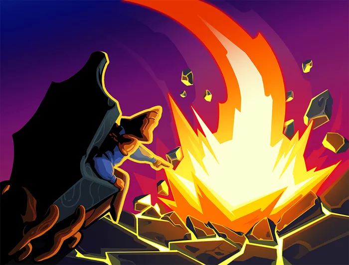 **Chute d'étoile** | 0 ⚡ | Attaque | Infligez 8 dégâts. Appliquez **Affaibli** (1). Appliquez **Vulnérable** (1). | Infligez 12 dégâts. Appliquez **Affaibli** (1). Appliquez **Vulnérable** (1). |
| 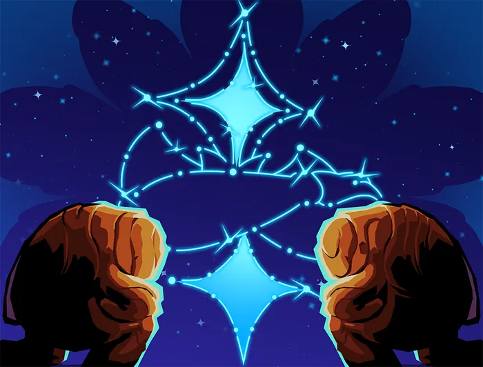 **Vénération** | 1 ⚡ | Compétence | Gagnez 2 ★. | Gagnez 3 ★. |
| 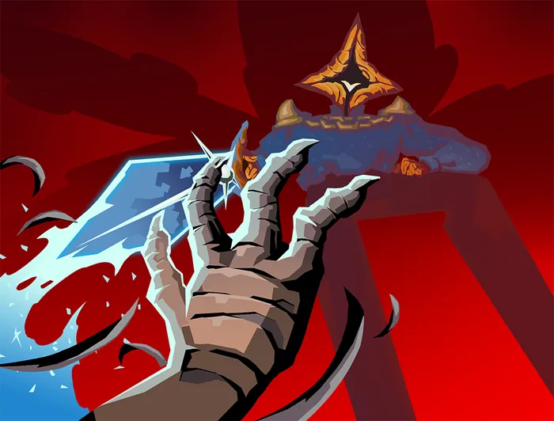 **Conquérant** | 1 ⚡ | Compétence | **Forgez** pour 3. **Lame souveraine** inflige le double de dégâts à l'ennemi pendant ce tour. | **Forgez** pour 5. **Lame souveraine** inflige le double de dégâts à l'ennemi pendant ce tour. |
| 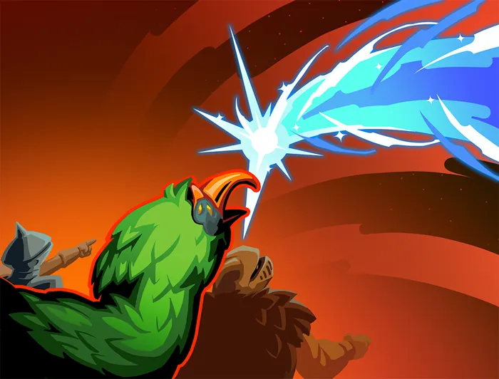 **Comète** | 0 ⚡ | Attaque | Infligez 33 dégâts. Appliquez **Affaibli** (3). Appliquez **Vulnérable** (3). | Infligez 44 dégâts. Appliquez **Affaibli** (3). Appliquez **Vulnérable** (3). |

---

## 8. Catalogue des 20 cartes communes

Les cartes communes forment le socle de votre deck : ce sont celles que vous verrez le plus souvent en récompense.

| Carte | Coût | Type | Effet | Amélioré (`+`) |
|---|:---:|:---:|---|---|
| 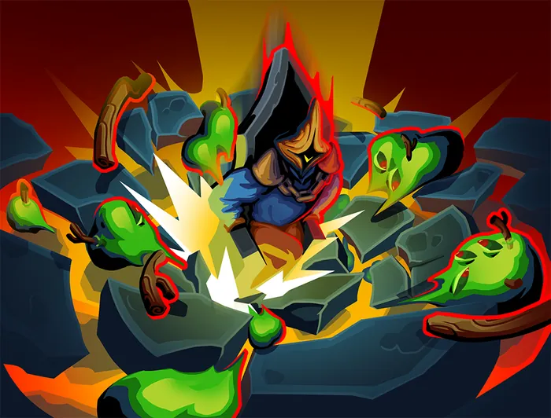 **Broyer** | 1 ⚡ | Attaque | Infligez 8 dégâts à TOUS les ennemis. Tous les ennemis perdent 1 de **Force** jusqu'à la fin du tour. | Infligez 9 dégâts à TOUS les ennemis. Tous les ennemis perdent 2 de **Force** jusqu'à la fin du tour. |
|  **Butin de guerre** | 1 ⚡ | Compétence | **Forgez** pour 6. Piochez 2 cartes. | **Forgez** pour 9. Piochez 2 cartes. |
| 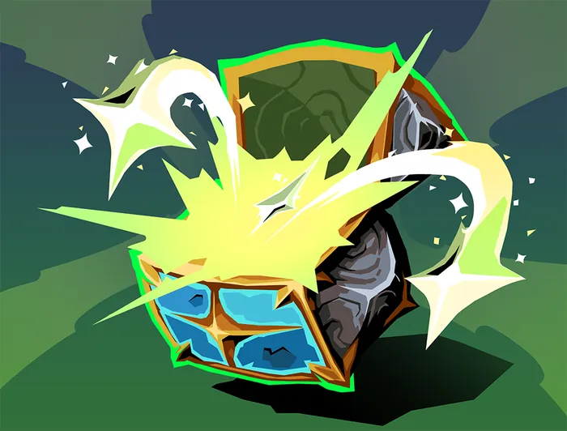 **Cache secrète** | 1 ⚡ | Compétence | Gagnez 1 ★. Au prochain tour, gagnez 3 ★. | Gagnez 1 ★. Au prochain tour, gagnez 4 ★. |
| 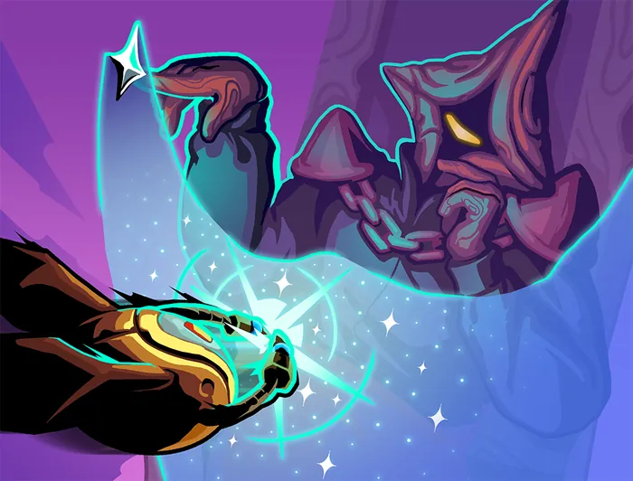 **Courant pailleté** | 2 ⚡ | Compétence | Gagnez 11 d'**Armure**. Au prochain tour, gagnez 5 d'**Armure**. | Gagnez 13 d'**Armure**. Au prochain tour, gagnez 7 d'**Armure**. |
| 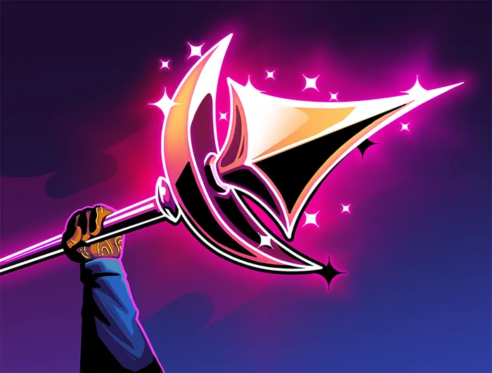 **Croissant de lance** | 1 ⚡ | Attaque | Infligez 8 dégâts. Inflige 2 dégâts supplémentaires pour TOUTES vos cartes coûtant des 1 ★. | Infligez 8 dégâts. Inflige 3 dégâts supplémentaires pour TOUTES vos cartes coûtant des 1 ★. |
| 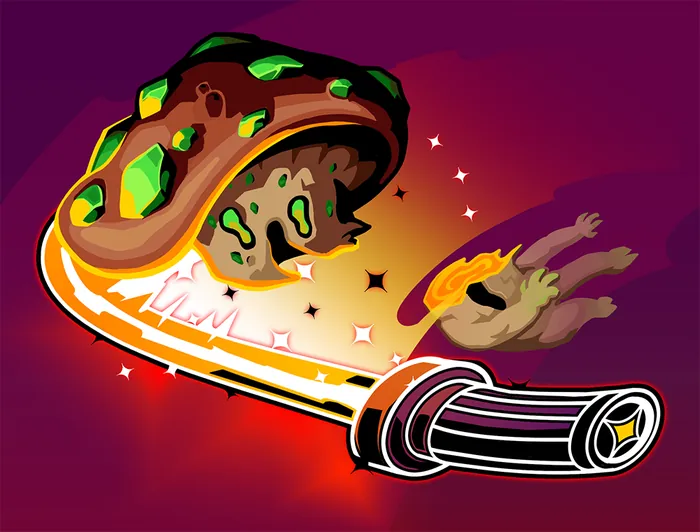 **Entaille photonique** | 1 ⚡ | Attaque | Infligez 10 dégâts. Piochez 1 carte. Choisissez 1 carte de votre **Main** à placer sur le dessus de votre **Pioche**. | Infligez 13 dégâts. Piochez 2 cartes. Choisissez 1 carte de votre **Main** à placer sur le dessus de votre **Pioche**. |
| 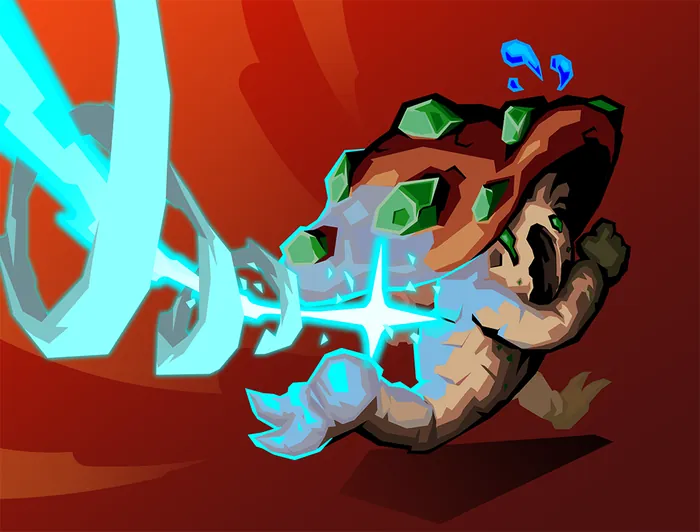 **Étoile directrice** | 1 ⚡ | Attaque | Infligez 12 dégâts. Piochez 2 cartes. | Infligez 13 dégâts. Piochez 3 cartes. |
| 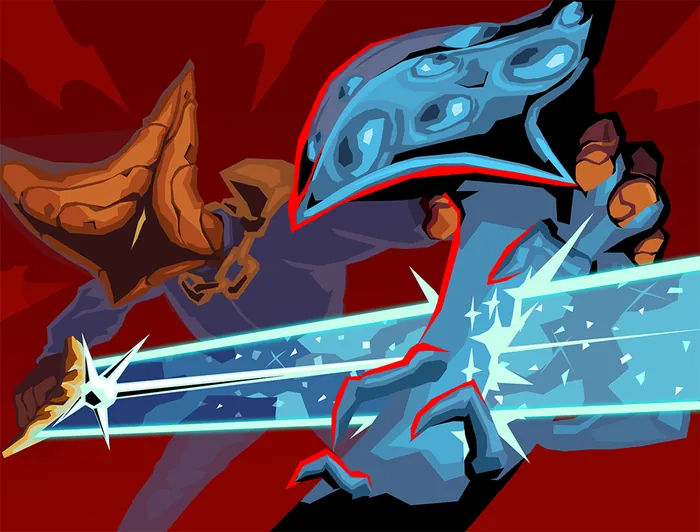 **Forgé par la guerre** | 1 ⚡ | Attaque | Infligez 7 dégâts. **Forgez** pour 7. | Infligez 9 dégâts. **Forgez** pour 9. |
| 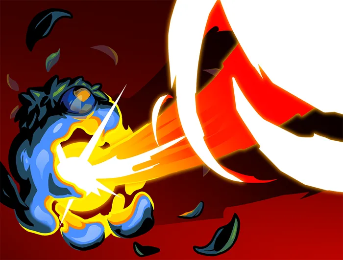 **Frappe solaire** | 1 ⚡ | Attaque | Infligez 9 dégâts. Gagnez 1 ★. | Infligez 10 dégâts. Gagnez 2 ★. |
|  **Hiérarchie** | 0 ⚡ | Compétence | Appliquez **Affaibli** (1). Appliquez **Vulnérable** (1). **Épuisement**. | Appliquez **Affaibli** (1). Appliquez **Vulnérable** (1). |
| 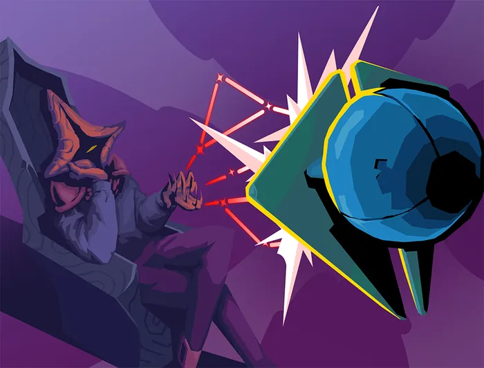 **HORS DE MA VUE !** | 1 ⚡ | Compétence | Choisissez une carte dans votre **Main** à **Transformer** en **Frappe de sbire**. | Choisissez une carte dans votre **Main** à **Transformer** en **Frappe de sbire+**. |
| 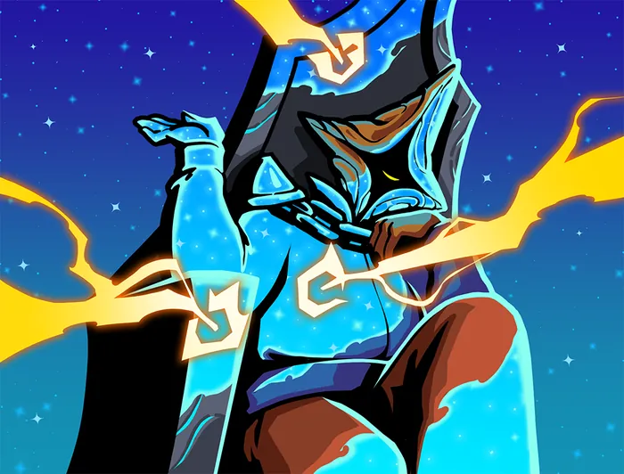 **Indifférence cosmique** | 1 ⚡ | Compétence | Gagnez 6 d'**Armure**. Placez une carte de votre **Défausse** sur le dessus de votre **Pioche**. | Gagnez 9 d'**Armure**. Placez une carte de votre **Défausse** sur le dessus de votre **Pioche**. |
| 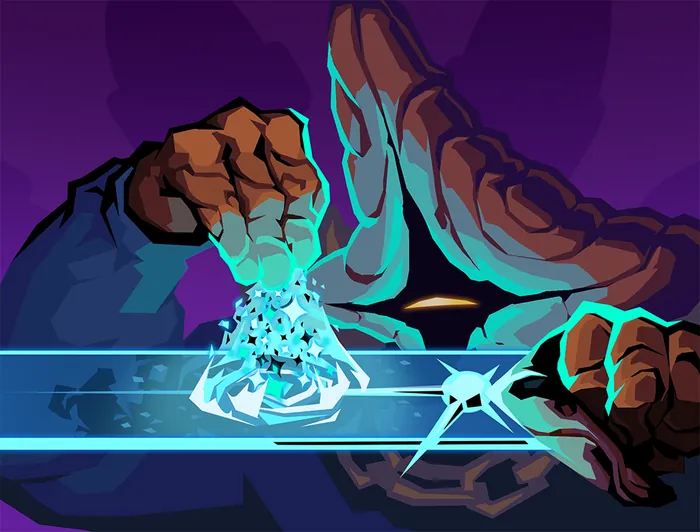 **Lame lustrée** | 1 ⚡ | Compétence | **Forgez** pour 8. Au prochain tour, gagnez 1 ⚡. | **Forgez** pour 12. Au prochain tour, gagnez 1 ⚡. |
| 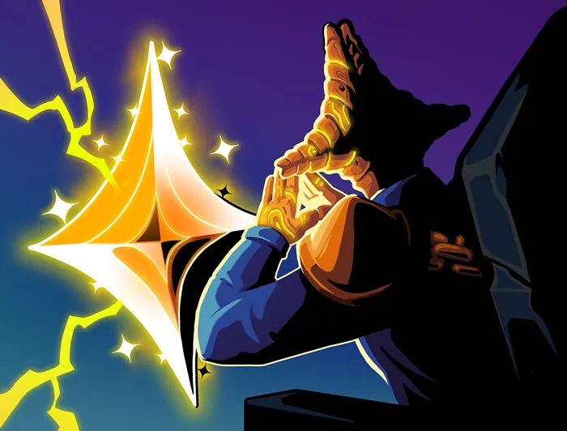 **Lumière rassemblée** | 1 ⚡ | Compétence | Gagnez 8 d'**Armure**. Gagnez 1 ★. | Gagnez 11 d'**Armure**. Gagnez 1 ★. |
| 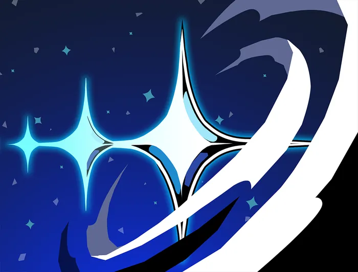 **Luminosité** | 1 ⚡ | Compétence | Gagnez 1 ★. Piochez 1 carte. Au prochain tour, piochez 1 carte. | Gagnez 2 ★. Piochez 1 carte. Au prochain tour, piochez 1 carte. |
| 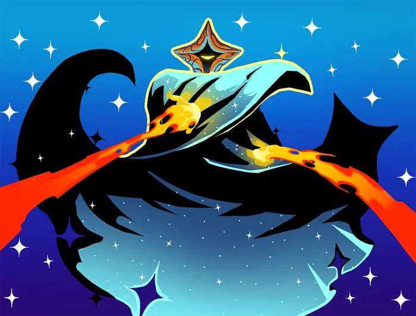 **Manteau d'étoiles** | 0 ⚡ | Compétence | Gagnez 7 d'**Armure**. | Gagnez 10 d'**Armure**. |
|  **Petits pas** | 1 ⚡ | Compétence | Gagnez 8 d'**Armure**. Gagnez 2 de **Vigueur**. | Gagnez 10 d'**Armure**. Gagnez 3 de **Vigueur**. |
| 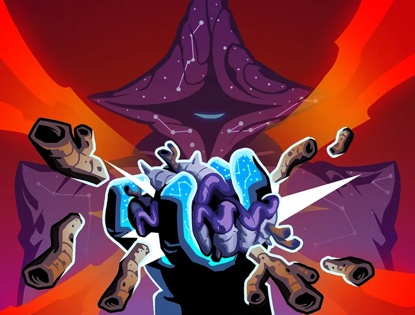 **Puissance céleste** | 2 ⚡ | Attaque | Infligez 6 dégâts 3 fois. | Infligez 6 dégâts 4 fois. |
|  **Pulsation astrale** | 0 ⚡ | Attaque | Infligez 6 dégâts à TOUS les ennemis deux fois. | Infligez 8 dégâts à TOUS les ennemis deux fois. |
|  **Trajectoire de collision** | 0 ⚡ | Attaque | Infligez 10 dégâts. Ajoutez un **Débris** à votre **Main**. | Infligez 14 dégâts. Ajoutez un **Débris** à votre **Main**. |

L'édition compte **91 cartes** au total : 4 de base, 20 communes, 38 peu communes, 27 rares et 2 anciennes. Retrouvez-les toutes dans le [tome des cartes](12_cartes_regent.md).

---

## 9. Conseils de survie

1. Le **Droit divin** donne 3 ★ au début de chaque combat : dépensez-les tôt, ne les laissez pas dormir.
2. **Chute d'étoile** coûte 0 et applique Affaibli et Vulnérable : la meilleure ouverture du Régent.
3. Les cartes « Forgez » s'additionnent : **Conquérant** double ensuite les dégâts de la Lame souveraine.
4. Gardez un œil sur l'énergie ET les Étoiles : un tour sans l'une ou l'autre est un tour perdu.

---

## 10. Sauvegarde, Ascension et encyclopédie

* **Sauvegarde sur la cartouche :** la partie est enregistrée automatiquement en SRAM à chaque salle ; choisissez **Continuer** à l'écran titre pour reprendre là où vous vous étiez arrêté. Les réglages (volume de la musique et des effets) sont conservés.
* **Ascension 0 à 10 :** chaque victoire débloque un niveau de difficulté supplémentaire (élites plus fréquents, monstres plus robustes, soins réduits…).
* **Encyclopédie :** cartes, reliques, monstres, potions et Anciens rencontrés sont consignés au fil de vos parties.

---

*Slay the GBA existe en cinq éditions. Les quatre autres : Soldat de Fer, La Silencieuse, Le Défectueux et La Nécrolieuse. [Voir la collection des livrets](README.md).*
