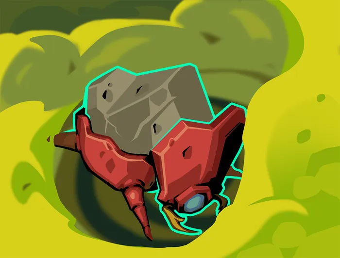

# Livret d'instructions — Slay the GBA : Édition La Silencieuse

```
====================================================================================
   SLAY THE GBA — LIVRET D'INSTRUCTIONS
   ÉDITION LA SILENCIEUSE · CARTOUCHE slay_silent.gba · RÉF. SLAYSILENT
====================================================================================
```

> **Frappez sans bruit. Laissez le venin finir le travail.**
> Moins de PV, mais une main plus grande dès le premier tour grâce à l'Anneau du serpent. Empoisonnez, esquivez, noyez l'ennemi sous les surins : la Silencieuse gagne à l'usure.

| Cartouche | Couleur | Zone | Difficulté |
|---|---|---|---|
| `slay_silent.gba` (réf. `SLAYSILENT`) | Vert Venin (`#40a048`) | Marais du Venin | ★★☆ Intermédiaire |

---

## 1. Histoire : La Silencieuse, chasseresse mortelle des brumes

Chasseresse redoutée venue des terres de brume, la Silencieuse dissimule son visage sous un crâne de fauve cornu. Là où les guerriers misent sur la force, elle compte sur l'agilité, les lames cachées sous sa cape et des toxines qui consument ses proies de l'intérieur.

*Idéal pour les joueurs patients qui aiment les combos, la pioche et les dégâts sur la durée.*

---

## 2. Fiche du héros

* **Nom :** La Silencieuse (*The Silent*)
* **Points de vie :** 70 PV
* **Or de départ :** 99 pièces d'or
* **Énergie :** 3 ⚡ par tour
* **Emplacements de potion :** 3

### Relique de départ :  Anneau du serpent

> Au début de chaque combat, piochez 2 cartes supplémentaires.

### Deck de départ (12 cartes)

* **5×** Frappe — Infligez 6 dégâts.
* **5×** Défense — Gagnez 5 d'**Armure**.
* **1×** Neutralisation — Infligez 3 dégâts. Appliquez **Affaibli** (1).
* **1×** Survivant — Gagnez 8 d'**Armure**. Défaussez 1 carte.

---

## 3. Mécanique signature : Poison & surins

Le Poison inflige ses dégâts au début du tour de l'ennemi puis diminue de 1 : il traverse l'Armure et s'accumule. Les Surins sont des attaques à 0 énergie créées par ses cartes, parfaites avec Précision. Pioche et défausse font tourner son deck plus vite que tout autre.

---

## 4. Commandes

Les commandes sont identiques sur les cinq cartouches.

| Écran | Bouton | Action |
|---|---|---|
| Carte | **◄ ►** | Choisir la salle suivante |
| Carte | **▲ ▼** | Faire défiler la Tour |
| Carte | **A** | Avancer vers la salle |
| Combat | **◄ ►** | Sélectionner une carte |
| Combat | **A** | Jouer la carte (puis choisir la cible si plusieurs ennemis) |
| Combat | **B** | Annuler le ciblage |
| Combat | **START / R** | Finir le tour |
| Carte / Combat | **SELECT** | Registre du deck (B pour revenir) |
| Menus | **A / B** | Valider / annuler |

---

## 5. La Tour et l'arène de combat

* **La carte de la Tour :** chaque acte compte 16 étages. Choisissez votre chemin parmi les embranchements : combats, élites, évènements mystères `?`, feux de camp, boutiques, trésors, puis le boss de l'acte. Entre les actes, un **Ancien** vous offre ses bénédictions.
* **L'arène façon Pokémon :** La Silencieuse apparaît de dos à gauche, les monstres (jusqu'à trois) à droite sur leurs socles, avec leur **intention** au-dessus de la tête. Barres de PV, dégâts flottants et secousses rythment chaque coup.
* **La main de cartes** s'étale en bas de l'écran : la carte sélectionnée grossit et affiche son effet ; si plusieurs ennemis sont en vie, un curseur de ciblage apparaît.
* **Récompenses :** après chaque combat, choisissez une carte parmi trois pour enrichir votre deck, et récupérez or et potions.
* **Feu de camp :** reposez-vous pour soigner vos PV ou **forgez** une carte (amélioration `+`), avec aperçu de la version améliorée.

---

## 6. Les teintes du héros

Au lancement d'une partie, choisissez la teinte de La Silencieuse :

1. **Vert Émeraude (Classique)** (`#00f800`) — La cape d'assassin verte de la tribu du serpent.
2. **Améthyste (Chromatique)** (`#8000f0`) — Une tenue pourpre venimeuse des ombres sylvestres.
3. **Spectre Nocturne (Ombre)** (`#282828`) — Un costume d'assassin invisible dans l'obscurité.
4. **Venin Doré (Or)** (`#40f800`) — La parure d'apparat des maîtres de la guilde silencieuse.

---

## 7. Cartes phares

| Carte | Coût | Type | Effet | Amélioré (`+`) |
|---|:---:|:---:|---|---|
|  **Neutralisation** | 0 ⚡ | Attaque | Infligez 3 dégâts. Appliquez **Affaibli** (1). | Infligez 4 dégâts. Appliquez **Affaibli** (2). |
|  **Vapeurs toxiques** | 1 ⚡ | Pouvoir | Au début de votre tour, appliquez 2 de **Poison** à TOUS les ennemis. | Au début de votre tour, appliquez 3 de **Poison** à TOUS les ennemis. |
|  **Danse des lames** | 1 ⚡ | Compétence | Ajoutez 3 **Surins** à votre **Main**. **Épuisement**. | Ajoutez 4 **Surins** à votre **Main**. **Épuisement**. |
|  **Adrénaline** | 0 ⚡ | Compétence | Gagnez 1 ⚡. Piochez 2 cartes. **Épuisement**. | Gagnez 2 ⚡. Piochez 2 cartes. **Épuisement**. |

---

## 8. Catalogue des 20 cartes communes

Les cartes communes forment le socle de votre deck : ce sont celles que vous verrez le plus souvent en récompense.

| Carte | Coût | Type | Effet | Amélioré (`+`) |
|---|:---:|:---:|---|---|
|  **Anticipation** | 0 ⚡ | Compétence | Gagnez 2 de **Dextérité** jusqu'à la fin du tour. | Gagnez 4 de **Dextérité** jusqu'à la fin du tour. |
|  **Cape et épée** | 1 ⚡ | Compétence | Gagnez 6 d'**Armure**. Ajoutez 1 **Surin** à votre **Main**. | Gagnez 6 d'**Armure**. Ajoutez 2 **Surins** à votre **Main**. |
|  **Coup bas** | 1 ⚡ | Attaque | Infligez 8 dégâts. Appliquez **Affaibli** (1). | Infligez 10 dégâts. Appliquez **Affaibli** (2). |
|  **Danse des lames** | 1 ⚡ | Compétence | Ajoutez 3 **Surins** à votre **Main**. **Épuisement**. | Ajoutez 4 **Surins** à votre **Main**. **Épuisement**. |
|  **Dérobade** | 1 ⚡ | Compétence | Gagnez 4 d'**Armure**. Au prochain tour, gagnez 4 d'**Armure**. | Gagnez 6 d'**Armure**. Au prochain tour, gagnez 6 d'**Armure**. |
|  **Déviation** | 0 ⚡ | Compétence | Gagnez 4 d'**Armure**. | Gagnez 7 d'**Armure**. |
|  **Frappe initiale** | 1 ⚡ | Attaque | Infligez 3 dégâts. Ajoutez 2 **Surins** à votre **Main**. | Infligez 6 dégâts. Ajoutez 2 **Surins** à votre **Main**. |
|  **Hurlement perçant** | 1 ⚡ | Compétence | TOUS les ennemis perdent 6 de **Force** jusqu'à la fin du tour. **Épuisement**. | TOUS les ennemis perdent 8 de **Force** jusqu'à la fin du tour. **Épuisement**. |
|  **Intouchable** | 2 ⚡ | Compétence | **Ruse**. Gagnez 6 d'**Armure**. | **Ruse**. Gagnez 9 d'**Armure**. |
|  **Lancer de couteau** | 1 ⚡ | Attaque | Infligez 9 dégâts. Piochez 1 carte. Défaussez 1 carte. | Infligez 12 dégâts. Piochez 1 carte. Défaussez 1 carte. |
|  **Morsure de serpent** | 2 ⚡ | Compétence | **Retenue**. Appliquez 7 de **Poison**. | **Retenue**. Appliquez 10 de **Poison**. |
|  **Pluie de couteaux** | 1 ⚡ | Attaque | Infligez 4 dégâts à TOUS les ennemis 2 fois. | Infligez 6 dégâts à TOUS les ennemis 2 fois. |
|  **Poignard empoisonné** | 1 ⚡ | Attaque | Infligez 6 dégâts. Appliquez 3 de **Poison**. | Infligez 8 dégâts. Appliquez 4 de **Poison**. |
|  **Poison mortel** | 1 ⚡ | Compétence | Appliquez 5 de **Poison**. | Appliquez 7 de **Poison**. |
|  **Prédateur** | 2 ⚡ | Attaque | Infligez 15 dégâts. Au prochain tour, piochez 2 cartes. | Infligez 20 dégâts. Au prochain tour, piochez 2 cartes. |
|  **Préparatifs** | 0 ⚡ | Compétence | Piochez 1 carte. Défaussez 1 carte. | Piochez 2 cartes. Défaussez 2 cartes. |
|  **Ricochet** | 2 ⚡ | Attaque | **Ruse**. Infligez 3 dégâts à un ennemi aléatoire 4 fois. | **Ruse**. Infligez 3 dégâts à un ennemi aléatoire 5 fois. |
|  **Salto arrière** | 1 ⚡ | Compétence | Gagnez 5 d'**Armure**. Piochez 2 cartes. | Gagnez 8 d'**Armure**. Piochez 2 cartes. |
|  **Tic tac** | 1 ⚡ | Attaque | **Ruse**. Infligez 7 dégâts à TOUS les ennemis. | **Ruse**. Infligez 9 dégâts à TOUS les ennemis. |
|  **Trancher** | 0 ⚡ | Attaque | Infligez 6 dégâts. | Infligez 9 dégâts. |

L'édition compte **91 cartes** au total : 4 de base, 20 communes, 38 peu communes, 27 rares et 2 anciennes. Retrouvez-les toutes dans le [tome des cartes](10_cartes_silent.md).

---

## 9. Conseils de survie

1. **Neutralisation** au premier tour : Affaibli réduit de 25 % les dégâts de l'ennemi.
2. Le Poison ignore l'Armure : c'est votre meilleure réponse aux ennemis qui se barricadent.
3. Avec l'**Anneau du serpent**, vous commencez chaque combat avec 7 cartes : cherchez vos pièces maîtresses dès le tour 1.
4. Précision + Danse des lames transforme chaque Surin en vraie attaque.

---

## 10. Sauvegarde, Ascension et encyclopédie

* **Sauvegarde sur la cartouche :** la partie est enregistrée automatiquement en SRAM à chaque salle ; choisissez **Continuer** à l'écran titre pour reprendre là où vous vous étiez arrêté. Les réglages (volume de la musique et des effets) sont conservés.
* **Ascension 0 à 10 :** chaque victoire débloque un niveau de difficulté supplémentaire (élites plus fréquents, monstres plus robustes, soins réduits…).
* **Encyclopédie :** cartes, reliques, monstres, potions et Anciens rencontrés sont consignés au fil de vos parties.

---

*Slay the GBA existe en cinq éditions. Les quatre autres : Soldat de Fer, Le Défectueux, Le Régent et La Nécrolieuse. [Voir la collection des livrets](README.md).*
