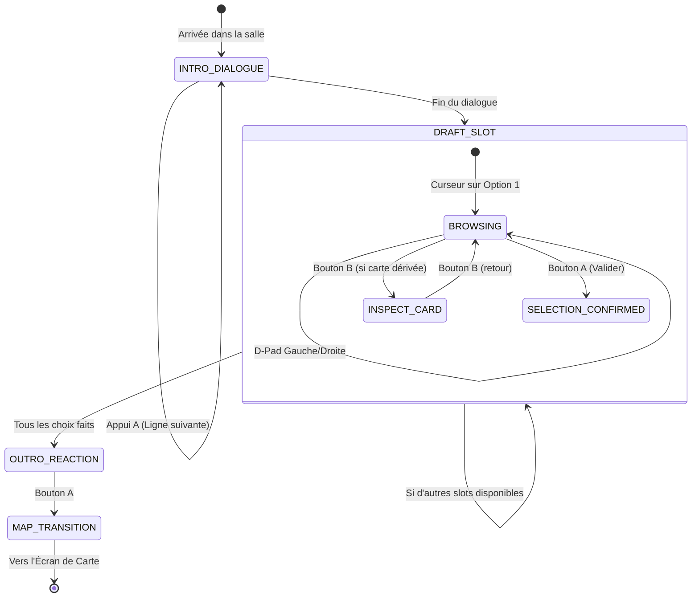

# ⚙️ Spécifications Techniques GBA — Système des Anciens

> **Document de Référence Technique pour `slay_the_gba`**  
> **Moteur :** Butano C++20 | **Plateforme cible :** Nintendo Game Boy Advance (ARM7TDMI @ 16.78 MHz)  
> **Données sources :** Slay the Spire 2 — Patch `v0.111.0 Beta` (Août 2026)

---

## 1. 📐 Contraintes Matérielles & Résolution (240x160)

La Nintendo Game Boy Advance dispose d'une résolution fixe de **240 × 160 pixels**. L'adaptation du système des Anciens nécessite une ergonomie sans encombrement visuel, séparant la scène en zones distinctes :

### 🖼️ Mockup d'Écran GBA — Scène de Rencontre Ancien (`AncientEncounterScene`)

```
0                       120                     239 px
+-----------------------------------------------+ 0 px
| [PORTRAIT]   ANCIEN: NEOW           ACTE 1   |
|   64x64      Mère de la Résurrection          |
|              Choix restants : 1/2             |
|                                               | 64 px
| +---------+   +---------+   +---------+       |
| | RELIC 1 |   | RELIC 2 |   | RELIC 3 |       |
| |  32x32  |   | [FOCUS] |   |  32x32  |       |
| | Tier S  |   | Tier A  |   | Tier B  |       |
| +---------+   +---------+   +---------+       | 115 px
+-----------------------------------------------+ 116 px
| Perle dorée (Tier A)                          |
| Gagnez 150 Pièces d'or immédiatement.         |
| [A] Sélectionner    [B] Annuler   [SEL] Deck  | 160 px
+-----------------------------------------------+
```

### 🧩 Découpage des Calques Graphiques Butano (Modes BGs & Sprites)

| Calque | Rôle Butano | Caractéristiques techniques |
|---|---|---|
| **BG 0 (Texte & HUD)** | `btn::regular_bg_ptr` | Tilemap texte 8x8, priorité 0, affiche le dialogue et les cartouches de texte. |
| **BG 1 (Illustration Ancien)** | `btn::regular_bg_ptr` | Image 64x64 / 80x80 pixels indexée 4bpp (16 couleurs), priorité 1, ancrée à gauche. |
| **BG 2 (Fond d'ambiance)** | `btn::regular_bg_ptr` | Dégradé vertical ou motif texturé correspondant à la couleur thématique de l'Ancien. |
| **Sprites OBJ (Reliques & Curseur)** | `btn::sprite_ptr` | 3 à 4 sprites 32x32 (ou 24x24) pour les reliques présentées, + 1 sprite curseur clignotant. |

---

## 2. 💾 Budget Mémoire & Allocation

| Zone Mémoire | Capacité | Utilisation par le Système des Anciens |
|---|---|---|
| **ROM (Cartouche)** | 4 à 32 Mo | Table constante de toutes les reliques, effets, textes de dialogue et graphismes. |
| **EWRAM (RAM Externe)** | 256 Ko | État du tirage en cours (`AncientDraftState`, ~256 octets), historique des choix. |
| **IWRAM (RAM Interne)** | 32 Ko | Boucle d'animation du curseur, gestion des entrées manette (zéro allocation dynamique). |
| **VRAM (Vidéo)** | 96 Ko | Tuiles d'icônes de reliques (32x32 @ 4bpp = 512 octets par icône), portrait 64x64 (2 Ko). |

---

## 3. 🏗️ Architecture Logicielle & Structures C++20

L'architecture est intégrée dans le répertoire [`include/engine/`](../include/engine/) pour respecter le découpage existant de `slay_the_gba`.

### `include/engine/ancient_types.h`

```cpp
#pragma once
#include <cstdint>
#include <string_view>
#include <span>

namespace sts::engine {

enum class AncientId : uint8_t {
    NEOW = 0,
    DARV,
    OROBAS,
    PAEL,
    TEZCATARA,
    NONUPEIPE,
    TANX,
    VAKUU,
    COUNT
};

enum class RelicTier : uint8_t {
    TIER_S = 0,
    TIER_A,
    TIER_B,
    TIER_C,
    TIER_D,
    TIER_UNTIERED
};

enum class RelicEffectType : uint8_t {
    PASSIVE_COMBAT,      // Modifie force, dextérité, vulnérabilité
    END_COMBAT_HEAL,     // Soin fin de combat
    MAX_HP_CHANGE,       // Modifie les PV Max
    GOLD_IMMEDIATE,      // Ajoute des pièces d'or
    CARD_DRAFT,          // Offre une sélection de cartes
    ADD_CARD_TO_DECK,    // Ajoute directement une carte dérivée
    ENERGY_BONUS,        // Modifie l'énergie de base (+1 avec contrainte)
    TRANSFORM_CARD,      // Transforme des cartes (Astrolabe, Pandore)
    POTION_ACTION        // Offre une potion ou un slot
};

struct DerivedCardDef {
    std::string_view id;
    std::string_view name;
    uint8_t energy_cost;
    bool exhausts;
};

struct AncientRelicDef {
    std::string_view id;
    std::string_view name;
    RelicTier tier;
    RelicEffectType effect_type;
    int16_t primary_value;       // Ex: 150 pour l'or, 6 pour les PV, etc.
    std::string_view description;
    std::span<const DerivedCardDef> derived_cards;
};

struct AncientSlotDef {
    std::string_view group_name; // "blessing", "curse", etc.
    uint8_t picks_allowed;
    std::span<const AncientRelicDef* const> options;
};

struct AncientDef {
    AncientId id;
    std::string_view slug;
    std::string_view name;
    std::string_view epithet;
    uint16_t bgr555_color;       // Couleur 15-bit native GBA
    uint8_t act_mask;            // Bitmask (1 = Acte 1, 2 = Acte 2, 4 = Acte 3)
    std::span<const AncientSlotDef> slots;
};

} // namespace sts::engine
```

### Machine à États de la Rencontre (`AncientStateMachine`)



---

## 4. 🔄 Pipeline d'Assets Graphiques (WebP vers GBA Grit)

Les images sources officielles téléchargées dans `bible/images/` sont au format **WebP**. Le pipeline de compilation GBA (Butano / devkitARM) utilise l'outil `grit` avec des fichiers PNG indexés 16 couleurs (4 bpp).

### Script de conversion automatique (`scripts/convert_ancient_assets.py`) :

```python
#!/usr/bin/env python3
# Convertit les images WebP de bible/images/ vers graphics/ancients/ au format PNG 16 couleurs
import os
from PIL import Image

def convert_to_gba_sprite(src_path, dst_path, size=(32, 32)):
    os.makedirs(os.path.dirname(dst_path), exist_ok=True)
    with Image.open(src_path) as img:
        img = img.convert("RGBA")
        # Redimensionnement avec préservation du pixel art
        img = img.resize(size, Image.Resampling.NEAREST)
        # Quantification en 16 couleurs (couleur 0 = transparent)
        quantized = img.quantize(colors=16, method=Image.Quantize.MEDIANCUT)
        quantized.save(dst_path)

# Exemple d'appel pour Butano :
# convert_to_gba_sprite("bible/images/relics/golden_pearl.webp", "graphics/relics/golden_pearl.png", (32, 32))
# convert_to_gba_sprite("bible/images/ancients/icon/neow.webp", "graphics/ancients/neow_portrait.png", (64, 64))
```

---

## 5. 🔤 Système de Texte & Dialogue

Sur GBA, l'espace mémoire et la vitesse d'affichage des polices nécessitent des optimisations strictes :

1. **Table de pointeurs constants en ROM :**  
   Les dialogues complets de la version v0.111.0 Beta sont compilés directement en ROM flash sans chargement dynamique.
2. **Variable Interpolation au Runtime :**  
   Les balises comme `{characterGender:choose(neutral):Tu viens|Vous venez}` sont résolues statiquement en fonction du personnage actif (`IRONCLAD`, `SILENT`, `DEFECT`, `REGENT`, `NECROBINDER`).
3. **Formatage 2 lignes max :**  
   Chaque bulle de dialogue ne peut dépasser 30 caractères par ligne sur 2 lignes (soit 60 caractères par écran), garantissant une lisibilité parfaite sur l'écran rétro-éclairé de la Game Boy Advance SP.

---
⬅️ [Retour au Sommaire de la Bible](README.md)
